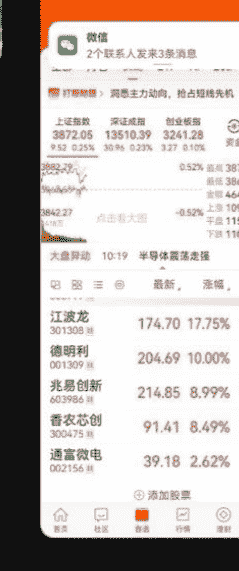
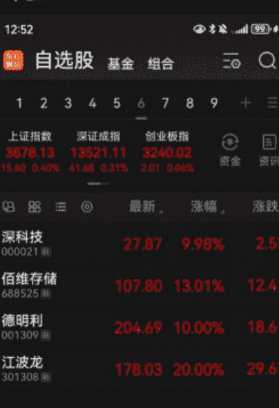

## 观海

前两期预测里提到主力最佳操盘策略是先拉到4200点再下下跌，10月就明朗化了，其实，无非就是先拉还是先跌后拉，最终都是往上上涨。

Alex：观海，这是拉近，还是先拉后跌，哪个概率大些

Alex：先拉到 4200 吗？

观海：等 10 月预测

观海：其实，节后就明朗化了

Alex：安静地等

黄炜

黄炜：这几个真牛逼呀，本来还想等回调

Andey：现在还有今天可推荐上车

花王【情亭】：大哥啊，厉害！我手上就剑陵和中芯，昨天还起高出了点，看来还是能力有提升

朱明广发银行：兴业银锡

XU小传：越涨越高，越越高不敢上车

大林：就减车

花王【情亭】：没空仓，没重仓，就6-7成仓拿着核心ETF。等等明天利好再搞。虽然这些跌了也会涨回来，可是……

观海：其实，节后就明朗化了。

马太效应，涨了还要让他跌，跌了的，让他继续跌……

哈哈哈哈忍不住一上车就开始回调。

规避一下创业板，股指遇到上轨就开始回调。

当下美股最火爆的方向属于 HDD 概念股（硬盘驱动器），西部数据涨9.23%，希捷科技5.35%，另外是存储芯片方向继续走强，美光科技上涨4.22%。

上午的盘面看，资金在压制大金融板块。已经涨起来了。5小时前没看推荐。🤭唉！4家三个涨停。刚才挂单追了没涨停的。

看着美股炒A股赢率很大，是@观海。

观海：看着美股炒A股赢率很大。早晨我说过这个话题。

阿里：4家3涨停。

阿里：因为有人问，他早上发了个分析的视频。临时的视频。12:53

阿里：4家国内工业存储公司，最牛B的是深科技。唯一的四家公司。

观海：AI搜的结果不含深科技。

# 知识星球TOP

添加微信 免费入群
微信:top28688

| 序号 | 公号/星球/社群 | 原价 | 领域 |
| --- | --- | --- | --- |
| 1 | 生财有木 | 2765/年 | 副业，搞钱 |
| 2 | 众宗众吃瓜群 | 365/年 | 时政，历史 |
| 3 | 记忆巷/裁树西风 | 365/年 | 成长 |
| 4 | 欧洲金轨 | 328/年 | 时政，历史 |
| 5 | 卢克青云会 | 699/年 | 时政，社会 |
| 6 | 体制内主任 | 599/年 | 体制，职场 |
| 7 | 局外人的视界 | 669/年 | 金融，时政 |
| 8 | 溯泽异贷 | 4166/年 | 财富，成长 |
| 9 | 守夜人总司令 | 599/年 | 时政，经济 |
| 10 | 江宁知府 | 365/篇 | 时政，国际 |
| 11 | 政事堂/顾子明 | 568/年 | 时政，经济 |
| 12 | 唐书院 | 1399/年 | 金融，财富 |
| 13 | 大树乡村 | 199/年 | 时政，成长 |
| 14 | 水库欧大 | 10000/年 | 房产，经济 |
| 15 | 洪灏宏观策略 | 4376/年 | 经济，搞钱 |
| 16 | 金政通鉴/海北山 | 4576/年 | 股票，行研 |
| 17 | 猫哥的世界 | 299/年 | 时政，社会 |
| 18 | 飞龙弋 | 3600/年 | 股市，经济 |
| 19 | 米联诸见闻 | 599/年 | 经济，金融 |
| 20 | 茶茶财经圈 | 330/年 | 房产，股票 |
| 21 | 赢在八小时之外 | 365/年 | 成长，职场 |

...... 更多资源，不再列举
+图书、报告、课程等各类高价值资源

- 免费群 每日分享份资源
- VIP群 每日分享所有资源（日均20+），75/年

赠送付费资源合集，市场原价数万
