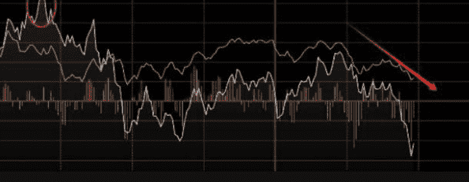
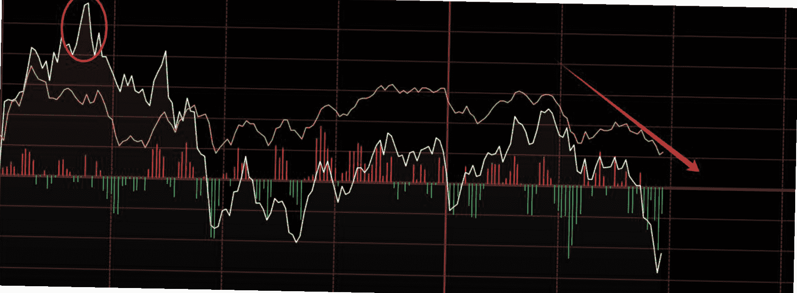

# 群公告

[File] 股市行情推演.docx121.docx

30日：节前最后一天继续上涨，日内预判先涨后跌再反弹震荡。

不是单边上涨走势，日内还有波回调，假如如上午未调，则在下午出现。

节日假期较长，不确定因素太多，要不要持股节自己决定，从预测来看，起码节后第一天看看不到有下跌迹象。

......
预测前两日上涨实现，预判主板高点在10月10日上午；创业板在30日上午10点触及上轨，高点可能就在今天，不排除10日再次拉上上轨的。

了解更多

预测前两日上涨实现，预判主板高点在10月10日上午；创业板在30日上午10点触及上轨，高点可能就在今天，排除10日再次拉上拉上轨的可能性。

阿里

电池跌，电子跌 🤐

观海

30日：节奏最后一天继续上涨 日内预测先涨后跌反弹震荡。不要单靠上涨走势，日内还有没有回调，如若上节日回调，则在下午出现。从预测来看，不确定因素太多，要不要持股自已决定，起码节后第一天看不看到下跌迹象。

观海

观海

今年的机会就在4月和10月，预判10月行情进入牛市第二阶段段

今年的机会就在4月和10月，预判10月行情进入牛市第二阶段段

第二阶段杂毛毛股群飞?

科技

退潮的时候，才能看清那条鱼最大

👍@观海

观海：退潮的时候，才能看清那条鱼最大

浑水摸鱼不一定摸大鱼

过节期间准备弹药去

节前上涨有利于积累人气

国庆中秋8天假跟春节差不多长，期间变量可不少。国外市场可能因为政局、地区事儿波动，大宗商品价格也可能忽视忽下。国内消费、旅游咋样，也会影响节后板块行情，国外股市、汇率变了也可能连累A股开盘。节前布局别太冒进，留点心，节后应应对起来更稳~！

看王健林那窘相，地产只有一一口气

连中国中冶这种铜矿股也涨停

深圳地铁拿出几百亿救万科，还是不死不活

好像有个占世界产量4成的铜矿发生事故，恢复生产需要几年

买黄金吧，美国塌缩，人民币升值

明年铜矿短缺是板上钉钉

地惨股起码几年不能碰吧

牛市如果不抓住主线，等于躲猫猫

## 观海

抖音看到有些户外直播，很多农村几乎看不到，都不生娃，消费上不来

# 阿里

是的。

观海: 抖音看到有些户外直播，很多农村几乎看不到，都不生娃，消费上不来

# 日月生

深圳国资地股可以一层
深圳业000006持有了一年半

观海: 深圳地铁拿出几百亿救万科，还是不死不活

## 观海

主板 10日如果冲高，又上轨

## 知识星球TOP
添加微信资源分享群 免费入群

| 序号 | 公号/星球/社群 | 原价 | 领域 |
| --- | --- | --- | --- |
| 1 | 生财有木 | 2765/年 | 副业，搞钱 |
| 2 | 众宗吃瓜 | 365/年 | 时政，历史 |
| 3 | 记忆/碧树风 | 365/年 | 成长，成长 |
| 4 | 欧洲金轨 | 328/年 | 时政，国际 |
| 5 | 卢克文青会 | 699/年 | 时政，社会 |
| 6 | 体制内主任 | 599/年 | 体制，职场 |
| 7 | 局外人的视角 | 669/年 | 金融，时政 |
| 8 | 溯泽异迁 | 4166/年 | 财富，成长 |
| 9 | 宁夜人司令 | 599/年 | 时政，经济 |
| 10 | 江宁知府 | 365/篇 | 时政，经济 |
| 11 | 政堂/顾子明 | 568/年 | 时政，经济 |
| 12 | 唐书院 | 1399/年 | 金融，财富 |
| 13 | 大树乡谈 | 199/年 | 时政，成长 |
| 14 | 水库欧大 | 10000元 | 房产，经济 |
| 15 | 洪灏宏观策略 | 4376/年 | 经济，搞钱 |
| 16 | 金通代鉴/海南海南 | 4576/年 | 股票，行研 |
| 17 | 猫哥的世界 | 299/年 | 时政，社会 |
| 18 | 飞龙沃 | 3600/年 | 股市，经济 |
| 19 | 米联诸见闻 | 599/年 | 经济，金融 |
| 20 | 餐茶财经圈 | 330/年 | 房产，股票 |
| 21 | 赢在八小时之外 | 365元/年 | 成长，职场 |

...... 更多资源，不再列举
+   ★ 免费群 每日分享份资源
★ VIP群 每日分享所有资源（日均20+），75/年
赠送付费资源集合，市场原价数万元
