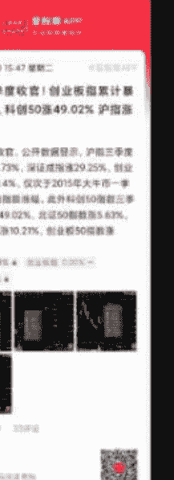
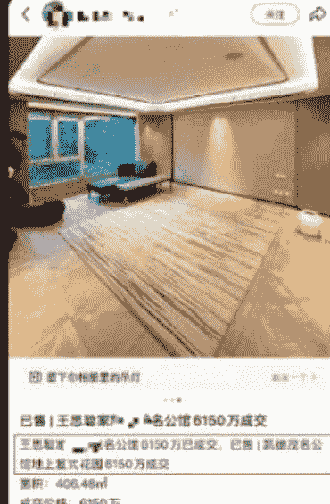
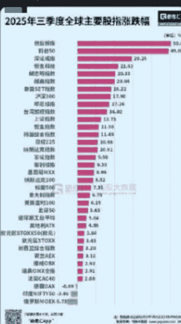
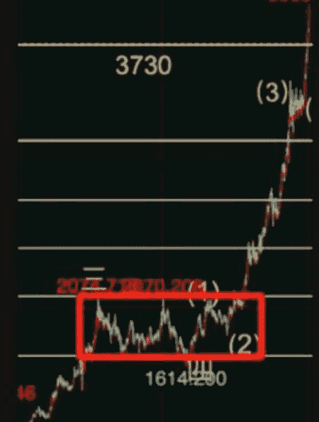

# 十三少

央行继续释放流动性啊，整个和10月才8000亿到期，9号就来了11000亿🤯

# 观海

10月有重大事件，维稳需要

“十三少”撤回了一条消息

# 十三少

哦哦，原来有此深意啊

# 令狐辩zane

10月2号进入特朗普财年

# 令狐辩zane

据说美股会股债双杀啊

# 观海

主要有一个重要会议，关系重大

# 花王【精情寻】

国庆期间美股港股涨，等A股开市再杀?

令狐辩zane:10月2号进入特朗普财年

# 花王【精情寻】

每逢大会必挨打🥊

观海:主要有一个重要会议，关系重大

# 观海

央行还持续释放流动性，稳个和10月才8000亿到期，9号就来了11000亿😱

观海

10月有重大事件，维稳需要

“十三少”撤回了一条条消息

十三少

哦哦，原来如此深意啊

令狐辩zane

10月2号进入特朗普财年

令狐辩zane

说美股会股票债双杀啊

观海

主要有三个重要会议，关系重大

花王【精情寻】

国庆期间美港股大涨，等A股开市再杀?

令狐辩zane:10月2号进入特朗普财年

花王【精情寻】

每逢大会必挨打👊

观海:主要有三个重要会议，关系重大

观海

国家都控盘了，不用担心

观海

别和实施“十二五”资本市场

观海

提到打造一流投行，

观海

双创改革

日月生

国家队的券商？

观海:提到打造一流投行，

观海

相关概念去年炒过了

日月生

海通国泰合并后再找两个两两两组合，估计这样

日月生

或者银行加证券组合这个更有点创新

观海

三季度创业板积累大涨50.4%，这个涨幅历史第二高，仅次于2015年的一季度！三季度科创50大涨49.02%，这是科创板历史上最大的涨幅。

# 观海

买指数挣钱容易

9月30日晚上20:40

日月生

创业板楼:易中天胜宏

观海

从双创的角度，现在牛市强度已经超过2015、2021那两次了，仅次于07年那一波。

花王【猜情亨】

估计第四季度，还是涨跌他们

观海

Alex

观大，双创回调幅度大概多少，10%打得住吗

观海：从双创的角度，现在牛市强度已经超过2015、2021那两次了，仅次于07…

观海

# 观海

上证本月小涨0.64%。深成指本月大涨6.45%，创业板指本月累计超12%，科创50指本月涨超11%!都是月线5连阳了，

# 观海

牛市不言顶，这还没没跌呢，回调时再测

# 观海

新股民为啥盈利大，----胆大

# 观海

老畏缩怕跌，老股民特性

零点..

# 观海

# 观海

老王家看样子真的资金紧张，儿子都把家里卖了

特朗普然宣布！n从2025年10月1日起，美国将对橱柜、浴室柜征收50%关税，对软垫家具征收30%关税。他还给了听起来非常“高大”的理由：国家安全。

阿里

特朗普10月第一天就招

观海

他会不会干涉内

阿里

明抢

观海

他想拿贝尔奖，估计不主动

阿里

嗷

观海

# 观海

节后预测上涨，目前看这还是判断的，娃娃..

阿里

希望他们能坚持几天，最好

观海

4月是上半年加仓点；10月是下半年加仓点，

佳伟

节后减仓等低点加机会

阿里

应该就在节后一周

观海

牛市不空仓

花王【精情矛】

比亚迪，中芯积电，阿里巴巴，令狐辩zane:中芯国际港股涨了9个点

花王【精情矛】

中国长线标的是腾讯，没人能竞争

港股好企业，腾讯是第一位的。👍👍👍

观海：中国长线标的是腾讯，没人能竞争

你太牛了。拿这么久

mojin:我15的中芯

我非常有耐心，海光也还在

不过腾讯过不了1000A股里面最好的科技股是工业富联，也没人竞争海光成本是负数了，数量比原来少了，但我现在住的贷款还完了，无债一身生活那些极度风险厌恶者，不会给你拍桥的说是买了银行的基金，银行基金进场了观海：确实从银行出来了，但大部分没进场，只是观望为何今年ETF涨的好？出来的资金都是买了ETF，他们直接买股的观海：为何今年ETF涨的好？出来的资金都是买了ETF，他们直接买股的ETF占比最大的都是mojin重仓股一个对市场陌生的投资者，选股是难点，ETF就是他们的准备的，专业人士选股今弥弥zane:撒了一条消息

昨晚，三倍做多中国ETF，跌了3.35%。熟悉的配，同样的味道，高盛资本在节假日期间高调宣布市场将大幅调整。目的很明确，就是诱导A股节后大跌。明天的黄金、铜、小金属等资源类大宗商品上涨应该是确凿无疑的。而科技板块比较纠结，CPO、HBM等芯片支持内部、前期涨幅较小的个股还有上涨的空间。节前减仓铜、铝，现在想想有点后悔后市要加大仓位布局有色吗？放假期间黄金和半导体都涨了不错

观海

这是伦敦类走势，现在上证走势大约类似红色方框位置，多点耐心，等待主升浪

观海

观海

北瑜

帅呆了🤡

观海

还没突破呢，突破前需要大家拱手让出筹码🤡

阿里

👍👍👍

观海：还没突破呢，突破前需要大家拱手让出筹码

观海

心态平和一些，现在套牢筹码说几个月赚钱呢。管理局数据显示，截至2025年9月末，我国外汇储备约为3387亿美元，升幅为0.5%。目前中国黄金储备2300吨。美国黄金储备名义上是1000吨。不过中国民间消费（包括金条和首饰）约9万吨。加上历史存量，估计民间规模在2万吨以上。目前黄金价格每克3万美元的计算，民间藏的价值18万亿元以上人民币。

| 指标 | 涨跌幅 |
|---|---|
| 标普500 | -1.2% |
| 纳斯达克 | -1.5% |
| 道琼斯 | -1.1% |
| 德国富克斯 | -0.8% |
| 日经225 | +0.5% |
| 恒生指数 | -2.1% |
| 沪深300 | -3.5% |
| 上证200 | -4.2% |
| 印度尼基 | +1.2% |
| 斯富指 | -0.9% |

2025年三季度全球主要指数涨幅

| 序号 | 公号/星球/社群 | 原价 | 领域 |
|---|---|---|---|
| 1 | 生财有 | 2765/年 | 副业，搞钱 |
| 2 | 众筹吃瓜群 | 365/年 | 政治，历史 |
| 3 | 记忆亥树风 | 365/年 | 成长 |
| 4 | 欧洲金轨 | 328/年 | 政治，历史 |
| 5 | 卢克文青会 | 699/年 | 政治，社会 |
| 6 | 体制内主任 | 599/年 | 体制，职场 |
| 7 | 局外人的视界 | 669/年 | 金融，政治 |
| 8 | 泽沛异迁 | 4166/年 | 财富，成长 |
| 9 | 守夜人总司令 | 599/年 | 政治，经济 |
| 10 | 江宁知府 | 365/篇 | 政治，国际 |
| 11 | 政堂/顾子明 | 568/年 | 政治，经济 |
| 12 | 唐书 | 1399/年 | 金融，财富 |
| 13 | 大树乡谈 | 199/年 | 政治，成长 |
| 14 | 水库联大 | 10000元 | 房产，经济 |
| 15 | 洪灏宏观策略 | 4376/年 | 经济，搞钱 |
| 16 | 金融通鉴/北海南山 | 4576/年 | 股票，行研 |
| 17 | 猫哥的世界 | 299/年 | 政治，社会 |
| 18 | 飞涨龙 | 3600/年 | 股市，经济 |
| 19 | 米来联债见闻 | 599/年 | 经济，金融 |
| 20 | 茶茶财经圈 | 330/年 | 房产，股票 |
| 21 | 赢在八小时之外 | 365/年 | 成长，职场 |

# 群公告

观海

2025-09-30 13:55 股市行情推演.docx

30日：节前一天继续上涨，日内后跌再反弹。单边上涨走势，日内还有波，上午未回调，则在下午出现。假期较长，不确定因素太多，要不要持股节自己决定，从预测来看，节日前后上涨实现，主板高点在10月10日上午，创业板在30日上午，高点可能就在今天，排除10日再次上拉上轨的可能性。
