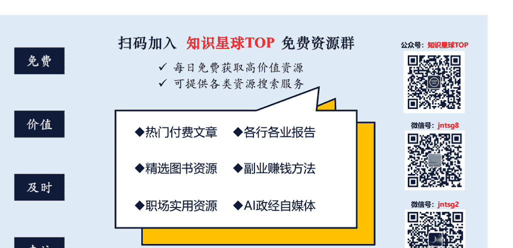
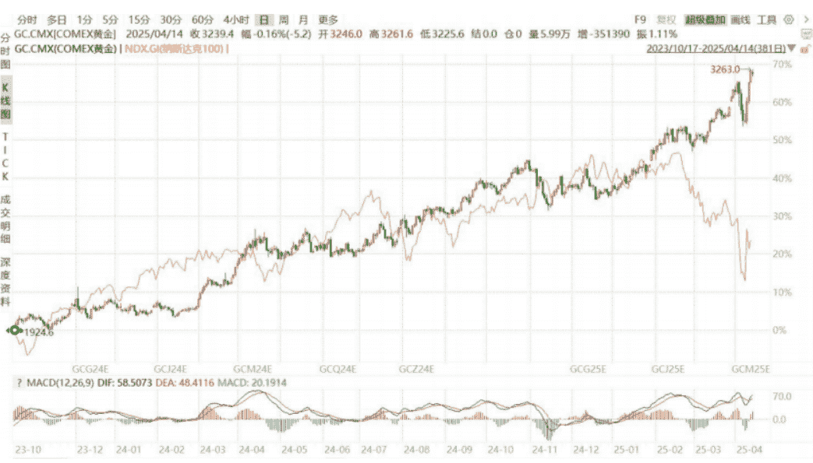
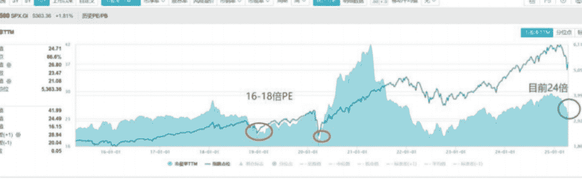

# 【基金】美股跌了多少倍估值算合理？
20250416

特朗普上任以来政策左右摇摆，导致全球市场充满不确定性。在一种“无”状态下，美股七巨头接连调整，纳斯达克100年来最大回调20%以上，而黄金突破3200美元/金，今年大涨超20%。

面对节节升的金价，动态调整的股市，基金经理如何应对全球不确定性？个人在仓位调整上如何考虑？

国富兰克林基金筑足全球及大中环地区投资，他在防御资产中首选黄金。

- 基金：德国

基金代码：096114
报告日期：2025-02-24
基金托管公司：德国国富兰克林基金管理有限公司

| 现金资产 | 仓位资产 |
| --- | --- |
| 77.35 亿元 | 206.04% |

基金经理：郭伟
毕业于英国卡迪夫大学，拥有英国曼彻斯特大学硕士学位。曾在美国国富兰克林公司担任分析师，现任美国国富兰克林基金公司高级投资经理、投资经理及助理投资经理。曾担任美国加州政府、纽约州政府养老基金的投资顾问，并担任国富兰克林中国基金投资经理。自2017年7起担任国富兰克林中国基金首席投资经理。

加微信jntg2 免费资料集

相比于低波、高息银行，徐成为为何选择黄金？他认为黄金目前具备以下几种逻辑：
第一，在疫情之后，全球（包括中国和G20国家）都在大量释放货币，黄金对应法币，黄金会天然保持购买力；
第二，全球主要货币美元信用出现下滑，美国负债规模、成本高，主要货币地位受到挑战；
第三，当下不仅是普通投资者在买入黄金，央行是市场上重要的增持力量。
银行股票属于股权资产，本质上黄金是两类资产。前者受到市场波动、投资者情绪影响，流动性也会有影响。而黄金是全球通用货币，有极强的认同。

目前对于美股徐成为没有增持计划，原因为估值没有吸引力。从估值看，他认为美股现在大致在合理偏低位置，尚未到达历史低位。例如2018年或2020年那种极端情况下的水平相比还差一些。（2018-2020年，PE大概是16-18倍，而目前是24倍，换言之，16倍估值左右，徐成为可以考虑介入美股）

微信jnts2，免费资料群

更重要的是，他不确定企业每股盈利是否触底。徐成认为宏观冲击对这些企业的影响尚未完全释放。叠加不少美股投资者对特朗普政府失望情绪也较高，尤其是长期投资者，认为目前的政策处理方式比较简单粗暴，这种政治层面的不确定性也会对整体美股的估值造成影响。

目前他会关注别公司，作为备选配置，但不会像以前那样大比例配置。除非市场出现明显调整，或者美国政策发生大的转向，他可能会重新考虑参与。

整体上，认为目前美股较大的风险可能依然来自政策方面，以及企业盈利尚未见底的因素，虽然估值回落，但远未便宜到“非买不可”，所以仍需观察，也劝各位投资者慎抄底。

# 国泰东华信投2023年4季度基金投资报告

| 序号 | 基金代码 | 基金名称 | 净值 | 涨幅 | 占比 | 持仓行业 | 基金规模(万) | 收益 |
|---|---|---|---|---|---|---|---|---|
| 1 | 00700 | 君泰混合 | 454.00 | 2.35% | 价值 | 6.20% | 30.00 | 11584.76 |
| 2 | 015016 | 生物富利优 | 43.20 | -0.37% | 价值 | 3.93% | 20.00 | 2348.13 |
| 3 | 007208 | 中银瑞达 | 58.84 | -0.19% | 价值 | 3.53% | 28.00 | 6598.06 |
| 4 | 072300 | 台海制造混合 | 144.40 | -2.20% | 价值 | 3.03% | 50.04 | 5063.52 |
| 5 | 05171 | 华泰精选 | 4.24 | 2.66% | 价值 | 2.97% | 15.00 | 5556.24 |
| 6 | 007581 | 国泰利成长 | 15.81 | 2.73% | 价值 | 3.01% | 11.00 | 7511.18 |
| 7 | 008500 | 银发价值 | 43.08 | 1.03% | 价值 | 3.17% | 11.00 | 5074.87 |
| 8 | 009596 | 招宏景瑞 | 441.40 | 3.23% | 价值 | 2.68% | 10.00 | 5000.62 |
| 9 | 019995 | 高成长优选 | 181.94 | 5.59% | 价值 | 2.67% | 10.00 | 4999.68 |
| 10 | 019690 | 泰发混合 | 54.77 | 1.53% | 价值 | 2.40% | 10.00 | 4488.94 |
| 11 | 012725 | 中泰达利 | 99.35 | 1.03% | 价值 | 2.26% | 9.00 | 3533.12 |
| 12 | 013649 | 景瑞价值 | 31.15 | -1.11% | 价值 | 2.15% | 24.68 | 4273.17 |
| 13 | 012114 | 华泰瑞享 | 376.00 | 1.95% | 价值 | 2.11% | 16.00 | 3650.12 |
| 14 | 003698 | 金嘉瑞 | 2.47 | 0.82% | 价值 | 2.05% | 16.00 | 3837.51 |
| 15 | 023699 | 中银信利 | 5.36 | 0.94% | 价值 | 2.01% | 80.00 | 8017.76 |
| 16 | 011538 | 中信瑞达 | 43.31 | 1.16% | 价值 | 1.84% | 12.00 | 3512.48 |
| 17 | 003393 | 凯富成长 | 7.76 | 1.44% | 价值 | 1.84% | 52.00 | 3433.39 |
| 18 | 007980 | 国泰启盈 | 22.35 | 3.71% | 价值 | 1.72% | 191.00 | 3902.25 |
| 19 | 000830 | 中国国泰 | 16.64 | 2.72% | 价值 | 1.67% | 176.00 | 17650.12 |
| 20 | 021753 | 中国国泰 | 4.72 | 2.61% | 价值 | 1.57% | 600.00 | 2601.86 |
| 21 | 009992 | 景顺丰 | 8.27 | 2.99% | 价值 | 1.50% | 300.00 | 2800.34 |

# 国泰富兰克林基金晓东是公募基金经理里有名的老将，是不非常常的经理。他经理管理的多产品经历近10年仍能够做到10%以上的年化收益率。

- 基金经理深度剖析

晓东：2023-03-17
晓东先生出生于1978年，毕业于北京大学经济学院。自2006年进入公募行业以来，一直参与基金投资及管理工作。自2012年加入国泰富兰克林基金管理（有限公司），担任投资经理，并负责QDII基金、国泰富兰克林中证混合基金的管理。自2012年3月起担任国泰富兰克林中证混合基金经理，自2013年8月起担任国泰富兰克林中泰混合基金经理，自2014年3月起担任国泰富兰克林中证混合基金经理，自2015年8月起担任国泰富兰克林中泰混合基金经理。晓东先生曾于2016年2月至2017年6月担任国泰富兰克林中泰混合基金经理，自2018年1月起担任国泰富兰克林中证混合基金经理，自2019年4月起担任国泰富兰克林中泰混合基金经理，自2020年1月起担任国泰富兰克林中证混合基金经理，自2021年8月起担任国泰富兰克林中泰混合基金经理，自2022年2月起担任国泰富兰克林中证混合基金经理。

## 他目前的市场以及预测

### 第一，A股短期不会大跌，上行概率很大。原因在于，如果市场出现剧烈波动，会有平稳运行，例如前几天国家队就会出手。

### 第二，对于内需的持续观察。政策节奏分为几个步骤。第一步可能是消费开始，然后是增加。目前他会关注别公司，作为备选配置，但不会像以前那样大比例配置。除非市场出现明显调整，或者美国政策发生大的转向，他可能会重新考虑参与。

| 序号 | 股票代码 | 股票名称 | 最新价 | 涨跌幅 | 相关行业 | 占比 | 持股数量 | 市盈率 |
|---|---|---|---|---|---|---|---|
| 1 | 601577 | 长电 | 9.00 | 0.00% | 银行 | 7.70% | 2807.32 | 24957.04 |
| 2 | 601158 | 常行银行 | 6.90 | -0.00% | 银行 | 7.30% | 3128.05 | 23679.33 |
| 3 | 601555 | 浙商银行 | 8.24 | -0.57% | 银行 | 6.62% | 766.81 | 21827.80 |
| 4 | 002568 | 百信证券 | 25.75 | -1.10% | 银行 | 6.62% | 766.81 | 21.11 |
| 5 | 000551 | 招商银行 | 6.54 | -0.76% | 银行 | 4.39% | 1939.99 | 11150.55 |
| 6 | 601988 | 金融租赁 | 12.20 | -0.20% | 银行 | 6.73% | 1825.07 | 21475.35 |
| 7 | 600068 | 华夏银行 | 7.80 | 0.30% | 银行 | 3.19% | 1221.32 | 10356.30 |
| 8 | 000571 | 格力地产 | 43.89 | -2.68% | 银行 | 4.57% | 1426.18 | 14824.72 |
| 9 | 002035 | 华泰证券 | 11.39 | 0.35% | 银行 | 3.40% | 784.09 |
| 10 | 002303 | 浦发 | 13.42 | -1.51% | 银行 | 2.52% | 768.00 |
| 11 | 601999 | 南京 | 10.30 | 2.00% | 银行 | 3.12% | 951.00 |
| 12 | 600325 | 广发 | 8.67 | -1.69% | 银行 | 3.00% | 971.00 |
| 13 | 002244 | 上海城建 | 9.89 | 1.69% | 银行 | 2.58% | 728.34 |
| 14 | 002304 | 阳渝 | 73.62 | -0.63% | 银行 | 2.03% | 658.67 |
| 15 | 000773 | 莱信证券 | 62.58 | 2.33% | 银行 | 1.95% | 195.00 |
| 16 | 002233 | 锦信 | 7.96 | -0.50% | 银行 | 1.94% | 215.00 |
| 17 | 001979 | 洛阳银行 | 9.64 | -0.31% | 银行 | 1.93% | 610.00 |
| 18 | 686333 | 包钢股份 | 62.53 | -1.06% | 银行 | 1.86% | 152.92 |

### 第四，目前看好消费、地产和银行板块。银行是高红逻辑，目前估值较低，股息率较高，波动较小，属于红利型品种。对于房地产板块，认为已位于底部区域，虽然销售额在下降，但企业利润有望升，房价稳定，未来三年将改善。

