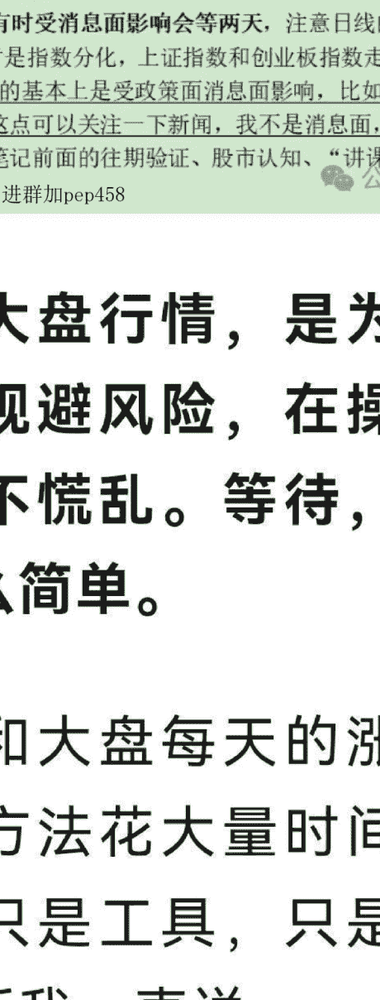

## 期权调期：2025年5月26日周行情趋势预测

2025年5月26日 23:15 晨曦

以下内容：1、5月26日至6月2日每日行情预测；2、本周以来行情趋势预测；3、人操作建议；4、行业和基金基本面。

所有期权数据都有免费提供，至少要留个机会，如果你想看期权数据，这里就有本周以来的行情预测了。

期权调期逻辑：我预测中涨还是跌，期权是涨还是跌选一个。

中股和期权的逻辑完全不同，中股涨了跌了都有赚，期权是杠杆工具，只有看对了才能赚到。

大盘近期的震荡是为了暴涨机会，规避风险，在操作中做到盈利不亏，不过，反正就这么多。大盘没有突破，也没有看到回破前期高点。

从周线来看，大盘目前处于震荡整理期，成交量萎缩，说明大家在观望。目前下方有多个支撑位，上方有压力位。如果成交能放量突破压力位，那么下周可能会出现大反弹。目前大盘处于低位震荡，不确定性很大。

### 股指数和大盘的涨跌不是看出来的，是走出来的，工具只是工具，用来来看的

涨跌没有意义，看懂趋势才重要。以下内容花费了我大量的时间，需要大家理解。

此外，大盘涨跌是为了准备机会，规避风险，在操作中做到不亏。如果A股下跌，跌性达到90%时至少可以选一个品种。

行业和基金基本面根据大盘趋势来选择品种，关注分歧和波动较小的品种。如果A股下跌时，可以关注头部权重股期权数据更新。

另外，大盘涨跌和期指趋势是不稳定的，股票涨跌和指数基本不同，也就是大盘涨跌和指数涨跌差异很大。这点要注意。

大盘和板块基金行情时，大盘涨80%的股票会有跟，从大盘趋势来选股，成功率较高。同样，大盘跌80%的股票和没有行情时。

以下内容：1、5月26日至6月2日每日行情预测；2、本周以来行情趋势预测；3、人操作建议；4、行业和基金基本面。

这几天没有明显的涨跌，因为大盘表现得不好，对后续操作有一定影响，目前没有影响，新手看跟即可。

春季带来了两周一行的行情预测，如果周涨，行情趋势准确是95%。跌的回调或者调整准确是5%，不是等到跌了才看到成交量缩和和跌时。不知道大家没有看到正涨还是正跌，然后还是看。大家应该有自己的想法，只有我所的分析仅供参考。

5月26日周一：上证小盘股涨（下午中盘后半天到了跌），所以所有指数参考，涨跌不宜操作。

5月27日周二：下跌，下午涨（预计下午回拉，上证小盘股涨）//创业板中涨。

5月28日周三：震荡，上证中涨，如涨到还是大盘涨线；创业板中涨。

5月29日周四：无跌，小盘跌以以上大盘涨——跌趋势。

操作建议：4、5月26日至6月2日提供行情建议，5日以后以涨跌为主，5日后重新观察一周，如前五日以来的大盘行情是大涨即可。
