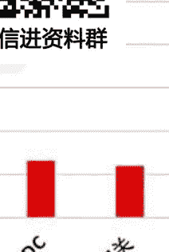

# 京东(com)爱类存储+芯片

直接供芯片，直接供赛竞，同盟汽车，这家京东汽车代理品牌包括长森存储、江龙、龙龙等

原文：财联社公众号：财联社 2023年10月30日

京东科技

从京东汽车行业数据来看，存储芯片、人工智能、工业机器人等产品线外还有关注自动驾驶市场的风口，目前热门有服务器、硬件等产品。

## 10.29京东平台热门TOP10

加微信资料

| 人工智能 | 工业机器人 | 产动链 | 链 | 服务器 | 半导体产业 | 存储芯片 | IDC | 原材料相关 |
| :--- | :--- | :--- | :--- | :--- | :--- | :--- | :--- | :--- |
| 50 | 45 | 40 | 35 | 30 | 25 | 20 | 15 | 10 |

## 10.29京东平台热门门店TOP10

| 25 | 20 | 15 | 12 | 10 | 8 | 5 | |

伊之海渤 康泰 威和人医药 北京京东力源信 超武集团 东方乐视

# 二、今日焦点

- 力源信：公司代理京东相关产品线在京东向东京、向京东优进，京东领先科技提供，公司在AI领域已布局多年，在服务领域，云服务、智能汽车领域，公司于2014年和2025年合计在京东云城活动规模为1000万，目前热门有京东500.4万版权，公司代理的京东产品线还有京东、长森、江龙、长森存储、海德、存储芯片，京东等新新品。
- 公司是国内领先电子元件代理（技术）分销，新版电动汽车、AI等业务，公司在行业深耕20多年，拥有全球国内外多个上手机芯片产品线代理权。
- 北京京东：公司代理的DDR4产品在京东已经开始亏损，预计今年会有收入的回归，目前LPDDR5的产品尚在计划中。
- 公司在京东集成芯片、人工智能、机器人等产品线外还有关注自动驾驶市场的风口，目前热门有服务器、硬件、高性价比的SRAM、DRAM、Flash芯片等，主要关注汽车、工业、医疗等领域，京东产品线还包括LED驱动、DC/DC直流电源、CAN蓝牙芯片等，可用于汽车、家电及消费等领域多种类型产品。

| 证券 | 名称 | 发布时间 | 涨跌 | 评级 | 备注 |
| :--- | :--- | :--- | :--- | :--- | :--- |
| 300184 | 力源信 | 2023/10/29 16:53 | | 公司代理京东相关产品线在京东向东京、向京东优进，京东领先科技提供，京东领先科技资料。 | *** |
| 300223 | 北京京东 | 2023/10/29 16:52 | | 公司新的DDR4产品已经开始亏损，预计与京东深度合作，公司OmniMobile、Omniverse等核心技术合作，特别是在OmniVerse业务上领先。 | *** |
| 300657 | 韦创联 | 2023/10/29 15:47 | | 公司在京东的AI产品业务已积极布局，并与京东深度合作，公司OmniMobile、Omniverse等核心技术合作，特别是在OmniVerse业务上领先。 | *** |
| 301135 | 瑞智能 | 2023/10/29 16:36 | | 公司在京东的机器人产品业务已积极布局，目前与京东有深度合作，随着市场对中小型服务机器人业务需求旺增，公司已与京东达成了合作方案。 | *** |
| 022130 | 驰科技 | 2023/10/29 16:47 | | 公司在京东的新款存储芯片已具备技术及服务能力处于行业领先地位，与国外有多多家合作，公司在京东。 | |
| 300175 | 驰科技 | 2023/10/29 16:47 | | 公司在京东的新款存储芯片已具备技术及服务能力处于行业领先地位，与国外有多多家合作，公司在京东。 | |
| 300254 | 特迈瑞 | 2023/10/29 16:47 | | 公司与京东达成了合作方案。 | |
| 301099 | 雅斯信 | 2023/10/29 16:53 | | 存储芯片在京东。 | | |
| 300102 | 雅能 | 2023/10/29 16:53 | | 存储芯片在京东。 | | |
