# English for Everyday Activities
## A Picture Dictionary

Published by Macmillan

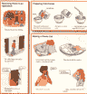

# 免费 价值 及时 专注

# 扫码加入 知识星球TOP 免费资源群

- 每日免费获取价值资源
- 提供各类资源搜索服务

| 热门付费文章 | 各行行业报告 |
| :--- | :--- |
| 精选图书资源 | 副业赚钱方法 |
| 职场实用资源 | AI政经自媒体 |

公众号:知识星球TOP 微信信号:jntsg8 微信信号:jntsg2

分享资料仅供个人学习，请及时删除，切勿商用传播

# Contents

# CHAPTER 1: DATA PREPARING

1. Data Types and Structures 3
2. Structuring Your Data 5
3. Cleaning Data 7
4. Scaling Features: Normalization 10
5. Scaling Features: Standardization 12
6. Missing Values 15
7. Handling Categorical Data 18
8. Handling Imbalanced Data 22
9. Outlier Detection 25
10. Feature Engineering 28

# CHAPTER 2: DATA ANALYSIS

11. Descriptive Statistics 32
12. Bivariate Analysis 35
13. Univariate Analysis 38
14. Correlation Analysis 42
15. Hypothesis Testing 45
16. Time Series Analysis 48
17. Dimensionality Reduction 52
18. Clustering 55
19. Association Rules 58
20. Exploratory Data Analysis with SQL 61

# CHAPTER 3: MODELBUILDING

21. Linear Regression 66
22. Logistic Regression 69
23. Classification Models 72
24. Feature Selection 75
25. Decision Trees 78
26. Random Forest 81
27. Support Vector Machines 84
28. Neural Networks 87
29. Hyperparameter Tuning 90
30. Model Evaluation 93

01 History of Art 07
02 Masters of Painting 11
03 Sculpture 14
04 Design in Art 17

# PART I: CREATIVITY AND DESIGN

05 Drawing and Coloring 21
06 Photography and Film 24

07 The Language of Art 28
08 Painting and Color 31
09 Digital Art and Media 35
10 Graphic Design 38
11 Technology of Art 42
12 Art in a Global World 45
13 Fashion and Play 49
14 Sculpture and Public Space 52
15 Moving Image 55
16 Art in a Social Context 59
17 Performance Art 62
18 Theater and Design 65
19 Urban Art 68
20 Modern Art 72

# PART II: CONTEXT AND CONTENT

21 Mastery, Power and Lust 76
22 Art and Religion 79
23 Identity and Politics 83
24 Freedom and Memory 87
25 Art in the Digital Age 90
26 Multilingual Cultures 94
27 Art and Nature 98

# PART III: EXPERIENCE AND EXPRESSION

28 Art in a Mobile World 101
29 Art in a Chinese World 105
30 Art and Society 108
31 The Future of Contemporary Art 112

APPENDIX: MAPS LISTS AND REFERENCES

Glossary 116
Index: 120-127
How to use this book 128

# 1 Doing in the Morning

**Listen and repeat.**

- wake up
- brush teeth
- wash face
- get dressed
- comb hair
- have breakfast
- go to school

**Listen**

- I wake up at six o'clock.
- I brush my teeth.
- I wash my face.
- I get dressed.
- I comb my hair.
- I have breakfast.
- I go to school.

**Look and say**

- I wake up at seven o'clock.
- I brush my teeth.
- I wash my face.
- I get dressed.
- I comb my hair.
- I have breakfast.
- I go to school.

# 什么是个人卫生？

良好的个人卫生是指保持身体清洁，防止很多疾病发生，让我们健康。

1. 饭前后洗手
2. 每天洗澡
3. 定期修剪指甲

# Drawing Your Text: Flowing

Learning your page

### Vocabulary
- flow
- curve
- bend
- junction
- channel
- stream

### Grammar
- use present continuous to describe actions
- use present simple to describe facts

### Speaking
- talk about your local river
- describe the path of a river

## Writing
- write a short story about a river
- write a description of a river you know

Let's learn some words

- The water flows along the channel.
- The river curves at the bend.
- The river turns at the junction.
- The river forks at the fork.

# 3

# 呼吸

- 吸气
- 呼气
- 憋气
- 慢呼吸
- 深呼吸

### 动作

- 坐姿
- 站姿
- 侧卧
- 俯卧
- 仰卧
- 跪姿

### 放松

- 肌肉放松
- 心理放松
- 冥想
- 听音乐放松

# 我们来练习

在开始之前，请选择一个舒适的姿势坐好或躺下。闭上眼睛，让身体放松，深呼吸几次。

1. 呼吸：用鼻子深吸气，感觉肚子鼓起；用嘴慢慢呼气，感觉肚子凹下去。
2. 肌肉放松：用力紧握某部位，保持几秒，然后放松，感受肌肉松。
3. 冥想：闭上眼睛，想象自己在一个安静、美丽的地方，心里感到。

##### Key vocabulary

Flexion

- Bones
- Humerus
- Radius
- Ulna
- Carpals
- Metacarpals
- Phalanges
The arm is bent during flexion of the elbow.

- Extension
- Joints
- Ligaments
- Tendons
- Muscles
The arm is straight during extension of the elbow.

Flexion and Extension

Flexion occurs when the arm is bent.
Extension occurs when the arm is straight.
The elbow is a hinge joint.
It allows movement in one plane.
The shoulder is a ball and socket joint.
It allows movement in many planes.
The wrist is a pivot joint.
It allows rotation.
The fingers have many hinge joints.
They allow flexion and extension.

## The muscles of the arm

- Biceps contracts during flexion.
- Triceps contracts during extension.

## Problems of the Pelvis

Pain in the groin

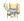
Pain radiating to leg

Pain in the buttocks

Weakness in leg

Numbness or tingling

Difficulty in walking

## Walking with pain

Limping gait

Hunching forward

Stiff back

Difficulty standing up

Short step

# 5

# Paragliding

### VERBS

- be
- have
- do
- say
- go
- get
- make
- know
- think
- see
- want
- find
- give
- call
- try

### ADJECTIVES

- big
- small
- hot
- cold
- new
- old
- happy
- sad
- easy
- difficult
- easy
- hard
- fast
- slow
- light
- dark
- first
- last
- long
- short

## The Paraglider

Paragliding is a sport in which a person flies with a harness, attached to a wing-like canopy called a paraglider.

- Paragliders use a parachute-like wing.
- They fly from mountains.
- They sit in a harness.
- They use wind currents.

### NOUNS

- person
- man
- woman
- child
- mountain
- sky
- air
- wind
- equipment
- ground
- height
- safety
- time
- work
- life
- world
- hand
- foot
- eye
- body

Some people enjoy paragliding.

# Energy and Matter

Energy can be stored, transferred and transformed.

The sun provides energy.

Food provides energy for us.

Batteries store electrical energy.

Wind provides kinetic energy.

Energy can change form to form.

Light energy becomes heat.

Potential energy becomes kinetic.

Chemical energy becomes light energy.

Mechanical energy becomes sound energy.

## Changes in Matter

Matter can change in physical or chemical ways.

Ice melts into water.

Water evaporates into vapor.

Water freezes into ice.

Iron reacts into rust.

Paper burns into ash.

Sugar dissolves in water.

Wood burns into smoke.

Food cooks into energy.

Metal melts into liquid.

Physical changes are often reversible.

# #6 Making a bed

### Vocabulary
- pillow: a soft thing you put your head on
- sheet: a thin cloth that covers the bed
- blanket: a warm cover
- duvet: a type of blanket

### Grammar
- present continuous: am/is/are + -ing
- prepositions of place:
  - on the bed
  - under the blanket
  - on top of the pillow

## Writing
- ask questions about the bedroom
- describe your bedroom

### How to make a bed

First, put the sheet on the bed.

Next, put the blanket on.

Then, put the duvet.

Finally, put the pillows.

Now, smooth the bed.

Your bed is ready!

I am making my bed.

He is making his bed.

She is making her bed.

We are making our beds.

They are making their beds.

Our beds are ready!

What is in your bedroom?
There is a bed. There is a desk. There are some posters.

# Making Bread

### Step 1 Mix
Ingredients
- 500g flour
- 300ml water
- 7g yeast
- 5g salt
- 20ml oil

### Step 2 Knead
- Mix all ingredients in a bowl
- Knead for about 10-15 minutes until smooth

### Step 3 Rise
- Place dough in an oiled bowl
- Cover and leave in a warm place for 1 hour until doubled

### Step 4 Bake
- Shape the dough
- Bake at 200°C for 25-30 minutes

### Step 1: Mix ingredients and water

### Step 2: Rise

# Making Breakfast 2

## Preparing Cold Soup: Mung Beans

### Key differences

## Instructions
### Ingredients
- 200g mung beans
- 1 liter water
- 100g sugar
- a pinch of salt

### Steps
1. Soak the mung beans in water for at least 4 hours.
2. Rinse the beans and place them in a pot with water.
3. Bring to a boil, then simmer for 30 minutes.
4. Add sugar and salt to taste.
5. Let the soup cool down before serving.

## Safety Tips

## Kitchen Skills

Be careful when handling hot pots and pans. Use mitts to avoid burns. Ensure the stove is turned off after use.

When measuring ingredients, use a measuring cup or spoon. This ensures the recipe.

# Making Breakfast 3

## Trying Eggs
Tools
- Frying pan
- Spatula
- Bowl
- Fork
- Plate

Ingredients
- Eggs
- Oil
- Pepper

Steps
1. Heat the pan over medium heat.
2. Add a little oil.
3. Crack the egg into the pan.
4. Cook until the white is set.
5. Flip the egg with a spatula.
6. Cook the other side.
7. Serve the egg on a plate.

Crack the egg into the pan.
Add a little oil.
Cook until the white is set.

Flip the egg with a spatula.
Cook the other side.
Serve the egg on a plate.

Beat the eggs together.
Heat the pan.
Scramble the eggs.

Whisk the eggs in a bowl.
Pour the eggs into the pan.

# 10 Talking About Myself

Vocabulary
- eye
- ear
- nose
- mouth
- hand
- arm
- finger
- leg
- foot

Grammar
- I have...
- You have...
- He/She has...
- We have...

Skills
- Listening
- Speaking
- Reading
- Writing

Review
- Let's review the words from Unit 9.

Let's talk about body parts.

I have two eyes. I have one nose. I have one mouth. I have two ears. I have two hands. I have ten fingers. I have two legs. I have two feet.

# 11 Learning English

Vocabulary
- shirt
- skirt
- dress
- trousers
- hat
- gloves
- socks

Grammar
- He is wearing...
- She is wearing...
- I am wearing...
- They are wearing...

Skills
- What is he wearing?
- What is she wearing?
- Read and listen

Project
- Draw your friends
- Describe what they are wearing
- Talk to your class

# 12 Taking a Bus

### VOCABULARY
- timetable: a list that shows when buses arrive and leave
- fare: the money you pay for traveling on a bus, train, or other vehicle
- route: the path that a bus follows
- stop: a place where the bus stops
- passenger: a person who travels on a bus
- driver: the person who drives the bus
- ticket: a piece of paper that shows you have paid
- station: a place where you wait for a bus or train

### GRAMMAR
- present simple: used to talk about schedules and timetables (e.g., The bus leaves at 8 a.m.)
- present continuous: used to talk about things happening right now (e.g., I am waiting for the bus)

## PRONCIATION
- /s/ and /z/: buses, stops, passengers, arrives

## Listening: Taking the bus
- 1. Listen to the recording and fill in the timetable.
- 2. Listen again and answer the questions.
- 3. Talk to your partner about taking the bus.

a bus interior view

The timetable shows the time and the stops.

the entrance of the bus

a passenger buying a ticket

the inside of the bus

the driver's open area

# 第一课 认识植物

我们要观察我们身边的植物。

- 观察植物的形状
- 观察植物的颜色
- 观察植物的生长变化

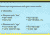
观察植物的形状

观察植物的颜色

观察植物的生长变化

植物是从哪里来的？

植物需要什么来生长？

植物需要阳光？

植物需要水？

植物需要空气？

植物需要土壤？

植物需要肥料？

## 植物的结构

# Driving a Car 1
## Starting the Car

### The Basics
- STEP 1
- Sit in the seat
- Adjust the seat
- Adjust the mirrors
- Fasten the seat belt

- STEP 2
- Put the key in the ignition
- Turn the key to start the engine

- STEP 3
- Put your foot on the brake
- Put the car in 'Drive'

- STEP 4
- Release the handbrake
- Slowly press the gas pedal

- STEP 5
- Look over your shoulder
- Slowly move the car

### Tips for beginners
- Always check your mirrors
- Keep a safe distance from other cars
- Be patient
- Practice in empty lots

# Driving a Car 2
## Operating a Car

### Shifting Gears
- Park gear
- Reverse gear
- Neutral gear
- Drive gear

### Starting
- Turn the key
- Press brake
- Wait for engine

### Steering
- Steering wheel
- Turn signals
- Horn
- High-beam lights

### Instruments
- Speedometer
- Tachometer
- Fuel gauge
- Temperature gauge

### Speeding up and slowing down
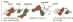
To accelerate, press the gas pedal.
To slow down, press the brake pedal.
To stop, press the brake firmly.

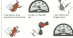
The speedometer shows the speed of the car.
When you press the brake, the car slows down.
When the car comes to a stop, shift the gear to neutral or park.

### Basic Safety
- Always wear a seatbelt
- Follow traffic rules
- Use signals when turning
- Keep a safe distance
- Stay alert

## Stopping
## Turning
## Blowing Horn
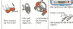
Press the brake pedal gradually.
Turn the steering wheel to turn.
Use the horn when necessary.

# Driving a Car 3
## Turning

## IN FOCUS
### VOCAB
- Steering wheel
- Indicators
- Lights
- Headlights
- Horn
- Windshield
- Seat belt
- Airbag
- Dashboard
- Mirror
- Brake

### VERBS
- Turn left
- Turn right
- Signal
- Accelerate
- Reverse
- Park

### GRAMMAR
- Present continuous
- Imperatives
- Prepositions of place

## Car Safety Features
- Always wear a seat belt.
- Check your mirrors.
- Use your indicators.
- Don't speed.

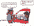

# Energy Storage Devices

Supercapacitor cell

Secondary battery

Fuel cell

Torsion spring

Winding leaf

Winding spring extension

Torsion bar

Bending beam

Leaf spring

# Energy for Cars

An electric car

A hydrogen car is fueled.

Fill up the fuel tank of the gas car.

A battery pack powers the car.

An engine powers the car.

Place the fuel tank.

# 16 Taking a Tree
WORDS
- trunk: the main stem of a tree
- branch: a part that grows out
- leaf: the flat green part of a tree
- root: the part of a plant underground
- flower: the colorful part of a plant
- fruit: the part that contains the seeds
- seed: the part that grows a plant
- bark: the outer covering of a tree

SPEAK
- What do you see outside?
- What do you need to do a tree?
- What do you like about trees?

READ
This tree is very tall. It has a thick trunk and many branches. The leaves are green. The roots are deep in the ground. The tree has white flowers and red fruit. Birds like the tree.

WRITE
- Draw a tree.
- Label the parts.
- Write three sentences about your tree.

LEARN
- Learn the parts of a tree.
- Learn how trees grow.
- Learn why trees are important.

1. The trunk is thick.
2. There are branches.

3. The leaves are green.
4. The fruit is red.

5. The roots are deep.
6. The flowers are white.

7. The tree is tall.
8. The bark is rough.

# 17 English Fun

### Vocabulary
- bike
- bus
- car
- plane
- taxi
- walk

### Grammar
- I go to school by bus.
- He goes to school by car.
- We walk to school.

## Reading
How do you go to school?

## Writing
Write a short paragraph about your transportation.

I ride a motorcycle.

He goes in a car.

We walk to school together.

She knows the way.

He takes the train, I too.

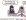
They go by bus, together.

We both come home by taxi.

# 18 Walking Scenarios

Walking is one of the simplest and most effective ways to stay fit. It improves your cardiovascular health, strengthens your muscles, and helps you maintain weight.

## Urban Walking

- Street
- Sidewalk
- Intersection
- Traffic
- Safety

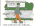

## Challenges

- Crowds
- Weather
- Pollution
- Noise
- Surface quality

Urban environments can be challenging, but with proper planning and awareness, you can enjoy your walk.

## Solutions

- Comfortable shoes
- Choose off-peak hours
- Plan routes carefully
- Stay hydrated

## Nature Trails

- Forest
- Hills
- Water
- Wildlife
- Navigation

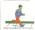

Nature trails offer a peaceful escape from the city but require more preparation for safety.

# 19

## TYPES

- Two-wheeled
- Tricycle
- Quadricycle
- Unicycle
- Others

## USAGE

- Riding for transport
- Riding for exercise
- Riding for fun/leisure

## SAFETY

- Helmet
- Protective gear
- Traffic rules
- Awareness

### Rules to follow

- Always wear a helmet
- Use hand signals
- Obey traffic lights and signs
- Be visible to others

I wear a helmet.

I am riding a bicycle.

I enjoy riding the tricycle.

I am riding the unicycle.

I go by wheelchair.

I use a skateboard to go.

I ride on roller skates.

I use a scooter.

# 20 Morning routine

### Vocabulary

- alarm clock
- wake up
- get up
- make the bed
- wash face
- brush teeth
- take a shower
- comb hair
- get dressed
- have breakfast
- put on shoes
- leave for school
- arrive at school

### Listen

- I wake up at 6:30.
- I get up at 6:40.
- I make the bed.
- I wash my face and brush my teeth.
- I take a shower.
- I comb my hair.
- I get dressed.
- I have breakfast at 7:15.
- I put on my shoes and leave for school at 8:00.

## Grammar: point

- We use the present simple to talk about daily routines.
- I wake up every day.
- He/She wakes up every day.

## Morning routine

The alarm clock goes off.

He gets up and gets dressed.

He washes his face.

He brushes his teeth.

He combs his hair.

## Phrasal verbs

get out of

get dressed

get out of

put on

leave for

What is this? It is a house. The house is big. The house has many windows. There is a garden in front of the house.

This is a house.

This is a man.

This is a girl.

The house is brown.

The man is reading.

The girl is playing.

The man is cooking.

The man is eating.

The family is happy.

The man is painting.

The man is smiling.

The girl is happy.

# Making Dinner 1
Making a salad

### Ingredients

- 2 tomatoes
- 1 cucumber
- 1 onion
- lettuce
- olive oil
- salt and pepper

## Method

1. Wash the vegetables.
2. Cut the tomatoes, cucumber, and onion.
3. Put the vegetables in a bowl.
4. Add olive oil, salt, and pepper.
5. Mix well.

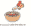

### Let's talk
Do you like eating salad? What are your favorite vegetables? Do you make salad at home?

# Walking Dinner 2

# Squaring Dance

How we dance

## Preparation

- Find a partner
- Find a space
- Get ready
- Start moving

### Steps

Step 1: Move to right
Step 2: Move to left
Step 3: Move forward
Step 4: Move backward
Step 5: Turn around

## Rules

- Keep your space
- Don't push
- Have fun!

Now let's be along

When you finish, don't forget!

# Making Dinner 2

Peel the onion.

Slice the onion.

Cut the meat into pieces.

Wash the vegetables.

Put the pot on the stove.

Cook the ingredients.

The dinner is delicious.
We eat together.

The smell of bacon fills the air.

It looks hot.

The water bubbles so I can add the noodles.

The soup is almost ready.

The rice finishes cooking.

The vegetables are ready to be served.

The sauce is thick and ready to pour.

The oil is sizzling as I fry the meat.

## Kitchen tools and utensils

## Utensils

- spatula
- frying pan
- ladle
- pot
- whisk
- bowl
- jar
- strainer

# Making Dinner 4

## 24 Cooking Rice

### Ingredients
- 2 cups rice
- 3 cups water
- a pinch of salt

### Tools
- pot with lid
- cup
- spoon
- stove

### Steps
1. Rinse the rice in cold water.
2. Put rice and water in the pot.
3. Bring to a boil.
4. Turn down the heat and cover with lid.
5. Cook for 15 minutes.
6. Fluff the rice with a spoon.

# 25 Tasty Treats

## What do we need?

### Ingredients
- 2 eggs
- 1 cup flour
- 1/2 cup sugar
- 1/2 cup butter
- 1 tsp baking powder

### Tools
- large bowl
- mixing spoon
- whisk
- spatula
- baking pan

### How to make them
1. Preheat the oven to 350°F.
2. In a large bowl, mix the butter and sugar until smooth.
3. Beat in the eggs one at a time.
4. Gradually mix in the flour and baking powder.
5. Pour the batter into the baking pan.
6. Bake for 25-30 minutes.

Let's make some treats!

They smell delicious!

Are they ready?

> I'm hungry!

They look perfect.

They love the treats!

It was fun to bake.

They are yummy!

# 26 La Date du Temps

### JOURS
- Lundi
- Mardi
- Mercredi
- Jeudi
- Vendredi
- Samedi
- Dimanche

### TEMPS
- Matin
- Après-midi
- Soir
- Nuit

### MOIS
- Janvier
- Février
- Mars
- Avril
- Mai
- Juin
- Juillet
- Août
- Septembre
- Octobre
- Novembre
- Décembre

### ANNÉE
- 2020
- 2021
- 2022
- 2023
- 2024

Quelle date sommes-nous ?

Aujourd'hui, nous sommes le \_\_\_\_\_\_\_\_\_\_\_\_\_\_\_\_\_\_\_\_\_\_\_\_\_\_\_\_\_\_\_\_\_\_\_\_\_\_\_\_\_\_\_\_\_\_\_\_\_\_\_\_\_\_\_\_\_\_\.

Demain, ce sera le \_\_\_\_\_\_\_\_\_\_\_\_\_\_\_\_\_\_\_\_\_\_\_\_\_\_\_\_\_\_\_\_\_\_\_\_\_\_\_\_\_\_\_\_\_\_\_\_\_\_\_\_\_\_\_\_\_\_\.

Hier, c'était le \_\_\_\_\_\_\_\_\_\_\_\_\_\_\_\_\_\_\_\_\_\_\_\_\_\_\_\_\_\_\_\_\_\_\_\_\_\_\_\_\_\_\_\_\_\_\_\_\_\_\_\_\_\_\_\_\_\_\.

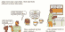
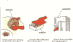
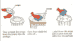

# 27 Living 3D

### Concepts
- Coordinate systems
- Transformations
- Projection
- Viewport

### Tools
- Camera
- Light
- Object
- Texture

### Operations
- Translate
- Rotate
- Scale

### Glossary
- Coordinate: A point in 2D or 3D space.
- Axis: A line used to measure.
- Coordinate system: A grid system.
- Origin: The point (0,0,0).

### Things to remember
- Vertex: A point in space.
- Edge: A line connecting two vertices.
- Face: A surface bounded by edges.
- Mesh: A collection of vertices.

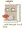

# Relaxing at Home - 1

## 28

### NEW WORD TO LEARN

### VOCABULARY
- armchair: a comfortable chair with arms
- sofa: a long, comfortable seat for several people
- cushion: a soft bag or pillow used for sitting or leaning
- blanket: a large cloth used for keeping warm
- pillow: a soft bag used to support the head when sleeping
- rug: a piece of floor covering
- lamp: a device for providing light

### VERBS
- relax: to become less tense or anxious
- switch off: to stop thinking about work or problems
- fall asleep: to begin to sleep
- dream: to have thoughts or images while sleeping

### ADJECTIVES
- comfortable: providing physical ease and feeling relaxed
- quiet: making little or no noise
- spacious: having a lot of space

### USE THE STRUCTURE
- I like to sit on the sofa and read a book.
- It's very comfortable to relax in the armchair.
- I often fall asleep when I am tired.

| Word | Meaning |
|---|---|
| armchair | a comfortable chair with arms |
| sofa | a long seat |
| cushion | a soft pillow |
| blanket | a large cloth |

# Relaxing at home 1

## Using a Personal Camera Album

## 29

### Vocabulary
- album (n): a book with pages for holding photographs
- decide on (v): to make a choice from several options
- arrange (v): to put things in a particular order
- display (v): to show something so that people can see it
- frame (n): a decorative border around a picture
- keep (v): to store something in a safe place
- organize (v): to plan
- place (v): to put in
- select (v): to choose from
- store (v): for later

### Grammar
- present: used to talk about started now
- past: used to talk about happened in the past

### Skills
- listening
- reading
- writing

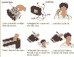

She selects for the album.

She arranges.

She puts in the photos.

She finishes the album.

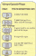

She stores the album.

# Relaxing at Home 3

## 30

### TASK
- Listen and repeat
- Read
- Matching
- Speaking

### VOCABULARY
- relax
- comfortable
- pillow
- armchair

### GRAMMAR
- present continuous

### READING
- Read the story
- Answer questions

### WRITING
- Write about your living room

### PROJECT
- Make a poster about your home

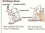
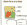
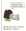

# Relaxing at Home: 4

## 31 Collecting Collections

## Your Schedule

### Monday
- 7:00 - Wake up
- 7:30 - Breakfast
- 8:00 - Go to school
- 15:00 - Come home
- 21:00 - Go to bed

### Tuesday
- 7:00 - Wake up
- 7:30 - Breakfast
- 8:00 - Go to school
- 15:00 - Come home
- 21:00 - Go to bed

### Wednesday
- 7:00 - Wake up
- 7:30 - Breakfast
- 8:00 - Go to school
- 15:00 - Come home
- 21:00 - Go to bed

### Thursday
- 7:00 - Wake up
- 7:30 - Breakfast
- 8:00 - Go to school
- 15:00 - Come home
- 21:00 - Go to bed

### Friday
- 7:00 - Wake up
- 7:30 - Breakfast
- 8:00 - Go to school
- 15:00 - Come home
- 21:00 - Go to bed

### Weekend
- Saturday: Out with friends
- Sunday: Rest at home

## Special Hobby Activities
- Collecting stamps
- Collecting coins
- Collecting cards

# Relaxing at Home: 1

## 32 Working from Home

### Vocabulary
- relax
- stretch
- exercise
- posture
- muscles
- comfortable

## Phrases
- take a break
- do some exercise
- sit up straight

### Grammar
- present continuous

When you work from home, it is important to take care of your body and mind.

You should move around and stretch frequently to stay healthy.

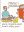

## 33 Playful, loud, and full of ideas.

### Traits
- Curious
- Creative
- Energetic
- Active
- Social
- Spontaneous
- Enthusiastic
- Expressive
- Inquisitive
- Playful
- Outgoing
- Talkative
- Bold

### Interests
- Playing
- Building
- Singing
- Running
- Exploring
- Storytelling
- Games
- Nature
- Art
- Music
- Dancing

### Skills
- Communication
- Creativity
- Physical coordination
- Social interaction
- Problem solving
- Empathy
- Expression
- Flexibility

### Strengths
- High energy
- Strong imagination
- Quick learner
- Adaptable
- Passionate

They love to be outside.
Long days of happiness.
Sharing with friends.
Making memories together.
Full of fun and laughter.
Every moment is an adventure.
Exploring the world around.
Growing up with joy.
The joy of childhood play.
Learning through every day.
A memory that lasts forever.

## 34

### 早上
- 起床
- 刷牙
- 洗脸
- 穿衣服
- 吃早餐
- 出门
- 上学
- 听课
- 放学
- 回家
- 做作业
- 玩耍
- 吃晚饭
- 洗澡
- 刷牙
- 睡觉

### 下午
- 运动
- 课外
- 散心
- 绘画
- 音乐
- 舞蹈
- 游戏
- 休息

### 晚上
- 晚饭
- 看电视
- 聊天
- 听故事
- 睡觉

我起床，洗洗脸。
刷刷牙，洗洗脸。
穿穿衣服，吃早餐。
我上学了。
我听课，做作业。
我回家，吃晚饭。
我玩耍，洗澡。
我刷牙，睡觉。
我听故事，睡觉。
我睡觉了。

## 35 During winter. Frequency: weekly

Try to get up early.
And drink a glass of water.
Make your bed.
Get up.
Stretch your body.
And wash your face.
Take a deep breath.
Eat a healthy breakfast.
Get dressed.
Start your day.

### Vocabulary
- cough - 咳嗽
- cold - 感冒
- fever - 发烧
- headache - 头痛
- stomach ache - 胃痛
- sore throat - 喉痛
- muscle pain - 肌肉痛
- medicine - 药
- doctor - 医生
- hospital - 医院
- nurse - 护士
- pharmacy - 药店

I have a bad cough and a fever.
He has a headache and a sore throat.
I don't feel well today, I have a stomach ache.
He feels very weak with muscle pain.
She took some medicine for her fever.
He went to the pharmacy to get medicine.

### Grammar
- Present Continuous
- I am feeling sick.
- He is feeling better.
- Are you feeling okay?
- No, I am not.

## Reading and Writing
- Read about visiting a doctor.
- How to describe symptoms.
- Write a story about being.

She took the medicine for her cold.
He is resting now.
Each use the blankets now.

## Culture and Science
- How people treat colds worldwide.
- Traditional remedies for fever.

First, sort the clothes.
Then put them in the machine.
Then add the softener.
Press the button to start the cycle.
Wait for the cycle to finish.
Hang the clothes out to dry.
Take the clothes out and fold them.
Put the clean clothes in the wardrobe.
and put the clothes away.
Now everything is neat.
Your room looks great now.

## 36 Closing the door

In the story

### Steps
- Open the door
- Pull the handle
- Close the door

First, he opens the door. Then he pulls the handle to close the door.

# Let us talk

He closes the door.

He uses the key.

He turns the key.

and locks the door.

# How to brush your teeth

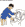

First, put some toothpaste on your toothbrush.

Next, brush your teeth.

Then rinse your mouth with water.

Brush for at least two minutes.

Then, clean your toothbrush.

Finally, wash your face.

# Knowing how to do the laundry

First, sort the dirty clothes.

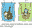

Next, put the clothes in the machine.

Then, dry the wet clothes.

Finally, fold the dry clothes.

Then, put the clothes in the closet.

Finally, hang up the dry clothes.

# Taking Care of Pets 1

# 37

| Category |
| :--- |
| Water |
| Feeding |
| Grooming |

My pet needs fresh, clean water every day.

My pet needs healthy food to grow.

I brush my pet's fur regularly.

I trim my pet's claws.

I bathe my pet sometimes.

I take my pet for walks.

I play with my pet every day.

I love my pet very much.

A pet needs water, food, grooming, baths, walks, and play to stay happy and healthy.

# Taking Care of Pets

## taking care of a dog

## For you to discover

### NEED
- food
- water
- a place to sleep
- love
- attention
- toys

DO
- exercise
- visit the vet
- brush the fur
- clean the teeth

### NEVER
- give chocolate
- give bones
- leave food out
- pull the tail

DON'T
- leave the dog alone
- leave the dog outside
- forget to walk

## New Vocabulary

- leash: a long rope or chain used to lead a dog
- collar: a band worn around a dog's neck
- vet: a person who takes after sick or injured animals
- exercise: activity to keep the body healthy
- brush: to clean or smooth the fur

# 39 Taking Care of a Lawn

### tools
- lawnmower
- rake
- hose
- shears

### activities
- mow the grass
- rake the leaves
- trim the edges
- pull the weeds

### steps
1. mow the grass when it gets too long.
2. rake the leaves in the fall.
3. water the lawn when it is dry.

## HOW TO CARE FOR A LAWN

First, mow the grass when it gets too long.
Next, rake the leaves in the fall.
Finally, water the lawn when it is dry.

Mow the grass when it gets too long.
Rake the leaves in the fall.

Rake the leaves in the fall.
Water the lawn when it is dry.

Water the lawn when it is dry.
Water the lawn when it is dry.

Mow the grass when it gets too long.
Water the lawn when it is dry.

# 40 How to plant

### Seeds
- Bean
- Pea
- Sunflower
- Carrot

### Soil
- Loamy
- Sandy
- Clay
- Compost-rich

### Tools
- Trowel
- Watering can
- Seeds
- Gloves

### Planting a seed

Dig a hole in the soil.

Place the seed in the hole.

Cover the seed with soil.

Water the seed gently.

Wait for the plant to sprout.

Water the growing plant.

### Taking care of a flower

Water the flower regularly.

Remove the dead flowers.

Prune the flower.

Add fertilizer to the plant.

Mulch around the plant.

Protect the plant from pests.

# 41 Opening a door

General operation

### OUTDOORS
- Front doors
- Rear doors
- Hatchback

### INDOORS
- Front seats
- Rear seats
- Storage compartments

### SPECIAL CASES
- Power doors
- Fuel filler
- Trunk lid

This section describes how to open and close the doors and hatches of the vehicle.
Before opening any door, ensure that it is clear of obstacles.
When closing a door, ensure that the latch is fully engaged.

# 42 I plug a laptop charger to keep

What is electricity?

### AC
- Alternating current
- The current changes periodically
- It is used in the wall sockets

### DC
- Direct current
- The current flows in only one direction
- Batteries provide DC current

### Energy
- The ability to do work
- Energy can exist in many forms like heat, light, and chemical

### The unit of energy
- The unit of energy is the joule (J)
- One joule is the amount of work done when a force of one Newton moves an object a distance of one meter
- Energy can be transferred or transformed
- The law of conservation of energy states that energy cannot be created or destroyed, it can only be changed from one form to another

AC stands for alternating current.

DC stands for direct current.

Energy is the ability to do work.

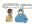
Energy can be transferred or transformed.

The unit of energy is the joule (J).

The law of conservation of energy states that energy cannot be created or destroyed, it can only be changed from one form to another.

One joule is the amount of work done when a force of one Newton moves an object a distance of one meter.

# 43 Changing a Flat Tire

Key words

- flat tire
- jack
- lug wrench
- nuts
- wheel
- loosen
- tighten
- spare
- tire

Let's learn how to change a flat tire.

Loosen the lug nuts first.

Use the jack to lift the car.

Take off the flat tire.

Next, put on the spare tire.

Then, tighten the lug nuts.

Finally, lower the car.

Now, the car is ready.

Grammar

Use imperative sentences to give commands or instructions.

- Loosen the nuts.
- Lift the car.
- Take off the tire.

Writing

Write a short story about a time you had a flat tire.

# Dealing with Phobias

- arachnophobia
- fear of spiders
- fear of heights
- fear of flying
- fear of dogs
- fear of dentists

- acrophobia
- fear of heights
- fear of falling
- fear of being in an open space

- claustrophobia
- fear of enclosed spaces
- fear of being trapped

Fear of claustrophobia

Fear of acrophobia

Fear of arachnophobia

Fear of aerophobia

Fear of cynophobia

Fear of odontophobia

Fear of nyctophobia

Fear of phrophobia

What is a phobia?
A phobia is an intense, irrational fear of something. It is much more than just being afraid. People with phobias feel distressed when faced with their fear.

# Working with Data

## How it works

- Input
- Process
- Output
- Storage

## Components

- CPU
- Memory
- Disk
- I/O Devices

## Data Types

- Structured
- Unstructured
- Metadata

### Data Flow

Data flows from sources through processing units to destinations.

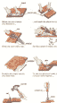

Data can be changed during the process.

Each update is recorded in storage.

Processing transforms raw data into useful information.

Results are generated for user analysis.

Example of data storage over time.

Historical data is used for future predictions.

# 46 Jumping with Robot Screws

## A. PROJECT

### Materials
- Cardboard
- Rubber bands
- Pipe cleaners
- Screws
- Glue

### Tools
- Scissors
- Adhesive tape
- Small screwdriver
- Ruler

### Steps
1. Cut out the cardboard for the body.
2. Attach the legs using the screws.
3. Thread the rubber bands through the legs.
4. Secure the bands to create tension.

## Safety Tips
- Be careful when using sharp scissors.
- Ask an adult for help with the screwdriver.
- Experiment with different sizes of screws to weight down the robot and improve jumping height.

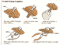

## B. Exploring with Physics

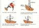

# Shopping for clothes

For you and them

### Vocabulary
- shirt
- T-shirt
- sweater
- jacket
- dress
- skirt
- trousers
- shorts
- jeans
- shoes
- hat
- scarf
- bag

We are shopping for clothes.

She is wearing a red dress.

He is looking for a jacket.

She is trying on a blue shirt.

They are having lunch.

He is drinking some juice.

She is paying for the clothes.

Let's practice
- What are you wearing today?
- I am wearing a T-shirt and jeans.
- How much is it?
- It is $20.

He CARRIED THE BOX HOME.

He OPENED THE BOX.

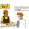

And he SAW...

He looked at the beautiful present.

He looked at the smaller box.

And he remembered the secret.

It was a picture of his mother.

He opened the small box and found

And he found the key to the house.

He had a very happy dream that.

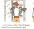

Then he went to sleep with the key.

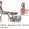

Then he woke up in the morning.

# 48 Pattern for Design

## Key elements

### Elements
- Line
- Shape
- Color
- Texture
- Value
- Space
- Proportion
- Unity

### Principles
- Balance
- Contrast
- Movement
- Pattern
- Rhythm
- Variety
- Unity

### Design Process
- Define the problem
- Research and analyze
- Brainstorm ideas
- Sketch concepts
- Develop designs
- Prototype
- Final product

The outer shape of the picture

Pattern with color

By repeating shapes we create rhythm.

The pattern creates visual interest.

# Playing with Blocks

CHAPTER 12
172

Building with Blocks

## Building a Tower

$12.50

## Building a Tall Tower

UNIT 4

STEP 1

Place one block on the table.

Place another block on the first.

FALL!
CAUTION!
The tower falls down.

The blocks fall on the floor.

OH!
OH NO!
The blocks hit the floor.

# Playing with Blocks Again

He picks up the blocks.

He puts the blocks together.

He builds the tower again.

The tower is tall now.

The tower is very tall.

The tower falls again.

 (Wait, index 11 in text)

# 49 Going to the Beach

## What do we need?

### GEAR
- Bag
- Towel
- Hat
- Sunscreen
- Water
- Snacks
- Shoes

### ACTIVITIES
- Swim
- Play
- Build sandles
- Run
- Relax

## What else can we do?

We build a sandcastle.

We swim in the ocean.

# MY BEACH CALENDAR

Date: April 20

| Activity | Done |
|---|---|
| Swim | |
| Build | |
| Play | |

We go to the beach.

We play in the sand.

We run on the beach.

We relax under the umbrella.

We eat snacks.

We watch the sunset.

We had a great time at the beach. We want to go back!

# 50 Pang-yo

Pang-yo
- fast
- slow
- big
- small
- heavy
- light
- hard
- soft

shape
- circle
- square
- triangle
- rectangle
- oval
- star-shaped

around
- inside
- outside
- near
- far

How to use this

The small box is inside the big box.
The small box is near the big box.
The small box is far from the big box.

The small box is inside the big box.

The small box is near the big box.

The star shape is far from the box.

The small box is near the big box.

The small box is inside the big box.

The small box is far from the big box.

The small box is near the big box.

The small box is inside the big box.

The small box is far from the big box.

The small box is near the big box.

## Unit 5: Telephones
## Making a Phone Call

### Let's learn
- Hello
- Hi
- Good morning
- May I speak to...?

### Vocabulary
- answer
- call
- message
- leave
- phone
- telephone

Answer the phone. Leave a message.

Pick up the receiver and say hello.

Answer the mobile phone.

Use the laptop for the meeting.

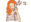

Answer the headset. Wait.

Wait for someone.

Leave a message for your friend.

Hang up after the call.

### Listen and repeat
Listen to the sentences and repeat them carefully.

- May I speak to John please?
- Can I leave a message?
- I'll call you back.
- Thanks, goodbye.

## Using the Telephone 2
## 52 Answering a Telephone

### Vocabulary
- answer
- call
- busy
- dial
- message
- phone
- receiver
- ring
- hang up
- wait

### Verbs
- answer
- call
- dial
- hang up
- ring

### Nouns
- busy
- message
- phone
- receiver
- wait

He picks up the phone.

She listens to the phone.

He talks on the phone.

She waits for the phone.

He hangs up the phone.

She dials the phone number.

### Grammar
- He answers the phone.
- She calls him.
- He leaves a message.
- She waits for his call.

### Speaking Practice

The man leaves a message.

The woman receives the message.

He waits for her call.

She calls him back.

## Using the Telephone
## 53
### Let's review
- phone
- answer
- call
- message
- mobile
- talk

### VOCABULARY
- answer the phone
- hang up
- call back

### GRAMMAR
- I'm calling about...
- Can I speak to...

### Let's practice
1. Look at the pictures and listen to the dialogue.
2. Practice the dialogue with your partner.

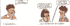

## Using The Telephone 4
## Giving & Taking Messages

### Use your phone
- Hello
- Hello, this is [Name]
- Can I speak to [Name]?
- Is he/she there now?

### Vocabulary
- message
- take
- leave
- call back

### Giving / Taking Messages
He's not here now. Would you like to leave a message? Can he call you back?

### Conversation 1
A: Hello, can I speak to Mr. Smith?
B: I'm sorry, he's not here now. Would you like to leave a message?
A: Yes, please tell him to call me back.
B: Okay, I will do that.

### Conversation 2
A: Hello, this is [Name]. Can I speak to Mr. Smith?
B: He's out at the moment. Can he call you back?
A: Yes, my number is [Number].
B: Okay, I'll let him know.

She is answering the phone and he is speaking to her.

She is writing a message. He is leaving a message.

He is taking a message. She is taking a message.

He is calling her back. She is calling him back.

## Using the Telephone
## 55 Using an Answering Machine
How do you use an answering machine?

### Dial
- Dial the number
- Wait for the tone
- Leave your message
- Hang up

### Listen
- Pick up the phone
- Listen to the message
- Hang up again

### Delete
- Press the delete key
- Listen to the deleted message

To leave an answering message, dial the number.

Wait for the tone, then leave your message.

Hang up when you're finished.

Pick up the phone to listen to the message.

Press the delete key to delete the message.

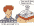

Hang up after you delete the message.

### Grammar Focus
An answering machine is used to receive messages when you are not home. We use the present continuous to talk about actions happening now.

To leave a message.

To delete a message.

## 56
A list of things to do with your group

Make the rules clear before you start.

Take turns and listen to others.

Draw a picture of your activity.

Share your work with the group.

Write down what you learned today.

Think about what to do next.

Talk about your experience.

Clean up when you finish.

## 57 Writing a Letter
### Key Vocabulary

### NOUNS
- address: the place where someone lives or works
- postcard: a piece of card for writing on and sending
- envelope: a paper used to put a letter in
- stamp: a small piece of paper stuck on letter to pay for delivery
- postman: a person who delivers letters

### VERBS
- write: to make words on paper
- send: to make something go to another place
- receive: to get something that has been sent to you
- post: to send something by the post

### ADJECTIVES
- formal: polite and used with people you don't know
- informal: relaxed and used with friends and family

### PHRASES
- Dear...: used to start a letter
- I hope you are well: used to ask how someone is
- I look forward to hearing from you: used to end a letter
- Best / Regards: used to end a letter

You have a letter to write. This is a postcard.

You put the letter in the envelope.

Write the address on the postcard. Don't forget to add a stamp!

You post the letter. The postman delivers the letter to your friend.

### HOW TO
1. Write a letter to your friend.
2. Put the letter in an envelope.
3. Put a stamp on the envelope.
4. Post the letter.

## Where is it? (Contextual title from images)
Who is Tom?

Where is my key?

Where is the cat?

I can't find my glasses.

Where is the phone?

Where is my money?

Where is my wallet?

Where is my watch?

Where is my card?

Where is my phone?

# Going to a Birthday Party

### Vocabulary
- invite
- party
- gift
- cake
- sing
- surprise

### Usage
- invite someone to a party
- give someone a gift
- sing happy birthday
- have a surprise

### Grammar
- When are you going to...

I invite friends to my party.

She opens the gift.

They sing happy birthday to her.

We have a surprise party.

"We say happy birthday!"

"Here is your cake"

He likes the cake.

They have a party together.

# Learning to be a Hiker

### Listen and repeat
1. mountain
2. forest
3. tent
4. campfire
5. path
6. map
7. compass
8. flashlight
9. backpack

### Vocabulary
1. mountain
2. forest
3. tent
4. campfire
5. path
6. map
7. compass
8. flashlight
9. backpack

### Grammar
1. We need a...
2. We need some...

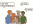

# 60 Going on a Picnic

### VOCABULARY
- picnic
- basket
- blanket
- food
- drink
- fruit
- juice
- park

### GRAMMAR
- I want to...
- He wants to...
- We want to...
- They want to...

### READING

The family is going for a picnic in the park.

They are packing the food in the basket.

The children are sitting on the blanket and eating fruit.

They are playing with a ball together.

### Let's talk
- Where do you want to go for a picnic?
- What do you want to eat at the picnic?
- What do you want to drink?

The family is having a great time.

They are happy to be together.

They love the picnic together.

They are going home now.

# 61

Unit 4

### FRUIT
- apple
- banana
- cherry
- grape
- orange
- pear

### VEGETABLES
- carrot
- potato
- onion
- pepper
- tomato

### VERBS
- eat
- drink
- like
- want

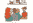

I like apples.

He likes juice.

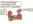

She wants carrots.

They like to cook.

We like to eat together.

Their family has breakfast.

My mother likes bananas.

She likes healthy food.

# Appendix on American and Metric Measurements

| Unit | American | Metric |
|---|---|---|
| Length | inch (in) | 2.54 cm |
| Weight | pound (lb) | 0.453 kg |
| Length | foot (ft) | 0.305 m |
| Area | square foot | 0.092 m2 |
| Distance | mile (mi) | 1.609 km |
| Volume | gallon (gal) | 3.78 L |
| Volume | quart | 0.946 L |
| Volume | pint | 0.473 L |
| Volume | cup | 0.236 L |
| Volume | ounce | 29.57 ml |

Temperature
F = C * 9/5 + 32

| Fahrenheit | Celsius |
|---|---|
| 212°F | 100°C |
| 98°F | 37°C |
| 68°F | 20°C |
| 32°F | 0°C |
| 0°F | -18°C |
| -40°F | -40°C |

Length Metric
meter = 100 cm

| Metric | American approx. |
|---|---|
| kilometer | a mile |
| meter | a yard |
| gram | a bill (dollar) |
| centigram | an ounce |
| liter | a quart |
| ml | a drop |
