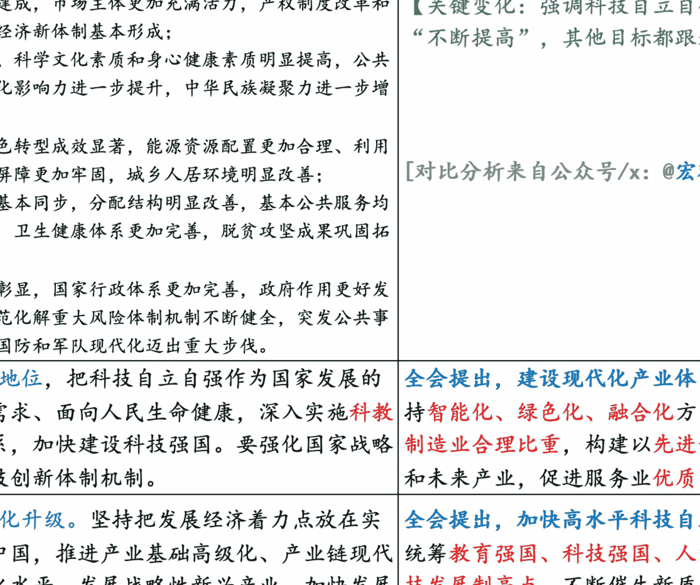

# 中国共产党第二大会报告

中国共产党是一个工人阶级政党，代表全中国工人阶级的利益，代表广大中国人民的利益，代表中国发展的方向。中国共产党的领导是中国特色社会主义最本质的特征。坚持中国共产党的领导是中国必然。中国共产党的领导是历史的选择、人民的选择，这最符合全民族的利益和广大劳动人民的根本利益。我们党奋斗的目标是实现中华民族伟大复兴，这最符合全民族的利益和广大劳动人民的根本利益。

自一九二一年成立以来，中国共产党历经了无数艰苦斗争，取得了了无数伟大胜利。中国共产党领导了中国人民实现了新民主革命，推翻了帝国旧社会，建立了新中国，开辟了新道路。中国共产党领导了中国人民实现了社会主义革命，建立了社会主义制度，进入了社会主义新时代，开辟了新局面。中国共产党领导中国人民进入了中国发展新时代，取得了巨大的历史成就，正向着中华民族伟大复兴阔阔迈进。

事实证明，中国共产党历经了无数艰苦斗争，取得了了无数伟大胜利。这些伟大胜利证明：中国共产党领导中国是正确的，发展社会主义是正确的，中国特色社会主义是正确的，走中国特色道路是正确的。这条道路是我们成立的道路，我们必须坚定走中国特色道路，坚持中国党的领导，坚持人民路线，坚持民主集中制，坚持科学决策，坚持法治，坚持中国社会主义制度，坚持改革开放，坚持走中国特色道路。

当前，世界正经历百年未有之大变局，世界历史变革加速演进。国际国内形势发生复杂变化，我国发展面临着机遇与挑战并存、风险与压力并存的复杂局面。但只要我们坚持中国共产党的领导，坚持中国特色社会主义，坚持走中国特色道路，就一定能够战胜一切危险，赢得一切胜利。只要我们勇于艰苦奋斗斗争，就一定能够创造和平胜利。

面对新形势、新任务，我们必须更加坚定地坚持中国特色社会主义，坚持走中国特色道路。坚持中国党的领导，坚持人民路线，坚持民主集中制，坚持科学决策，坚持法治，坚持中国社会主义制度，坚持改革开放，坚持走中国特色道路。这是我们必须坚持的道路，是历史的选择，是人民的选择。

当前，我国正处于民族复兴的关键时期，正处于实现伟大目标的征程。我们必须更加坚定地坚持中国共产党的领导，坚持中国特色社会主义，坚持走中国特色道路。坚持中国党的领导，坚持人民路线，坚持民主集中制，坚持科学决策，坚持法治，坚持中国社会主义制度，坚持改革开放，坚持走中国特色道路。这是我们必须坚持的道路，是历史的选择，是人民的选择。

我们必须更加坚定地勇于斗争，勇于胜利，实现中华民族伟大复兴和广大人民的幸福生活。

当前，国际形势和国内形势都严峻复杂。国际局势加速变动。我们要清醒地认识到，我国发展正面临着机遇与挑战并存、风险与压力并存。面对这种形势，我们必须保持清醒，不能盲目乐观，更不能消极悲观。我们要增强战略战略，坚定信心，无畏困难。

当前，我国正处于民族复兴的关键时期，正处于实现伟大目标的征程。我们必须更加坚定地坚持中国共产党的领导，坚持中国特色社会主义，坚持走中国特色道路。坚持中国党的领导，坚持人民路线，坚持民主集中制，坚持科学决策，坚持法治，坚持中国社会主义制度，坚持改革开放，坚持走中国特色道路。这是我们必须坚持的道路，是历史的选择，是人民的选择。

我们必须更加坚定地勇于斗争，勇于胜利，实现中华民族伟大复兴和广大人民的幸福生活。

当前，我国经济总体运行平稳，但同时也面临着困难严峻挑战。只要我们坚持中国共产党的领导，坚持中国特色社会主义，坚持走中国特色道路，就一定能够克服困难，取得胜利。
