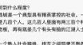
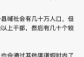

# 6-4 难道你不想要小小的？

你不想要一个小小的吗？

如果你想要一个小小的，那么就要找一个聪明、漂亮、调皮、甚至偶尔脾气有点怪的女孩。但是你愿意这样做吗？

当她哭的时候，你也不抱也不逗她，只是坐在床旁边看着她，等她哭完了，再过去抱抱她。

# 6-5 难道你不想要大的？

我才不要小小的，我想要一个大的。但是，你有找到这样的女朋友吗？哪里能找到吗？

我有很多要求，她要高、要长得漂亮、要幽默、而且要非常体贴。人最好不要太脾气大，凡事要听我的话。

但是我知道这么多要求，这样的女孩世界上真的存在吗？即使存在，我真的可能遇到这样的女朋友吗？

如果真的有这样的女朋友，我愿意和她一辈子，一辈子不离开！

# 6-6 难道你不想要我的？

你是不想要一个小小的吗？

小美：你问我喜不要生孩子？我当然是喜欢生孩子，但是我想和你一起生孩子，而不是你一个人生！

人生的意义并不是一定要生孩子，最重要的是和谁一起度过一生。对我来说，你就是人生的意义。

即使没有孩子，只要能和你一辈子，我就足够了！

小美：你难道不想要一个孩子吗？

小强：我想要孩子，但是我不想要你一个人生！

可是你不生，哪来的孩子呢？

小强：那我们可以一起生呀！

小美：好啊！可是生孩子很疼的呀。

小强：我会心疼的，好吗？

小美：那我就愿意。

小强：我爱你！

小美：我也爱你！虽然生孩子真的很疼，但是为了我们的孩子，值得的！

小强：我们一起努力吧！

小美：嗯！

小强：我也爱你！
