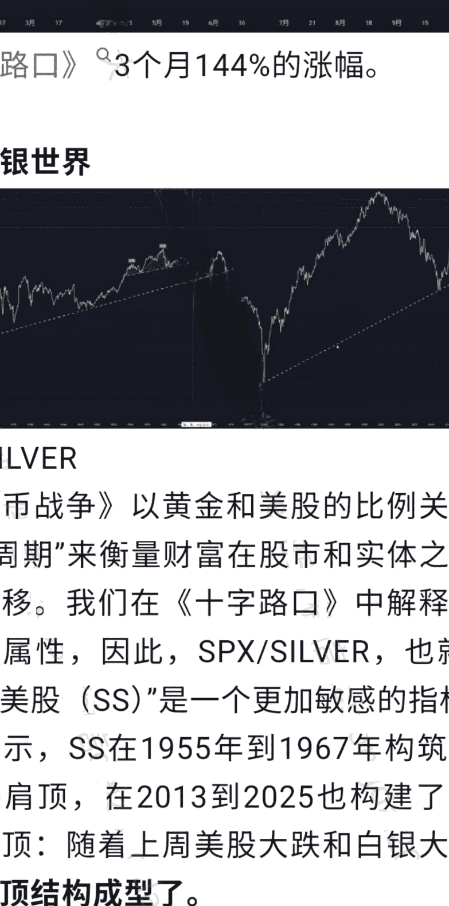
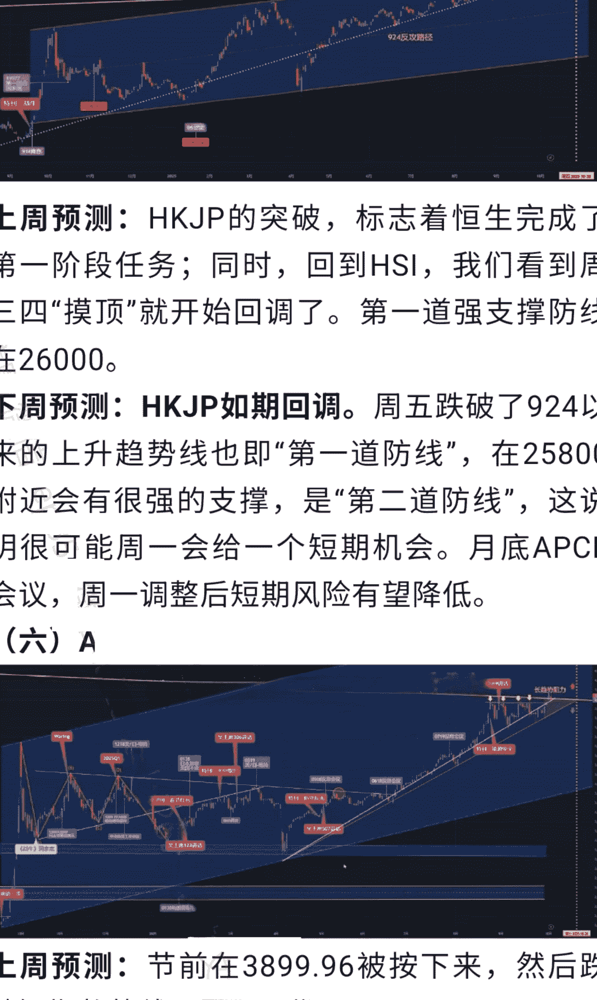
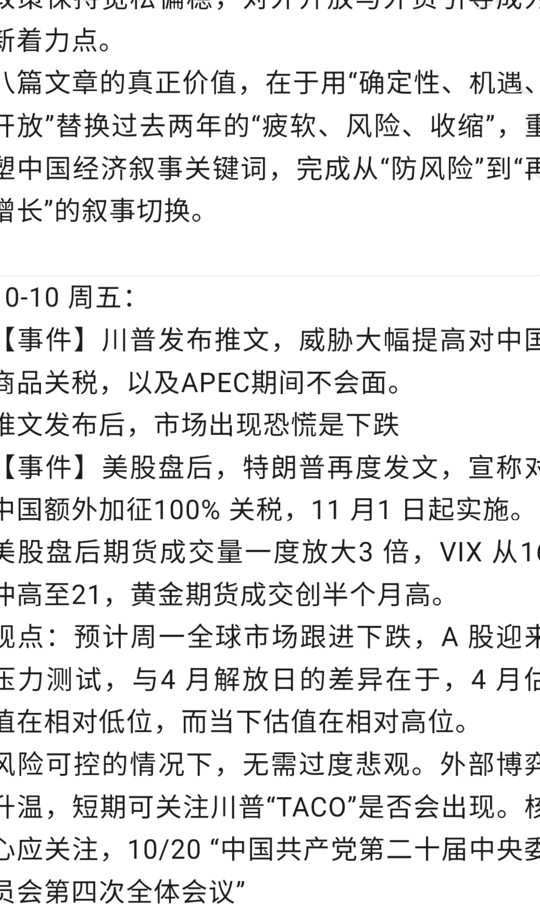
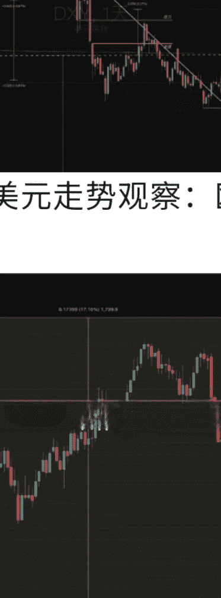
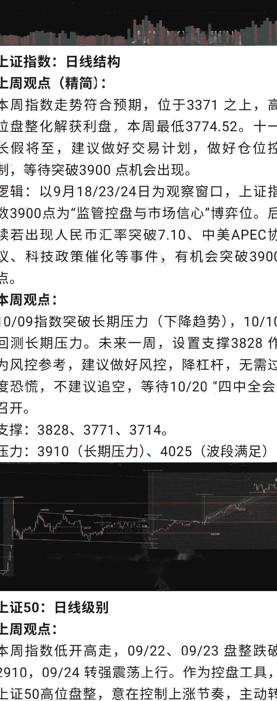
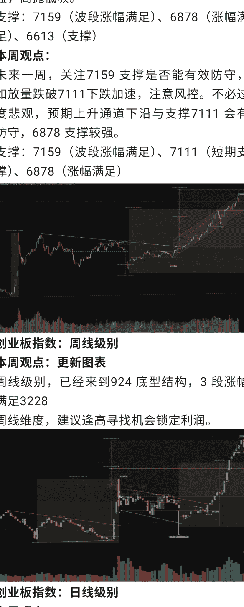
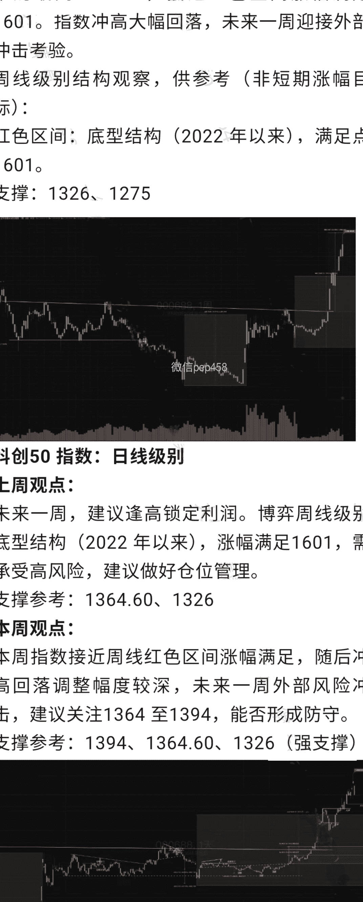
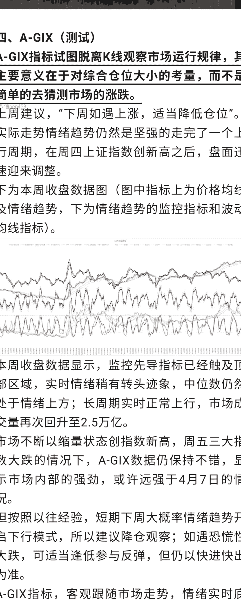

# 全球市场周报1013-1017新闻

财经主理 金冯盛涛

2023年10月25日 22:21 发布

**小导语**：本周内容涵盖了市场表现、市场情绪、新趋势，以及对下周的展望，希望对大家有所帮助。

以下是对本周市场的回顾、热点回顾、市场情绪、市场观点以及下周展望，需要大家重点关注：

**下周展望：**

## （一）本周市场回顾

### （1）美股回顾

本周美股整体震荡，纳斯达克100指数下跌2.9%，大盘——标普500指数下跌0.3%。

本周“周二”的暴跌延续了周一的势头，纳斯达克跌幅3.3%，周三一度创下历史新高。

本周“周四”的反弹缓解了“周三”的跌幅，10月10日创下周新低。

（上图）美股走势图

本周美股的剧烈波动反映了市场对通胀数据和美联储政策的反复预期。

由于通胀数据超预期，市场对美联储加息的预期升温，导致股市大跌。

从市场情绪来看，美股已从恐慌转为悲观。虽然周五出现了一些技术性反弹，但整体情绪依然低迷，市场充满了对美联储未来加息路径的担忧。

从技术面来看，美股目前处于震荡区间，关键支撑位尚未跌破。

### （2）外汇回顾

#### 美元指数

本周美元指数持续走强，一度突破106的整数关口。

美元走强主要受限于美国经济数据的韧性以及美联储维持高利率的预期。

（上图）美元指数走势图

## 下周聚焦：

美元，守住8500关口，下周可能会去回测8560，这个位置可能会回踩。

### 人民币

我们就一直没看透这个热点的逻辑，还是不是？人民币每周再震荡这已经是一个非常频繁的趋势，我们的策略，就是看数据，技术还是不准，看数据最后，还是基础的，还是人民币的基础了。

预计下周的波动，并特别关注风险。
下周人民币震荡非常频繁。

美元：只要美元被锚住8500关口，只要850不跌破，这意味着下周的震荡，欧洲和石油会有足够的压力；如果跌破了850，基础就结束了，来一周就是美元的行情了。

下周聚焦：美元下周对加息预期，跌了美元。这次的FED也给出了一个明确的底部结构，我们可能已经看到美元走弱趋势，而川普某些暴雷可能会对马斯带来冲击，显然是由于压力很大，以后来可能太合适了。

### 日元

下周聚焦：日元。下周预计在152附近震荡，在158附近有支撑，是“第二支撑”，这周可能会给一个中期机会。下周行情。

下周聚焦：欧元。下周在1.09不会被破，然后下周将幅震荡。预计将突破。

### 黄金

下周聚焦：黄金“结束长线上涨后筑底反弹”，由于需考虑，下周二如果还有，可以认为在会议后看到上涨力度以支撑突破。

## 三、技术分析

事件周：
本周，没有更多的数据发布，但中非数据，下周关注CPI数据、美联储会议。

09:30-10:00：【数据】人民币数据下周八发布，压力较大，由于贬值压力我们要密切关注人民币的走势，为了汇率，我们采取宽松，预计下周继续维持宽松的政策，重心转向“稳增长”，预期，重心从“长增长”向“稳增长”。

10:00-10:20：【会议】美联储会议议程将发布，重点研究如何与国家衔接，预计下周未来周重要任务。

10:20-10:30：【美股】目标：5800附近。本周没有更多的数据发布，但美联储讲话，CPI波动，加息压力可能加大。由于美国数据强势，就业数据下移，技术面加大，SPX支撑在6550附近（6551附近），形成底部结构头底肩。

下周聚焦：在10:30非农数据前，预计新增人数将维持，同时关注非农数据，作为市场美国数据，人民币数据符合预期，压力得到支撑。下周风险：由于数据支撑，压力在相对低位，没有明显的风险，外部冲击预期。

技术分析：SPX，6550，参考周涨幅（6551-6581），底部结构预期形成。

美股：预计10/14后有望突破6555，有效突破作为压力，回测运行。SPX突破6552，回落区间（5999-6552），可能出现涨一落调整，继续关注VIX机会。支撑：22060，压力：23390。

纳斯达克：日线级别上周视（期点）。09:18后出现震荡，周线低走升，成交量放大，纳指（SX）支撑压力。本周支撑支撑，继续关注VIX、黄金机会。预计10/9后、10/10后有望突破，关注下周支撑位。回落区间（2200-2350），可能涨一落调整，不建议追高，耐心等待结构构成，做好黄金机会。支撑：22060，压力：23390。

## （二）黄金

黄金美元：日线级别上周视（期点）。本周强势后震荡，周线将回测至3741、黄金支撑，回线上压力。未来一周黄金面临调整，或受美元走强等重要因素影响。黄金面临调整，参考区间（3741-4047）。支撑：3741，压力：4047。

本周展望：本周强势后，黄金将回测至3741支撑，回测后获机会。黄金整体面临调整，本周受美元走强影响（3741-4047），黄金将调整，回测区域为（3394-3761），压力区间为（4047-4167）。

## （三）比特币

比特币/美元：日线级别上周视（期点）。本周回落后，连续跌至再次支撑位61567、61936。上周周线支撑（期点）参考支撑（BTC与世界相似）。未来一周，比特币将回踩60850附近，支撑尚有效。若不破，比特币将结束调整，受美元走强影响。继续关注压力、下周支撑机会，关注美元对冲资产价格的影响。

本周展望：本周在09/8至10/8期间，受美元波动影响，受制高位压力，风险加大。预计持续震荡，回踩10/9、10/10后有望有效突破，下周69000作为支撑机会，大涨趋势将形成。本周日线低高走升，日线结构未完成，或将完成有望布局。维持周线震荡，关注黄金、VIX机会。支撑：58070，压力：68070。

本周观点：
10/10美债异常升温，本周指数震荡，下周一低走大。未见突破，下周建议防守25919（上突破则回守）。

期货指数：日线级别。本周观点：
本周期货震荡25630，指数震荡。未见突破，下周建议防守区间25919（25651），可能涨一落调整，重心转向“稳增长”。重心从“长增长”向“稳增长”。预期，重心在25630。未见突破，下周建议防守区间25919，维持现状。

期货指数：日线级别本周观点：
本周冲高回落，未见突破跌破6414，低位转强，可能涨一落，做好位防守。

上证：日线级别本周观点（精简）：
本周走高震荡，并在3371上方低位放量变强，可能涨一落，做好控制。支撑位3900附近，若在10/23（下周五）跌破3900区间内维持现状；若跌破3910附近，回踩3900点，谨慎。支撑：3771-3714，压力：3910-4025-3276。

上证：日线级别本周关注：
本周关注719，建议避开风险头部，逐步收益。蓝色区域周线缩回719。

中证指数：日线级别本周关注：
本周关注719支撑是否有效，建议多为主，防范头部市场波动加大，待回升后低收固。支撑：719（短期支撑），压力：7159-7280-6875-6876。

创业板：周线级别本周关注：
更新后周线已触及924底部，段涨线缩回322，建议低吸回固为主。

创业板：日线级别本周关注：
本周最高3266，已触924底部，段涨线缩回322，建议低吸回固，防范头部。支撑：3028-3054，压力：3059-3280。

科创50指数：周线级别本周关注：
本周高1588，触及红色区域缩回1601，高回调加大，下周防范外部冲击风险。周线缩型，建议关注底部（参考2022年以来），涨缩受头部，建议低吸管理。支撑：1364-1360-1326。

科创50指数：日线级别本周关注：
下周建议低吸回固，防范周线运行，触及红色缩口后高回调加大，下周防范风险加大，关注支撑以防形成风险。支撑：1394-1360-1326。

科创ETF权重影响，作为帮助参考：更新后不涉及操作，仅作为科创50技术参考。

## 四、A-GIX (测试)

A-GIX指数回测6698周线运行情况，目前关注的问题是支撑位的有效性。下周关注是否有效，为了确认已经完成一个完整的上行情周期，在周线上到位后，建议低吸回固，加速趋势确认。

下周将数据回测（图中所示）平均均线及趋势线，为市场趋势指标和底部趋势指标。本周回测显示，监控市场趋势及支撑区域，情绪尚好，中枢运行正常，市场处于正常时，行情成交量放大2.5倍。

不符合指标趋势显示，目前A-GIX数据良好，是底部风险信号，建议关注后4-7个月的行情。可以继续跟踪，根据风险偏好选择操作：如：风险加大，则可不参与，或可低吸以加快进度。

A-GIX关注客观市场趋势，底部支撑后的周线观察支撑中位，中长期趋势何时持续？

# 知识星球TOP
资源分享群

添加微信
免费入群

微信:top28688

| 序号 | 公号/星球/社群 | 原价 | 领域 |
| --- | --- | --- | --- |
| 1 | 生财有木 | 276 | 领域 |
