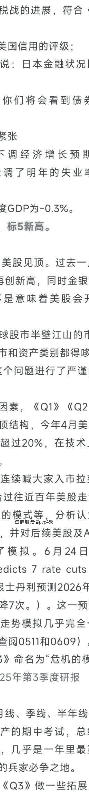
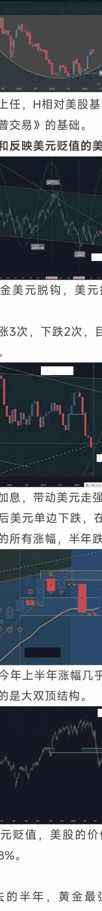
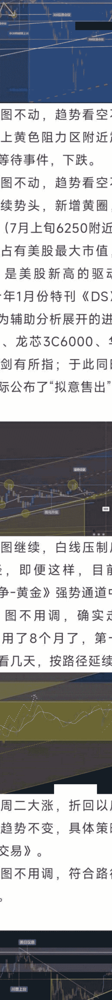
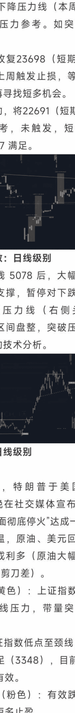
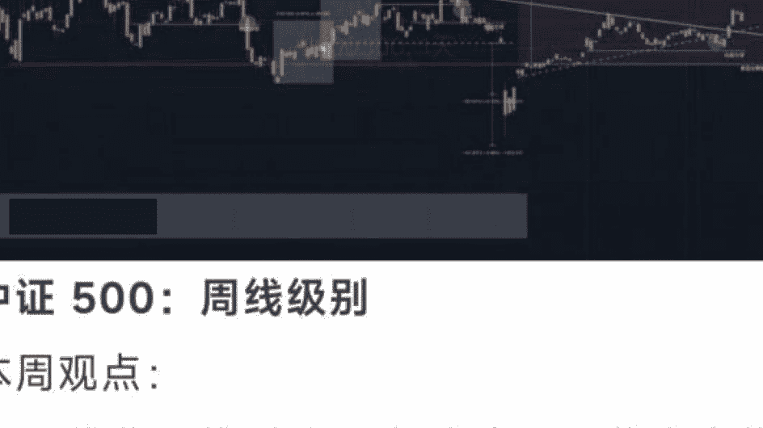
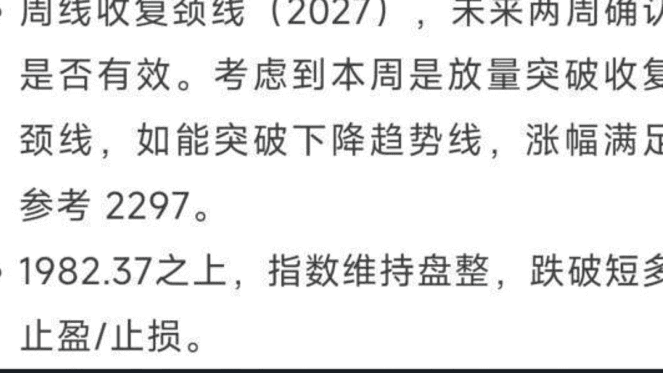
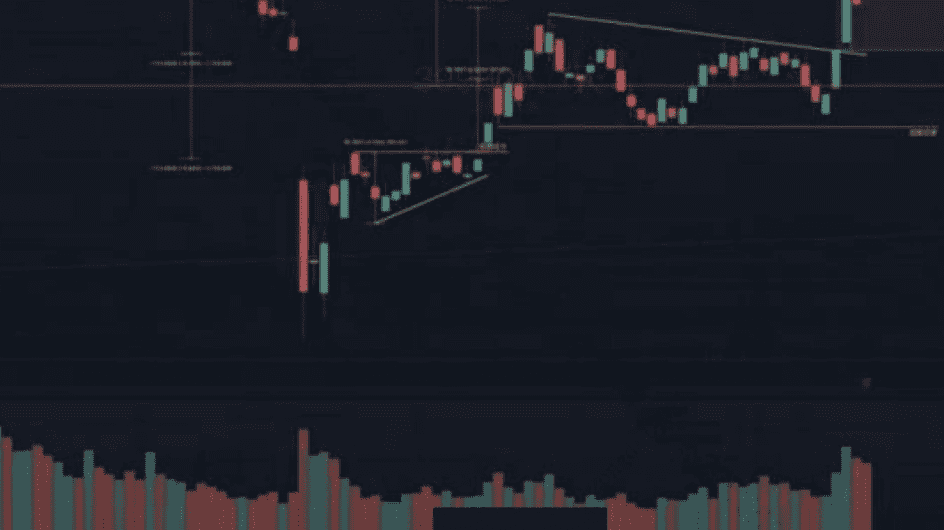
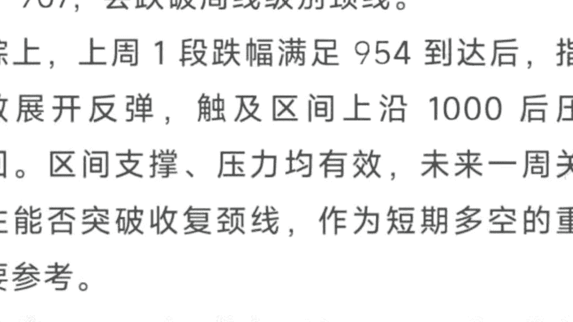
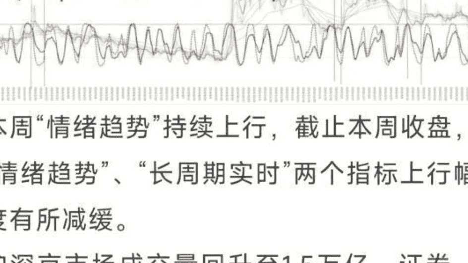

# 全球黄金2023-07-04行情分析

## 概述

- Q2季度表现良好；2023年第二季度黄金的收益率达到8%。
- 受2023年第二季度美联储加息预期的影响；
- 受美元走弱、实际收益率下降和通胀预期放缓的影响。

下半年黄金的影响因素：

- 一、美元：近期美元指数创下新高，
- 二、实际收益率：近期实际收益率从1.7%下降到0.4%，
- 三、通胀：美国CPI数据回落至3.0%，
- 四、避险情绪：避险情绪是否回升？

Q2季度结束时，黄金在6月一度创下新高，但由于美元走强、实际收益率回升，导致黄金出现回撤。

## 一、美元

近期美元指数创下新高，受美国经济数据强劲影响。由于非农就业人数远超预期，且失业率也低位，这支撑了美元走强。

2020年以来的月线：2023年以来，受美联储加息影响美元上涨。

2020年以来的月线：2023年以来，受美联储政策影响黄金波动。

## 二、实际收益率

### 上周：议会议后走红色

本周将：由于好消息终结，股市有望继续走高。美国股市在周末拉高。

### (周一)

上周：纳斯达克5333收跌，道指5386收高。周五纳指5599收跌，受议会议影响，大指数收涨。

## 三、美元

本周预测：2025/05/26，周五由于市场情绪好转，美元指数收跌。预计周五美元在104.2-104.5之间波动，收收104.73。

周中：美元指数在104.0-105.0波动。

### (周二)

### 欧元/美元：

本周预测：2025/05/26，周五由于市场情绪好转，欧元/美元收涨。预计周五欧元在1.08-1.09之间波动。

止参考(4022)：04/07指数低至顶线，反弹1段幅满足。
止参考：低反幅3815，高反幅3768

### 中证 500：周线级别

本周观点：

- 周线级别(5387)之上，周线之上支撑盘(5815 至 5469)
- 本周量能突破5815，1段幅满足6004。短多操作，注意观察下降趋势能否突破，压力约为5975左右。

### 创业指数：周线级别

本周观点：

- 周线收复线(2027)，未来周确认是否有效。考虑到本周是量能突破复线，若能突破下降趋势，涨幅满足参考 2297。
- 1982.37之上，指数维持盘整，跌破短多为止/止损

### 创业指数：日线级别

- 日线级别突破结构，1段幅满足2140，2段幅满足2216。

### 科创50指数：日线级别

维持观点：

- 周线级别头顶在成型，线级别 939。
- 下跌中继结构，1段跌 954，接近足点，可能会反弹，规避连续情绪操作，留有空头风险。
- 下跌中继结构，2段跌，跌幅满足97，会突破周线级别。954跌后，，日线级别突破过程中，“长期回调，触及区间上 1000压力区间支撑、压力均有效，未来一周能否突破复线，作为短期趋势的重参考。

支撑：979（日线级别）、939（周线级别）
压力：1012

## 四、A-GIX（测试）

A-GIX指标图画K线观察市场运行规律，其意义在于监测宽合指数的大小而不是简单的监测市场指数的涨幅。
下为本周收盘数据图（图中，上为价格均值及趋势线。下为趋势的监控指标和波动趋势指标）。

本周“情绪趋势”持续，截至本周收盘，“情绪趋势”、“长期实时”两个指标向上度有所缩减。沪深市场成交量回升至1.5万亿，证券、金融科技等领主指数虽突破昨日n位，下周趋势大跌开启，突破A-GIX指标，建议适当回仓锁定利润，密切观察运行过程中的市场表现。如果“情绪趋势”指标震荡回调，下个周期可以继续尝试？

# 知识星球TOP 资源分享社群

汇聚全网付费资源让更多人获取高价值信息

- ◆付费文章 付费社群
- ◆付费课程 副业&搞钱
- ◆财经&股市 行业报告

时政·历史·职场·体制·自媒体学习·军事·软件·影音·社会学

公众号:知识星球TOP 微信信号:jntsg8 微信信号:jntsg2

添加微信 免费进群
