# 十字路口

## 一、基本原理

美股是全球最大现金流吸收器，当其出现“顶部”、回调，而后再次接近前高，这种情景下，会触发“十字路口交易”。

情景 1：止步前高。两高共同形成“双顶”，因为“双顶”比“单顶”更难再次突破，市场会开始紧张并陷入焦虑，会加大回调力度，形成悲观到恐慌的负反馈，寻求避险。

情景 2：突破前高。市场加大对未来乐观预期，这种情绪下，延续看涨趋势变得更加容易，短期形成从美股新高到美国经济走强的全面乐观预期。

因此，十字路口交易，需要在情景1能够反馈反映金融风险加剧，证券资产趋势走弱情况下保值能力；也需要在情景2能够反映金融改善经济预期的增长能力。

市场上，所有资产中，白银在美股“十字路口”阶段表现出色：情景1的情况下，黄金会走强，白银也会，虽然可能弱于黄金，但历史上白银保值能力仅次于黄金；情景2的情况下下，因为白银是一种重要工业原料，经济改善预期会形成白银消费的增长预期。

加微信jntsg2，进资料分享群

## 二、白银历史走势

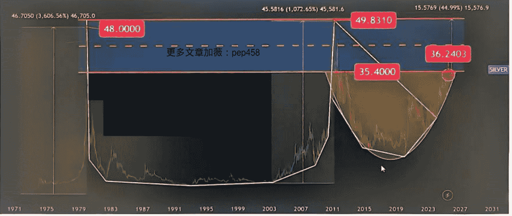

1970 年以来，白银的 55 年走势图：

加微信jntsg2，进阶资料分享群

1970 年以来，白银的 55 年走势图：

- 1. 布雷森森林体系解后，白银 10 年涨了 37 倍；
- 2. 2000 互联网危机和 08 次贷，白银 10 年涨了 10 倍。两次大规模危机共同构成了 50 多年来白银两个山峰，48-49.8 美元附近；
- 3. 2011-2013 年，白银在 35 附近形成了一个非常密集的阻力区，2024 年至今白银一直在进攻这个区间，而在本周（6 月 6 日）收盘，周线级别强势突破。

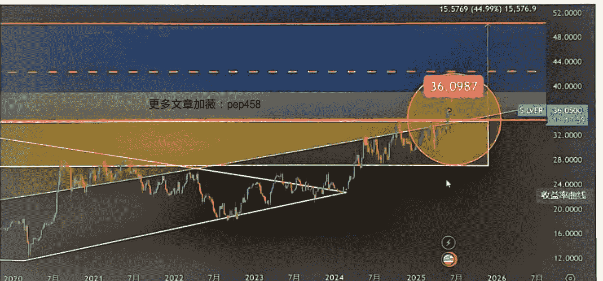

加微信jntsg2，进资料分享群

## 三、技术分析

“香奈儿杯柄形态”是一个经典的技术分析理论：
第一次新高后，回调再回升，那么，第一次新高就成了阻力；再回升碰到“阻力”大概要回调，然后，第二次才能突破。
道理很清晰，实际图形中会在这个基础上演化出很多变种，不过还是非常有指导意义的。

更多文章加微：pep458

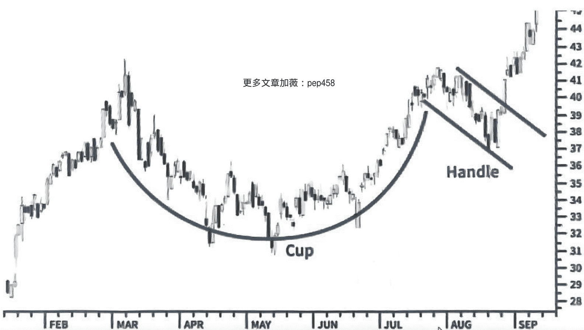

## 现在回到银 XAG 的 55 年走势：

黄色线条勾勒出来的就是一个进退趋势的杯柄形态

## 现在回到银 XAG 的 55 年走势：
### 黄色线条勒出来的就是一个巨大的“杯柄形态”
### 因此，本周线级别的突破，是一个很强烈的看多信号。

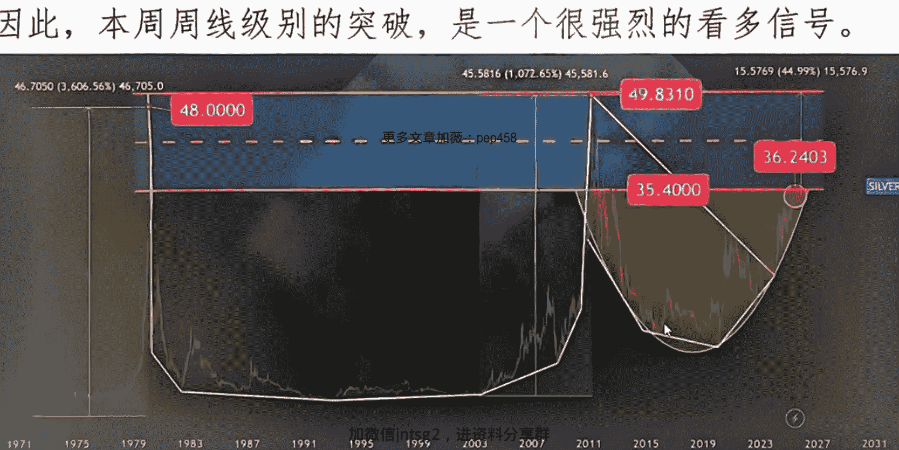

## 四、实证“十字交易”

政治决定金融，中期选举会对 2028 年大选产生重大影响。美国现阶段的内部矛盾集中在明年中期选举，核心在于什么时间爆发危机。对于川普越早爆发危机越越好，有利于为明年中期选举前实现复苏争取足够的时间；相反，如果太晚，那么到明年选举还深陷衰退，选举影响可想而知。

美股是全球最大的流动性吸收器。“美股回落，万物调整。”

上周 SPX 站上了 6000，距离前高 6147.43，只有 2.45%，这个位置关系到美股是否新高，关系到危机爆发的时间，关系到中期选举，关系到下届大选，对全球资产走势进行定性。

（一）情景 1：美股 Q1 见顶，6 月止跌

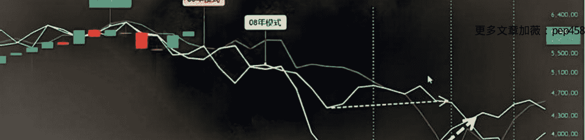

加微信jntsg2，进资料分享群

三次危机：71 年、08 年、对 25 年走势的拟合

- 最好的情况：08 年模式（黄色），到 2026 年 6 月见底，这更有确保中期选举胜利，川普还有 5 个月左右进行重建，在中期大选营造一种强势复苏氛围。

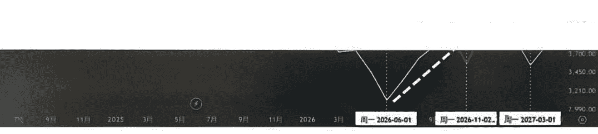

加微信jntsg2，进资料分享群

- 最差的情况：71 年模式（绿色），到 2026 年 1 月中期选举见底，这基本决定川普在中选举时失去优势。
- 偏差的情况：00 年模式（黄色），从 2026 年 3 月到 1 月，是一个持续震荡，这就有很多的不确定性。

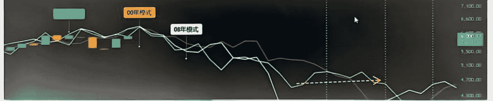

加微信jntsg2，进资料享群

（二）情景 2：美股 Q2 见顶，6 月突破前高

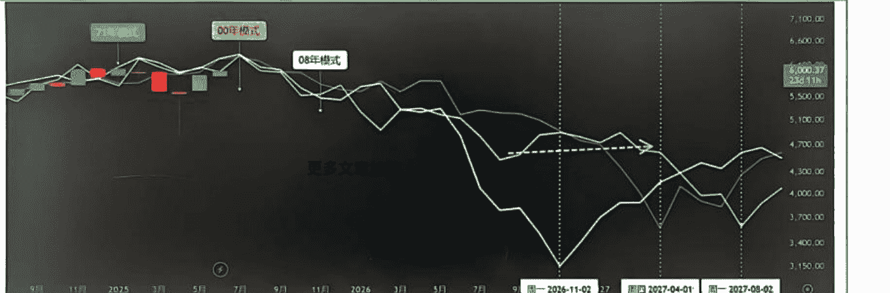

移动三条线至 Q2 顶

加微信jntsg2，进资料分享群

三种情况都在中期选举前下跌：
- 最早是 08 年模式，到 2026 年 1 月中期大选见底；
- 71 和 00 年模式见底的时间晚，这会导致川普在中选举遭遇“滑铁卢”的概率大幅提升。
- 唯一可能增加中期选举胜算的是00 年模式，在中选举前推动数月的小型震荡反弹，过了中期选举再继续跌。

加微信jts2，进资料分享群

## 五、第三次“十字交易”

当前美元超发美债走弱，只有尼克松时代和小布什时代的危机是类似的背景，都发生了“十字交易”。

（一）前两次“十字交易”

- 尼克松时代（红色 SPX/彩色 XAG）-对应情景1：美股一次见顶，白银突破，美股反弹未能创新高，白银继续上涨且加速。直到美股开启恐慌暴跌，白银同步下跌。

加微信jntsg2，进资料分享群

- 小布什时代（红色 SPX/彩色 XAG）–情景2：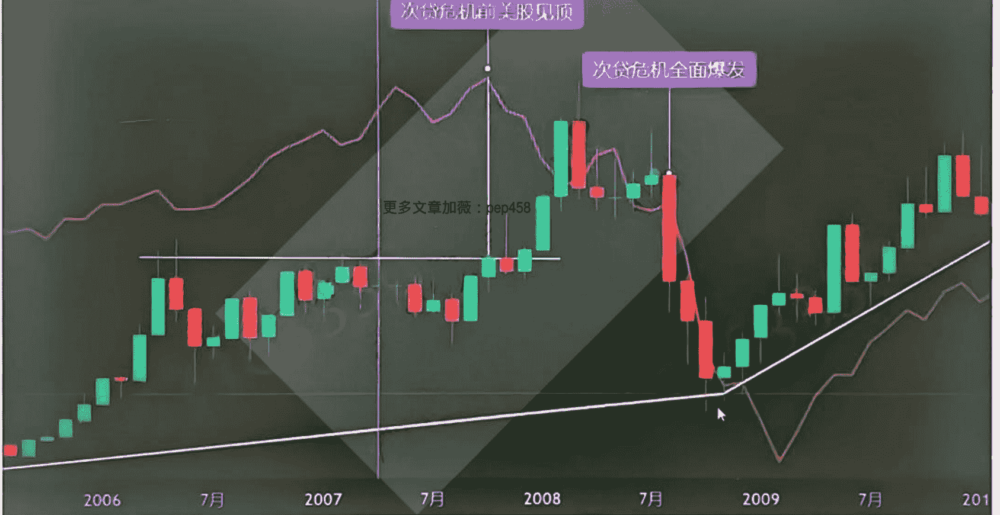 美股二次见顶，白银突破，继续上涨，美股二次见顶后下跌，白银加速，待美股下跌发生恐慌，白银同步下降。

加微信jntsg2，进资料分享群

## (二）第三次“十字路口交易”

- 现在（红色 SPX/彩色 XAG）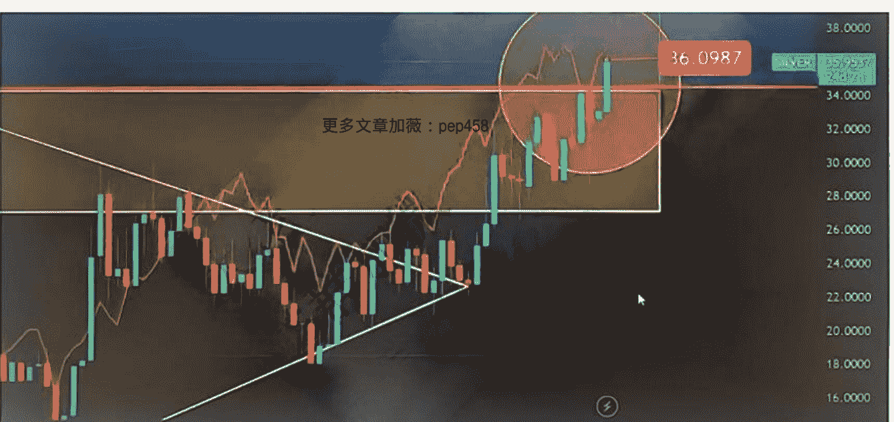

加微信jntsg2，资料分享群

### 白银突破与美股6月反弹突破6000点同时发生。

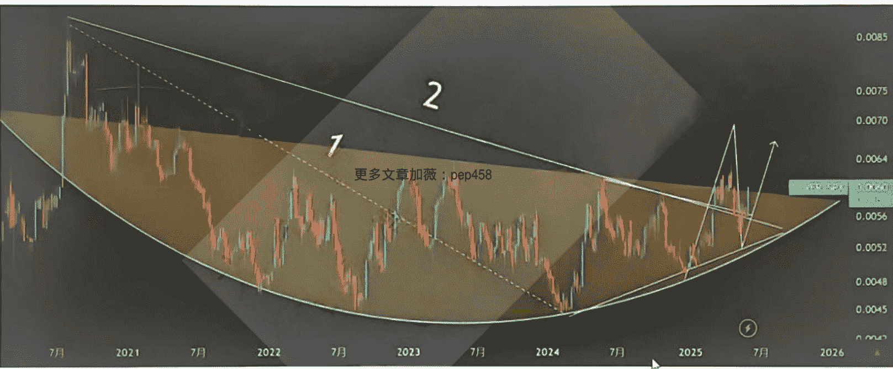

### 以 XAG/SPX衡量白银比美股的强度：

加微信jntsg2，进资料分享群

① XAG/SPX 新冠后完成了弧形反转，XAG 比 SPX 逐渐更强；
② 2023 年突破压制线 1，2025 年突破压制线 2；
③ 现在，完成突破后的第一次回踩确认，使压制线 2 为支撑线。

这次突破以后，尽管过程仍然曲折，但下一个强有力的压制线在前两次的高点，即 48-49.8 美元。

## 六、银矿

历史比较长，作为银矿参考，如下：

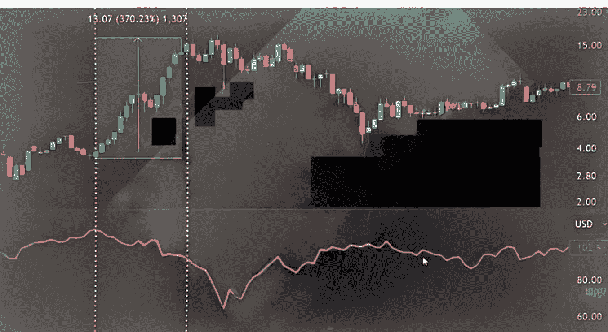

- 尼克松时代 70 年模式：SPX 见顶（红色）后（彩色）涨幅 37%。

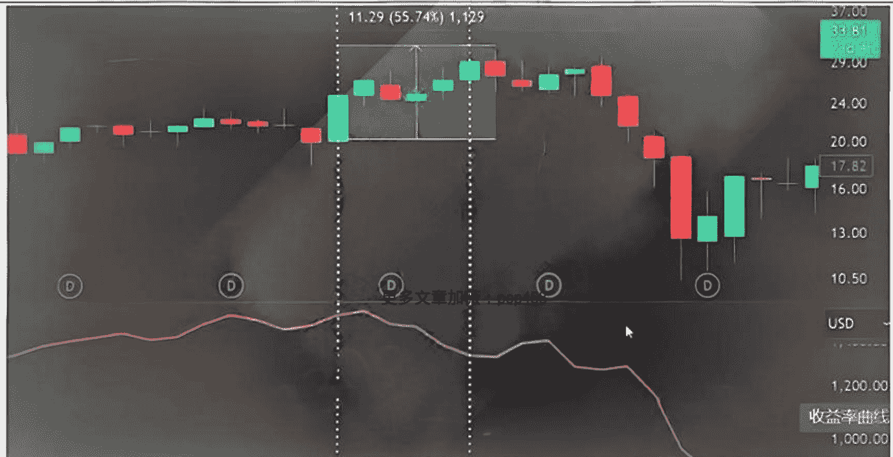

- 小布什时代 08 年模式：SPX 见顶（红色）后（彩色）涨幅 55%。股票方面，由于 2025 年货币超发和泡沫，所以接近 00 年的叠加。总体上看，这期间美股白银是强势的。

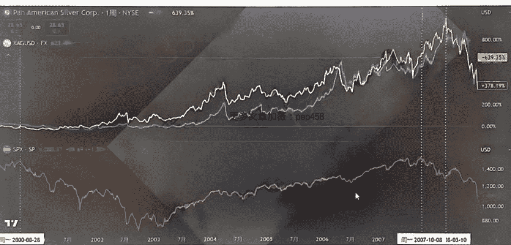

- 黄色银股（PASS）蓝色（XAG）红色（SPX）的较少，且上市时间短，只有 08 年的。

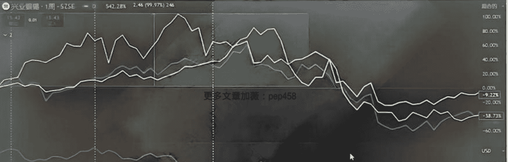

- 71 年 7 月 SPX 第一次见顶开始，经过 07 年 10 月第二见顶，到恐慌下跌，经历了一次 100%涨幅过山车。

- 2024 年 9 月首次降息，释放流动性同时也刺激了白银系，可见，6 月6 日全球白银集体完成了突破。

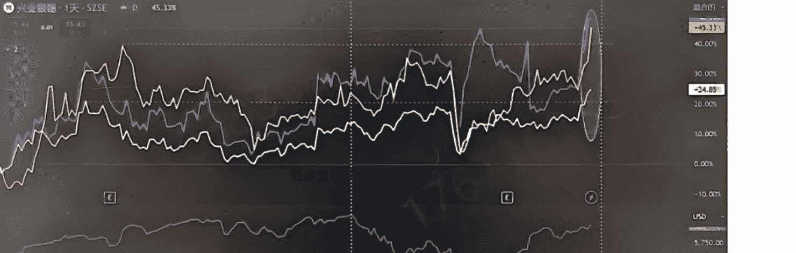

### （一）盛达资源

这种情况历史上第一次出现，不禁联系到最近发表的稳定，实际是可以与白银挂钩的。

1. 业务介绍：
公司主营贵金属、有色金属矿的采选与销售，下属7 家矿业子公司，包括银都矿业、金山矿业、光大矿业、金都矿业、东晨矿业、鸿林矿业和德运矿业。

其中，银都矿业、光大矿业和金都矿业为银铅锌矿山，金山矿业为银金矿山，上述 4 座矿山均为产状态。

另外 3 座矿山处于筹备阶段，其中鸿林矿业已取得《采矿许可证》，生产规模为 39.60 万吨/年，目前正进行矿山建设，预计 2025 年 7-9 月试生产，2026 年实现满产。东晟矿业 25 万吨/年采矿项目已进入基建阶段，力争 2026 年投产。

根据公司披露，今明两年产量预计将显著提升。

| 金属 | 销售量（金属吨） | 产量（金属吨） | 库存量（金属吨） | 同比增减（销量） |
| :--- | :--- | :--- | :--- | :--- |
| 铅 | 12,587.18 | 13,406.36 | 947.97 | -8.47% |
| 锌 | 23,263.99 | 24,367.51 | 1,865.48 | -15.02% |
| 银 | 131.84 | 138.59 | 7.61 | -9.23% |

2. 业绩成长逻辑:
盛达资源的业绩增长主要依赖矿产产量与金属价格。从未来 1-2 年看，这两大因素均有增长潜力。

此外，公司主力矿山金山矿业于 2023 年启动技改，2024 年 8 月完工，预计今年将带来产量提升与成本下降。

综上，若白银、铅、锌价格持续显著上涨，将对业绩形成支撑。

3. 股价分析：
月线图看，2015 年之后股价出现两波高（2020 年 8 月、2023 年 4 月），均受益于白银价格。当前白银价格已突破 2024 年高，上行趋势明显，预计有望试探甚至突破 80% 位置。

### （二）兴业锡

1. 业务介绍：
兴业锡在内蒙古和西藏拥有 7 家有色金属子公司，其中银漫矿业是国内最大的白银生产矿山之一，是公司核心来源；金达矿业、等均为当地企业。

2023 年起，公司通过收购银漫矿业、宇邦矿业、大西洋锡完成轮扩张。公司资源突出，随着在建矿山投产，未来增长显著（截至 2024 年）。

| 矿山名称 | 主要矿种 | 资源量（金属吨） | 现有产能（万吨/年） | 规划产能（万吨/年） |
| :--- | :--- | :--- | :--- | :--- |
| 银漫矿业 | 银、锡、锌 | 805 万、18.6 | 165 | 297 |
| 宇邦矿业 | 银、铅、锌 | 1.8 万、83.8 | 165 | 825 |
| 金达矿业 | 铅、锌、银 | 378 万、10.4 | 30 | - |
| 大西洋锡 | 锡 | 21.3 万 | - | 6000 (2027Q4) |

2. 业绩成长逻辑：
中短期来看，公司与锡、银价格关联性较强。当前锡价趋稳，银价上涨预期明确。

此外，控股股东东兴集团重组进展：2025 年 5 月 19 日，兴业集团与中国信达通过不超过 36.6 亿元信托计划纾困，其中 14.7 亿元用于转让兴业组 C070 号计划（信达 001 号计划）的资产信托权益。

3. 股价图形：
周线图显示，2024 年5月股价创历史新高进入横盘震荡，上周上涨使周线实体首次触及前期影线区间，突破概率提升。

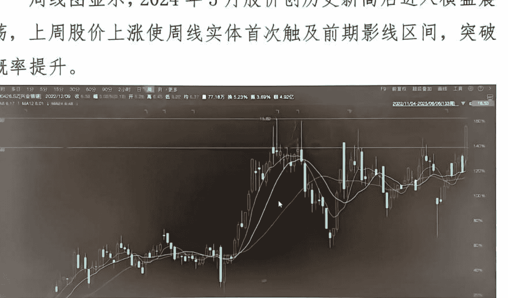

日线图显示，周五高开大涨形成缺口支撑，若缺口不破再次测试前高（14.73 元），股价上涨趋势有望确认。

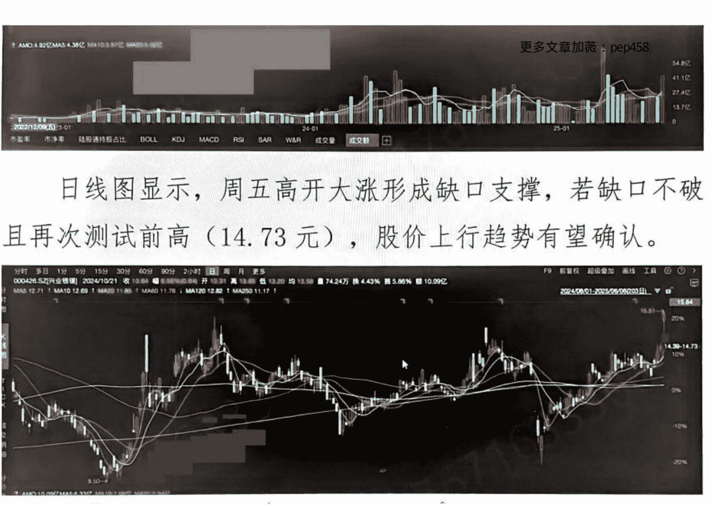

## (三)浩通科技

1. 业务介绍:
公司专注于贵金属回收及相关产品的研发、生产与销售，主要产品包括铂、钯、金、银。

2024 公司今年累计收入 26.6 亿元

| 名称 | 业务收入 | 占比 | 上比 |
| :--- | :--- | :--- | :--- |
| 贸易(行业) | 15.3亿 | 57.62% | 0.53% |
| 贵金属回收(行业) | 11.0亿 | 41.34% | 15.02% |
| 新材料(行业) | 1501万 | 0.56% | 21.59% |
| 其他业务 | | | |

不是完全不可能。如果出现这种情况，“十字路口交易”就会失效。

综上，白银系近日的强势突围值得关注，重点应对对小概率事件发生的手段，是关注VIX，也即，市场是否恐慌；如如果没有恐慌，也即VIX在低位，那么即便出现回踩，也可能是一种机会；而如果市场出现恐慌，即VIX走高，则需要把风险控制放在首位。

## 八、关注策略

回到大概率场景：尼克松于 1971 年宣布黄金与美元脱钩，因此，当时黄金和白银都出现了因为“脱钩”导致持续性暴涨；小布什么是 911 之后的量化宽松累积了货币超发和泡沫，推动了金银的短期上涨，并随股市泡沫破裂而下跌。2025 年美债积累了 2008 和 2020 年两次巨大的量化宽松，同时，货币超发更接近 70 年代，美股 AI 泡沫更接近 00 年互联网泡沫，因此，其特征更可能是一种混合。

基于美股见顶时间的 1&2 场景：无论美股是否新高，通过跟踪恐慌指数 VIX，只要 VIX 在 25 以下，说明市场可控，那么白银遵循规律就会执行“十字路口交易”。

关注白银系列（个股、期货、期权），都必须首先确认最大可承受的损失前提下，选定仓位。先认为“亏损”已发生，然后跟随白银“十字路口交易”：

- 趋势：鉴于近期全球白银系表现出同步的一致突破，后续全球白银系的趋势可能会紧密联动，因此，跟踪白银 XAG 来判断趋势。
- 时长：不确定，以美股下跌引发恐慌为标志，可能 1-2 周几个月。
- 止损：设置一个总仓位损失比例，比如 5% 或者 10% 或者多少，然后反算关注的精力。
- 止盈：VIX 超过 25 后开始陆止盈，或者白银系列上冲 48-49.8 区间继续止盈。

加微信jntsg2，进资料分享群

# 扫码加入 知识星球TOP 免费资源群

公众号:知识星球TOP

免费

- 每日免费获取高价值资源
- 可提供各类资源搜索服务

价值

微信:jntsg8

| 热门付费文章 | 各行各业报告 |
| :--- | :--- |
| 精选图书资源 | 副业赚钱方法 |
| 职场实用资源 | AI政经自媒体 |

及时

微信:jntsg2

关注

分享资料仅供个人学习，请及时删除，切勿商用传播
