# 十字路口

## 一、基本原理

美股是全球最大现金流吸收器，当其出现“顶部”、回调，而后再次接近前高，这种情景下，会触发“十字路口交易”。

- 情景 1：止步前高。两高共同形成“双顶”，因为“双顶”比“单顶”更难再次突破，市场会开始紧张并陷入焦虑，会加大回调力度，形成悲观到恐慌的负反馈，寻求避险。
- 情景 2：突破前高。市场会加大对未来乐观预期，这种情绪下，延续看涨趋势变得更加容易，短期形成从美股新高到美国经济要走强的全面乐观预期。

因此，十字路口交易，需要在情景1下能够反馈反映金融风险加剧、证券资产趋势走弱情况下保值能力；也需要在情景2下能够反映金融改善经济预期的增长能力。

历史上，所有资产中，白银在美股“十字路口”阶段表现出色：情景1的情况下下，黄金会走强，白银也会，虽然可能弱于黄金，但历史上白银保值能力仅次于黄金；情景2的情况下下，因为白银是一种重要工业原料，经济改善预期会形成白银消费的增长预期。

## 二、白银历史走势

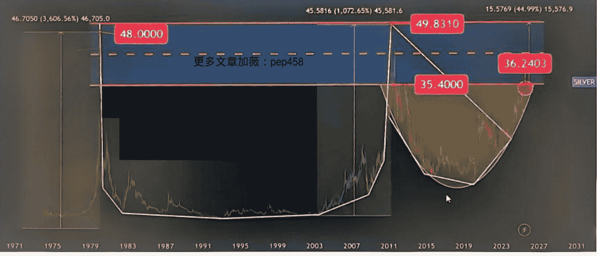

1970 年以来，白银的55 年走势图：

- 1. 布雷森森林体系瓦解，白银 10 年涨了 37 倍；
- 2. 2000 互联网危机和 08 次贷，白银 10 年涨了 10 倍。这两次大规模危机共同构成了 50 多年来白银两个山峰，48-49.8 美元附近；
- 3. 2011-2013 年，白银在 35 附近形成了一个非常密的阻区，2024 年至今白银一直在进攻这个区间，而在本周（6月 6 日）收盘，周线级别强势突破。

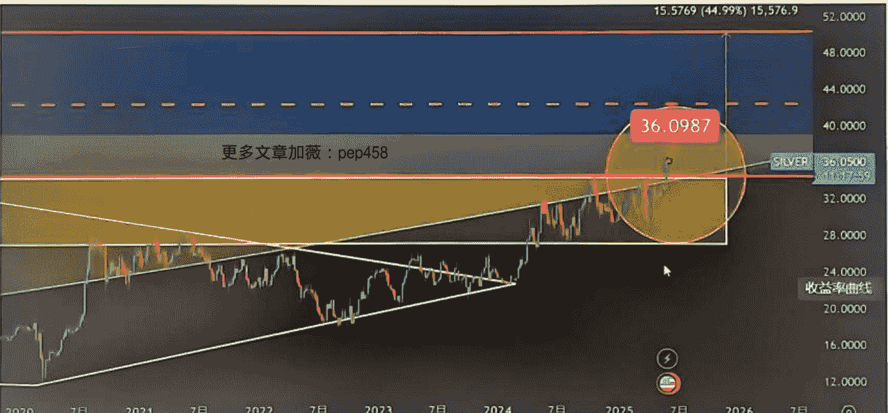

## 三、技术分析

“香奈儿杯柄形态”是一个经典的技术分析理论：第一次新高后，回调再回升，那么，第一次新高就成了阻力；再回升碰到“阻力”大概要回调，然后，第二次才能突破。道理很清晰，实际图形中会在这个基础上演化出很多的变种，不过还是非常有指导意义。

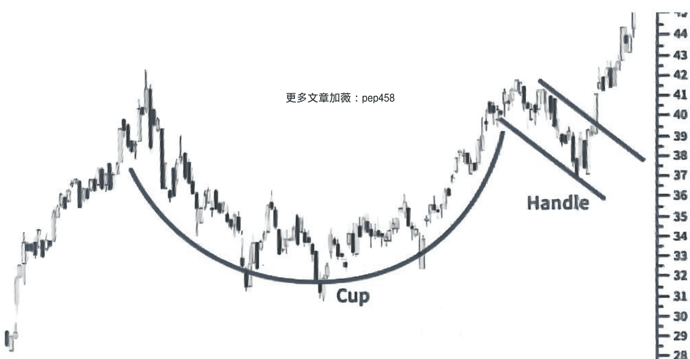

现在回到银 XAG 的 55 年走势：黄色线条勾勒出来的就是一个巨大的“杯柄形态”。因此，本周周线级别的突破，是一个很强烈的看多信号。

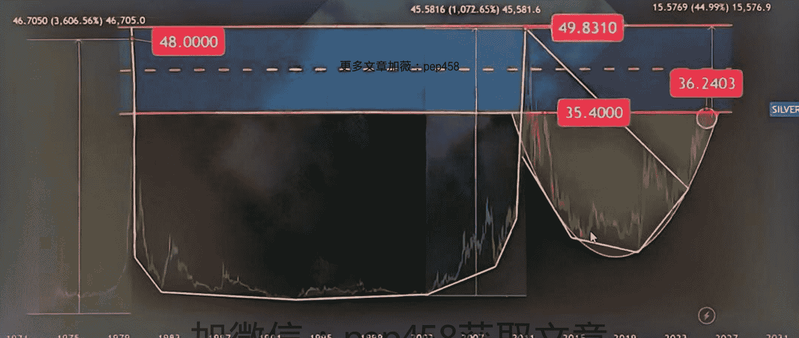

## 四、实证“十字路交易”

政治决定金融，中期选举对 2028 年大选产生重大影响。美国现阶段的内部矛盾集中在明年中期选举，核心在于什么时间爆发危机。对于川普越早爆发危机越好，有利于明年中期选举实现复苏；相反，如果太晚，那么到明年选举日前陷入衰退。

美股是全球最大的流动性吸收器。上周 SPX 站上了 6000，距离前高 6147.43 只有 2.45%，这个位置是否新高，关系到危机爆发的时间，关系到下届大选的定性和定量。

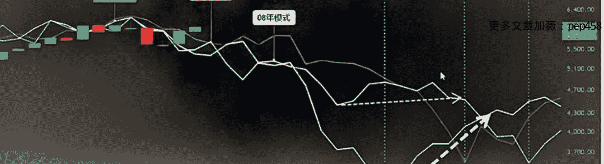

## 五、第三次“十字路交易”

当前美元发发债走弱，尼克松时代和小布什时代的危机是类似的背景，都发生了“十字路交易”。

### （一）前两次“十字路交易”

- 尼克松时代（红色 SPX/彩色 XAG）：对应情景 1。美股一次见顶，白银突破，美股反弹未能创新高，白银继续上涨且加速。直到美股开启恐慌暴跌，白银同步下跌。
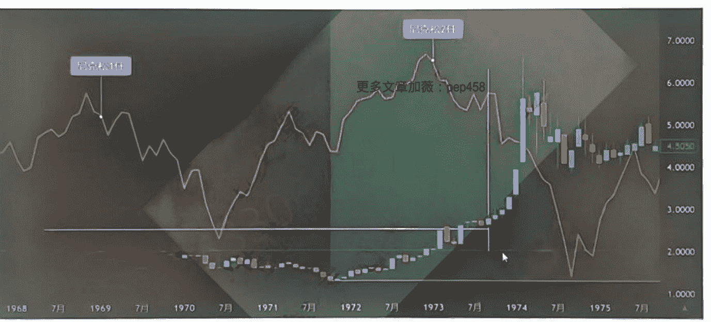

- 小布什时代（红色 SPX/彩色 XAG）：情景 2。美股二次见顶，白银突破，继续上涨，美股二次见顶后下跌，白银加速，待美股下跌发生恐慌，白银同步下跌。
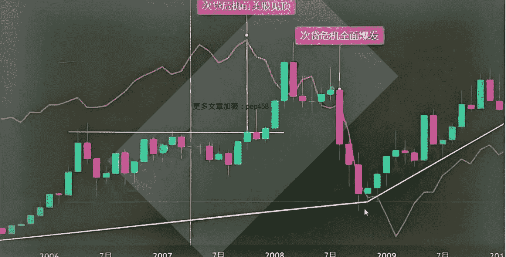

### （二）第三次“十字路口交易”

- 现在（红色 SPX/彩色 XAG）：白银突破与美股 6 月反弹突破 6000 点同时发生。
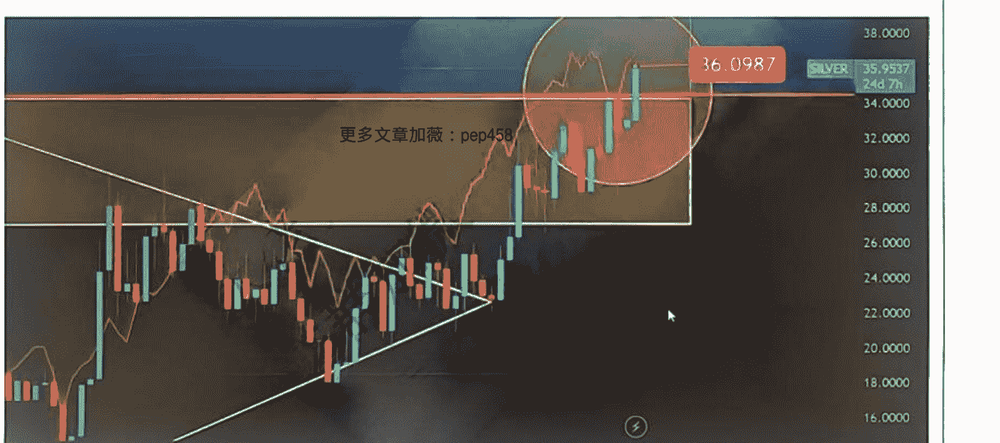

- 银突破与美股的强度：
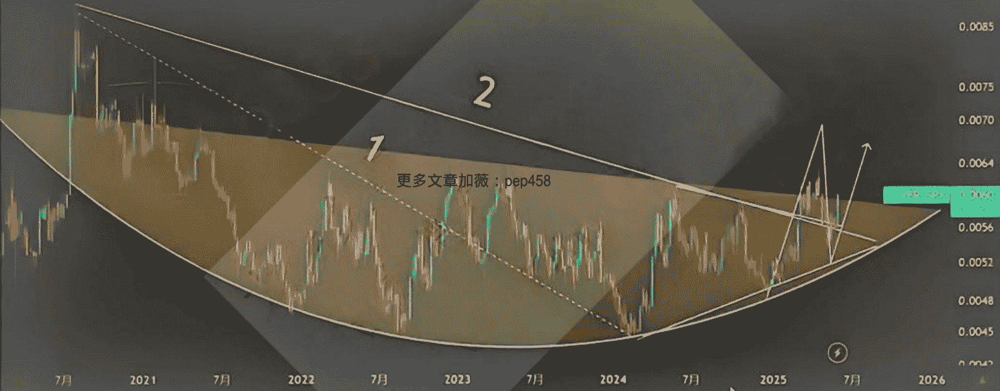

## 六、银矿股

以 XAG/SPX 衡量白银比美股的强度：
① XAG/SPX 新后完成了弧形反转，XAG 比 SPX 逐渐更强；
② 2023 年突破线 1，2025 年突破线 2；
③ 现在完成突破后的第一次回踩确认支撑线。这次突破以后，尽管过程仍然曲折，但下一个强有力的压制线前两次的高点，即 48-49.8 美元。

作为银矿股参考：
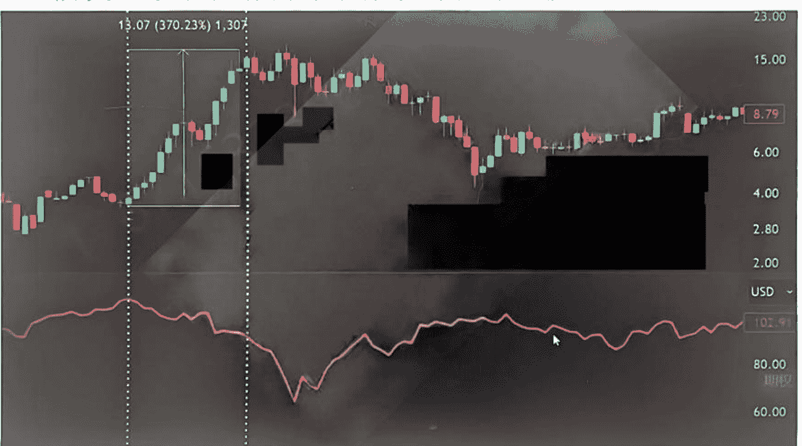

- 尼克松时代 70 年模式：SPX 见顶（红色），ASA（彩色）涨幅 37%。
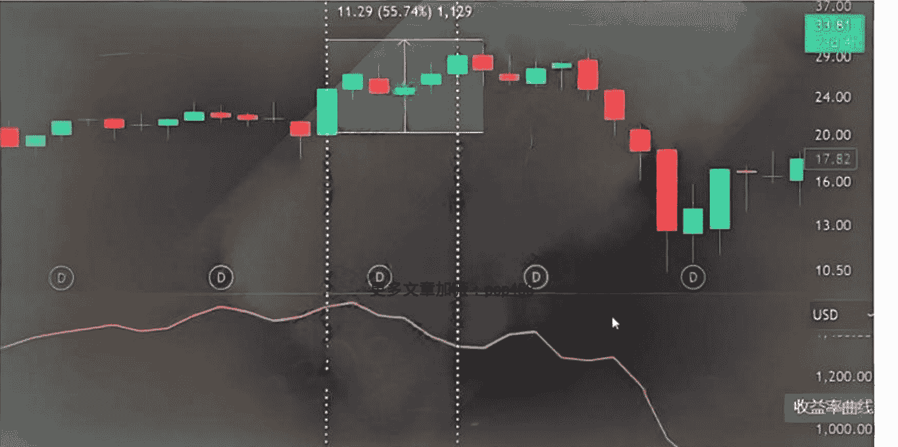

- 小布什时代 08 年模式：SPX 见顶（红色），ASA（彩色）涨幅 55%。方面，由于 2025 年货币超发和泡沫，所以接近 00 年的叠加。总体上看，此期间白银股是美股要强势的。
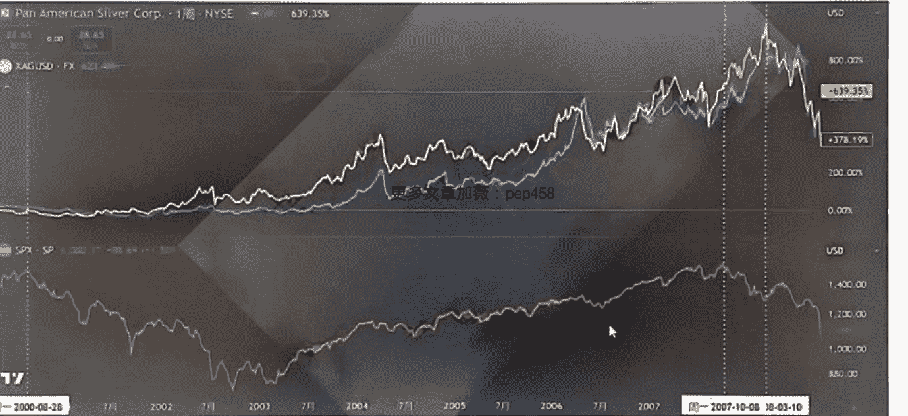

- 银矿标较少，且上市时间短，分析的几乎只有 2008 的兴业锡。
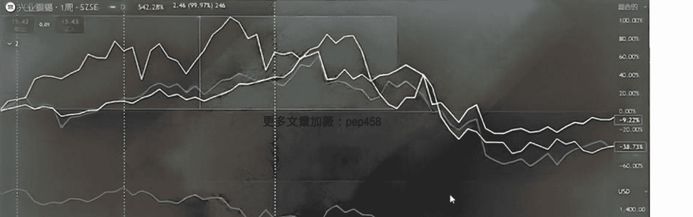

- 2007 年 7 月 SPX 第一次见顶开始，经过 2007 年 10 月见顶，到恐慌下跌前，兴业锡经历了一次 100% 的涨幅过山车。

- 2024 年 9 月首次降息，释放流动性支撑美股同时也刺激了白银，可见白银整体完成了突破。
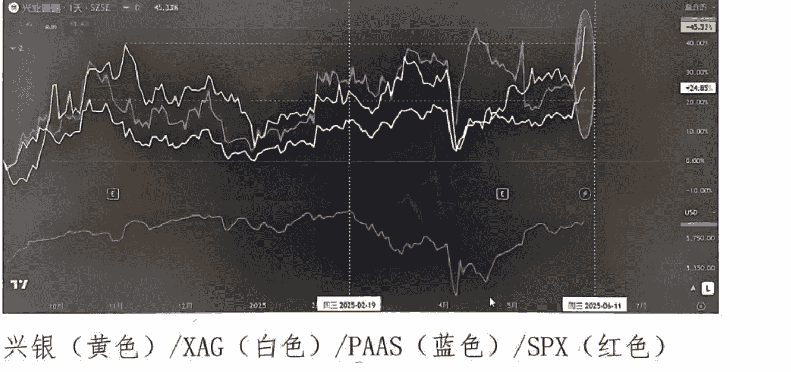

这种情况历史上是第一次出现，不禁让人联系到最近发表的稳定币，实际可以用与白银挂钩。

### （一）盛达资源

1. 业务介绍：公司主营贵金属、有色金属矿的采选与销售，下属 7 家矿业子公司，包括银都矿业、金山矿业、光大矿业、金都矿业、东晨矿业、鸿林矿业和德运矿业。

其中，银都矿业、光大矿业和金都矿业为银铅锌矿山，金山矿业为银金矿山，上述 4 座矿山均为在产状态。另外 3 座矿山正处于筹备阶段，其中鸿林矿业已取得《采矿许可证》，生产规模为 39.60 万吨/年，目前正在进行矿山建设，预计 2025 年 7-9 月试生产，2026 年实现满产。东晟矿业 25 万吨/年采矿项目已进入基建阶段，力争 2026 年投产。根据公司披露，今明两年产量将有显著提升。

从业务结构看，根据过往年报数据测算，白银收入占比约 60%，锌、铅收入合计占比 30%-35%，黄金收入占比约 5%。数据摘要（2024年）：

| 金属 | 销售量(金属吨) | 产量(金属吨) | 库存量(金属吨) | 同比增减(销量) |
|---|---|---|---|---|
| 铅 | 12587.18 | 13406.36 | 947.97 | -8.47% |
| 锌 | 23263.99 | 24367.51 | 1865.48 | -15.02% |
| 银 | 131.84 | 138.59 | 7.61 | -9.23% |

2. 业绩成长：盛达资源的业绩增长依赖矿产与金属价格。从未来 2 年看，这两个因素均有潜力。此外，公司主力矿山 2023 年启动，2024 年完工，预计今年带来产量提升。若白银、铅、锌价格持续上涨，对行业形成积极支撑。

3. 股价图形分析：从月线看，2015 年之后出现两波高（2020 年 8 月、2023 年 4 月），直接受益于白银上涨。当前白银价格已突破 2012 年高点，预计有望试探下行并挑战 80% 位置。

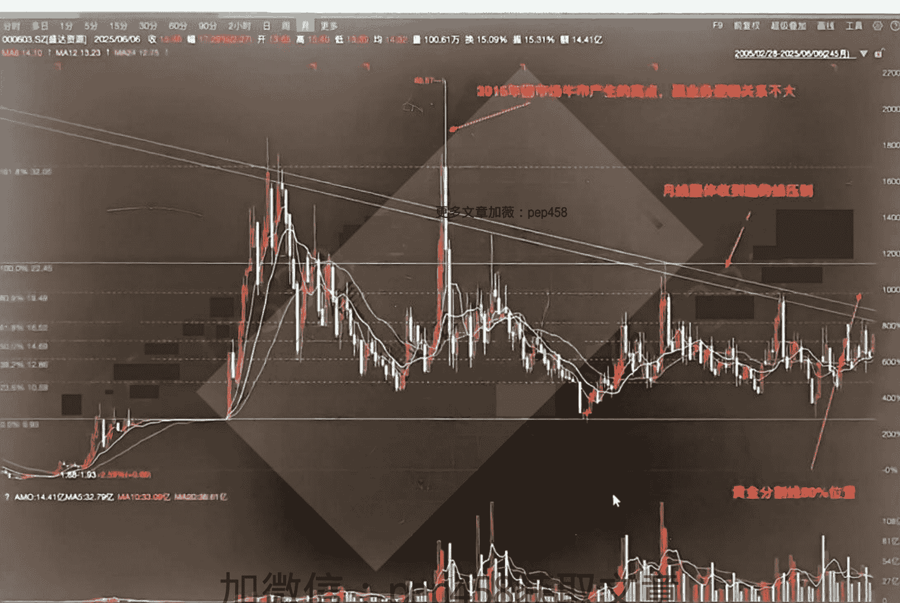

### （二）兴业锡

1. 业务介绍：兴业锡在内蒙古和西藏拥有 1 家色金属子公司，其中银漫矿业（银、锡）为国内最大白银生产矿山之一，是公司核心盈利来源；乾金达矿业、融冠矿业均为龙头企业。2023 年起，公司通过收购盛达矿业、宇邦矿业、拟收购大西洋锡，完成一轮资源扩张。

公司资源禀突出，随着在建矿山投产，未来产量空间显著。核心矿山资源与产能（截至 2024 年）：

| 矿山名称 | 主要矿种 | 资源量（金属吨） | 现有产能（万吨/年） | 规划产能（万吨/年） |
|---|---|---|---|---|
| 银漫矿业 | 银、锡、锌、铅 | 8058吨、18.6 万吨 | 165 | 297 |
| 宇邦矿业 | 银、铅、锌 | 1.8 万吨、83.8 万吨 | 165 | 825 |
| 乾金达矿业 | 铅、锌、银 | 378吨、10.4 万吨 | 30 | — |
| 大西洋锡业(拟收购) | 锡 | 21.3 万吨 | — | 规划 6000吨 (2027Q4) |

从营收结构看，2024 年锡、银、锌为主要贡献品种，分别占营收的 35.9%、26.9%、19.2%，占毛利的 43.9%、26.6%、14.8%。

2. 业绩成长逻辑：中短期来看，公司业绩与锡、银价格关联性较强。当前锡价趋稳，银价上涨预期明确。此外，控股股东东兴集团资产重组取得进展：2025 年 5 月 19 日，兴业集团与中国信达拟通过不超过 36.6 亿元信托计划实施纾困，其中 14.7 亿元用于受让兴业集团 C 070 股（信托号 19 001）全部股权。

3. 股价图形分析：周线图显示，2024 年 5 月股价创历史新高进入横盘震荡，上周股价上涨使周线实体首次触及前期影线区间，突破概率提升。

| 日期 | 5日 | 1日 | 5分 | 15分 | 30分 | 60分 | 90分 | 2小时 |
|---|---|---|---|---|---|---|---|

风险提示：公司市值仅约 40 亿元，且机构持股比例极低（不足 5%），股价波动弹性较大，需注意交易风险。

| ... | 浩通科技 | 盛达资源 | 兴业银锡 |
| --- | --- | --- | --- |
| 北向资金 | -- | 3.63% | 1.44% |
| 公募基金 | 0.00% | 5.11% | 2.98% |
| 券商 | 0.00% | 0.00% | 2.58% |
| QFII | 0.00% | 0.00% | 0.00% |
| 社保 | 0.00% | 0.00% | 0.00% |

加微信：pep458获取文章

## 七、风险提示

从基本原理，到白银自身的历史走势和技术分析，到两次突破的案例，到近期美股挑战前高与白银在统一时间（6月6日当周）开展历史性突破的事实，使本次白银的突破并形成短期趋势成为大概率事件。

有大概率就有小概率，不存在100%的确定性。比如美股跳过情景1或情景2，既未见顶震荡下跌，也不新高，而是突然山崩直接进入危机模式，比如新冠危机爆发期间，也不是完全不可能的。如果出现这种情况，“十字路口交易”就会失效。

综上，白银系近日的强势突破值值得关注，重点应对小概率事件发生的手段，是关注VIX，也即，市场是否恐慌；如果没有恐慌，也即VIX在低位，那么，即便出现回踩，也可能是一种机会；而如果市场出现恐慌，即VIX走高，则需要要把风险控制放在首位。

加微信：pep458获取文章

## 八、关注策略

回到大概率场景：尼克松于 1971 年宣布黄金与美元脱钩，因此，当时黄金和白银都出现了因为“脱钩”导致持续性暴涨；小布什是在 911 之后的量化宽松累积导致了货币超发和泡沫，推动了金银的短期上涨，并随股市泡沫破而下跌。2025 年美债积累了 2008 年和 2020 年两次巨大的量化宽松，同时，货币超发更接近 70 年代，美股 AI 泡沫更接近 00 年互联网泡沫，因此，其特征更可能是一种混合。

基于美股见顶时间的1&2场景：无论美股是否新高，通过追踪恐慌指数VIX，只要VIX在25以下，说明市场可控，那么白银遵循规律就会执行“十字路口交易”。

关注白银系列（个股、期货、期权），都必须首先在确定最大可承受的亏损前提，选定仓位。先认为“亏损”已发生，然后跟随白银“十字路口交易”：

- 趋势：鉴于近期全球白银系列表现出同步的一致突破，后续全球白银系的趋势可能会紧密联动，因此，追踪白银XAG来判断趋势。
- 时长：不确定，以美股下跌引发恐慌为标志，可能 1-2 周到几个月。
- 止损：设定一个总仓位损失比例，比如 5%或者 10%或者多少，然后反算关注的精力。
- 止盈：VIX 超过 25 后开始陆止盈，或者白银系列上冲 48-49.8 区间陆止盈。

加微信：pep458获取文章

信息精选群(原价499，限 年费365)包括以下全部内容送历史群:

加微信 pep458 信息精选VIP简介 备用微信qihaogongyuan8

- ① 吃瓜群众精谈实时图文实时聊天对话(原价365元/年)
- ② 子明私享(会)内部文章(原价 568元/年)
- ③ 政事堂(圈子明)付费内容再读圈子明群
- ④ 米储见见【作者米筐](原价 599元/年)
- ⑤ 欧洲金雀会员专属文章(原价 328元/年)
- ⑥ 砖瓦内部圈文(原价 400元/年)
- ⑦ 卢克文青读书会专属文章(原价 699元/年)
- ⑧ 鉴财经知识星球(原价 3310 元/年)
- ⑨ 哥的视界知识星球(原价 299元/年)
- ⑩ 财新周刊【独家新闻】原价 1498元/年)
- ⑪ 杨世光在金钱迷爆(原价 2200 元/年)
- ⑫ 森淼财经知识星球(原价 1600元/年)
- ⑬ 藻泽译许付费文集(持续更新)
- ⑭ 司马林柯逸选全音和书籍珍藏版不删减(原价 2.3 万)
- ⑮ 虚芦三部曲[国梦、帝国语、不被理解的MAO](原价 599 元)
- � 克知识星球(原价 268元/年)
- ⑱ 额外再读：卢胜元新微博付费专栏、村西老王、三花九树文集;不定内容：——更多资源写不下去了......

- 守奴司令知识星球、接欢魔王知识星球、生财术知识星球、- 创始人笔记、波天演论知识星球、成付财富圈、雪花甲老头等
- A 视野、大树语义、江友星球、咕咕浅、上海海学家等付费文集- 西风付费文章、老藏、在八小时之外、局外人的视野、升值、老体制内等等大V付费文集(每月不超过2000元的付费文集)

信息精选群，原价499元，现在仅365元，包含以上所有内容。

加微信：pep458获取文章

