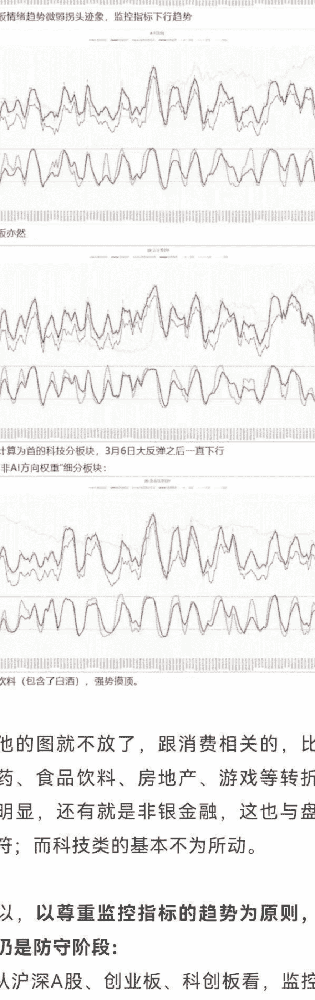
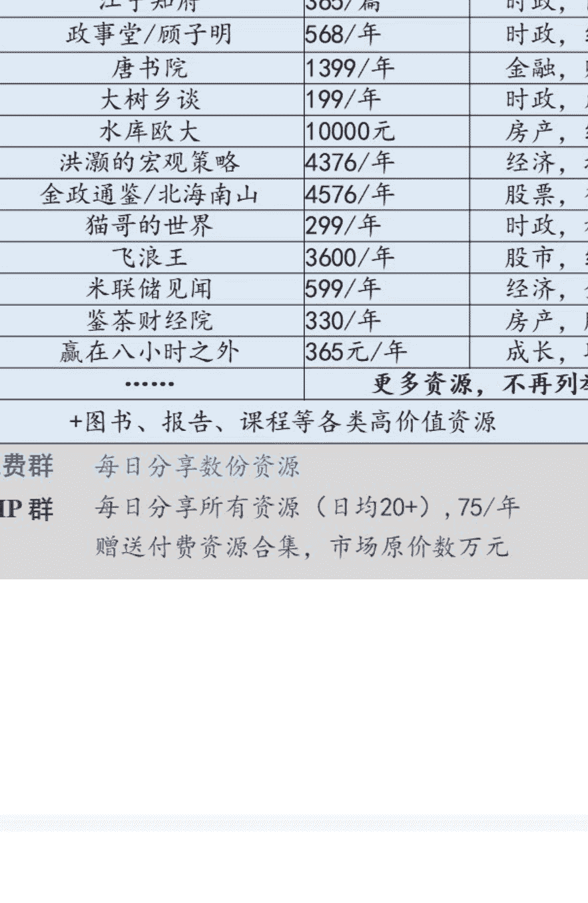

# 基金指数A—GIX——利用指数而不是成就的结局

【连载】基金指数具有指数的特性，利用而不是成就的结局 | 作者：

2025年05月23日 12:00 广东 财经频道

## 前言：基金指数具有指数的特性，利用而不是成就的结局

基金指数具有指数的特性，但是很多投资者却忽略了这一点。

很多投资者并不理解指数的优势，我们希望通过更深入的分析，让大家对指数有更深入的理解，从而进一步提升并让大家学会“利用指数”的策略：

- 1) 本系列基金组合组成，以跟踪指数为基础
- 2) 我们将根据指数的表现不断调整我们的跟踪指数和权重。
- 3) 本系列基金主要聚焦在“趋势指数”，涉及趋势的判断具有时效性，但最适合指数的特点：
- 4) 这样可以有效规避波动风险，市场行情等情况下可以构建：
- 5) 本系列基金组合费用为666元/月，每月更新。

# 基金指数A—GIX——利用指数而不是成就的结局

聚焦，基金市场每日早报01371-001 首次利用指数接入的策略

发布时间：2025年05月23日

图中与趋势的交叉处，可以看到，“趋势指数”、“趋势领先指数”、“趋势指数”在交叉处向上发散。当市场发生上涨时，可以参考“趋势向上”为买入，“均线为市场价格趋势。

从图中与趋势的交叉处，可以看到，“趋势指数”、“趋势领先指数”、“趋势指数”在交叉处向下发散。当市场发生下跌时，可以参考“趋势向下”为卖出信号。

此时要注意“趋势领先”、“趋势领先向上”、“趋势领先向下”为卖出信号，可视为风险提示：

