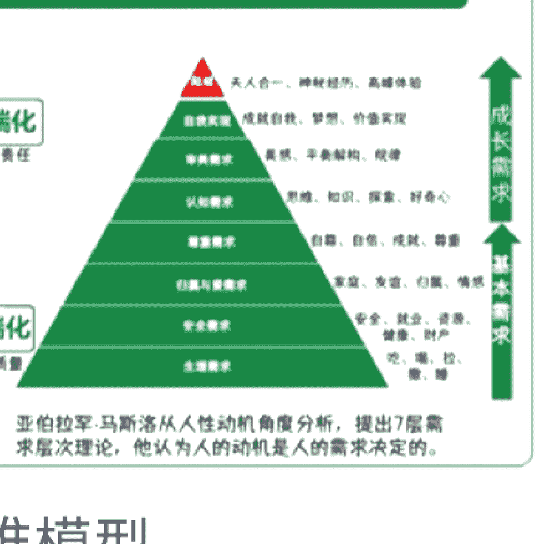

# 金字塔的最高是什么？

self-actualization自我实现需求，那到底啥才叫我自我实现？一个解释：人人都人。

所以大佬为什么敬业？不是敬业的才是大佬。而是大佬必然敬业。因为作为人类，你的底层编码就离不开这个顶层级的。

话说香港和东南亚的富豪人都非常敬业，李嘉诚90岁了还天天工作10小时以上。然后有个英国记者认真调查，李嘉诚还会叫什么工作啊？

早起来吃燕粥吃花洒。然后去公司看报，开会，骂人，吹水，享受被人拍马屁。中午去食堂吃大餐。中午午休，来个按摩师候着。下午就打高尔夫。晚上还要接待官僚和商业伙伴。这叫什么上班？这简直就是度假。

什么哈佛街一天睡4小时，什么每天工作16小时，都敬业之类的狗。大佬最值得学习的地方，从来不是什么敬业，工作狂。而是聪明，或者合理规划规则的智慧，这个才是接受教育的价值。

# 马斯洛需求层次理论

# 思维模型

Thetis，创剑1，凯，刘柯延，美好的出行

# 免费 价值 及时 专注

# 扫码加入 知识星球TOP 免费资源群

- 每日获取价值资源
- 可各类资源搜索服务

| 热门付费文章 | 各行各业报告 |
| 精选图书资源 | 副业挣钱方法 |
| 职场实用资源 | AI经营自媒体 |

公众号：知识星球TOP 信号：jntsg8 微信信号：jntsg2

分享资料仅供个人学习，请及时删除，切勿商用传播
