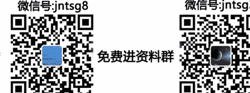
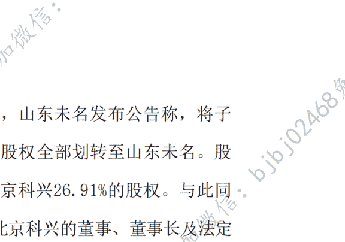
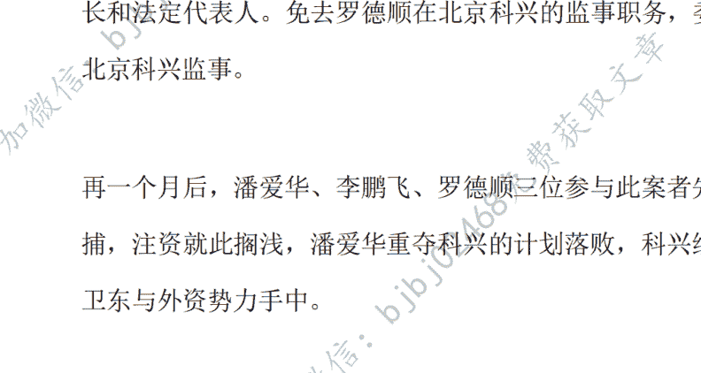
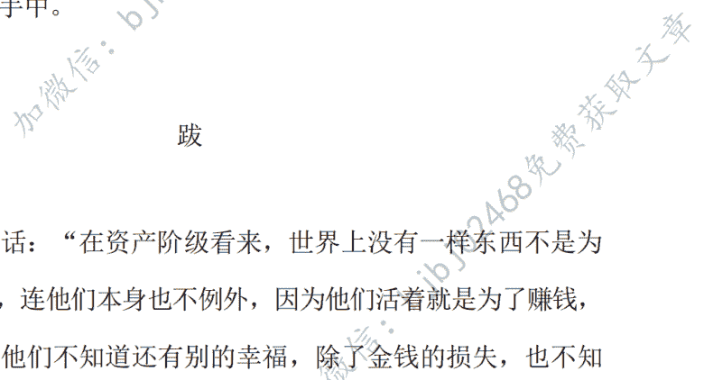

## 科兴背信：
文/欧洲金鞋

流感肆虐，接种疫苗的声音又起来了。

今年秋天，因为一次股权交易，年届65岁的山东未名生物医药股份有限公司，就是著名的科兴生物的母公司，其“实际控制人”潘爱被指涉嫌职务犯罪。

潘爱被指涉嫌职务犯罪
此引发广泛关注的刑事诉讼持续了八天，连续开庭，至今年9月28日在山东东赢结束庭审，仍未宣判。

今年年初以来，竞争犀烈的医疗资源附属列位出现，很多人觉得重由于突然，寻靠在哪里？

正是去年的三个个人：首都科医大学北京朝阳医院的魏奕华、中南大学湘二医院的刘辉峰。

卫生部的于鲁明，其中于鲁明是十八后落马的部级及以上中部首个民主党盟党员，这事一直直接靠卖出一家疫苗巨头，不是别人，恰恰是科兴。

这非科兴第一次出现落马官员，十年前的国家药监局药品注册生物制品处处长尹红章，因为其受了科兴的行赂（在法庭上公开承认而被查，自然一次曝光也是源于科内部的内斗，后文会述）。

2010年12月至2011年6月间，科兴生物旗下的肠炎病毒疫苗注射剂、大流感流行病毒溶解注射剂、风疹减毒疫苗注射剂，全部审核通过，并获批准注册生产，用于国家储备或进行临床试验。在申报报告上签综合评审意见的，正为吴红章。

而采购名单里除了科兴的厉卫东（此人后文会介绍），还有康泰生物董事长曹世民、天元生物董事长晓航、辽成大生物总经理庄久荣。

当采购曝光后，厉卫东只是辞了北京市政协常委，并未接到任何处置。

去年的曹鲁明是最新一例与科兴相关的落马官员，令人震惊的是，案发后仅仅一天，科兴属众目睽睽之下发生了天空污染一案负责被拆的曹晓斌不仅不是科兴负责政府部门的“旋转人”，而且从师从年前曾去莉的吴尊友，主动态清清政策。

而动态清清政策在很长一段时间内均与基础核酸扫描、疫苗大面积积配套......

于鲁明是被“猪队友”魏永祥“拖累”的，前者一直一直是后者的靠山。

魏永祥在担任儿研所所长之前，一直在安贞医院院长所长，任职长达8年，期间多次被医院职工实名举报，还曾被“双规”过。但是魏永祥还是当了首都儿科研究所所长，且职务级别从正处级提拔到副副局级。

此人能安然无恙，皆因后台于鲁明的获得保护。

2012年，于鲁明在北京市医院管理局局长，三年后升为北京市医院管理局局长——这一正也是魏永祥担任安贞医院院长的时期。

魏永祥去三个月后被查，于鲁明暗示自己是不可能的越过这一坎，毕竟虽是京城，天子脚下，万众瞩目，何况还是五年一次的大会召开之际。

其实按道理，于鲁明也是有靠山的，且这个靠山靠硬得不行，他正是这个靠山主政京城时在京城的医疗系统内稳步升高——2018年1月北京市政协副主席，同年11月兼北京市医保局长，两年后兼北京京健委主任。

关键的是，他扛起重担，帮助了这靠山圆满完成了北京冬奥会“零感染办”这一年最重要的国家活动，让领袖和人民十分满意，让靠山在领袖面前挺涨了脸，同时也让领袖在老人面前挺涨了脸，赢成了2020年1月京会的成功。

这位靠山凭借此功，也完成了自己确定多年后有资格进入情人圆圈的最后一块拼图。

要看到，这位靠山对于京城的治安稳定特别是抗疫时期的工作是重视的，2017年甚至搞过“聚散人口”等令人目目舌舌之策，值得一提的是，当时京城帮子里只有一人提出明确反对，就是现在的沪一方面，不过他也没有怕敢用……2020年5月新发现出现疫情时，他第一时间将丰台区三名官员免职；2020年底对本地疫情“问责处理”，称扬维护稳京。

所以对抗疫有功、保障冬奥有功的老部下于鲁明，这位靠山体恤之情极其，虽有不得不又想杀他（否则会影响自己半年后进入七情人圆桌，实在在没法保），但是给予了保护手段：没有让留靠山牵勒出的科兴这条线一步“爆雷”，

科兴的曹晓斌被灭口，于鲁明和科兴其实都安全的。

于鲁明被判十一年有徒刑，如果表现得好，最六明年就能而通报全是经济罪，没有一项是政治罪，这等于是公开说明：“此大站队伍正确，他们不过手脚不干净而已。

这就是政治。

> 《人民的义》里陈海的故事几乎每年初至每个月都会发生。

| 标题 | 50.87 |
| --- | --- |
| 【北京日报】2022-04-20 08:30 上海记者|webo.com |
| 【北京日报】曹晓斌被死罪检察#于月16日下发通知#北京市卫健委网站发布消息，北京市卫健委副主席申彦庆涉严重违法纪，近日被接受中央纪委国家监委委员会的督查和监视。 |
| 高兴生物有限公司在2022年4月20日宣布，近日关于科兴生物去的传言在通报中澄清，科兴生物有限公司的政府主席申彦庆涉心血管和国际医药集团违法行为无实。在2022年3月27日宣布，科兴方面对有关未经证实的、曹晓斌涉事违法等传言进行了澄清消谣回应。(中经财经客户端)北京科兴生物一高去？科兴公司回应：莫回应传言图片|

说明回科兴的疫苗。

去年5月27日，中国疾控中心就开始对“接种新冠疫苗后患上白血病”的社会现象进行回应，在会上中国疾控免疫规划首席专家王华庆介绍：“接种疫苗后出现一些症状和疾病，其和疫苗接种是否有关，相关的判断需要遵守规范流程，要有依据。如果怀疑，要报告给接种单位由多个领域专家，收集相关资料。”提到中国疾控中心，2020年3月10日，美众议院就新冠肺炎疫情的问题举行听证会，美疾控中心主任罗伯特·雷德尔（Robert Redfield）及其卫生官员出席了会议。在会上，雷德尔说了这句话：“美国疾控中心已经与中国三十年的合作关系，并且中国疾控中心还拥有一个小团队。疫苗副作用已经不是第一天了，但其副作用往往过去，且从2019年下半年开始在基层方面层层加码、强制推行疫苗接种，舆论发酵太大。”

最近两年，以科研为主的疫苗出现了白血病、重型再生性贫血、胶质瘤、红斑狼疮、血小板减少紫瘀、寡疹等严重不良反应甚至死亡的极端案例，引起重视。备注：打了三针疫苗的女孩查了三甲腺。后来来找我南山站出来，她说疫苗没有起作用，副作用太大了。理解提供者的痛苦吗？她说没有起作用。作为疫苗监测体系的一部分，中国的预防不良反应监测（简称AEFI）已经建立了十余年，且2018年后北京大学社会发展与公共政策学院博士向东指出：“中国的AEFI系统还有很大的空间，包括系统的灵活性、数据公布的及时性、分析效率等方面。”

从现实情况来看，中国新冠肺炎不良反应数据充足。2021年5月28日，中国疾控中心发布了2020年12月15日至2021年4月30日的安全性数据，是目前唯一的一次阶段性公布。此后官方再也没有发布新冠疫苗不良反应的最新数据，并且公众没有任何公开入口可以查询。截止去年年底，新冠疫苗在中国已经接种超过三亿剂，而全国范围内新冠疫苗不良反应的情况无知。真的是可以对比一下：美国的疫苗不良检测系统（简称VAERS）根据报告更新——2021年4月报道了六例病例年龄18-48岁的女性在接种病毒载体疫苗两周内发生了一种极其罕见的血栓，一例死亡。2021年6月，FDA决定对辉瑞和Moderna mRNA疫苗说明书进行修订，向民众警告：接种两种新冠疫苗将增加心肌炎和心包炎（心脏炎症）的发生风险。

去年4月，国家药监局正式批准奥密克变异株研制新冠疫苗进入临床研究，用评估新冠变异株人群中的安全性和免疫原性。去年2月底，继续向大陆以外多个国家提交奥密克变异株活疫苗申请，巧的是，香港特区获得。去年4月14日，香港卫生署发布报告：2021年2月26日至2022年3月31日，全市接种了千万剂新冠疫苗，期间报告异常事件八十九宗，其中死亡三十2021年12月，新加坡传染病中心与卫生部披露，接种两针科兴疫苗对德尔塔毒株的有效保护率为60%，需额外接种第三针才能完成基础接种程序。这里既透露了商业味，也体现了科学的“靠谱”。

去年12月抗疫落幕，作为北京生物开发的“明星级新冠肺炎活疫苗”，CoronaVac（科兴）已在六十多个国家和地区获得紧急使用授权或有条件批准，超过二十亿新冠病毒被运往等地，为北京生物打造了一份华丽的财务报表。2021年，智丰生物净利润率33.3%，康泰生物净利润率34.59%。康诺净利润率44.35%——而生物充足独秀，净利润高达74.63%。

高利润、华丽业绩之，其实也是科研投入比较低的现实：2021年，对比国际新冠疫苗企业的研发投入占营收比例可以发现，智丰生物（代理的默沙宁4/9价HPV疫苗贡献了其全部收益80%）为2.66%，康康诺（销售产品以新冠疫苗为主）为21.05%，康泰生物、沃森生物分别为20.22%、21.77%——而科兴生物只有0.8%。

而且，这就研发投入不全部是新冠疫苗，是sIPV（Sabin株脊髓灰炎活疫苗）和COVID-19新冠等疫苗的总。不是科兴还制造疫苗的科兴中维，其下的科兴制药也充满浓味的“去制造化”的味道，2021年其销售费用高达7.56亿元，较上一年度增长15.26%，占营业收入比例进一步提升至58.79%；其中市场推广费用为33亿元，占营业收入49.26%。相比，科兴制药销售费用占营业收入的比例处于较高水平，可能滥用财政支付量财富流向了哪里？不幸的是，第一股东是日本软银，占15.07%；第二大股东是科兴生物创始人兼CEO尹卫东，占XX；第三大股东是吴海涛等六位创始人，占XX；第四和第五股东分别为永恩国际和境外资本，占XX%。

造成这个现象不是一蹴而就的，其实包含着关于“私有化”的历史，一切源于2003年科兴赴美上市。1999年在安妥巴布达注册，总部设在北京，经研完成第一支SARS病毒疫苗临床研究，登陆纳斯达克斯，也是目前唯一一家在美国上市。在科兴内部，有两个“司令部”，一个是北京大学集团代表的“国资系”，主张国有控股；另一个是尹卫东代表的“国际资系”，主张境外资本。两派人为了争夺科兴控制权，互撕多年，过程曲折像一部电视剧，斗争一直是国内界为人津道。两人合作于2001年，北方大学从下属子公司出资1000万成立专攻生产，其后邀请唐山怡安加盟。唐山怡安是一家小公司，用研制的技术作为股，加上尹卫东拉来的新加坡资本2500万，三方的股权成了25%，北京大学集团处于控股地位。2002年，科兴生物的甲肝炎疫苗正式投入市场。2003年，为了推进科兴赴美融资，股权大规模重组——根据纳斯达克的规定，由于科兴第一大股东北京大学集团（中国国资不符合美方上市标准，只能改组。正是这一改组让尹卫东及其背后的境外势力找到了私有的机会。当时尹卫东在北京名下成立了一家科兴控股，通过香港控股间接控制上市公司。股权改造后北大集团放弃控股，科兴本身并非上市主体，改造后股权结构变成了尹卫东73%，潘爱华26%。为了补偿潘爱华，尹卫东承诺北大集团为实际控制人，潘爱华在董事会有一票否决权；另外在董事会五个席位中，北大提名两人。让人意外的是，香港此后又存在该协定，潘爱华本人拿不出实质的合同，曾有一份《备忘录》，但备忘录不具备法律效应。君子协定破毁，“君子协定”双方陷入长期的拉锯战，香港凭借大股东身份中占据了四个名，潘爱华一人。于是香港利用董事会多数优势，由尹卫东担任总经理负责运营，董事长潘爱华直接被架空，成了“吉祥物”一般的虚位人物。之下，潘爱华放大，十年向前十多个部门举报，引发了原国家药品局注册生物制品处长尹红章等官员。根据尹红章的裁判书显示，1995年后，北京科兴总经理尹卫东已认识尹红章。2002年，尹红章当上国家药品局注册生物制品处长后，科兴先申报肝炎疫苗、SARS疫苗、流感疫苗等项目，均过关。尹红章共收尹卫东转款二十万元。2011年夏天，尹红章看怀柔的一套小产权房，需要支付三十万元尾款，于是向尹卫东提出“借钱”。尹卫东心领神会，让妻子出门找到许红章的老婆郭卓，还送钱三十万元，并订了“借款协议”，名为借钱，实则是要钱……到去年，科中持发布的报告中，都出现了“中外股东之间存在不可调和的矛盾和利益冲突”的字眼。香港科羚，作为在美国上市的公司，47%的股权归美国所有，22.5%归赛基金，归1 Globe，尹卫东本人占0.61%。而赛基金的背后，是日本软银和美国思科；1 Globe的背后则是美国国强新领先集团（与开篇的潘爱华职务侵案有关），后文将述。注册地位于加纳比尔的安延岛的科兴，各大股东，除了创始人尹卫东持股11.07以外，其余早已全部是外资，是一家毫无争议的外资企业。股东名单中有一个提到的维维资本，这家投资机构仍有影子，其总部位于美国加利福尼亚，创始人为美籍华人孔健建和美犹太人Edgar Engleman。这就很好地理解了什么科学和比尔盖茨产生接触。推荐阅读：你需要了解的比尔·盖茨（需要阅读微信：jinxue2025通过私信）

# 加微信jntsg2，免费进资资源群

外资项目备案通知书：
重庆大亚发（第1182020号）
附件材料：n

| 西 | | 程 | |
|---|---|---|---|
| 中林医药 | | 后期 | |
| 面肯梅 | 回 | 计划在1 |
| | | arid | It |
| 配 | | 3内产型 | |
| 证为 | | m6bh | 回 |

今年8月29日，科兴控股生物有限公司（下称“科兴控股”）宣布旗下北京科兴生物制品有限公司（下称“北京科兴”）已经完成经营营业执照变更，变更后的北京科兴法定代表人为尹卫东。

由此，也引出了目前沸的潘爱华“职务侵占”案。

正是因为失去了北京科兴的控制权，所以才开始扭曲大脑。

去年5月，潘爱华为未名医药的厦门有限公司引入新资方“杭州强新”——就是美国强新投资集团的在华机构。

增资后，厦门未名注册资本由1.31亿元增加到1.99亿元，杭州强新持有厦门未名34%的股权，以货币形式出资，在2047年5月15日前缴足。这份决议的股东签字页盖有母公司未名医药公司。

# 加微信jntsg2，免费获取资源

然而，未名医药药品表示无视上述文件的真实性，并于去年8月18日在对深交所的回复中称：“未查询到本公司董事关于本次杭州强新入厦门未名的召集通知、会议记录及会议决议等信息，本公司内部未就此事项履行相应的审批程序和信息披露义务。”

潘博市街江区医院也获证：“潘爱华在北京签署了《股东决议》时，使用的未名医药公章其提前在白纸上套盖的，而公章当时放在上海办公室。”

潘爱的解释是，当时上海疫情严重，拿公章不方便，所以不得已变通……”

细看潘爱华拉来的这家杭州强新生物，背景并不简单，其实人为美籍华人李嘉强，国际医药界颇名的波士顿生物技术公司就是其手中企业。

同时，这位李嘉强还控制科华控股33%的投票权。

以前的这出一招，潘爱华的思想很简单，借李嘉强的力量重守科兴。

原因更是不言自明：去年此时，抗疫仍在继续，疫苗市场依旧红火，科兴“钱景”似乎还是廉价……

结果“反击”也适时到来：去年10月，山东发布公告，将子公司厦门未名持有的北京科兴26.91%股权全部转至山东未名。股权转完成后，山东未名直接持有北京科兴26.91%的股权。与此同时，免去山东未名董事长潘爱华在北京科兴的董事、董事长及法定代表人鲁顺，委派吕家荣（现任董事长）担任北京科兴的董事、董事长和法定代表人。免去德顺在北京科兴的监事职务，委派陈伟为

下个月后，潘爱华、李鹏、罗德顺三位参与者先后后被警方逮捕，注资就此搁浅，潘爱华重勃科兴的计划落败，科兴继续获护卫与外势力手中

恩格斯说过一段话：“在资产阶级看来，世界上没有东西是为了金钱而存在的，他们本身也不例外，因为他们活着就是为了赚钱，除了他们活着就是为了金钱。”

# 加微信公众号jtsg2，免费进资资源
