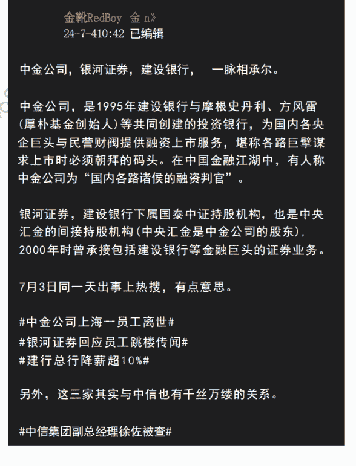
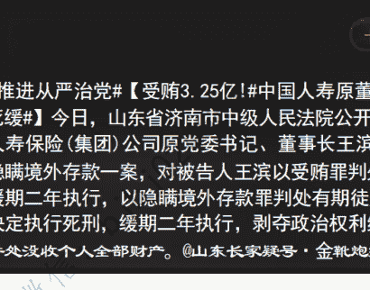
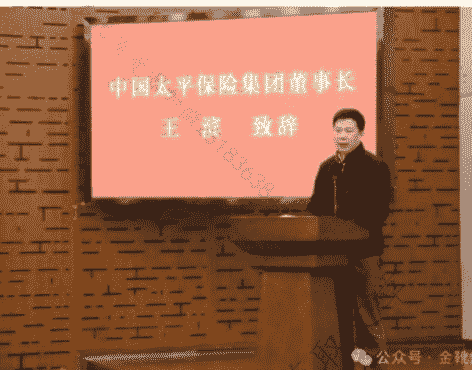
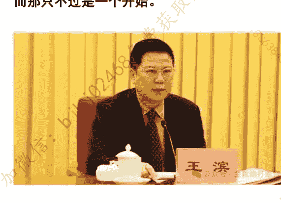

# 金融之乱，百乱之首

欧州金融 金鞋打击宫2024年07月06日22:05

文/ 欧洲金融

早在1946年以前，毛主席就明确指出：发展工业、商业和金融，是我们的重要任务。

金融之乱，堪称百乱之首。

从大搞“旋转门”鳄鳄掠取国家资产，到滥用“放贷杠杆”剥夺离民众群众财富，甚甚至包括许多不为人知的扰动国家命运根基、祸扰社会公共秩序、干预中央大政方……都可以通过金融手段实现。

不是通过盘根结节的资本权力控制，还是设计规避审查的腐败路径，金融领域的“独立王国倾向”已汪江涵诸侯，更是扩大国民贫富差距、实质性推进金融空化的力量。

同时，由于我国金融产业的后发性以及国际资本格局的现状，金融领域也是最容易被外轨渗透、操纵、策反的一汪深渊，往往哪里出现逾地、反共华、抱团圈吸的反动特征，是经历反复复改之后旧旧滋生买办阶级“买办金融阶层”的一个群体。

本文是以落马人物——王凌为例，可一不严整治所带来的后果有多严重。

## 全面推进从严治党#

2.5亿！#中国保险原董事长王凌某#今日，山东南市中级法院公布判决中国保险（集团）公司原党委书记、董事长王凌某隐匿巨外存款罪，对被告王凌某受监处罚刑，刑期两年执行，以隐匿巨外存款罪判处有期徒刑一年，决定执行刑；刑期两年执行，剥夺政治权利，没收其个人全部财产，由山东承家律师学·金融·地产事务所

王凌在2022年1月接受审查的，历时整整一年，他是2022年的金融首只“金融虎”，也是第二只落马的中管虎（第一只是另一前王凌几个小时被通报的西藏自治区副主席张永永）。

王凌是50后，他已接近退休年龄，黑龙江亦尔人，南开大学金融学系金融学专业的在职博士研究生，先后在政府与金融机构任职，有超过三十年的金融管理经验。

这个人，在国内金融系统内位置高，与诸多金融财阀涉及金融业务的传统领域渊源颇深。

王凌最最初任职于政府部门而非专业金融，1983年7月到1985年7月先后在黑龙江省省厅和体改革主任；1985年7月到1990年历任黑龙江省政府办公厅科长、正正级秘书、副正级秘书。

黑龙江的秘书是他王凌挑选过的关键一站，此后他就在金融系统内摸打近二十十年。

此后，他进入了金融系统，任职于人民银行、政策性银行、商业银行、保险公司等。

1990年6月，他调任中国人民银行黑龙江省份办公室副主任（正处级）；次年6月出任中国人民银行办公厅秘书处处级秘书、处长。

王凌曾作为重要成员参与中国农业发展行的筹备和成立工作。从1993年12月开始，他历任筹备办公室负责人、筹备办公室主任、江西省分行副行长、行长。

2000年1月，王凌加入交通银行，历任交通银行北京分行行长、天津分行行长；2010年，王凌同时担任交通银行执行董事、副行长。

2012年3月，王凌正式出任中国太平保险集团党委书记、董事长，正式驻保险系统——这一一段太平保险的主政经历十分重要，后文会有提及。

微信：jntsg8
微信：jntsg2
免费资料群
加微信jntsg2，免费资源群

2018年9月，王凌锦任中国人保险（集团）公司董事长、书记，属大型金融保险企业，部级单位，王凌锦被列为中管干部。

2019年9月，十九届中办八轮巡视对十五家金融单位开展巡视，王凌锦驻巡视组两个月余。

调研会上，时任一把手负责主持会议并发表讲话：要强化政治担当，以巡视契机推动高质量发展，更好满足人民群众需求，推动党的路线部署在基层落实效果。结果巡视组刚落马，王凌锦还是十九大代表、全国政协委员。

2019年12月8日，王凌锦在《人民政协》文中谈如何激活“双弦”：中国人保险（集团）成员单位广发银行全资子公司广发理财责任公司。

2020年8月，王凌锦在上海举行揭牌仪式，那是王凌最后一次公开露面。

在2022年1月8日的宣告处后，王凌被举报接受受贿。梳理太平保险运作局：王凌在香港资本市场诸多脉络，发现：王凌与“山东高速”、“景百孚”、“张伟”等玩家有着交集，王凌肃也因严重受贿被判处死刑。

太平保险集团前董事长小民等人严重问题，例如通过跨境贷款、股权或债权认购等不同方式向各类公司提供融资，其内在是在“垃圾股”的狂欢中分离浑水输血”，与其关联的“妖股”、“亮股”不在少数。

凌能够勾勒出一个清晰画面：王凌在“搞关系”的方法上早期始，王凌在农业银行和交通银行任职积累的资源，先后与交行、建行、东风等大型企业订签战略合作。比如，2014年8月，王凌在吉林担任省长。王凌很快就随而跑到吉林与蒋超谈生意，在政府关系方面，“搞关系”得到了巨大火光，比如经济震撼，王凌金融运作。

山东高速集团（下称“山高金融”），是山东大型国企在香港的金融平台。上市公司香港30年来多次交易，且大比例合股等等影响股票价值和投资者利益，一直有“妖股”之称。在王凌执掌太平控股时期的“山高”就经历了五年内多次易名，从“汉控”改为“中国新金融”，再名为“山高金融”。历史资料显示，太平与“山高”的公开表现：2015年10月13日，太平控股旗下太平信托认购了5000万元的可换债券；2016年4月，太平与中国石化集团的太平洋石化金融集团，在保险和融资租赁等领域达成合作关系。

虽然5000万元对于当时资产规模4000亿元的太平集团微不足道，但这笔资金到底是太平信托自己的投资，还是人为资金的代持，尚不透明。受贿，具体受贿的路，至今不得知，但有一信息：2018年，兼任国际刑警组织主席的公安部副部长传伟，在官方发布的落马通报中言。

微信：jntg2，免费资源群

家风破坏，利用职务影响为其妻谋取职务，纵容其妻利用职权的特殊、谋利。

王滨的妻子名叫高歌，此前在多多金融机构任职，而公开资料显示：2013年到2015年期间，高歌于中国太平保险集团董事办公室任总经理、于太平金融控股有限公司副总经理——那段时间，正是王滨在太平保险集团担任董事长、党委书记时。这是一条显性信息，但在王滨背后还有一条隐性暗示：金融反与蚂蚁风。

2019年，中央首次提出：守住不发生系统性金融风险的底线。然而一年后马云云在外滩公然飞龙脸……

# 微信:jntsg8
# 微信:jntsg2

免费资料群

加微信jntsg2，免费资源群

如今，而是加快金融圈“洗澡、去历史污垢”的步伐。

| 金融领域 | 横向来看 | 纵向来看 |
| :--- | :--- | :--- |
| 退休干部 | 商业银行、股份银行、金融企业 | 监管机构 |
| 中管干部 | 中央级单位 | 省管干部 |
| 派驻机构 | 监管机构 | 纪检监察 |
| 退休多年 | 派驻机构“探头”覆盖金融领域 |

这一直重复过一句：近来半年以来，金融领域面临挑战：从小开始，今年7月30日，原国资监部长郭薇被查；9月4日，深圳银保局侯桂锦被查；9月9日，国家开发银行副行长王祥被查；9月10日，中信银行广州行赵斌被查；9月12日，人民银行科司长杨梅被查；10月20日，恒丰银行宁波分行吴冀被查；12月5日，上海银保局局长韩庆被查。

# 今天哈哈 # 梦想 # 金融R 21世纪经济转型#【沈涛】

## 蚂蚁集团毫无IPO计划并不是试探。

两天前，史美德缘交易所称，史优宏。就在一周前，她刚刚进入蚂蚁集团执行董事。史优宏在2011年受相关邀请、担任当时证监会的副president，是改革开放以来中央委员会首次从陆外聘请。很多人没有注意的一个点是，马云在2020年秋天在那场金融峰会上的演讲，虽然气腾地直指银行和监管，但却没有涉及基金、保险、证券等其他金融机构。那年9月，也就是马云离开一个月前，2012年与王滨同时进入太平集团的著名金融人士张可，以“转身”姿态离开太平，加盟了马云麾下的云锋基金。这已经反映了蚂蚁集团与传统金融机构之间一种微妙的竞合关系，这也是为了保险业会与蚂蚁集团。以及，2022年王滨被带走后，境内外的资本市场会纷纷睁目光再度投向蚂蚁集团，投向马云。当然，这位张可，在今年年初已被查。

“别看今天闹得欢，小日落清单。”

# 中国共产党

【杨柏开除党籍】中央纪委监察中国太平保险集团福建省纪委监组、福建省纪委监察：近日，经中央纪委国家监委批准，中央纪委国家监委中国太平保险集团福建省对太平人人有限公司原党委书记、总经理，对严重重大案件进行了纪律审查和调查（中央纪委国家监委）

应当说，在2022年以前，蚂蚁集团在国际事实上找不到任何一个对标公司，《经济学人》杂志曾将其为世界上“最全的金融科技平台”，可以把它想象成Apple Pay（离线支付）、PayPal（在线支付）、Venmo（转账）、万事达卡（信用卡）。

但是，蚂蚁集团的股东，可只有中国大陆那些国家队成员与买办们……蚂蚁在港交所披露不算详尽，总体而言，涵盖了境外顶级的投资机构，以及我们想到和想不到的港拿。这些外资股东，其背后的架构都在维京群岛等离岸天堂里，现有的工具很难穿透。

微信：jtsg8 进资料

## 金刚RedBoy 22-6-921:43 体育博主

结果未至，格局已定。

除了与此前马云控制的万达集团产生诸多谎言语句，王滨其人更让人无法忽视的，还包括2022年上半年上海疫情期间的鬼魅。

记得前年前3月末、4月初频繁“崩盘”的上海健康云系统吗？可以说是对当时上海疫情传播起到了“推波助澜”的效果。

直至当年4月中旬，上海的地方国资企业（健康云开发公司）移交给北京东方，彼时刚刚火线进入上海市委常班子的陈金山同志负责该项工作。

对于这个“万达信息”，值得一愣（先强调：和老王的万达集团没关系关系）。

## Healthcare Cloud
## 健康云

公众号·金钱畅灯宫

好巧不巧，王滨，正是他主导了人寿2019年11月投资万达信息。

两家公司业务领域差异巨大，且人寿万达不是用自有资金，而是用保险资金的，这里争议颇多。

加微信号jnts2，免费获取资源分享群

根据《保险法》规定，保险资金不能用于设立保险业以外的企业；且保险公司投资单一上市公司股票的股份数，不得超过该上市公司总股本的10%，银保会另有规定或经银保监批准的除外。

在2018年9月王滨开始担任中国人寿董事长的四个月后，中国人就开始接盘了万达信息大股东的5500万股。

## 那不是一个开始

在2019年，中国人累计通过交易场所集中竞价、大宗交易方式共二十五次增持万达信息，加上此前通过纾困专项产品“凤凰”的投资（持股比例5.0025%），到2019年11月份，中国人及其一致行动人正式成为万达投资和实控人史一兵，成为万达信息第一大股东，持股比例为18.3279%。

值得一提的是，中国人寿通过交易期间2019年9月9日开始连续四天净买7亿元，合计增持2.0464%——对于万达信息跳出来公告后，中国人增持基于对行业和万达信息长期发展潜力的信心。

但然而，几天后万达信息再次发布公告，宣布董事会提前换届选举。

从结果来看，万达信息管理层遭到了“洗牌”，其董事会同意免去鸿涛、胡恒伟、钱豪、李光亚、杨煜、姜葵等六人为万达信息第七届董事会非独立董事候选人。

等于是：中国人成为控股股东后，向万达信息派出了新的管理层，让万达信息与中国人深度绑定。

## 中国人寿生产更紧密的协同。

从2019年到2022年王滨落马，中国人寿共计增持万达信息1.54亿，合计21.88亿元。合计持有万达信息20.3亿，占流通股份比例为18%。

但并未给中国人寿带来太多收益……截至王滨落马当天收盘，万达信息报价为11.69/股，在此之前中国人寿二十八次增持中有二十四次高于此价位，其中增持最高价为18.85/股。

而且，在中国寿的扶持下，万达信息的基本面并未出现好转：2020年扣净利润为-13.68亿元，2021年3季度虽相当扭局，但也仅为两千万元。

王滨与万达信息，这背后还有什么内幕？

更让人直奇的是，早在去中国人寿之前，他在履职太平保险集团期间，竟然就与万达信息有过交集。

2012年3月到2018年9月，这六年多时间王滨担任中国太平保险集团董事长，在此期间太平资产管理公司（以下简称：太平资产）就有参与与万达信息定投。

2015年3月31日，万达信息发布公告，拟以51.49元每股的价格，向万豪投资、太平洋资产、太平资产、大成基金和吴秉基金等五名定投资人发行不超过6799万股份，募集不超过三十五亿元资金。

当时，太平资产的法人代表正是王滨兼任。

不过，此次定向增发由于种种未能未能如。

从2022年4月9日起，上海市所有核酸检测采用新系统，原健康云被暂停（浦东已从4月7号开始试点），新系统采用一体化的模式，有效期三十天，不需要重复登录，新系统通过身份证进行登记。

加微信号jnts2，免费获取资源分享群

## 金融反腐

从2020年开始，我们开始了金融反腐。

又死了一个。金融反腐“英年早”了多少人，随便晾一下：

- 2023年5月，中国人基金经理李文振，曾被指控卷入存款利益输，退休。
- 2022年2月28日，上海寰茂首席执行人、基金经理高杉在2021年1月10日失踪。随后警方从黄江里捞出体，初步涉此案，年仅40岁。
- 2021年11月2日，华夏基金公告，高级管理人员、投委会成员、基金经理杨阳在北京去世，年仅45岁。
- 2020年2月17日，南方基金董事长张海源病在南京去世，年仅58岁。
- 2020年1月30日，财务首席官发布报告，量化投资部负责人李望突然去世，年仅37岁。
- 2020年8月19日，中交基金李雪梅因突发心脏病在北京去世，年仅55岁。
- 2020年4月14日，中海基金接到公司常务副总经理宋宇家属通知，宋意外不幸去世，年仅55岁。
- 2020年2月，西部利得基金总经理助理、投资总监陆亚英因患症治疗去世，年38岁。

终寿不保。

- 中国证监会山东证监局长吕鸿锦被查
- 中国银行协会原副行长刘锦峰。中央纪委国家监委消息：中国银行协会委员会原书记、秘书长刘锦峰涉嫌严重违纪，目前正接受中央纪委国家监委纪律审查和黑龙江省纪委监督调查。

鸿滨，山东的国有企业“改制”速度加大。他在公开场合表示，“我国国企改革的重心要以市场化为导向，对本地市场利用”，“加快国有控股上市公司多元化改革，完善公司治理。”

2015年7月，鸿滨体制“下海”，加盟民生证券，民生证券凭借资本下海系队——就是著名的志强（金融财经）。

2016年12月，鸿滨出任民生证券董事长，年薪600万，在待遇层面满足了当时证券会员的一年“薪期”的要求——一年后又入职证券控股，担任董事。

此外，王滨还担任过中国通国际金融有限公司执行董事、中信控股集团有限公司董事长，已在2020和2021年辞任，仍在证券及其控股子公司任职。

2018年他还曾发过“为资本市场发展、快速发展”讲话，“要全力支持中国企业的巨大规模。”

此次鸿滨带调研，大概是此之前王成奎（6月）和刘锦峰（6月）在同一时期任职。

鸿滨是2008年7月起担任证监会的第一批“圈内人”，王成奎在三个时期担任证监会委员会副主任；鸿滨在2009年1月至2016年12月一直担任证监会委员会发行主管。

值得的是，民生证券在策划IPO计划恐怕夭了。

仅半年后，继续处理。国家开始对全国国有银行开展审查，总共二十五个金融机构被审查，其中包括：

- 中信集团
- 中国人寿
- 中国人民银行
- 中国建设银行

这刀子，属于正常吗？

二十届中央第三次会议公布了一批：
- 财政部
- 自然资源部
- 住房和城乡部
- 农业农村部
- 商务部
- 国家市场监督局
- 国家审计局
- 国家市场总局
- 中国证监会
- 国家秘书部
- 知识产权局
- 物流储备局
- 国家银行
- 林业局
- 外贸部
- 资金拨付中心
- 上海证券交易所
- 深圳证券交易所
- 中国银行有限公司
- 中国建设银行有限公司
- 交通银行有限公司
- 中信集团有限公司
- 中国保险
- 中国太平洋保险责任公司
- 中国证券委员会

开展规模

2016年以后，随着“2015股灾”的爆发，市场第一次系统性调整，中信证券核心板块董王东被免职，宣布终止。此人是中国证券市场赫赫有名的大佬，双留学美国并经历了华证券、南方证券等重点机构。两年后（2018年），证监会宣告平静，调查结束。

而这一次，或有不同。

一直以来，群众对金融巨头吸血般的超高工资、超优待遇、涨福利未见过，2022年的“中金普通员工月薪8万”的新闻还记得：

扫码加入星球免费资源群
每日免费获取高价值资源
提供各类资源搜索服务
- 热门付费文章
- 各行业业务报告
- 精选图书
- 副业赚钱方法
- 职场实用资源
- AI政策自媒体

分享资源仅供个人学习，请及时删除，切勿商用。

## USCC 收入证明

其实三十年来，长江上就有中金公司违反国企业限薪的争议。

2002年的十六大后，国家曾推行过国企高管限薪制，规定薪资不得超过职工平均工资的十二倍；2009年又推出《关于进一步规范高管中央企业负责人薪酬管理的指导意见》，对中央企业发出高薪“限薪令”，规定高管薪应限制在六十万左右。

然而，中金公司高管工资倾向远远国家规定的高管工资总额，这是一种从一开始就奠定的“企业文化基础”，又因为中金涉及多类企业，民营巨头的上市融资举担保，说白了就是牵各种路利益和始终“逍法外”……
