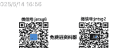
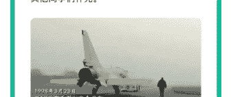

# 南诡王的主题

2022/04/24 16:56

## 大历史视角下的投资选择

一、十年度，看趋势。

别到日本看遍了，你就知道了。现在中药还没有完全养老，是有钱的，是70后和80后还没老，总有一天是需要咖啡、蛋、阿胶的。

男人补肾、女人补，是几千年的使命。

## 二、五年度，看机器人。

- 一、科技的激进。

现在的激进如此，满地停踩，就不说明还不完美，不完美，就得转型，机器人公司不是最有利，还有量利。
最靠的是ETF。

- 二、消费看逻辑和功能性。

1. 8亿人口，食品品的集中度还很低，还是需要聚变。
刚需ETF+定投+自+1

3亿多社会，总是要精神健康的，日本的1.2亿人口，力保业绩增长200亿日元，年销售额8亿。
我们的目标是东亚。
嗜神饮料是白酒，青春饮料比较极高。

## 三、五年度，看MCU/SOC芯片。

SOC领先，MCU次之。
中国的飞机、起落、巡航、远近的事情，侧是AI+智能车，未来出海的王力。

## 四、1-2年度，AI芯片、应用。

美英被替代的事情，我们在应用端合成一个又一个deepseek时刻。
其他我们学习补充。

| 加入我们，获得定投ETF 免费领取 |
|---|---|
| ●南诡王直播间 ●科技行业基金 |
| ●跟线交易策略 ●基础面分析 |
| ●定投实战策略 ●高收益基金 |
