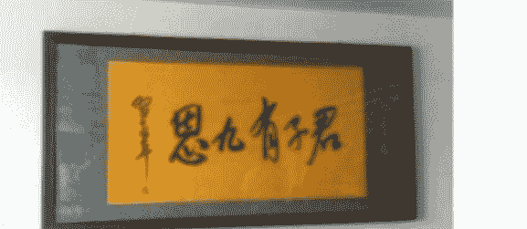

# 南院大王

## 易经八卦-蛊(上):躺平就会生虫

上一卦讲的是随，有些人随心，随随，随便，丧尸精神意志，干脆躺平了。

这就是“蛊”卦。

大家看武侠小说才知道“蛊虫”。

旧时传说，把许多毒放在器皿里相互相容，最后剩下不死的毒虫，就叫蛊虫，这毒虫虽然小，但却非常有害。

器皿久用而不生虫“蛊”。人躺平和懈怠久了生“蛊”。

先贤在易经的十八卦“蛊”，警示我们，

亲，你是不是不化了，堕落了?

蛊。元亨，利涉大川。先甲三日，后甲三日。

象曰：山(艮)在上，风(巽)在下，山里的风被阻挡，象征着发展停滞，个人懈怠，公司或者组织里风气败坏，腐败僵化。这个意境，山(艮)在上，君子以振民育民。

那为了什么“元亨，利涉大川”呢？因为你意识到了问题了，觉醒了，决定要改变了啊。一个人只要愿意反省，检讨，就是大好事。

“先甲三日，后甲三日”。

“先甲三日，后甲三日。”符号的开始，“先甲”指天干纪时的第一个符号，代表事物的开始，“三日”指在蛊治瘟之前，要分析研究腐化堕落的原因，制定治瘟方案，“后甲三日”指实施方法策略后，要观察实效，及时调整，以图兴利除禁，成效长久。

“君子以振民育德”。

君子振精神，找回初心，挽救危机，重整旗鼓。

《春秋左传》记载过一件事，晋平公生病了，泰景公派了大师“医和”去给他治病。

医和看完症状后，然后又卜了一卦，你就是“蛊”啊。

“在《周易》中，女感男，风落山，雷之孟，皆同物也。”

上卦为艮为少男，下卦为离为风为女，男的女的迷惑，就像风吹落在山上的树叶，所以叫蛊蛊。

平公的病是迷惑惑乱引起的，纵溺过度，要节制啊。

你堂当一国之君，君秋萧将，把精力放在女人身上，不就是自己想着怠了躺平了吗，无所事事，精神上滑坡了吗？

平公出了一身冷汗，果断听后，厚谢了医和。

去年下半年，有一个上市公司的创始人说他很焦虑，起一个六爻卦自明的各方面都很强超越那个女人，却得失丧，缺乏安全，心愁意乱，道理都知道，就是走不出来。

大王说，你被迷惑，根本原因还不是自己忘了吗？觉得事业不值，有钱有闲了，就跑去招惹女人吗？

你都快50了，虽然身材不错，又不是二十多岁八块肌的小鲜肉，势力又物质的女人怎么会心眼里喜欢你呢？

他不喜欢你还有你往来，不就是感情虐待和拿捏？你灵性高，感觉得到，直觉不停给你发警报，就不难受了吗？

治本的方法是什么？卷起来闹。

你当年的梦想呢？气吞万里如虎的志向呢？情关不是让你事业焕发第二春吗？

这哥们听了了，开始跑步，看书，重温英语，前段时间他叫，酒脱一笑，当年这都是什么么，荒唐。

所以啊，不管什么位置，时间，人都都是不能躺的，物必先腐后生虫。

眼中有火，心里有光，生命的质量才有基本的保障。

收起

# 免费 及时 专注

# 扫码加入 知识星球TOP 免费资源群

- 每日免费获取有价值资源
- 可提供各类资源搜索服务

| ◆热门付费文章 | ◆各行行业报告 |
| ◆精选图资资源 | ◆副业赚钱方法 |
| ◆职场实用资源 | ◆AI财经自媒体 |

公众号: 知识星球TOP | 微信号: jntsg8 | 微信信号: jntsg2

分享资料仅供个人学习，请及时删除，切勿商用传播
