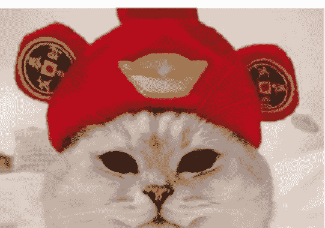

# 大尺寸板块之二：大消费

科技和消费，成为上面的两手抓，两手抓都要硬。

在3-5年确定方向，消费的分析如下：

1. 具有长期价值的是嘴巴股，这也是巴菲的最爱。
过去的嘴巴股是白酒，以后变成食品饮料。
饮料的增速和空间远大于食品，食品太散，主要原因是：难出大单品。
目前饮料能看的，就是我们反复提到的东鹏特饮。
一产品可以，东鹏特饮是百亿单品，椰子水和补水系列也在加速。
二是渠道硬，一路覆盖到城镇市场。
食品方面，我们不看人的，太散，集中度太低，轮动又太快。
前两年流行鸭臀，很快又流行魔芋。
而且人口的数量在减少，人们追求健康越慢不吃零食。

2. 长期看的是宠物食品，猫猫狗狗的增长率远超于人。
宠物食品能看的，就是三家：中宠、乖宝、佩蒂。
越来越多的人当了小狗的爸爸妈妈，撸猫可以减压，这个市场还很长。
很多人都没有保险，猫猫狗狗是有医疗保险的。

3. 大面积能刺激人的消费和内需的，就是旅游，尤其是普通百姓的国内旅游。
两个菩萨的道场，普贤菩萨的峨眉山，地藏菩萨的九华山，都是超级IP和精神需求，无形价值不可估量。
最近的K线也走的不错。

以上只是分析消费的公司，并不是马上就要买，市场如今缩量，总有大跌的空间和机会，给你分批次逐渐进入的机会。
时代变了，现在不少猫猫狗狗都是能上人的床睡觉的。

# 六月
2025-04-20 09:11

机器人马拉松是不是证明人形机器人还在炒作阶段？
云穿日常、沧海一粟、洛川觉得很赞
南院大王：概念阶段。跑得跟跟跟跑不是不是缺支撑，跑快最稳的形态是四条腿，自然界早就证明。具身智能肯定会很大发展，但未来大多数都是狗型、轮足等，只有少数极具情感价值的才人形。

2025-04-20 09:19
范佩回复南院大王：跑得跟跟跟跑。短期是利好还是利空机器人

2025-04-20 09:23
南院大王回复 范佩：上涨期，所有消息都是利好，调整期，碰到消息都利空。

2025-04-20 09:28
Saint_l1：感觉愁着开业期，下周再杀一下子，又有性价比了。

2025-04-20 14:08
Daidai：这个还需要马拉松证明吗？😂

2025-04-20 14:26

# 扫码加入 知识星球TOP 免费资源群

免费
- 每日免费获取高价值资源
- 提供各类资源搜索服务
公众号：知识星球TOP

价值
| 热门付费文章 | 各行各业报告 |
| :--- | :--- |
| 精选图书资源 | 副业赚钱方法 |
| 职场实用资源 | AI经营自媒体 |

及时
微信：jntsg8
专注
分享资料仅供个人学习，请及时删除，切勿商用传播
