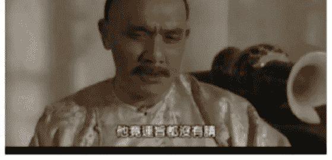
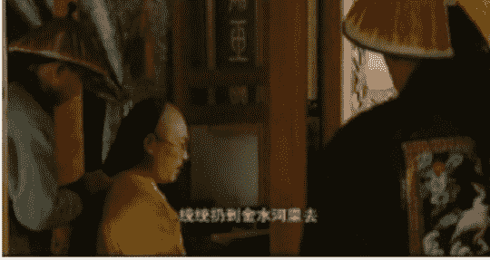

# 南院大王

## 董小姐这事的底层逻辑

问题不在于，他们互相抱团，到处补裙，形成山头，这个避免免了。

教员曾说过，党内无匮，千奇百怪。

问题在于，这些人歪土，专家，学阀们，特意搞出了“4+4”，让他们的弟子，可以批量“制度化”地抄近路。

一方面，这就是国家的“夺才大战”上明晃晃的一个洞，可以私下批量生产干部，这哪里是你们干的。

私设公堂，胆子太大了。

别以为医生就怎么样了，那也是吃财政饭的，过几年就能运转进体制。

另一方面，他最容易引发“那些”科学官僚们的愤怒，大家都是辛辛苦苦上来的，你们凭什么？

科学官可都是部委和地方主力，怎么会让你罢了呢？

我朝以前，一向优容专家学者所谓专业人士，没想到你们……

金杯共饮，白刃不相贷。

## 园Gloria: 大家不是早就提到专家就免了了吗?有时候专家出来说啥都会引起你怀疑态度，不说反而不一定

王多肉·谢侍夫:王侯将将，宁有种乎？

南院大王 回复园园Gloria:nono，体制里可呢，很多专家说话比封锁大还好使，觉得他们相对“中立”。中科，社科，那都是正极。

博阳:国企和高校也稳定向中青班输人才。

大道至简:最近重温，刚好看到恩科，张庭嵩一幕。

智宇:很多专家其实是砖家。

白开水:只为门户私利！

颂雅安:九品中正制变形版？曹魏烂开局，然后真正阻断阶层流通，导致“上品无寒门，下品无士族”。

# 南院大王

## 副村长与大局

去年，上面说要努力提振资本市场，全力发动了924行情。

结果，某前村长在高峰高峰闭门会上，阴阳怪气的说出来的，过了3000天就够了。

三千点，一张票子打着筒热的所谓专业人士和利益集团有意放纵出来的，是一种变相的压制，对下对上。

问题他们比谁都清楚，但那些政策的文，禁止胡乱武装的文，就是不出。

他们就是金融界的董小姐，坏比其害多了。

现在把副村长办了，副王，是三千当年的办公室主任和大总管，3000退休后，安排他去了深交所当总经理。

刘航：可恶

洪水流沫：大王，如何看待寒王垒增这件事？

征坐：大王节快乐乐乐 聚

永远满充永远远热润蓝焰：攥着明白财山，条糸

# 免费 价值 及时 专注

# 扫码加入 知识星球TOP 免费资源群

- 每日免费获取价值资源
- 可提供各类资源搜索服务

| ◆热门付费文章 | ◆各行行业报告 |
| :--- | :--- |
| ◆精选图书资源 | ◆副业赚钱方法 |
| ◆职场实用资源 | ◆AI经营自媒体体 |

公众号: 知识星球TOP | 微信号: jntsg8 | 微信号: jntsg2

分享资料仅供个人学习，请及时删除，切勿商用传播
