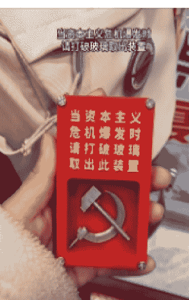

# 易经18卦蛊(下)4+4的毒虫钻了洞

六四爻：裕父之蛊，往见客。

象曰：裕父之蛊，往未得也。

裕，是宽宽，恤容。父，是前任。

对前任和往过的弊病拖延累衍，继续下去会招灾祸。

一个体系一旦开始腐朽和墙塌，会引发任何体系的扩散，所以发现坏灶一定要及早处理，放任它下去会局面恶化。

当年唐朝的科举制没有问题，有的。不糊名，可以推荐，商人子弟不能报名，等等等。

大家就是不去解决，

结果出个黄巢，

天街尽臻公卿骨，内库锦绣焚成灰。

几百年的门阀被杀的干干净净。

既然你不让考进，那就打进长安。

刀刃向内的窗口期很短，一旦过了，触动利益比触动灵魂还难。

所以各位，在健康的时候健身，在有的时候学习，在刚发现问题的时候解决，别等躺病床上了想到运动，晚了。

## 六五爻：干父之孟，用誉。

象曰：干父用誉，才能获得德。

解决旧体系的问题，要树典型，抓标兵，说话显，这样才能获得众人的拥护。

商鞅变法，面对秦国那些旧问题，他上来先抢的是“不患立信”。木头撒撮，立桩给五十金。

改过不是蛮干，不是乱来，特权干涉，不是强势打压，

而是建立一个顺应民心、人拥护的新体制、新风尚，让大家看到未来，看到希望，看到改革者的诚信与公正，产生由衷的信任和敬畏，这样事情才能推下去。

现在董小姐的问题，上面开放了大家讨论，把学术水准和精英的画皮拆掉，也是一种“干父用誉”。

过去几年，南北横榜、江淮案、张延睢，这种事情多了，上面从来不会放这种机会。

德是什么，奖励听话的你，对坏规矩的人开刀。

上九：不事王侯，高尚其事。

象曰：不事王侯，志可可能也。

王侯，不是王公贵族，而是利益集团。

改过，就不能媚权集团，替利益集团考虑，要有天下为公、心为民的志向的年轻人能够脱颖而出，而是给精英们设计了一条抄近路捷径。

协和的4+4，是不是改革，是的，但他的出发，却不是为了更多寒门弟子和有才的年轻人能够脱颖而出，而是给精英们。是私心而不是公心，那就是“蛊”。既是诱，又是欲望，迟早坏事，迟早出事，没有董小姐，也有王小姐、李小姐。

所以各位，在公司里要做事，要出业绩，要连接班子，不是说你要做圣人，而是一定要处事公正，讲清楚信用。

面对面对的现实，其实都面临迷挂的问题，我们不少同学也是，问题并不不可怕，而是要有面对问题的勇气和解决问题的自不息，革故鼎新，走出舒适区，炼新自己，是人生和事业永远的课题。

上洛的菜头、Candy、Best、金山小王亚、杨光、蝉蛹、zg、悦萌、剪衍、槟树等9人都觉得很赞

天心月圆：坏事多了之后，便宜占久了之后，都会反噬
2025-05-02 09:42

于洋：当年那首《董小姐》——“你才不是一个没有故事的女同学
2025-05-02 09:51

天心月圆：这种便宜占尽的自己太难看了
2025-05-02 09:52

于洋：再听一遍《王阳大传》。仔细良二字，天亦有情、正道浩繁。
2025-05-02 10:07

孤孤走巷：知所不可而为之
2025-05-03 14:03

桃子花开：公众号董小姐的文章本来还想再看一遍
2025-05-03 15:21

### 免费 价值 及时 专注

### 扫码加入 知识星球TOP 免费资源群

- 每日免费获取价值资源
- 可提供各类资源搜索服务

| 热门付费文章 | 各行行业报告 |
| :--- | :--- |
| 精选图书资源 | 副业赚钱方法 |
| 职场实用资源 | AI经营自媒体体 |

公众号：知识星球TOP 微信信号：jntsg8 微信信号：jntsg2

分享资料仅供个人学习，请及时删除，切勿商用传播
