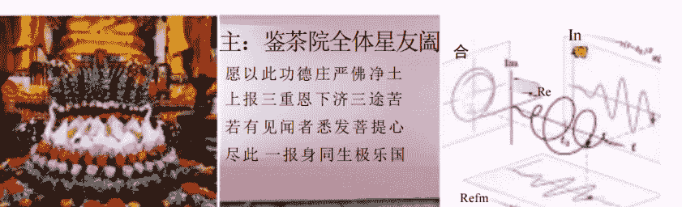
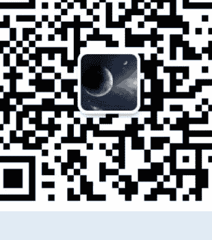

# 南院大王

2025-05-05 10:09

四月初八，为大家送祈福

今天是佛诞，又是洛佛节，今年来，很多星世界的朋友境况好，有些人还有缘络，群里也生了不少宝宝，是添丁之喜，特意为大家在监控和曹洞宗传承的古刹进行了供花祈福。

之前我们讲过，佛不是迷信的迷，最多学派的。西方的上帝是神仙，而释迦尼明确告诉大家，他是不是神。

佛，是觉悟者的意思。而《易经》里只有算法，是补素的人智能。

佛觉悟了什么？

人类生活在三维空间，而宇宙是十维的，我们可能只是高维世界的投影，一辈子是一场体验而已。如今高能物理学的理论，量子纠缠，不断在证明这点。

今天是立夏，又是巳年、巳月、巳日，这天祈福，人们对美好生活向往的愿力，被宇宙的能量肯定、加持，这就是不可思之功德。

进而出生：

感恩心，进取心，宁静心，平常心。

罚则独善其身，自我圆满，是为罗萨；

达则兼济天下，勇猛精进，是为菩萨。

今天这个特殊的日子，祝大家福慧双增，心情愉悦，以清净心态，迎接明日的上班！

主：鉴茶院全体星友圈
愿以此功德庄严佛净土
上报三重恩下济三迷途苦
若有闻者悉受菩提心
尽此一报身同生乐国

PIN、周璟、企业融资-老周、赵超、D. Z、一路阳光(徐)、向上、重庆污泥、吴小二、明心等189人觉得很好

查看详情>

于洋：感谢大王！
2025-05-05 10:12

小字：感谢大王，
2025-05-05 10:13

# 南院大王

匿名用户：大王，咨询，40岁的人还有没有必要MBA，一个是增加涨学。一个是扩充人脉，如果可以的话，n去哪个学校好呢？如果将来3-5年后通信行业好，是不是可以去北部？如果金融行业不好就去中财？或者制造业好了，去北理或者北大？还是去竞争更激烈的人大清华北大？还请指点迷路。

另外，北京房价还能怎么样涨？说是国家实在在一一路和西部开发（政策的缘故），是不是年底是投资出的好时机。

MBA全国联考的很难，意义也不大。EMBA吧，大概60万多，推荐五道口、北大、长大等几个综合高校，主要是有人脉资源和视野。北京房价这些段好产品的房子，已经涨了。

查看详情>

上数的菜头、elsa-用、北京、山乐水、于洋、GM ZZ、往措、沉静如海、小马哥等23人觉得很贵

匿名用户：我在emma也参加全国联考了，清华大的EM学费已经到了80多了，有点贵了，之所以想考，还有一个原因是有两个证参加积分落，所有这些细绪，好学校太贵不好，一般学校可能没有意义大，纠了。

南院大王 回复 匿名用户：多看看，不着急，仅靠也不够，五道口和交大可以给我写推荐信，中证也行。

查询南院大王 回复 南院大王：大王厉害

叶枫 回复 南院大王：推荐信，额，最近有点火啊。

南院大王 回复 叶枫：EMBA某种意义是个创收项目，学校借着赚钱的，上完全部学费够挣百万来。协和那是那种严肃的学历教育，两回事嘛。

# 扫码加入 知识星球TOP 免费资源群

公众号:知识星球TOP

免费
- 每日免费获取高价值资源
- 可提供各类资源搜索服务

价值
微信:jntsg8

| 热门付费文章 | 各行各业报告 | 精选图书资源 |
|---|---|---|
| 副业赚钱方法 | 职场实用资源 | AI政经自媒体 |

及时
微信:jntsg2

专注
分享资料仅供个人学习，请及时删除，切勿商用传播
