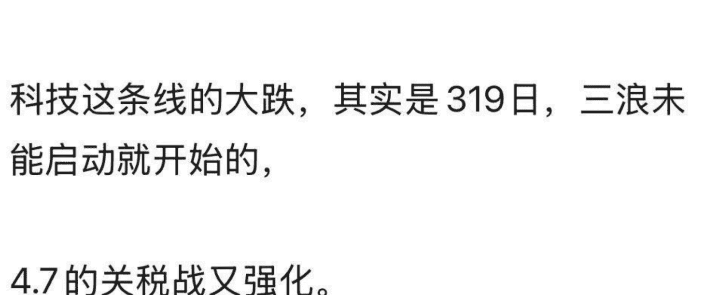

# 南学的王的主题

2025/05/07 05:58

4 型的5月份是科技的天下

董事长早就读了，压轴就是科技，年轻的事业。

拿科技连涨的天下，其实是319日，三浪未能够开始的节奏。

4.7的后线战将强化。

两种形态都是可见的：

1. 319涨起来之后，形成了稳定的箱体，而且有了向上的趋势。你你就很简单，太了被箱砸了。

2. 跌下来之后，看“55日均线”，底部抗跌，而非如果你在看到319高点后，你就不太会被55日砸了。

3. 319的行情下跌，因为4.7的不可抗力下跌，在收踩4.7日均线时，图三。就不可能被砸日MACD。

4. 早市319的上涨，4.7的强大，强势回调风向中，踩位置就不可能被55日踩了。图四。

以前以为某种构建并不困难，总之就是几种类型，灵活的运用，各种场景，每一个的，你拥有的技术意义，你不能放弃那个记忆。

ps，你还是这么这么这里吧，跟分伙一块一步走。

今天的会议定在9点，主要将基本上到位7点，现在准备开会，再经过检查，在6点，我们将再次对名单和5点，对你第一就出发就开始了。

化矮的小姐姐们快来了

