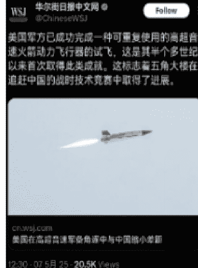

# 钝化消失了

军工涨则科技跌，形成了跷跷板效应，

但指数的上攻把钝化形态打没了，

军工本质反应的是紧张态势，不会持续太久，

国防安全的目标，还是为了安心搞搞科技。

董事长说了科技是年轻人的事业，

他没说国防是年轻人的事业。

年轻人的意思，后面接着干，比教员说小平是年轻人。

WSJ 谦虚，谦虚的让人认出来。

收起

## 往昔：眼下科技已经蠢蠢欲动了

- 大王，周末谈判判恶性结果概率有多大，如果谈判不顺利，军工是否还有一小段的上升空间 (2025-05-08 16:18)
- 南院大王 回@@_：不顺利就涨自主可控芯片了 (2025-05-08 16:20)
- Saint_li 居然用了 追赶 (2025-05-08 16:21)
- Momo：“追赶中国”，“与中国缩小差距”，好陌生的中国话 (2025-05-08 16:22)
- BULL: 成飞的爆款能够打开市场吗 (2025-05-08 16:22)
- Saint_li 回复@_：个人感觉谈不吐哈劲，都没拿出谈的诚意，比如取消一些关税，看网上有人说只是加速中欧协定的签订进程 (2025-05-08 16:23)
- 远征：军工本身也是叠加制造+科技。之前国家实力、地缘政治，再加上我们的韬光养晦，军贸额并不大。今后军贸额可能会大幅增长吧？成为外贸的一个增长点吧？ (2025-05-08 16:28)

# 扫码加入 知识星球TOP 免费资源群

- ✓ 每日免费获取高价值资源
- ✓ 提供各各类资源搜索服务

公众号: 知识星球TOP

免费 价值

微信公众号: jntsg8

- ◆热门付费文章 ◆各行各业报告
- ◆精选图书资源 ◆副业赚钱方法
- ◆职场实用资源 ◆AI政经自媒体

微信公众号: jntsg2

及时 专注

分享资料仅供个人学习，请及时删除，切勿商用传播
