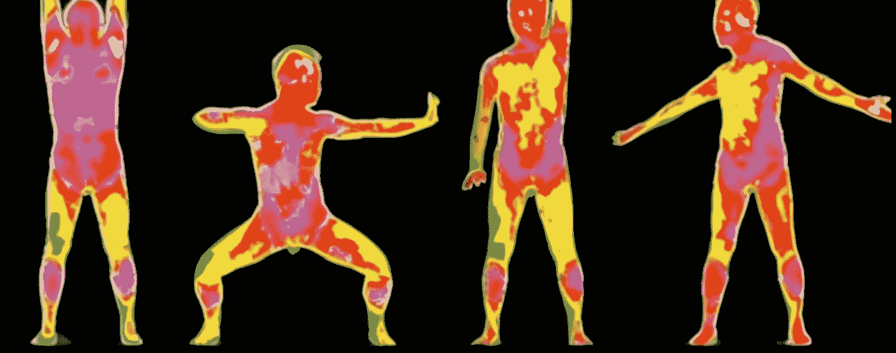
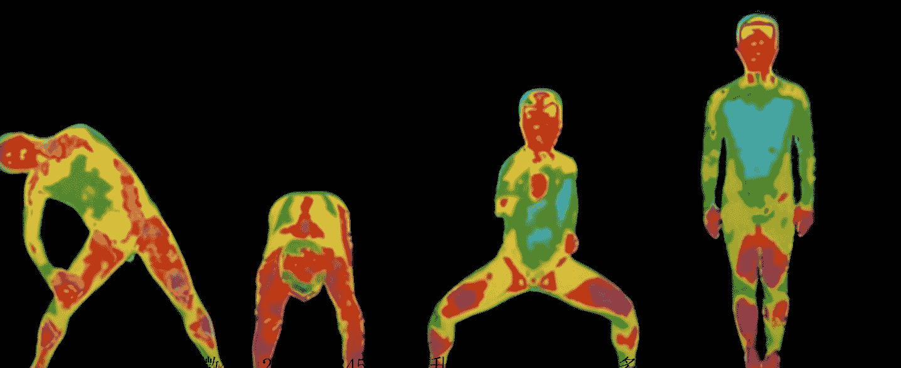

# 形成八段锦

人的生机来自于哪里？气血。

气血充盈，百病不生；气血虚弱，外邪乘虚而入，疾病，焦虑，压抑等由此产生。

气血是什么，中国人最容易感悟。

举个简单例子，气血就是大领导。大领导关注和指示的事情，才能办好，你指望地方是自动发的，很快就懈怠了。

你手脚冰凉，就是因为大领导气血，没有深入基层督督，没去温暖。

中医可视化技术是国家医药管理局国家级课题，曾怡引入红外成像技术，将检测的人体发出的红外线转换成温度，并以八种颜色将温度分布图像显示出来，直接“看出了”人体的寒温凉，气血搬运和变化。

事实证明八段锦的引导效果非常显著。

红外成像显示：

- 练后，劳宫穴位温度上升2.3±0.5℃，提示手揉瘀心包能量传输增强。
- 太溪、元泉等位级微血液流量提升40%，证“以形导气，以气通经”理论。
- “揽拳忍目”通过肝主筋理论疏解，临床可见可调节唾液皮质醇下降28%。
- 后七七式激活少阴肝肾，调节下丘脑-肾上轴腺，改善焦虑量表(GAD-7)评分34%。

八段锦最早来自于1973年长沙出土的马俑《导引锦》，44个动作证明八段锦与先秦方道呼吸吐纳的渊源。

所以各位，如果你想长期稳定的改善身体的肥胖体型问题，身体的长期的问题，心理的焦虑，紧张，尤其是很多人的失眠，早醒，睡不好等问题，习练八段锦是最佳方式之一，因为让他回归的是自我和能量的本源。

《西游记》第二回讲的长生大道，题目是，《悟彻苦体真妙理，断魔归本合元神》。你不慢下来，心情放空放松下来，怎么能够感受自己的心情，去合元神呢？为什么詹挑铁冠军没有长寿的，老了容易痴呆？伤了元神了。所以太极越越慢。

金刚功就是八段锦的延伸和变种，更适合中青年。

我们都听过一句段子，“一粒金丹吞入腹，我命由我不由天”。金丹是啥？你练完八段锦金刚功后的口水。术语讲就是益生菌。

## 天心月圆：长寿功夫第一式就是罚吃昆仑长老酒，随时随地都可以在练

| 时间 | 用户 | 留言 |
| :--- | :--- | :--- |
| 2025-05-09 06:30 | 天心月圆 | 咱们小白撸铁的那点强度，就相当于下地去劳作一下 |
| 2025-05-09 06:31 | 天朗气清水木流济 | 今天本来想偷懒，因为每晚饭后都有乒乓球半小时以上。看到大王这篇，立马起来打 |
| 2025-05-09 06:47 | 点满满迷 | 那么练金刚功还是八段锦呢？感觉八段锦练起来更容易些，金刚动作多，要反复琢磨。 |
| 2025-05-09 06:57 | kk 回复点满满 | 都不行了现在，复述一个有点迷信的观点：练的东西的人越多，效果越差 |
| 2025-05-09 07:52 | yx | 想请下大王和大家，练长寿金刚功是不是有必要去纠纠？因为看到的人说练气息或者用力不对反而打了身体还不舒服？？ |

### 作品用医学研究的红外热成像器拍摄创作

创作内容围绕与传统中医相关的八段锦、五禽戏等养生、仿生功法开展，是艺术家关于中医与艺术的探索，展出的系列作品旨在探讨艺术、科技与中医药文化的融合与转译，启发。

大王，您好，想教下现在北京市楼已经算到底了吗？

近期刚把自己的老破小卖了，本来最初想在孩子的初中附近换扇房，但是转念一想初中就初三年，回上了高中又不知道是在哪里，可能离得远远是，不如初高中六年都在学校附近租住房；然后择机在楼市底部下手买房。我们的终极梦想是在老公上班的朝阳公园附近换房，这样退休就不折腾了。

> 南院大王：基本上。都朝阳公园了，再往北点，去年让大家看东坝和崔庄，那会中建的项目还能打招呼。

大王，我想请教一下，都有哪些软件适用于回测自己的股票策略南院大王：你弄个模拟仓，每个礼拜，每个月复盘几次，自己思考出来的最好

# 免费 价值 及时 专注

# 扫码加入 知识星球TOP 免费资源群

- 每日免费获取有价值资源
- 可提供资源搜索服务

| 热门付费文章 | 各行行业报告 |
| 精选图书资源 | 副业赚钱方法 |
| 职场实用资源 | AI政经自媒体 |

公众号：知识星球TOP | 微信号：jntsg8 | 微信号：jntsg2

分享资料仅供个人学习，请及时删除，切勿商用传递
