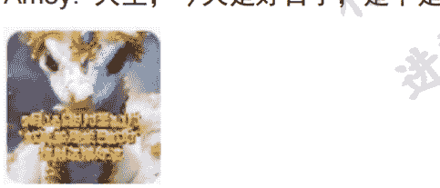

运此不在彼

关战打成啥样？

把4月2号的浮沫都搬了，各自自留10%。

并继续保留关税争取又一刀的余地。

憋气游戏结束，白拍一场。

今天是

乙巳年、辛巳月、辛巳日。

从立夏以来就一堆了火。巳火，地底奔湃的能量。

对方是憋不住的。

军工带动大A第三浪。

段子说，CCTV的央视风向标，
《甘岭》空练
《长津湖》傲空
《黄河绝恋》满仓
《我爱纽约》满仓满融。

军工带队过后，

后面的压力给到梁峰了。

微信:jntsg2
微信:jntsg2
免费进资料群

> 进群加微信:qihaogongyuan458
进群加微信:qihaogongyuan458

往昔: 武的咱们先下一一成，文的（科技）咱也不差台 2025-05-12 15:41
范逸: 就得在收盘后发公告。恒生指数大涨 2025-05-12 15:47
Saint_li 回复范逸: 老美鸡贼，盘前发 2025-05-12 15:49
南院大王 回复Saint_li: 这可能是美方代表团的小要求，他们都有老鼠仓，懂老王和小伙伴们又大赚 2025-05-12 15:52
Saint_li 回复南院大王: 怪不得建国上周让大家买股票 2025-05-12 16:01
林森回复南院大王: mcu是不是得减点?算上今天加的接近仓了 2025-05-12 16:09
Amey: 大王，今天是好日子，是不是很缺火缺肉的人 2025-05-12 16:41

孤身走巷: 气吹大了要爆，放放气接着吹 2025-05-12 16:45
