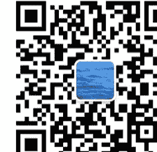
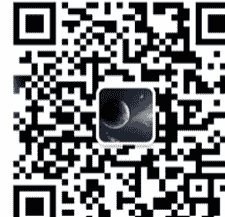
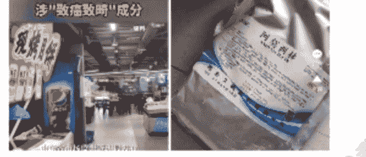

# 南院大王

2025-05-01 13:04

无抗蛋天蛋了

微信公众号:jntsg8
微信公众号:jntsg2

盒马卖的无抗蛋被检出含有药物残留超标。

免费进资料群

一个朋友经常买他们的还生吃，

超标成分主要是地美硝唑和甲氧苄啶。

地美硝唑是治疗家禽和动物滴虫病的，甲氧苄啶是抗感染的，用于肺炎杆菌和呼吸道感染等。

无抗蛋在生产过程中严禁使用抗生素，别说无抗了，哪怕正常的，动物没病你还不能用。

但很多商家为了“预防动物得病”和传染病，给他们吃一堆药。

这两个东西会严重影响人类的肝肾功能，致癌可能对新生儿……

早上我们说蛇皮袋放牛磺酸好了，牛磺对动物算是好东西，

蛇皮袋放阿莫西林，庆大霉素的是你真没见过，

管它有病没病，直接拌到饲料里水里，下没轻重的。

我们当年看过之后，再也不投农业了。

人类站在食物顶端，也站在一切污染的顶端，

所以各位，别告诉你什么无抗、无菌蛋等都可以吃蛋，别信他们，糟心蛋也不要吃，全部做熟再说。

平时多锻炼身体，多喝水，多喝茶解毒，

水也不能多喝自来水，买个净水机过滤。

茶也不能不能乱喝，农药狂喷的多的是，明前茶可以，那会虫子出来不用打药。

收起

微信信号:jntsg8
微信信号:jntsg2

免费进资料群

D. Z., Jonny涛、Bob、荣楠、剪行、楫、三五九、自在、琪、沐涵等46人觉得很赞

园园Gloria: 什么牌子的？买过那个好多黄天鹅，从不敢不敢吃，用来做猪汤，但是也会会有腥味，后来没买了 2025-05-13 15:09

Super: 净水器也不敢乱用，怕滤芯有问题 2025-05-13 15:11

园园Gloria: 破防啊破防

