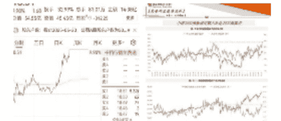
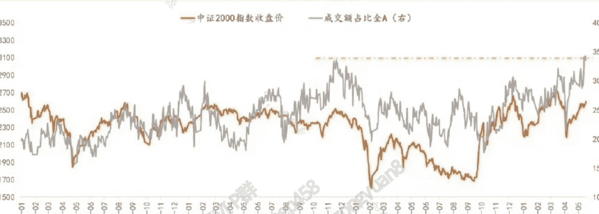
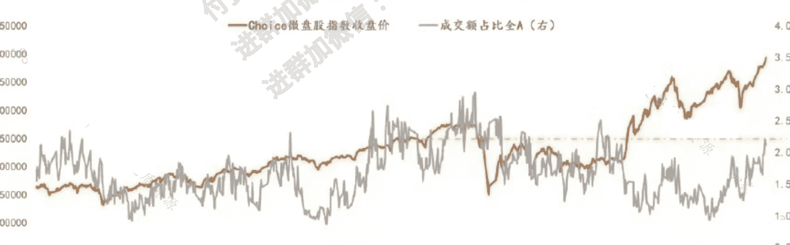

# 南院大王

2025-05-22 14:30

风格随机切换

裤子该止盈了

它到现在还有4-5个波板了，纵使它差断卖裤子。

小满+2，过犹不及

主要是高标持的在不断瓦解，风格可能随时切回大盘和科技。

你要留一部分也行

看好身后，大盘韭，科技割它，反之也是。

它还能就是，它涨不动了就是错

虽然也有可能，主力给你掏一个钩子号，比如18.88，19.99落口。

口诀：

当强不强为韭，

福刚_小小于，elsa-专用，Jonny，Dr Lee、敏、叶枫、静心、证杜、大周-真找我等8人觉得很好。

查看详情>

诺寒李：瑞王已经从174降到150，它这带着科技冲击一波了。

# 18.51 今开 17.80 最高 18.51 最低 16.46

9.98% 1.68 换手 32.99% 总手 81.01万 金额 14.08亿 总值 54.55亿 流值 45.45亿 市盈 -312.25 更多

股东户数：截止2025-05-20，公司A股股东户数为50...

+ 分时 五日 日K 周K 月K 更多

| 档 | 价格 | 数量 |
| :--- | :--- | :--- |
| 卖5 | -- | -- |
| 卖4 | -- | -- |
| 卖3 | -- | -- |
| 卖2 | -- | -- |
| 卖1 | -- | -- |
| 买1 | 18.51 | 5.3万 |
| 买2 | 18.50 | 62 |
| 买3 | 18.49 | 77 |
| 买4 | 18.48 | 3 |
| 买5 | 18.47 | 19 |

分时成交
14:24 18.51 2
14:24 18.51 1
14:24 18.51 2
14:24 18.51 2

15.15 -9.98% 主意愿 解锁查看最新实时数据

## 东方富利证券
Eastmoney Securities
【莱曦研究团队】
撰稿：陈翔/郭佳佳

## 中证2000指数成交额占比2023年高点

图：中证2000指数收盘价与成交额占比

图：Choice基金涨收盘价与成交额占比

资料来源：Choice指数数据终端，东方富证券研究所
风险提示：本报告内容仅供数据参考，不构成任何投资建议

诺院大王回复 诺寒星子: 今天上午科技试图反攻，失败

2025-05-22 15:11

诺寒星子回复诺院大王: 瑞王这几个月的走势很磨人，不过我记得大王说过的一个核心逻辑“这是一家好公司”，我还是选择相信。

2025-05-22 15:16

林鑫: 有没有可能大盘小盘一起砸一波?

2025-05-22 15:19

123 回复诺寒星子: 大王讲的不是5日平台稳就可以考虑了吗

2025-05-22 15:41

诺寒星子回复123: 看日瑞王走了个大箱体，上175下151，昨天跌破151的时候很慌，不过今天稳住了。如果只看五日线，瑞王好几次都是刚破就拉，所以我选择看一个大箱体，希望明天瑞王别跌破150打我的脸。

2025-05-22 15:50

牟牟: 那个19.99是我心里选择去的痛，本来二月初一次吃完，要么买卖享受生活，要么老人类海兰信，或者做点热人气乐山电力，哪怕就是做点击线这种，现在也不至于这样憋着，随便哪个出来也相当于瑞王上300-400的效果。

2025-05-22 15:56

123 回复诺寒星子: 希望稳住，如果明天有信号出现我就再搞点
