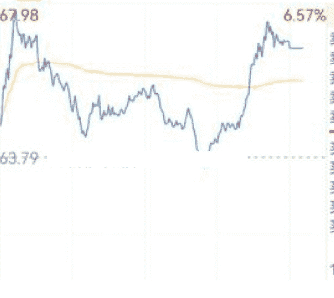
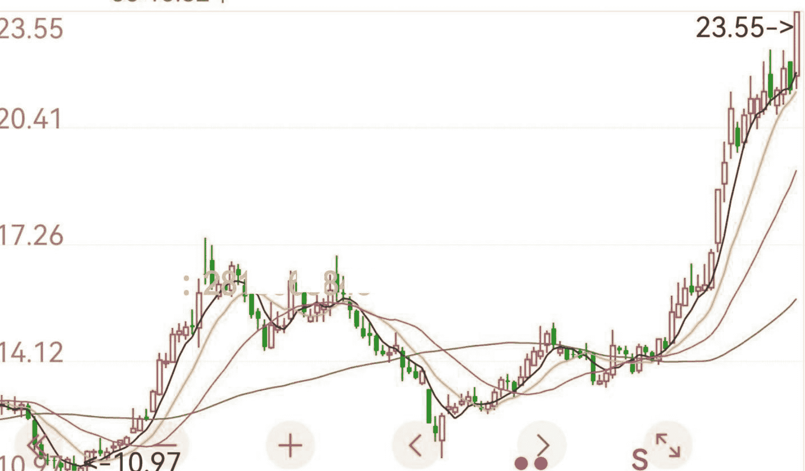
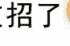

# 南院大王
2025-06-30 15:20

历史新高

这些都是鸡犬升天，占上 PCB、CPO 的毛都都能飞。

游戏终于来了，巨人代表的预期兑现，之前的冰川算领先。

那么后续呢？

按照我们早上和之前讲的逻辑，科技和游戏是内部做扩散、补涨，军工开始炒情绪，创新药在角落随时卷重来。

周五大跌，有些人就牵牛走了。

今天还讲什么？趋势不以人的意志转移。

村里换 logo 了，从连环套变成 V 字拥抱。

## 66.77 今开 64.66 最高 67.98 最低 63.49
4.67% 2.98 换手 14.00% 总手 37.64万 金额 24.80亿 总值 194.3亿 流值 179.4亿 市盈率 54.16 更多

盘后固定价格: 66.77 量: 2 额: 13354 盘后分时

股东大会: 于2025-06-27 召开2025年第二次临时股...

分时 五日 日K 周K 月K 更多

67.98 6.57% 千档行情免费送

| 卖 | | |
| :--- | :--- | :--- |
| 卖5 | -- | |
| 卖4 | -- | |
| 卖3 | -- | |
| 卖2 | -- | |
| 卖1 | 66.77 | 0 |
| 买1 | 66.77 | 8 |
| 买2 | -- | |
| 买3 | -- | |
| 买4 | -- | |
| 买5 | -- | |

分时成交
14:56 67.00↑ 56
67.00 138

## 23.55 今开 21.80 最高 23.55 最低 21.45
10.00% 2.14 换手 4.39% 总手 84.86万 金额 19.44亿 总值 455.6 亿 流值 455.6 亿 市盈 32.74 更多

分时 五日 日K 周K 月K 更多

均线 MA5:21.91 ↑ 10:21.40 ↑ 20:19.27 ↑

DK点 前复权

23.55 20.41 17.26 14.12 10.97

KDJ K:82.68 D:80.89 J:86.24

## 大盘个股点评

zg、Bob、福田一、月照大江、玲轩、剪行、来自星星、有道、沉静如海、elsa` 专用58人觉得很赞

雨喽，是吗咩：新 logo 有深意啊，国家，公司，人都都 victory 啊
2025-06-30: 15:26

雨喽，是吗咩：招牌变化得一小步，是管理，市场，我朝变化的一大步
2025-06-30: 15:27

自在：这个 logo 换好了！之前那个不仅被套，还被被困，手脚被缚动弹不得。现在这个有开放和流动感，内部循环，同时向外螺旋扩张，意蕴很好好！
2025-06-30: 15:34

和光同虚：相由心生，境随心转。
2025-06-30: 16:20

纵四海之内皆兄弟：所以说吴清是懂风水的，设计这个标肯定是要找王支招了
2025-06-30: 16:20

叶枫：讲了回，三制是我D攻城拔赛的优良美德，九九归一，十十美！中华玄学！
2025-06-30: 16:23

叶枫：博创和巨人，继续？
2025-06-30: 16:24

南院大王回复叶枫：没有看到宏观的不好微观的走歪
2025-06-30: 18:02

