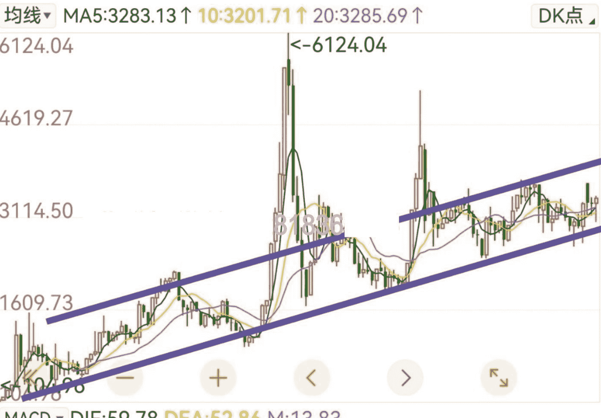
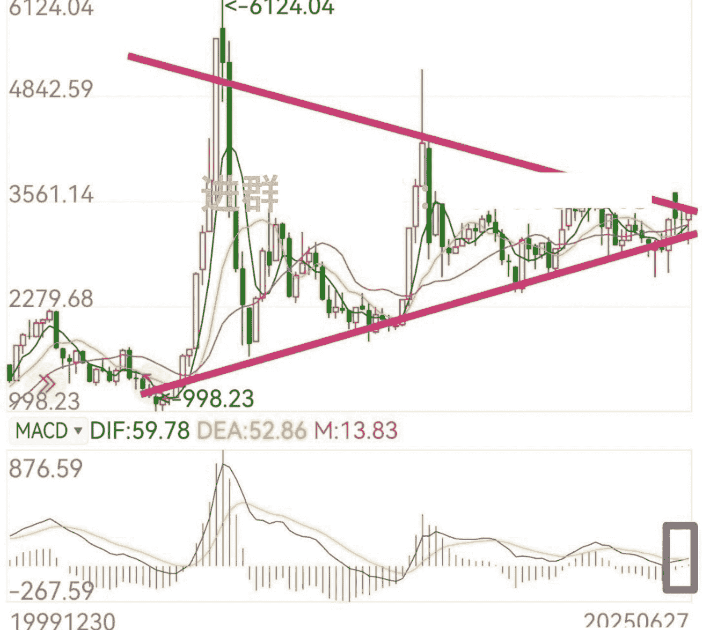

# 南院大王
2025-06-30 09:21

七月的科技继续回归

今天是半年报表最后一天，之前银行为什么加速，周五为何回落？

很多公募和机构为了业绩满一桩，然后再回调，按照募集集说明回归本业。

同时银行也要分红了，当下股东，拿完红利决定。

所以今天看谁在涨，看准谁卖，基本决定7月方向。

因为董大将即将访华，彭博500亿美金半导体大基金三期要落地，因此科技将延续回归。

- 1. 海外算力，看起来好，直到中报。中美关系缓和了，还是PCB、光模块和电源。

之前PCB较猛，之前的宏生蓝涨过，后后的聚涨，东山之类还有，模块模块依然有机会，月中他们1.6T、800G、N400G的涨，后面各种200G、50G的都在涨。

被资金同时关注到的电源，海外以迪陆为代表，国内的是科泰电源和中恒电气等，趋势是有，不够明确。后备的是液冷。

目前的热度虽然已经涨了3-50%左右，但热度并未完全打开，打开后看延续，这块块要定盘，前后和几个板块是轮动的，今天的这个涨六七个点，明天那个涨五六个点。

- 2. 国内的科技，主要集中在半导体设备，考虑到摩尔射线、芯景微等等未上市，科创半导体ETF588710可能更贴近。

一步就是国产化的板块，华为的模块是华勤科技，电源是科泰，其他的同学们自己挖。

同时，谷歌的TPU开始给供货，TPU是中国努力的ASIC之一，ASIC芯片是老牌，代表就是寒元、芯原那几个家伙，有望着出灿。

免费进资源分享群
jntsg8

博创同时为ASIC搞光芯片封装，广合科技为其做PCB，锐捷网络做交换机。

国产纯正TPU概念的是上市的中昊芯英，科德教育和浙数文化有投资了，但目前没看到资金介入迹象。

总之从中报角度，N系海外算力的业绩可靠性更佳，虽然弹性可能已经忽略。

稳定币今天可能要部分调整，美股的Circle跌了，但整体肯定没走完，它是政策和情绪催化。

其他板块可参考前文。

不用太担心大盘，30年季线上升趋势，15年收敛结构的末端。

ps. 仅为学习。

# 中国500亿美元芯片基金调整策略以应对美国限制

作者：高远和董东
June 27, 2025 at 5:01 PM GMT+8

- 要点：中国集成ETF规模将因基金涌入科技债券而几乎翻倍——彭博社
- 中国大基金三期调整策略方向，重点攻克光刻机与芯片设计软件等关键领域短板，以突破美国对中国技术发展的遏制
- 该基金将支持光刻系统和芯片设计工具等瓶颈领域的本土企业与项目，并计划比前轮投资持有更长长时间
- 中国500亿美元芯片基金调整策略以应对美国限制——彭博社国家大基金三期将在未来数月内进行首批重大投资，其指导方针推动行业整合。若达到原定规模，该基金有望成为中国史上规模最大的半导体投资基金。

# 上证指数

000001
3424.23 今开 3450.69 最高 3462.63 最低 3421.04
-0.70% -24.22 换手 1.10% 总手 5.23亿 金额 6057亿

上涨家数 1463 平盘家数 110 下跌家数 746 更多

分时 五日 日K 周K 月K 季K

# 上证指数

000001
3424.23 今开 3450.69 最高 3462.63 最低 3421.04
-0.70% -24.22 换手 1.10% 总手 5.2亿 金额 6057亿

上涨家数 1463 平盘家数 110 下跌家数 746 更多

均线 MA5:3283.13 ↑ 10:3201.71 ↑ 20:3285.69 ↑ DK

