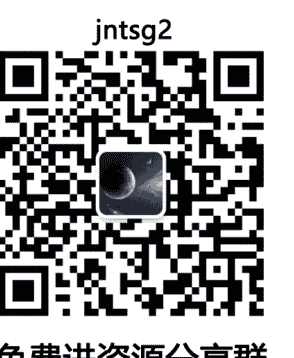
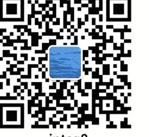
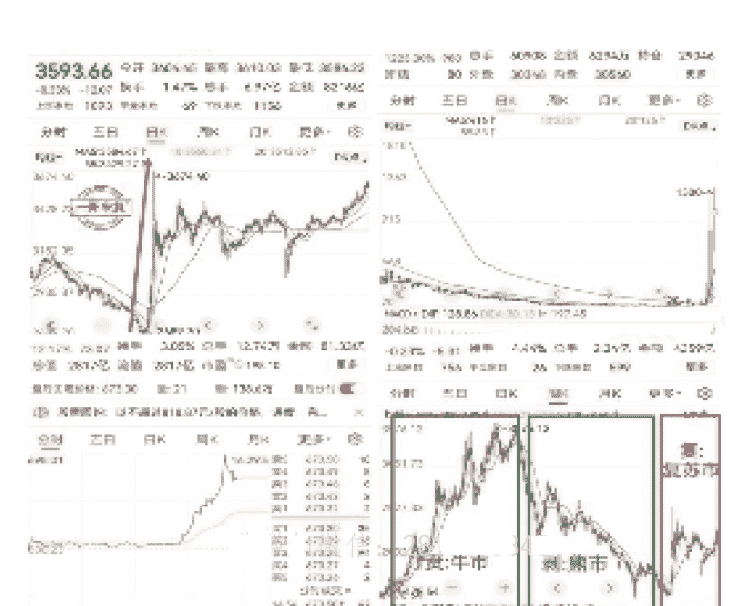
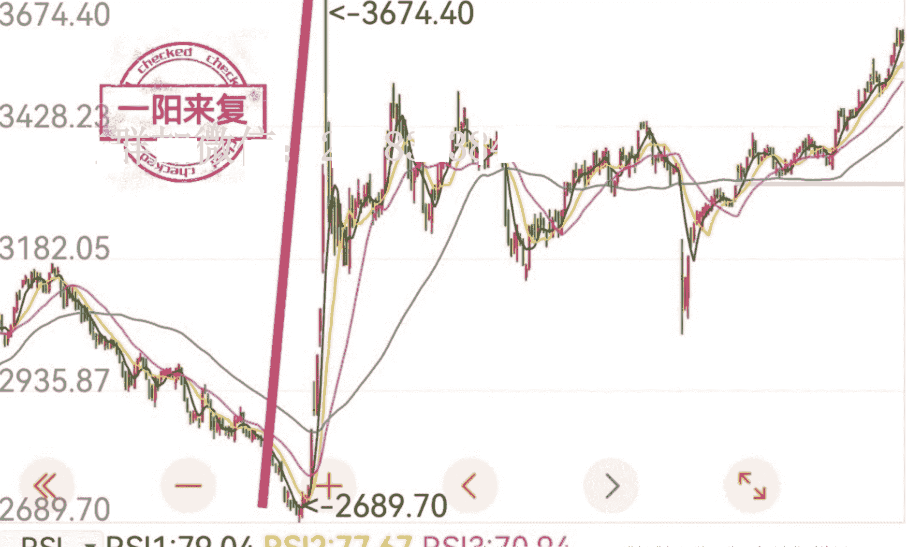
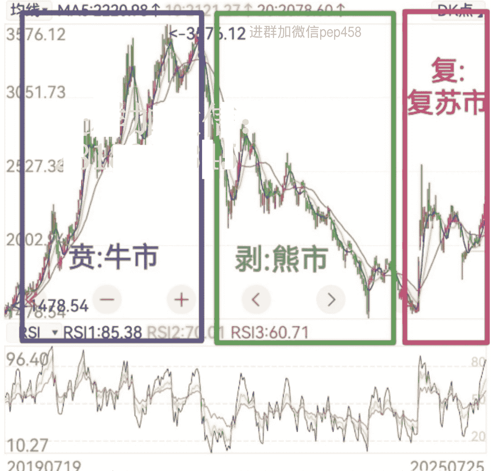
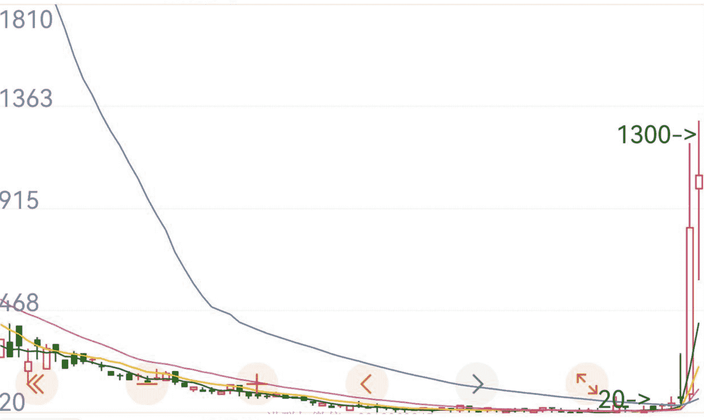
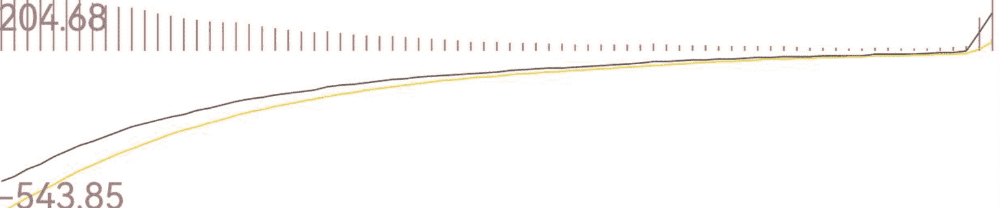
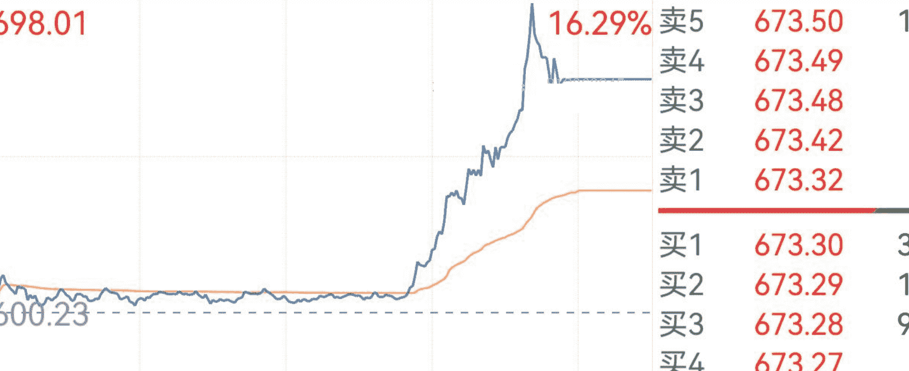

# 2025-07-26 09:51：易经第24复（上）：早地播葱，百点长阳

前天有人问，你在哪里聚牛市？

易经第22卦，是匮，人工牛市，一片大涨。

易经第23卦是剥，剥脱，剥落，熊市。

但剥到了极致，横住盘拒绝再跌了，那几天就会“一阳来复”，“万象更新”。

上周五，资金是不是从诸路涌进牛市的半导体和国产算力？

牛到极致走熊，熊到极致走牛，轮轮循环，生生不息。

这是先资通过破解世界代码，告诉我们的终极智慧。第24卦“复”。

10年前人们涌进互联网大厂挥弃体质，现在人们进体挥弃企业，再过几年可能又倒过来。

今年涨到离谱的创新药，他们之前4年，跌的也跌了。

宇宙和人间万事万物，都是在玩高低切，在高位高低切和循环中一轮又一轮的发展。

真正妙的股票，做好规划自己的人生和未来，来不是先看到几个代码，而是先通透智慧。

然，你何以平静持仓，不为所动，是一会卖飞牛骨，割肉底部。世界上最伟大的力量就是时间，一定会促进进值的回归。

“夏。出入无凭，朋来无否。复往其，七日来复，利攸往”。

复，，是通的。出门处均无问题，对外外交也没有毛病。万物运行周期，并且反复循环，你要在转折点蓄力待发，迎接新的机遇。

象曰：雷在地中，先王至日闭关，商旅不行，后不省省”。

复具体的体意的，是坤上下，大地上，雷声在下，内部在酝蕴勃的力量，先王看到这种Perhaps，关闭门城，诸商也不巡视地方，躬身自身，酝能量，以待春天。

每个优秀的，都有一段沉淀的时光，那段时间光，我们付出了很多努力，却默默无间也看不到什么结果，那段蛰伏的日子，我们把它叫做掘机进。。

如此朋友，如果你现在不好，请不要放弃，积蓄力量，等来自己的时刻；如果你现在很好，请戒戒躁躁，百尺竿丈，寻求自己的增长曲线。

横有多长，就有多高，正可谓，金鳞不是池中物，一遇风云就化龙。

一阳来复是什么图形，经典的就是924行情，这几天的，放两张图大家体会一下。当然仅为示范不构成建议，复了之后怎么参与，我们下篇再说。收起

# 枫：万物皆周期！

循环往复，人生皆如此
2025-07-26:10:50

- 智字：大王，英伟达链的PCB、光模块都创新高了，国产算力链的PCB、光模块是不是迟早也会创新高？（2025-07-26 11:17）
- 飞雪回复叶枫：2025-07-26 12:53
- 南院大王回复智字：华为的华工科技就不新高了吗，国产算力链看的是核心芯片和AIDC，这两天会话。（2025-07-26 14:48）
- 牛王魔回复南院大王：下一个资金修复的版块医疗还在底部聚聚市。（2025-07-26 16:57）
- 陈W.M：大王，能分析AI未来两走势吗？可以关注，有哪些受益股？（2025-07-26 20:22）
- 南院大王回复陈W.M：AI的核心不是soc。（2025-07-26 20:40）
- 叶枫回复陈W.M：目前比较突出的轻量化发热问题，算法延迟及处理，部分反馈还带着，小米的发布没多少，进步。（2025-07-27 08:09）

## 上证指数
000001 3593.66 -0.33% 12.07
今开 3604.45 | 高 3610.03 | 低 3586.22
换手 1.47% | 总手 6.97亿 | 金额 8216亿
上涨193 平盘69 下跌1156
分时 五日 日K 周K 更多
均线 MA5:3584.67 ↑ 10:3550.31 ↑ 20:3513.85 ↑ 55:3429.27

## 创业板
399006 2340.06 -0.23% -5.31
今开 2348.28 | 高 2350.06 | 低 2332.02
换手 4.44% | 总手 2.34亿 | 金额 4359亿
上涨756 平盘26 下跌599
分时 五日 日K 周K 更多

## 碳酸锂
25年0月购100000 1060 22.50% 980
今开 1000 | 高 1300 | 低 600
总手 60908 | 金额 6294万 | 持仓 29046
昨结 80 外盘 3348 内盘 30560
分时 五日 日K 周K 更多
均线 MA5:416 ↑ 10:225 ↑ 20:126 ↑ 55:83

MACD DIF:128.86 DEA:30.13 M:197.45

# 673.30 今开 599.53 高 698.01 低 599.53
12.17% 73.07 换手 3.05% 总手 12.74万 金额 81.33亿
总值 2817亿 流值 2817亿 市盈 198.10
盘后固定价格: 673.30 量: 21 额: 138.6万 盘后分时
股票回购：以不超过超过818.87元/股的价格，进度:完...

分时 五日 日K 周K 更多

| | | 价格 | 数量 |
| :--- | :--- | :--- | :--- |
| 16.29% | 卖5 | 673.50 | 18 |
| | 卖4 | 673.49 | 8 |
| | 卖3 | 673.48 | 8 |
| | 卖2 | 673.42 | 2 |
| | 卖1 | 673.32 | 2 |
| | 买1 | 673.30 | 35 |
| | 买2 | 673.29 | 16 |
| | 买3 | 673.28 | 94 |
| | 买4 | 673.27 | 4 |
| | 买5 | 673.26 | 2 |

分时成交↑

| 时间 | 价格 | 数量 |
| :--- | :--- | :--- |
| 14:56 | 673.50↑ | 42 |
| 14:56 | 673.28↓ | 83 |
| 14:57 | 673.28↑ | 25 |
| 15:00 | 673.30 | |
| 15:34 | 673.27 | |

