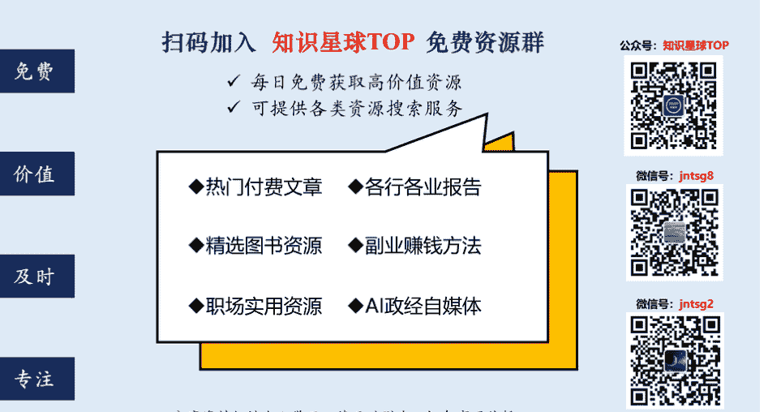

# 鉴财富进阶250617：盐铁会议与陆家嘴论坛

南院大王：

国家高速发展，但各阶层都感觉获得幸福感不足怎么办？大家对政策未来的预期不明朗怎么办？

那么大家就辩论一论，

公元前81年，大将军霍光组织召开了一次关于汉沿治国方略的辩论大会。

参会的人分为两派，一派是以霍光为首的“贤良文学”即社会人士六十余人，他们主张与民息和市场经济；

另一派是以财政大臣桑弘羊为首的“官营”派，他们主张行政干预与国有垄断。

因为当时的盐和铁被政府垄断，是最盈利高利的利润品，所以后来被整理成了《盐铁论》，会议也叫做“盐铁会议”。

从此，朝堂的意见发布和政策探讨可以被民间“知悉”，成了一个惯例。

2008年，由人民银行、国家金融监督管理总局、证监会、外汇管理局和上海市，共同搭建了一个平台，叫做“陆家嘴论坛”。

每年都有重量级人物和嘉宾，会后都确定了新的大事和方针。

可以说，它是中国金融和资本的定调发布会，而且非常详细，来的都是各部门的主要负责人，他们执行。

几来的主题和大事：

2020年：
新起点、新使命、新愿景，论论坛后启动深圳、苏州等数字人民币试点，2023年试点范围扩大至17省。

2021年：
人民币国际化、碳达峰碳中和金融支持。会后，很多绿色债开始发行，碳中和概念大涨。

2023年：
金融科技与 ESG 结合，推动数字化金融创新，那年初很多银行开始搞 AI 风控，各种闪电贷的秒批产品大量上线。

2024年：
金融高质量发展，“科创板八条”出台，同时强制上市公司提升投资者回报，要求现金分红比例不低于净利润 30%，推动市场治理规范化。

今年的的主题是什么？
《全球经济变局中的金融开放合作与高质量发展》。

新动向是人工智能赋能金融，“金融支持新生产力”，聚焦半导体、量子计算等前沿领域；再保险市场建设、金融法治国际化。推动上海-香港联动，探索跨境理财通扩容与再保险市场国际化。

还是希望往高科技领域去走。

陆家嘴论坛是“朝”、这个论坛结束几个月后，上海还有一个“野”的，即外滩金融峰，它由中国金融四十论坛（CF40）与中国国际经济交流中心（CCIEE）联合主办，请的是世界各地的财经政、机构高管和学界领袖，智库代表，名流等。

进而朝野联动，共同看看效果和呼应。

2020年，马老师去了开炮，结果大家都知道。

全文完

Saint li：后者概率大毕竟全球火药桶之一中东有终结之势，压力一下子回到了亚太

牟牟：在术数，不在劳身

王多肉谢夫淫：想知道是霍光胜利了还是桑弘羊胜利了

100 课程大师 回复王多肉·谢夫淫：霍光。有格局，搞过活市场后来有了昭宣中兴。

字 回复 100 课程大师：关键的还有多少人愿意相信犬口向向？拿出实际行动才行

王肉肉·谢旻回复 100 课程大师：谢谢大王。刚也百度了一下，是霍光胜利了。

经济政策的调整调整是不是应该和农民种橡一样遵从“天时”，该放的该收的。毕竟经济这个东西，手心手背都是肉肉，都是自己的。

100 课程大师回复：小字：明天见

分享资料仅个人学习，请勿对错，如有需要请传播

加微信intsg2，进资料分享群
