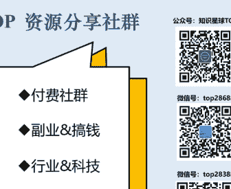

# 鉴茶财经院 251024：强者恒强

当你知道，

知识星球TOP 资源分享社区
汇聚全向，向价值创造

- 财富文章 ◆ 财经社群
- 投资国际 ◆ 财富线
- 财经与股市 ◆ 行业科技

学习、发现、拆解、创造、深度学习、策略、软件、创意、商业

- 调整已接近尾声，
- 校花的具体转身，明年利润中值 250 亿，
- 上峰决定要大搞科技，
- 碰到她 300 多元，碰到她-4.66%大跌，
- 碰到它折合 2026 年 16 倍 pe，

你的选择是：

B，扶一把。

“涨了就要回去，跌回去就要涨上来”这是典型的认知误区，不懂行的博主和机构忽悠你们的。

涨跌互现，均值回归，只针对好学生。

校花本来考 100 的，前几天和妈妈吵架了，发挥失常跌到 80，下回再涨到 100。

加微信：pep458获取文章

你要说有个学渣，平时就 50 分，你怎么可能有 100?

回归是人家花回归，轮不到你。

早上为什么还有调整？

咱们也说了，是因为很多机构手里拿了了一堆杂毛和老登，再一次调虎离山让你交科技筹码。再次给了你上车排核心的机会。

论预期，创业业绩的内幕，考题的底子提前都递给你了。

论技术，胜宏 55 日线稳 5 日平台再有 PCB 利好刺激也谈得很透彻了。

为啥老登彻底不行，

你看昨天天公报里有传统产业，有提到怎么发补贴吗？基本没有。

就八个字，“力量而行，尽力而为”。

说白了老登你别添乱就行了，你要凭真本事事吧，别谈预期和概念念了，不给。

各位以为老登核心是什么，地产和城投平台啊，真潮到最后迟早去那里。

上峰真的是 NB，你得佩服这决心魄力，救地产和平台，不是哈本事，敢于教你硬实自主创新，才是真本事。

最后要扬一下 Amey 同学的，科技大跌那几天，她赌性顽强，捡易天ETF159381，孩子的岁钱都拿去搞了恒利，相当于淮海战役血战大王牌时，把自己的通讯员，炊事班，医疗兵，马夫，警卫连全拉上去了。这决心气魄，能不赢吗?

今天谷歌 TPU的新闻广泛传播，而我们提前谈过了谷歌链

昨天还专门给了调整，上车的开心吗？

男方女方双发力，旭创新高，等待寒王再超茅台。

你说后面还涨什么？再度参考 4-8 月，机构回过神来会重新加仓科技，它们一天买不完的慢慢慢慢。

加微信：pep458获取文章 查看

# 算力飙飙光模块 5000 亿中际创再创新

21 世纪经济报道:

2025 年国产算力产业迎来供需共振的爆发期。需求端，大厂资本开支延续高态势，算力国产化共识逐渐形成；供给端，先进制造突破与企业创新驱动下，一条自主可控的产业链加速成型。在此背景下，政策密集加持与技术路线创新，推动产业迈向新阶段。

财联社 2025-10-24 10:24:23 星期五

【中共中央新闻新闻发布会：未来 10 年将再造一个中国高技术产业】

财联社 10 月 24 日电，中共中央今天(24 日)上午举行新闻发布会，介绍和解读党的二十届四中全会精神。国家发展改革委党委书记、主任郑沪洁介绍，创新育新，就是要培育壮大新兴产业和未来产业。2024 年，我国“三新”经济增加值 GDP 比重超过 18%。“中共中央规定国民经济和社会发展第十五五年规划的《建议》提出打造新兴支柱产业，加快新能源、新材料、航空航天、低空经济等战略性产业集群发展，将催生数万亿级市场甚至更大规模的市场。《建议》还将前瞻布局未来产业，推动量子科技、生物制造、氢能和核聚能、机器接口、具智能、第六代移动信成为新的经济增长点，这些产业勃勃发展，未来10年将创造出一个中国高产业。

信息精选（原价499，年费365）包括全部内容赠送历史文集：

- 加微信vip458 信息精选VIP群体备用微信qihaogongyuan8
① 叮发群众包时文档时群群群文档（原价 360 元/年）
② 子明轩义（会员）内部文章（原价 568 元/年）
③ 刘享宁（褚子刚）付费内文章诸群群聊
④ 米联讨见间【作者林】（原价 599 元/年）
⑤ 州众龙会员专属文章（原价 328 元/年）
⑥ 转华付费内部圈（原价 400 元/年）
⑦ 老文坤云读读书会专属文章（原价 699 元/年）
⑧ 墨豪财经识星球（原价 3310 元/年）
⑨ 蜀的望林解读毛选全套豪（原价 299 元/年）
⑩ 新周肖刘【独家内容》（原价 148 元/年）
⑪ 杨世光在金牌（原价 220 元/年）
⑫ 崇磊财经识星球（原价 1600 元/年）
⑬ 萧游许付费文章（持续更新）
⑭ 可马林捷豪全套豪和全书籍藏版无删割（原价 2.3 万）
⑮ 虚虚三曲比（民国、帝国战争、不被理解的MAO）【原价 599 元】
⑯ 陆付费星球文章（原价 268 元/年）
⑰ 外再内送：户麟新微播付费专辑、村西老王、三花九树文集
不定期内容：——（更多资源写不下去了……
十八 守奴人可识星球、接获凤凰和周识星球、生育术星球、成就富帝国、雪花甲老头等
十九 创始笔记、达达译论识星球、成就财富源
二十 A 非野、大树多读、江宁号、呼咏说、上海海学家等付费文集
⑒ 西风付费文章等大V（每月不低于2000元/年）

信息精选，原价499 元现价365 元，包含以上内容。

# 加微信：pap458获取文章 免费
