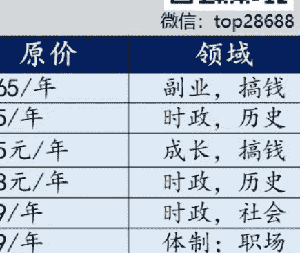

# 鉴茶财经院 251025：易经第27 颐卦：吃好吃爽吃长久

又到了周末谈人生和风花雪月阶段。

大家周一到周五挣钱，这是“大畜”，要一直收获，坚持下去，持续下去，源源不断，不容易的，要修，要养。

这正是“颐”卦。

初九：颐吉；观颐，自求口实。

《象》曰：山下有雷，颐，君子以慎言语，节饮食。

颐卦为上卦为艮，为山，下卦为震，为雷，雷出山中，万物萌发。

十五五规划来了，如如此长的时间，你如何始终终持盈保泰？

“君子以慎言语，节饮食”。

该听的听，该说的说，不该听的，不该说的，已经不说了，该吃的吃，该喝的，其他吃喝的，已经不感兴趣了。

这样，才是养养。

加微信top28688，进资料分享群

在“大畜”阶段，你没有什么基础，能顶级的都吃，能赚钱的都干，

什么核聚变，超导体，俄乌概念，工程机械，量子信息，马股，能挣钱的都炒，到了“颐”的阶段，只做很少的东西了。

巴菲特当年买买 70 股，后面慢就买四五个股了。

初九，舍尔灵龟，观我呆妥，凶

《象》曰：“观我呆妥”，亦不足也灵龟，是有灵气的大龟，自然是好东西。它指的是你的先天和根本。

安于自己的生活，看到别人大块妥颐便馋，急于去取功名，结果是凶险的。

比如，我涅茧开医美挣钱了，我去搞医美，别人都去质很热门，我也得去考。

每个人的特色，机缘，禀赋，赚钱和富贵的方式截然不同，一定按照自己的优势和特色去最大化的发挥，不能盲目照抄。

就像有的同学，人家经验丰富，擅长高低吸，热门题材，人家就能在风口尖上赚一个股，而你

加微信top28688，进阶分享群

比较木讷钝，承受差，那不如定投 etf 或者锚住几个优秀的长期公司。

齐白石说，“学我者死，像我者死”，

你要学别人的，永远是方法论而不是外壳。

学的是“为什么我要买它”，而不是“代码是什么？”

六二，顾颐；排駔于顾颐，征凶。《象》曰：六二“征凶”，行失类也。

赖吃东西，违背养生常规，在土堆边吃东西，征有凶险。

依赖走捷径，捞懒，是难以长久的，危险的。生活中估计不少人总会告诉你一个热血沸腾，前景光明，你只出钱，不花什么精力就短期收获巨大的项目，千万万别信。

股市中也一样，什么重组了，要收购了，大佬拉升了，某个 ST 要装资产了等等消息，基本都是忽悠，一个不要采纳。

光是上海微电子的光刻机要装哪里，多少所谓内幕，上海的多少垃圾公司都炒过，现在也免谈。

加微信top28688，进资料分享群

六三，拂诡；贞凶，十年勿用，无攸利。《象》曰：
“十年勿用”，道大悖也。

违背养生之道，长期都拒绝转型，拒绝改变或者固执己见，自然然没有利益，因为大道相悖了。说的就是老老登。

从2015年起，上峰就坚决的要求“去地产，降杠杆，搞科技”。但层层出穷，源源不断的人依然在一拥而上，螳臂挡车。

到了今年9月，依然还有人“抨击科技泡沫”，给老登站讲话，号召大家高低切，买堆昂贵又没有预期的夕阳产业。

到了上周五早上，十五五规划都出了，电视上十点都要直播了，还有人一早在“观望”，在磕科技，拉老登，多的看不清形势。

2015-2025，正好是十年，“十年勿用”。

小目标王同志又在地产里坚持扑腾了十年，没有啊。

人生苦短，不留神10年就过去了，正可谓，富在术数，不在劳身；利在势局，不在力耕。

加微信top28688，进资料分享群

有了正确的方向和趋势，但过程并非一帆风顺的，漫取经历，先积累了具体的操作指南和指引呢？
我们下期再讲。

# 知识星球TOP 资源分享群

添加微信
免费入群

| 序号 | 公开/星路/社群 | 原价 | 领域 |
| :--- | :--- | :--- | :--- |
| 1 | 生才有木 | 2765/年 | 副业、励 |
| 2 | 记忆众吃萨 | 365/年 | 时政、历史 |
| 3 | 碧犀风 | 365/年 | 成长、励 |
| 4 | 欧洲金锐 | 328/年 | 时政、历史 |
| 5 | 克友大会 | 699/年 | 时政、社会 |
| 6 | 体制内主任 | 599/年 | 时政、职场 |
| 7 | 局外的视角 | 669/年 | 金融、财富 |
| 8 | 潇涯非绊 | 4166/年 | 财富、成长 |
| 9 | 守诺人心合 | 599/年 | 时政、经济 |
| 10 | 江江护少 | 365/年 | 时政、国际 |
| 11 | 政事堂/颖子明 | 568/年 | 时政、经济 |
| 12 | 库川 | 1399/年 | 金融、财富 |
| 13 | 大树栖语 | 199/年 | 时政、成长 |
| 14 | 水库联沃 | 10000/年 | 房产、经济 |
| 15 | 洪演的宏规律 | 4376/年 | 经济、励 |
| 16 | 金融通鉴/南海山 | 4576/年 | 股票、行研 |
| 17 | 鸿哥的世界 | 299/年 | 时政、社会 |
| 18 | 飞沃云 | 3600/年 | 股市、经济 |
| 19 | 鉴爸爸财经 | 330/年 | 金融、金融 |
| 20 | 赢在八小时之外 | 365/年 | 房产、股票 |
