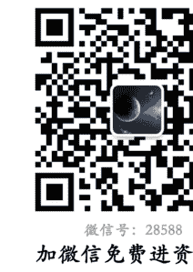

# 鉴茶财经院 251208: 迎接新行情春运动

周末的消息，村里调低了险资的风险因子，给券商加杆，都是要进一步给股市注水。

第一，先说大金金融，反正仓位组合有新机会，继续拿着就是。

玩法是手快的，一看券商启动，你立刻点仓位，一看券商萎靡，你见好就收，高开不追记。

科技的女方海外算力，【最近有往上游登陆的趋势】，确切的说，是光通讯光器件的上游。

类似于上一轮宁王涨了以后，大家去挖掘隔膜，负极，这一次，旭创等涨了以后，机构早就去挖掘上游的组件。

我们把核心供应商再梳理下：

1. 法拉塔旋硅片，东磊（微）有望打破日本垄断。
加微信top28688，进资资料分享群。
福晶科技（在送样阶段，福晶原本是光刻机概念）这个产品26 年的需求也要增加一倍。

2. EML 芯片/CW激光器：
源杰、仕佳、长光华芯。
源杰最聚焦，是CW激光龙头，旭创核心供应商，北美也有工厂；仕佳节奏稍慢，战线更长，产品更多更多；长光号称100G的EMML已经量产，200G在送样，业内看不好，旧游头认为有搞头，也可能是位置稍低，其他两家都好几倍，有交易价值。
永鼎股份旗下的子公司永鼎光电，也说自己有生产100G的 EML 和 CW 光源，也是二线交易价值，如果真按源杰的涨法，它算是没涨过。
但交易价值就是交易价值，不能太头上，狠砸了你再去，大涨要注意跑，动能能够通过验证两事。
Lumentum 则透露，预计 EML 与 CW 激光器芯片的短缺状况将至少持续到 2026 年底，价格上涨预期强烈由于 EML 芯片的产能扩张周期长达12-18 个月，供应难以迅速跟上市场需求。
加微信top28688，进资料分享群。

做这块多盯美股 Lite，基本是一荣俱荣。

3. 硅光调谐器，这个旭创就能干，后排的是华工和光迅。

4. C-lens 组件，华腾光电，未上市。

5. FAU、光栅耦合器，天孚通信。前两天Marvell豪挪32.5亿美元收购了光互独角兽 Celestial AI，天孚的差不多。

6. 光纤阵列(FA)，仕佳。

7. 高通道V槽，矩光科技，前段时间刚刚实现96 通道的量产，之前讲过是华为突击入股的公司，他同时还生产硅透。V 槽的供应量很紧也会成为卡点。

8. 测试设备，长川科技、华峰测控，这两个主业务是光刻机和国产半导体的，光模块这种天然更能搞。

上面是怎么涨法的？此起彼伏。这个涨涨涨那个。

第三，男方的国产半导体，依然是国产芯片和先进制程，尤其是之前讲过长江鑫供应商的，微导纳米，京仪装备。
微信top28688，进阶资料分享群。

沐曦马上也要上市，设备明年景气度不是问题。

第四，东大链芯对应的西大缺电，这几天好几个机构给我们讲他们去调研了杰瑞股份，原来是燃气轮机电机组获得北美订单，不建议大家去追气轮，金盘科技、伊奎尔之类的在34日不好吗，电网设备ETF是回落买点结构。明年出口的亮点之一是电力设备。

第五，春节月的概念，擅长和喜欢打子的，雅下水电站之类同学们自己看过，龙头很可能是上一轮有概念的，比如冰轮环境这种这块。

我不熟悉，同学们可以自己发掘，工程机械是缺不了的，这里的核心是恒立液压。不仅是工程周期步步它，它还有机器人概念。

请注意，以上大多数数字你看看他们的图，涨法基本都是破旗翻模型，涨一天跌3天，你纵险欲准备备了，它猛然给你个20cm，所以不要上头，逻辑为主，图形为辅，老祖训。

加微信top28688，进资资料分享群。

# DealBook Summit
美国是中国的盟友

# DealBook Summit
美中关系保持不变

# 知识星球TOP资源群
入群畅看网内付费资源（部分）

| 序号 | 公众号/星号/社群/V会员 | 原价 | 领域 |
|---|---|---|---|
| 1 | 生育教育 | 2765/年 | 副业·搞钱·电商·自媒体 |
| 2 | 欧洲搞钱 | 328/年 | |
| 3 | 众筹·虎见云会 | 365/年 | |
| 4 | 政事/诡子明私会 | 568/年 | |
| 5 | 广见开云会 | 699/年 | 时政·经济·国际·历史 |
| 6 | 江江宁湖 | 599/年 | |
| 7 | 来职闲见网 | 26/周 | |
| 8 | 读书的世界 | 599/年 | |
| 9 | A星级会员 | 899/年 | |
| 10 | 宁予付心令 | 1888/年 | |
| 11 | 付妈妈 | 899/年 | |
| 12 | 洪源的宏观视角 | 4576/年 | |
| 13 | 金政通/薇莉 | 1599/年 | 股市·财富·房地产·趋势 |
| 14 | 丁士莱豪 | 330/年 | |
| 15 | 豪事财经 | 3600/年 | |
| 16 | 莹筱老姐 | 28/周 | |
| 17 | 万宁分析 | 6980/年 | |
| 18 | 水木云汇 | 498/年 | |
| 19 | 智融运营 | 365/年 | 社会·职场·认知 |
| 20 | 记忆汇/锦鲤南西 | 99/年 | |
| 21 | U省/薇在小海之时 | 599/年 | |
| 22 | 武策堂（学习党） | 669/年 | |
| 23 | 体制内主人 | 4166/年 | |
| 24 | 外界人的秘密 | | |
| 25 | 涛源非语 | | |
| 26 | 大树少女 | | |
| 27 | 图务·策划资源 | | |
| 28 | 影视·剪辑字体资源 | | |

VIP群：特价888/年+每天分享资源+入群赠料（价值过万）
