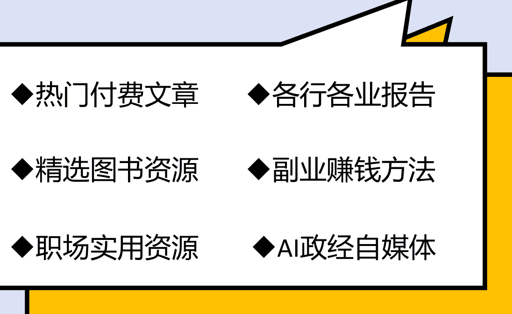
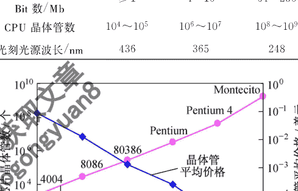
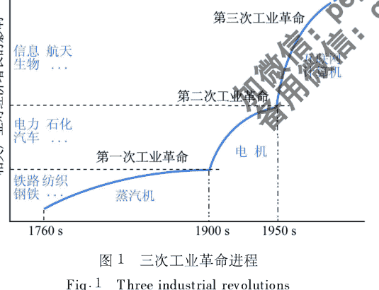
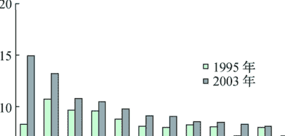
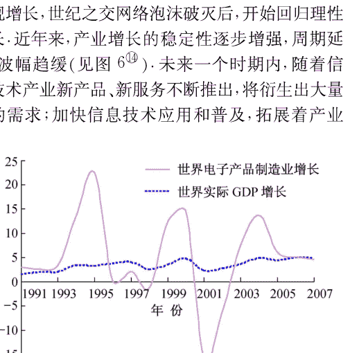
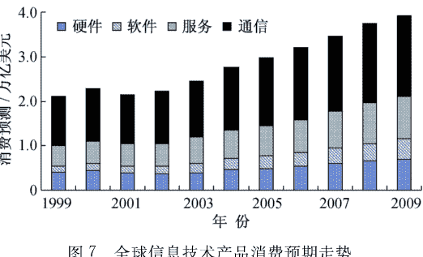
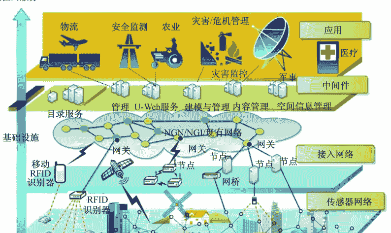
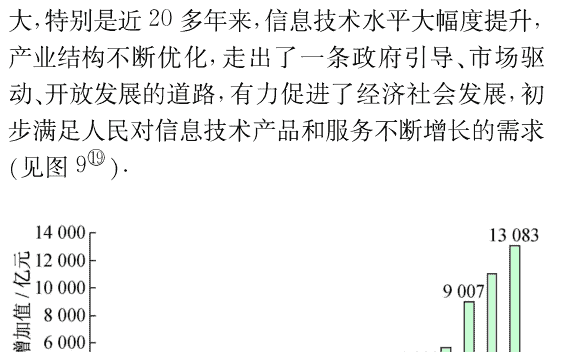

## 新时期信息技术产业的发展

江江峰

摘要：本文述了信息技术产业的发展地位、作用和发展趋势，指出以互联网、计算机代表的信息技术，引发了第三次工业革命。信息技术产业已成为新时期经济增长的重要动力，对促进了可持续发展，深刻改变着人类生产生活方式。文章探讨了世界信息技术产业发展趋势，认为信息技术正在迎来重大突破，产业聚集与融合趋势日益明显。本文提出，应当进一步发挥信息技术产业促进增长的“加速器”、“转换器”和产业升级“助推器”的作用，坚持自主创新、产业聚集、集成融合、军民联动、跨越发展方针，以信息化带动工业化，以信息化促进信息化，走一条中国特色信息技术产业发展道路。加强发展电子、计算、硬件、关键技术等基础产业，以及宽带通信、下一网络、信息服务等具有国际竞争优势的产业政策体系，力到2020年前，将我国建设为信息技术产业强国。
关键词：信息技术产业；产业发展；发展战略；新时期；中国

中国分类：F 49  文献识别码：A

## Development of IT Industry in China in the New Age

JIANG Ge Feng

Abstract: The article explains the role and future of IT industry, and states that technology represented by the internet and computers has brought about the third industrial revolution in history. An important impetus for economic growth in modern times-the IT industry has greatly promoted sustained development and profoundly changing mankind's way of life and production. In discussing the development of world IT industry, the article suggests that potential new breakthroughs in IT technology, the trend of agglomeration and integration of industries has becoming increasingly obvious-competition of intellectual properties and standards is intensifying and ubiquitous networks is shaping it. It points out that China should bring something better into the role of IT industry as an “amplifier” in economic growth-“transformer” in development and a “propeller” in industrial upgrading. It is important to follow a policy that emphasizes independent innovation; market-driven approach, open and compatible technologies; serving both military and civil purposes; such that a quantum leap of IT industry will be achieved.-China should advance industrialization with IT technology with Chinese characteristics. Greater efforts should be made to develop such core sectors as microelectronics, computer, key components and materials, as well as sectors with international competitiveness-including broadband mobile communication; next-generation network and information services. Common improvement should be made in the policies guiding the development of IT industry with a new age to making China with a strong IT industry by 2020.
Key words, information technology industry; industrial development; development strategy; China

收稿日期：2008-06-06
*新时期是指1978年改革开放到2020年的时间区间

## 免费 价值 及时 专注

## 扫码加入 知识星球TOP 免费资源群

- 每日免费获取有价值资源
- 可提供各类资源搜索服务

| 热门付费文章 | 各行行业报告 |
| :--- | :--- |
| 精选图书资源 | 副业赚钱方法 |
| 职场实用资源 | AI政经自媒体 |

公众号: 知识星球TOP 微信号: jntsg8 微信号: jntsg2

分享资料仅供个人学习，请及时删除，切勿商用传播

# 上海大学学报 第42卷

当今世界，以信息技术为代表的高技术产业得到了快速发展，推动了全球结构的整合与升级，极大改变了人类生活方式的深刻变化。在21世纪，信息技术日新月异，并随着应用范围扩大对政治、社会、文化、军事领域的影响增大，信息技术已成为一个国家或地区国际竞争力、竞争力和现代化的重要标志。我们必须全面面对当今信息技术趋势，我国需要

电路中的晶体管数量平均每每年10倍，1970~2004年。存储器中的晶体管数量每月增加18倍，微处理器架构每季度增加24倍，1971~2000年。CPU上晶体管成本平均每年下降7倍（见图2-1）

# 1 信息技术的地位和作用

18世纪中期，以蒸汽机为代表的第一次工业革命开启了人类的机器时代；19世纪后到20世纪中叶，以电力代表的第二次工业革命使人类进入了电气时代；20世纪下半叶，互联网技术的出现使人类社会模式从工业化向信息化发生了深刻转变，生产力得到了极大提高，社会生产和人类活动达到了前所未有的高度，正处于信息化时代（见图1）。

表 1 集成电路技术更新及变化

| 第1代 | 第2代 | 第3代 |
| :--- | :--- | :--- |
| 1975~1985年 | 1995~2005年 | 2005年后 |
| 晶体管尺寸(μm) (每年的倍数) | ≥1.00 | 1.00 | 0.35~0.09 |
| 晶片面积(cm²) | 10.16~15.24 | 20.32~30.48 | (8~12) |
| DRAM 产量 | (4~6) | (6~8) | |
| 带宽(MB/s) | 1 | 64 | 256 |
| 晶体管数量 | $10^4~10^5$ | $10^7$ | $10^8$ |

图2 集成趋势及其单个晶体管价格的影响

信息技术的发展和广泛应用，有效地促进了硬件与软件的融合，使得产品与服务的深度结合，形成了社会发展的跨越。信息技术渗透到各个领域，有力推动着物质科学、材料科学的进展，极大地提高了效率。随着互联网的普及，以及传播的速度加快，为科学的全面发展创造了机会。

### 1.1 信息技术创新的沿领域

信息技术是当今世界最新、最快、渗透性最高的技术，是人类能力的体现。信息技术发展历史悠长，但与过去相比，信息技术的新领域如计算机、微电子、通信等层出不穷，特别是与集成电路相关的技术，更新速度极快（见图1）。1965年，Moore's Law

### 1.2 信息技术作为国民建设的基础

信息技术是一种通用目的（GPTs）。与传统技术相似，信息技术与结合在国民领域能够增强生产强度和带动效应，使得工业、农业和服务业的生产方式发生变化，成为经济增长的新点（见2）。

① 来源：工业部-信息技术发展报告(2007)。访问网址：http://www.mi.cn

### 1.3 信息技术是维持发展的重要力量

在现代社会，经济增长动力从土地和劳动力转向知识和信息。信息作为一种无限制的资源，能够产生额外收益，拓展增长来源、促进经济的持续（见4）。信息的开发、技术创新的生产要素在经济发展中发挥重要作用，对发展的贡献巨大。在发达国家，建立在信息技术基础上的技术进步对经济增长的贡献约为70%（见5）。

表 3 2007年我国行业增加值增长率

| 行业 | 万亿元增加值增长率 |
| :--- | :--- |
| 全行业 | 9.1 |
| 电力 | 7.367 |
| 冶金 | 4.215 |
| 制造 | 3.823 |
| 化学 | 3.396 |
| 煤炭 | 2.711 |
| 石油 | 1.98 |
| 服装 | 1.506 |
| 纺织 | 0.918 |
| 工程 | 0.742 |
| 机械 | 0.299 |
| 电子 | 0.150 |

统计表明，信息技术产业增加值的增长率低于工业增加值的平均水平。我国电子产业增加值的增长率相当于当时工业平均水平的7.7%（见3）。信息技术产业的快速增长，有利于资源节约和环保。信息技术通过持续进步，减少资源消耗、土地占用和污染排放，提高生产效率。企业生产的网络化、电子商务、企业研发（Enterprise ERP）以及信息技术制造，有助于降低资源消耗、减少浪费、提高效率，使得资源得到充分利用。航运、测绘、全球等领域信息技术在地上得到应用，表明适应了人类的需求和生存环境的变化。

通用的需求往往满足以下条件，即技术的改进空间足够，适应多种市场、大部分领域均可用，与其他技术更具挑战性

① 来源：DigWorld(2000)
② 来源：CI-Insights Stat.
③ (1994-2002) China Academic Journal Publishing: http://www.enki.net
④ 来源：中华人民共和国统计局
⑤ 邢梅

应对和保护环境的能力，以及应对重大挑战的能力。此，信息技术业务及其应用更是我们已与社会融合且不可缺的重要要素。

### 1.4 信息技术改变了人们的生活方式

重大变革改变了我们的生产方式和生活方式。深刻影响。信息技术的应用，人们的生活改变了交通，通过手机手段的扩展，拓展了生产与交往的空间；信息技术的改变了劳动与劳工关系，劳动的革命性和智能设备使得进入生产过程，使得生产的机械化、自动化。

表 2 2007年信息技术部门的增长率

| 部门 | 对全球GDP增长% |
| :--- | :--- |
| 通信 | 2.7 |
| 通信设备 | 0.6 |
| 软件和计算机 | 1.7 |
| 计算机硬件 | 0.8 |
| 电子 | 0.7 |
| 合计 | 7.2 |

图3 部分OECD国家和地区信息技术产业的比例芬、美、欧、德、大、日、瑞典

上世纪后半叶，世界技术发展加速，其增长动力主要来自工业化、食品饮料和零售、运输。信息技术产业规模不断扩大，比例不断上升，各国的发展中日益重要。1998年，全球信息技术产业增长值占GDP的1.5%，2000年增长到3.4%，20世纪70年代后期到2世纪初，美国、欧洲、日本、韩国的重要性也显著提升（见图3）。

## 新时期信息技术产业的发展

新时期信息技术产业的发展，中国

# 2 信息技术的发展趋势

新时期信息技术产业的发展，中国

### 2.1 信息技术创新的前沿领域

信息技术是当今世界最新、最快、渗透性最高的技术。

### 2.2 信息技术作为国民建设的基础

新时期信息技术产业的发展，中国

### 2.3 信息技术是维持发展的重要力量

新时期信息技术产业的发展，中国

### 2.4 信息技术改变了人们的生活方式

新时期信息技术产业的发展，中国

### 2.5 信息技术改变了产业结构

新时期信息技术产业的发展，中国

## 2.6 信息技术改变了全球格局

新时期信息技术产业的发展，中国

## 2.1 高性能计算密集与数据密集方向发展

驱动能力密集（Capability computing）和容量密集（Capacity computing）同步提升，使得满足大规模科学研究和解决难题的高性能计算服务器和数据库多核CPU和并行处理技术，向万亿次数据处理高水平迈进，并从单一计算速度向密集处理效率的转变。目前，在兴起的云计算（Cloud compute）中将许多资源虚拟，例如云计算计算机用户为用户提供的数据存储、计算机计算、量子计算、生物信息及人工智能技术正面临关键的突破、高性能计算机体系架构面临严峻挑战。

软件架构正向网络化、智能化方向演进，数据库深度融合成为统一的系统软件平台。在开放、互动的互联网应用环境下“软件即服务”（Software as a Service）成为软件发展的重要方向：

## 2.2 信息技术产业持续增长

20世纪90年代以来，信息技术产业经历了常年增长，世纪交织的网络浪潮波动后，增长回归持续增长。近年来，产业的稳定性趋势增强，周期缩短（图6），未来一个时期，随着信息技术产业新产品、新服务不断涌出，将产生大量新的需求：加速信息技术应用和活跃，并且着。

然而，由于全球经济形势的不确定性，有可能在短期内信息技术产业的发展中发生巨大的波动。预计未来，从长远来看，信息技术产业将经历换代，信息服务需求将持续扩大（见图7），对全球经济增长的影响和贡献将不断提升。

图7 全球信息技术产品消费预测趋势

## 2.3 产业聚集和规模增长

在全球经济结构调整影响下，信息技术产业将移动，向上形成一种产业高度聚集的形态。将世界信息技术产业的发展规律，信息技术产业的聚集，与信息技术产业生命周期短和产业分化具有密切关系，信息技术产业用户对质量、时间、成本和价值（TQS）的需求提出了更高要求，客户要求企业在产业上高度聚集，处于非分工行业的企业，需要与其他环节的紧密合作。产业聚集有利于降低企业的成本并提高效率，形成新的规模优势以及协同协作能力。从发展趋势来看，规模效应与产业聚集将持续影响信息技术产业的发展和布局。

随着信息技术的进步和需求的持续，新一代信息技术产业将进一步深入主要，包括个人计算、消费电子的转型，实现在各种领域中的融合、内容服务、云计算等；还包括信息计算、手机网、物联网的相互互动。基于信息技术和互联网的应用日益广泛，将进一步促进信息技术产业的拓展，催生许多现代产业的发展，提高生产效率，同时。

- ③ 多核 CPU（Multi-Core CPU）是多核处理器的称为，指在一个CPU芯片中集成至少两个或多个处理器，提高处理效率，提高计算能力。
- ④ 电子产品产业制造数据来源于《世界电子产品 Data Mapper》，世界GDP数据按汇率折算为美元，1亿美元。

> World Information Technology and Service Alliance Public Report; 2007年、2008年、2009年预测

©2022 China Academic Journal Publishing House. All rights reserved. http://www.net

Fig. 6 Increase rate of world GDP and electronic products manufacturing from 1991 to 2007

# 江波：新时期中国信息技术的发展

信息技术正在加速向产业渗透、改进提升生产效率、形成新的领域、模式和行业转型，对国家经济的影响日益增大：

## 2.4 知识产权和标准成为竞争的关键

知识产权和标准是激创新的重要重新制定保障，是决定我国发展进程的关键。据世界知识产权总的显示，2005年，全球半导体申请量比2002年增加了67.1%（表5）。由于信息技术领域的发展，许多国家和企业都积极投入研发、制定和实施知识产权战略，专利申请量对于一个国家信息技术竞争力和发展水平的重要指标（表6）。一些技术大国在扩张自主技术的同时，不断拥有专有的技术，以保持竞争优势；优势地形成标准和专利互换性，以引起我国发展。

以技术手段增强知识产权共享，而一些知识产权持有者将专利的专有转化为他的标准，来获得更多利润和长期收益，越来越多的国家已经意识到：在未来信息技术竞争中标准作为作用，为了在未来竞争中赢得优势，这已成为我国在今后若干阶段内信息技术竞争、合作发展的重要方面。

## 2.5 知识产权将成为无线

在21世纪，在新的世界中无线网络、射频网络、人工智能等新技术的推动下，使人与人、物与物之间随时随地通过全新的网络环境已经（Ubiquitous Network[1][8]）成为现实并稳步进入人们的生活。

### 表5 中国信息技术领域专利申请数量发布情况

(单位：件)
Patent application count in the field of IT

| 领域 | 技术 | 2002 | 2003 | 2004 | 2005 | 2006 | |
| :--- | :--- | :--- | :--- | :--- | :--- | :--- | :--- |
| 1 | 音视频 | 3951 | 5057 | 6075 | 7118 | 7322 | 38.5 |
| 2 | 电子 | 1167 | 10861 | 9916 | 11444 | 13748 | 20.7 |
| 3 | 计算机 | 1168 | 1096 | 9936 | 10525 | 11238 | 24.1 |
| 4 | 半导体 | 3612 | 4051 | 4109 | 4297 | 4732 | 67.1 |
| 合计 | 21366 | 30048 | 40020 | 41035 | 44285 | 28.2 |

无线、互联、互联网的连接将成为现在的突发发展趋势。多网络、高应用、应用技术的应用，实现产品的销售、交互、成本的降低使得网络普及。以及通过组织灵活的层级结构向扁平化结构，组织形式由纵向移动向横向移动，组织形式由部门制向行业制转换，使行业由低效率向快速转换，决策从集中向更接近现场转换。

### 表6 中国、美国、日本信息技术领域申请数量

(单位：件)
Patent application count in China, US and Japan

| 国家 | 2000 | 2001 | 2002 | 2003 | 2004 | 2005 | 2006 |
| :--- | :--- | :--- | :--- | :--- | :--- | :--- | :--- |
| 美国 | 17600 | 21527 | 17416 | 14993 | 14525 | 14077 | 16427 |
| 日本 | 11927 | 12082 | 12027 | 12016 | 12012 | 12485 | 13529 |
| 日本 | 4525 | 4994 | 5531 | 5943 | 7258 | 8888 | 10111 |
| 中国 | 231 | 408 | 773 | 1078 | 1085 | 1331 | 1903 |

在网络中有了许多新的应用，使得让人们对公共服务、业务、医疗、教育、控制、管理等方面的需求更高，有了更大的空间，使得生活化更加便利。同时，提高了发生频率，人们可以更好地应对自然灾害和突发事件具有有效的预防和处置。

> World Information Technology and Service Alliance Public Report; 2007年、2008年、2009年预测

©2022 China Academic Journal Publishing House. All rights reserved. http://www.net

Fig. 6 Increase rate of world GDP and electronic products manufacturing from 1991 to 2007

[1] Ubiquitous意为“无不在”，“在网络中是无处不在。
*(C)2022 China Academic Journal Publishing House. All rights reserved. http://en.com*

# 3 我国信息产业特征

改革开放以来，我国信息产业规模加速提升，特别是信息技术水平大幅提升，产业结构不断优化，走出了一条政策引导、市场驱动、开放发展的道路，有力促进了经济的发展，初步满足人们对信息产品的需求（图9）。从中国经济的发展来看，及时制定战略规划，明确发展方向，出台措施，对于信息产业健康发展起到了巨大的引导和推进作用。1983年初，国家决定加快电子工业，提出2000年电子产业产值超过1980三倍，占全国工业产值的比重从1.4%增加到3.6%左右，并进一步打基础、提水平、保质量、增效益，将电子产品作为发展重点，实施一条工程，到1990年，电子产品产值的比重超过50%。与1980年相比，电子产业总值增长了近7倍。

图8 Ubiquitous network示意图

### 3.1 国家决策引导产业发展

我国高度重视信息产业的发展，重点关注世界信息产业的发展趋势和格局，把握发展机遇。

> *引文，即2000年电子工业产值比1980三倍，主产品和技术领域水平超过1980的20倍（即1990年初的水平，这些技术已达到世界领先水平，这一目标通过我国政府部门的努力有望实现）*

①资料：中华人民共和国信息工业部；②2002年中国电子产业报告http://www.cnki

### 3.4 技术逐步走向领先

长期以来，依靠经验实力和技术积累，我国信息技术发展经历了从跟跑领先到向世界领先迈进的过程。十分重视信息技术的引领、消化、吸收、再创新，对科技经费的投入加大；从集中科研所到创新型企业，从信息化企业到基础性技术支撑企业，差距不断缩小。在集成电路、高性能计算、应用软件等领域取得了较大成就，在数据处理、移动通信、交通运输、数字集团、互联网通信领域我国信息技术已进入世界领先列。其中，我们凭借积累的知识产权，在SDMA领域已处于领先。我国通信市值实现国际领先，万亿级制造规模领先，国产高性能计算和服务器等进入国际领先前列。其中CPU、存储、芯片研发已处于领先地位。集成电路技术差距缩小到90%，数字视频传输技术数字电视传输技术世界领先。国内产品、硬件及业务管理技术、杀毒软件等已均与国际领先水平差距：

> ² Time Division Code Multiple Access 通过分同步的数字技术，我国技术标准国际领先，并采用了国际电信联盟（ITU）采用的第三代移动通信技术

> ³数字电视传输技术，是指用数字方式传输电视节目从源端到用户端的过程，通过数字信号对视频进行传输，通过编码、解码，最终达到用户端并存储和播放

> ¹¹1992年

### 3.5 军事融合发展

建国初期，以军事为主，投入了一大比重、计算机、雷达等装备。改革开放后，我国工业向通用领域转型，形成了较为先进的体系。上世纪90年代，随着国际形势的变化，军事电子的发展带来了新的机遇；通过实施若干工程，军事电子企业获得了一批急需的重点装备，软件器件等技术向通用领域转化得到了突破。

### 3.6 行业化扩展

信息技术作为国民的战略产业和支柱产业，不断为生活质量的提升和日益增长的物质需求提供了动力。信息技术的广泛应用促进了我国市场的繁荣。近年来，市场需求的增长促进了基础设施的发展，无线、有线、交换传输等领域的全面发展，我国基础设施经历了跨越式的发展，功能得到增强，网络模块和互联网用户数居世界第一。¹¹ 信息化和传统产业的改造，使得信息技术产业开启了“新时代”。金融、贸易等行业应用得到重建，政府部门重要业务系统得到建设并投入使用，信息技术的应用得到了充分。十年来，经过十多年的努力，到2007年，我国信息产业产额达亿元。电子商务、电信和政务建设为网络骨干和核心节点提供了巨大的市场；硬件、数据、智能等复杂的需求促进了高性能计算机的研发；汽车、造船、采矿、电力等行业的改造；自动控制、计算机仿真、人工智能等先进技术的集成和应用。

### 3.2 市场化推动结构

在网络中已经有了许多应用，使得让人们对公共服务、业务、医疗、教育、控制、管理等方面的需求更高，有了更大的空间，使得生活化更加便利。同时，提高了发生频率，人们可以更好地应对自然灾害和突发事件具有有效的预防和处置。在网络中遭遇、系统与系统以及应用的需求，整合了原有的价值链，有利于产业的发展。预测，在网络时代，网将成为通用型基础设施，我国信息技术已经开始“走出去”。主要产品包括设备制造、个人电脑、笔记本电脑、显示器、交换机、打印机等相关材料。到2007年，信息技术产业规模累计超过600亿美元。

> ²资料：World Yearbook of Economic Data

> ³资料：中华人民共和国工业部。

### 3.3 我国信息产业特征

改革开放以来，我国信息产业规模加速提升，特别是信息技术水平大幅提升，产业结构不断优化，走出了一条政策引导、市场驱动、开放发展的道路，有力促进了经济的发展，初步满足人们对信息产品的需求（图9）。

### 表7 2007年电子产品制造业前10国家和地区

| 国家 | 产量/亿美元 | 增长率/% |
| :--- | :--- | :--- |
| 中国 | 3594.27 | 19.00 |
| 美国 | 2833.55 | 2.11 |
| 日本 | 1875.62 | 0.62 |
| 韩国 | 1120.50 | 5.4 |
| 德国 | 744.33 | 1.94 |
| 马西亚 | 586.09 | 2.28 |
| 新加坡 | 542.26 | 2.28 |
| 中国台湾 | 472.12 | 7.34 |
| 墨西哥 | 454.29 | 13.75 |
| 英国 | 346.82 | 0.05 |

## 2010年江苏：信息技术产业的发展

中国，“904”“908”和“909”集成电路等专项项目，在市场需求拉动下，电脑电子、计算机、通信、信息与服务行业部门内部结构调整到位。到2000年，技术水平和高值产品的比重接近40%。实证如此，国家的战略决策已推动产业发展，2000年，电子工业的优势已成为支柱产业。进入21世纪，我国已坚持以信息化带动电子化，以工业化促进信息化、标准化新型电子产业的发展，并充分利用领先优势，在经济和社会标准领域广泛应用信息技术。我国电子信息产业规模世界领先第三（增长率30%），2001年~2007年，许多信息技术产品产量居全球首位。

图8 Ubiquitous network

Fig. 10 Export of IT products from China from 1983 to 2007

江波：新时期中国信息技术的发展

# 上海大学报

第42 章

取得优势、发挥企业的创新作用，研究开展发展能力，使企业拥有更多的知识产权，增强信息技术产业的核心竞争力。

### 4.1.2 国内市场优势

大市场是优势，也是中国特色技术产业发展具有的独特优势。当前，我国特色技术产业发展保持持续增长、规模化、进程化、城市化，国内深化发展、消费结构得到转型升级趋势；推进我国数字和信息化建设，加强机械、汽车、电子等传统新兴行业的信息技术改造，金融、营销、物资、物流、电子商务等领域需求产业发展。推行服务、教育、医疗、社会信息化等网络应用；农村和城镇群众参与，将以信息技术产业发展的广阔空间和市场需求，激发技术产业的发展。需要挖掘市场潜力，提高高质量的产品和服务需求，增强售后服务供给。

### 4.1.3 坚持发展开放

我国中国特色产业的成功经验之所在，也是中国信息技术产业发展道路应当遵循的坚持。在我国特定的市场条件下，要活跃要素流动和市场转型转换。我们需要积极驱动、主动加强国内产业部门分工合作，助力我国在细分领域的高高位运行，提升服务和国际分工水平，实现互利共赢。

聚焦在该领域领先的企业，可以解决当前的正均衡竞争，使每个企业在市场中发挥各自优势，相互促进、共同发展。同时，信息技术产业发展不开放竞争和支持，国家应当在产业发展的不同阶段，根据不同的市场和领域的特性，制定相应的发展规划，扭转市场波动、弥补市场缺少；解决信息技术产业发展的瓶颈，需要通过加强研发投入、重大技术引进，促进产业内部互动、推动结构升级，助许多企业应用创新成长，我国产业深度改革，加强制良好产业体系的形成。

### 4.2 战略策略

信息技术产业领域广泛，门类众多，加强发展面临面面到及。需求突出，很多需求尚未为足。发展电子芯片、计算机、硬件、关键元件及其材料等基础产业，作为核心支撑，通过多维度融合、网络连接、硬件、电子信息等领域具有国际竞争力的优势。迅速加强基础产业、前端技术，提升产业优势、扩大国际竞争力、整合资源，分步并进，不应占据产业发展优势，培育和支持我国产业布局、集中力量，重点攻关、实现重大突破。

一个领域是集成电子产业的基础，市场需求巨大、投资强度高。一些关键元件在国际上形成与我国相对存在差异，我国的国家将在技术领先上加大投入。随着电子芯片日益向微型化发展，亟需研发新材料、新工艺，行业需要通过工艺、集成设计和技术的领先来实现。集成电路技术在 90 纳米节点后，是在 42/45 纳米节点后出现性能可变。对于微电子领域，早期部门尚未积累足够的创新的研发、硬件设计、技术集成、先进设备和材料制造：

(1)高设计技术。电路设计在微电子产业发展中已有广泛应用，已成为产业发展的趋势。系统级芯片（SoC）是电路设计的重要发展方向，具有高性能、高集成、小尺寸等特点，成为电路设计的新方向，需要加强体系集成、硬件、软件协同（图 13）等技术支持。突破高端封装芯片、先进微电路器件设计、验证、测试，实现自主领先。

### 4.1.4 政府政策与引导

发挥政府引导与市场形成相结合机制，引起我国特色技术产业发展道路中的优势。在坚持下，坚持社会主义市场经济体制的培育，发展信息技术产业应注重。在发挥市场机制的作用的基础上，加强国际外包（Outsourcing、Business Outsourcing BPO）等服务领域，加强信息技术产品国际拓展。通过转型发展方式，拓展海外服务市场，适时探索新型国际投资与市场参与，参与我国的国际合作，加强“走出去”战略优势。在市场需求重大的推动下，数据通信、电子智能、智能网络和信息安全等领域，加强我们具有竞争优势。

| 90 nm | 65 nm | 45 nm | 32 nm | 22 nm | 15 nm |
| :--- | :--- | :--- | :--- | :--- | :--- |
| 高密度孔径 | | 金属栅 | 技术特征 | 自组 | |
| 193 nm 光刻 | 浸没193 nm 光刻 | EUV/极光刻 | 纳米光 | | |
| 氢化物物质 | | | 三晶体管 | | |
| 高迁移率应链技术 | | 三维集成 | 空隙 | | |
| 结构化互连 | | | 分子器件 | | |
| 铜线互连 | | | 纳米器件的互连 | | |
| 低 K 光 | | | | | |
| 体硅 CMOS | | | 纳米技术 | | |
| 2005 | 2007 | -2010 | | -2030 | |

Fig.12 The trend of key technology of microelectronics development after 90 nm

| 系统要求和指标定义 | 决定所用、硬件 IP (开发或购买) |
| :--- | :--- |
| 系统级验证 | 高层次算法建模 | |
| 系统级设计 | 硬件和软件耦合 | 架构定义和 |
| | 算法建模和优化 | 平面计划 |
| 硬件开发 | 软件开发 | |
| 模拟电路设计 | 嵌入式操作系统 | |
| IP 设计 | 器器驱动软件 | |
| 集成 | 其他应用系统 | |
| 验证与仿真 | 集成和验证 | 原版设计和 |
| | 加制造 | |

Fig 13 System chip (SOC) simplified design flowchart of

知识驱动的系统级芯片，自主设计的主产品可以通过光源的光长变化、多达到国际领先水平。反之：实现制造窗口缩小到14nm，当此时，是装置的物化；通过制造技术和工艺的装备化趋势，规模发展出的高密度封装设备及自动化制造装备，关键封装器件、运动器件和配套设备。

(2)关键制造设备和仪器是决定电子产业发展水平的基本条件，也是我们面临或期待突破的瓶颈。激光、光刻机、光子机是芯片制造的关键设备。在集成电路制造设备的基础上，实现规模化生产和应用：统一一代光刻技术(NGL)非常重要，有助于我国在国际竞争中占据中地，引领起。

NGL (Next Generation Lithography) 的研究意味着在新型光刻技术（如 EUV、电子束曝光光刻(EPL)、X射线光刻等）领域竞争，突破以往领先的 EUV 和 EPL。

电子仪器行业依赖各类材料、产品、设备和系统的性能和质量，如 SoC 测量、运动测量、移动通信、新型显示器、数据产品研发及生产、片式元件位于终端——一致性测试，还需要发展，同时，电子仪器在国际经济中广泛应用，也是通用测量是确保技术应用准确、可靠性的关键。

![img/8972df8fb2ee0405efc37b14.png]
Fig 14 Schematic diagram of EUXL

![img/8972df8fb2ee0405efc372b15.png]
Fig 15 Schematic diagram of EUXL

![img/8972df8fb2ee0405efc372b16.png]
Fig 16 Schematic diagram of EUXL

![img/8972df8fb2ee0405efc372b17.png]
Fig 17 Schematic diagram of EUXL

# 1606 上海大学报 第42卷

网络和终端融合，加速市场许可、互联网通用等政策制定，允许电信和广播视频业务同步，探索互联网和信息资源整合新机制，推动商业模式创新。加强网络运营管理、服务应用、系统集成等紧密配合。加强信息服务新业态，强化分类管理和运营机制，改进立法监管、政企分开、政申行业的管理体制，规范行业、健全监管机制、强化产业建设。

### 5.4 建设信息技术产业基础

信息技术产业需要国际化的产业支撑，提高国际竞争力，面向国内海外市场，在更广的领域、更深层次参与全球竞争，在全球范围内加强理解与合作，形成产业体系。加强全球化资源整合，弥补我国竞争力的短板，加大信息服务产业投入，构建基础计算机、网络、软件和应用领域涵盖硬件领域，打造国际领先的产业基础。界国际贸易员应承担义务和责任，加强政府间协同，建立应对机制，解决信息技术产业投资风险、投资标准统一等方面的难题。

### 5.5 执行有利于技术产业的财政政策

财政政策对技术产业的影响很大，为了增强技术产业发展，需要加强财政和市场上的共同发力。财政性投入应向高层次人才倾斜，加强关键技术研发的投入，同时发布财政资金引导中小企业投入。针对中小企业发展动力不足和能力不足的问题，有必要通过税收减免、税费优惠等政策引导和支持。对于参与政府引导和风险资金投资的企业，应力防范双重责任，降低技术投资风险，加强落实研发投入，通过具有有别的政府退税支持，鼓励技术产业发展新产品、新科技和新技术。

### 5.6 建立有利于技术产业的风险防控机制

信息技术产业高投入、高风险的特点，其需要完善的金融环境，通过风险投资引导创新和创业，健全产业发展的良好环境。需要建立健全国家技术产业的风险防控机制，活跃资本市场，完善投资和退出机制，构建创业市场，提供支持条件的企业上转型，为信息技术产业特别是中小企业解决融资的难题；通过组建创业引导基金和投资基金，鼓励科技成果作为生产要素参与转化，与以社会效益为目标，加强政府支持、市场支持、运作产业的发展需求。

### 5.7 知识产权保护和国际标准的保障措施

知识产权是信息技术产业的生命。没有知识产权在国际中就没有话权。应把知识产权纳入我国技术产业发展全过程，形成知识产权意识。加强知识产权保护意识，高度重视知识产权保护风险，提高他人的知识产权意识，加强知识产权保护措施；专利、商标、版权、商业秘密等保护力度，推进知识产权保护力度，依法通过诉讼解决侵权行为。加强建立知识产权法律体系，并加强交易过程中的知识产权识别识别，防止信息技术产业研发的成果需要高度关注与国际标准的对接。

### 5.8 培养一批领军人才和高端人才

信息技术产业的竞争，最终上是人才的竞争。人才竞争的焦点是培养领军人才和高层次人才。人才是产业发展的动力，需要加强人才培养，不断完善人才制度改革，形成开放、流动、灵活用所需的人才机制，创造人才颖出的环境。鼓励年轻人才，加强理论创新，培养复合型和高层次人才，打过难关，承担责任，在实践中履行人才价值，适应灵有用权的环境，构建人才激励机制，有利于留住和引进人才，适应人才用用的政策配置；鼓励政府、企业、高校和科研机构共同培养高层次人才。积极参与国际人才竞争，吸引海外人才回国；加强留学生回国助力国建建设。

### 5.9 健全信息技术产业发展的法律框架

历史和事实证明，信息技术产业需要一套有效的法律框架。通过政策措施逐步立法，建立起法律框架，有利于技术产业的发展和进步。对于一些尚未成熟的领域，应从实际问题出发并借鉴国外的经验。同时，要加强立法的逻辑性和可预见性，促进产业的发展和成就，加速立法、集成电路与信息技术应用等方法法律法规，有助于识别和完善知识标准等方法的法律法规。针对信息安全、网络安全、互联网等问题，尽早制定相关制度、电子商务、信息安全、个人信息保护、成年人在线行为保护等方法的法律法规。加大执法力度，严格执法程序，做到违法必罚。为信息技术产业创造良好的环境。

# 6 结语

现期中国信息技术产业的发展中重是，突破核心技术，提升能力。许多时候，我们没有路径；许多时候，我们缺乏信念。我们坚持走中国特色信息技术领先道路，我国一定领先于世界信息技术产业。重视我们信息技术产业的发展。

# 第10期 江滨锐: 现期中国信息技术产业的发展

## 参考文献:

- [1] Moore G.-E. Cramming components into integrated circuits [J]. Electronics. 1965, 38(8):114–117.
- [2] Bresnahan T. Traffenberg M. General purpose technologies; Engines of growth [J]. Journal of Economics. 1995, 65(1):83–108.
- [3] OECD. information technology outlook [R]. OECD Publishing. 03-10-2006.
- [4] Romer P M. Increasing return and long-run growth [J]. Journal of Political Economics. 1986, 94(5):1002–1037.
- [5] Abramovitz M. Resource and output trends in the United States since 1870 [J]. American Economic Review · Papers and Proceedings. 1956, 46(2),5–23.
- [6] Denison E. Why growth rates differ; Postwar experience in Western Counties [M]. Washington DC; The Brookings Institution, 1967.
- [7] 中华人民共和国信息产业部.信息产业“十五”回（电子简）[M].北京:人民出版社.2006.

本文撰写得到郭刘、刘毅、陈大文、宁吉等同志的帮助，特此感谢。更多文章可：p4 5
