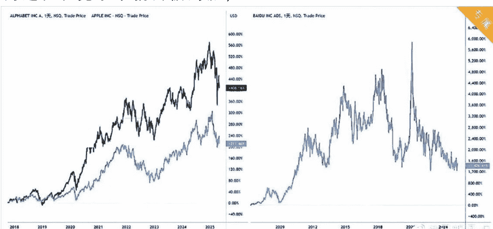

# 见知见识

25-5-8183:44 来自微博网页版
发布于上海

【V+ 微】从隔夜的苹果和谷歌新闻中隐约地能看出来，AI对于传统互联网中下游的冲击（与其说是冲击倒不如说是替代）已经开始。越来越多的用户开始习惯使用AI软件来替代搜索入口，曾经的搜索入口的争夺（从浏览器到搜索引擎）现在发生在AI之间之间。上月苹果Safari浏览器上的搜索次数首次下降，越来越多的AI搜索正在取代谷歌百度等标准搜索引擎。搜索方式的转换，意味着流量入口到广告变现的渠道会受到巨大的冲击，未来无论是苹果还是谷歌都可能随着AI的进化修改许多传统标准的互联网路径，这方面从长远角度看到不需要担心，苹果的手机硬件和生态系统的城河还很宽，而谷歌在AI上的投入和应用端上很容易跟随，但是还有一些传统的互联网企业可能在这一轮AI应用端的进化和竞争中被淘汰

分享资料仅供个人学习，请及时删除，切勿商用传播
