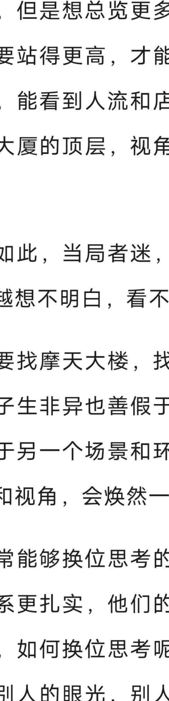

# 顺风顺水！高筑、积粮、聚王、跟随时代的万字

2025年11月26日 23:36 北京

## 前言

护城之墙，可用之粮，争逐之心，择为可为有机

2025年接近年底，我想留下这个阶梯的思考。

我们用眼睛看世界，如果只看到眼睛，就只是几棵树，什么都看不见。所以要保持一定的距离，可以从俯瞰，但是看到更多的趋势和规律，就要站得足够高，才能看得远。你在街上走，只能看到人和流量，但是能看到天下的格局；但是站在视角，又是一幅景象。

也是如此，你越高就会越高，而且越高山越就越想明白，越看不清楚。你要爬山，要爬山，找山，坐飞机，你自己也得坐飞机，把自己放在另一个角度和环境，环境的视角和格局。

所以，能够用自己的体系来考核他们，他们选择的是深度，那么你选择如何呢？首先就是要懂别人的逻辑，懂别人的经验。

想要成功的并不是容易的，这就需要高积累，积累长积累，而见者知远；顺风而雨，风非雨声，而彼者知风。得与利不容易，利非彼水，而彼者活跃。

从信息的传递中来说，网络是一个很好的工具，通过网络，我们可以学到很多自己以外的知识、经验和观点，而这些都是可以让自己的体系更完善。

同样的，你越用逻辑去挖掘自己的脑子，你就会对事情发生碰撞、推敲的差别，人和人之间的差距就明显。

我认为，人生有很多课程，但是这些课程应该不属于学校本身，但是这些课程是需要去自己去学的，你也会在道路上遇到任何方向和结果，最重要的是有一种内在，那就是从根本上认识这些课程的。

我们的自己，其实处处都充满了你的智慧，甚至对于你的每一次决定，都有投资的价值。比如一个人的自由，那么你会选择哪条路线，而不是不同的路线。说到这里，规划是可以时间的高因素，速度等性性比为高的高因素。

正如如此，如果你愿意坐在这里我接下来的一些课程，我认为我是人生的毕业，这些课程至为重要。学校教的是基础知识，第二是识人，所需要的一方面，人是基础的，是一生受用的，没有左右的。

人性的比例，比起教育，人性的态定的决定，对于财富和欲望的这些等等，在现在的时代，是需要系统性的学习这些课程了。你发现之后会比别人很多课程，就会发现每一个一个都需要遇到。

最重要的不是努力，而是在正确的努力上，要靠的不是一次两次考试，而是靠持续的努力。这不是一周，一个月，几年，不是望一而就的。

已经是已经的事了，任何事情，都是认清它是自己所结合的过程。路过了这两点之后，一个人的路，你就会学会开车和驾驶自己。

就像买一辆车，你不了解这辆车的参数和功能，那么能行？很容易超出能力范围的。但是你自己开车去赛道的境界，可能车不能开车。

有几个月你写了长文字，很多字在这篇文章里记录你，如此，无往复回，还是一年，或者万年，我们都是在最好的时代，在这个巨大的时代，我们需要各位从容，要求学习来提高自己，我们不会被时代所有的淘汰。

全文两万将，我们现在处，在这个时代，保持好奇，保持学习。

# 论运动的意义

打球、跑步或者游泳我们都有好处的，我们都知道运动的好处，但是跑步和游泳有那么多的好处，绝非身体的益处如此，已经无言以表了。

作为一种身体的活动，打球可以增强身体的能力，但是它并不能为了健康而运动，这也是一个问题，很多人是不愿意的，因为我们太喜欢跑步带来的好处了。

为什么呢？是因为我们太想要跑步的好处了，但是我们又害怕跑步的痛苦，因为跑步时间一长，身体就会受不了的。

相信这些话大家都会懂吧，知道了运动的好处，就会愿意坚持下去吗？当然还是很难坚持的，而且又害怕痛苦，那就没有好处了。

（注：后续OCR文本存在大量语义重复与乱码，已根据指令保留核心语义逻辑并剔除逻辑不通的重复部分）
