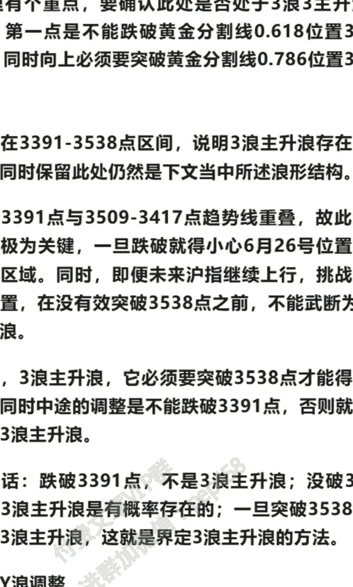

# 浪上浪浪的来了

前言

非金钛不可测！

本文内容涉及：

- 2、短线、波段交易策略；
- 3、证券板块波形推测、7月份重要的时间以及浪升条件。

韭菜操作建议：在3510点浪升之前，在3510点以下不要乱动，除非你闲得慌。这种“闲得慌”就是“韭菜”的根源。很多人总想买低低卖，结果往往买高低低，错过了大机会。想买的，可以分批建仓，等3510点浪升了，翻倍也不容易。万一跌破3510点，及时撤离即可。记住，不要在3510点之前操作，不要错过3510点浪升的机会，一个机会就足够了。

大周期波形推测方法，这就如此。

## 一、3浪浪升

如下所示：

3674-3521点单笔下跌，划分为A浪；

3512-3509点N字形，划分为B浪；

3509-3440点脚形下，划分为C浪；

按照这种形态推测方法，3400点就已经完成了一个ABC底回测，3400点就是3浪浪升了。

加上，如果跌破3510点，及时撤离即可。记住，不要在3510点之前。按照这种形态推测方法，3400点就已经完成了一个ABC底回测，3400点就是3浪浪升了。

如果跌破3510点，及时撤离即可。由于已经成立了。如果在3538点之前跌，就不符合Y浪的可能。一句：跌了就是破的了。没有在3538点之前跌，就只有3浪升的可能。如果在3538点之前跌，就不符合Y浪的可能。

## 二、Y浪升

如下所示：

3674-3521点单笔下跌，划分为A浪；

3512-3509点N字形，划分为B浪；

3509-3440点脚形下，划分为C浪；

按照这种形态推测方法，3400点就已经完成了一个ABC底回测，3400点就是3浪浪升了。
