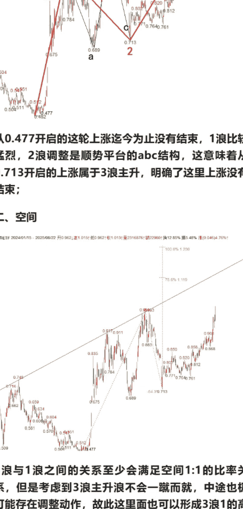
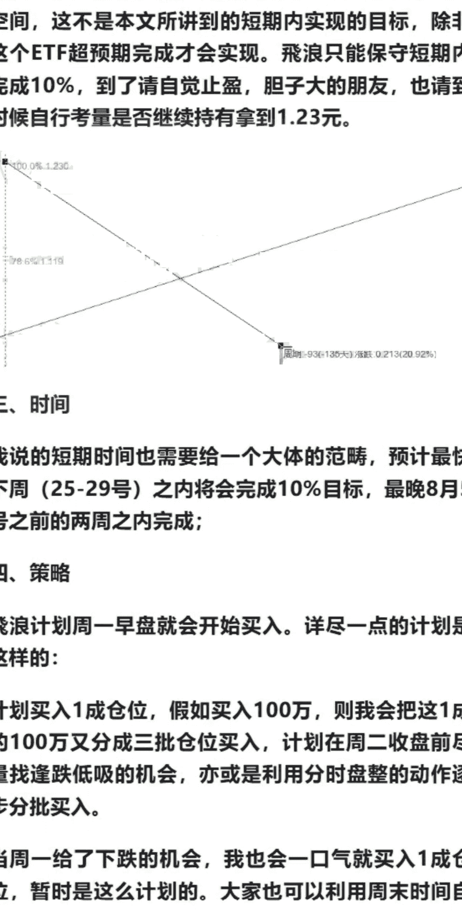
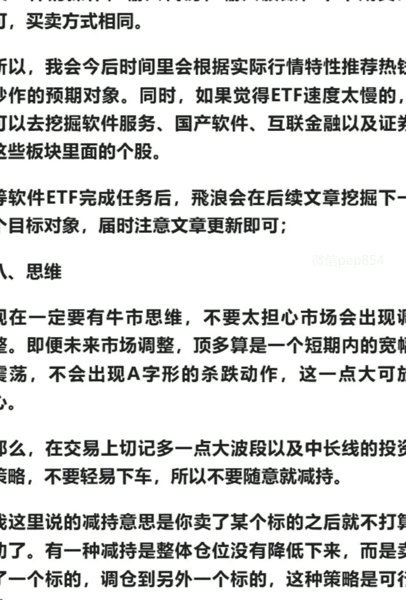

# 周一买它

原创 飞浪 飞浪王 2025年08月24日 07:30 湖南

## 前言

10%利润ETF

文章比较简单，明确了代码，明确了入场时间和价格，明确了短期内目标10%利润。

这个ETF，我周计划买入一成仓位。同时，先计划博一次短线加速上涨的利润，之后如果表现出众或严重高于预期，则根据实际走势再决定是否满足利润目标进行止盈。

大家先计划一下自己拿出多少仓位参与，获得10%利润可以赚多少。如果10%利润低于100元或没有性价比，请不要订阅！

(金不换学员员别订阅，7:30就发了)

名称：软件
目标：1.12，利润10%

(下方是图片，手指放大即可看)

分析如下：

## 一、一涨

从0.477开始的这波上涨并不是为了防止结束，1涨比2回调，2调整就是调整平台的abcabc结构。这意味着从0.713开始的2浪大于3浪主，明确了上涨大于上涨结束；

## 二、空间

3浪与1浪之间的关系至少会有1:1的比率显示，但是考虑到3浪上涨不会一而就结束，途中也可能是3浪的回调动作。此图中显示这里可能是第3浪的结束。

这一浪涨幅到位在abc位置，目标是1.16，1.19。是因为空间足够大，一涨看起来就结束了，目标升到1.11，涨幅扩大到1.12。

以五涨价格为起点，涨0.76倍的1.12元有10%的目标，如下所示：

以五涨价格为起点，第1浪涨23%了，这并不是我们所说的的短期内就能结束，除非这个TF的预期是不实现的。这波即使保守的，也能完成10%了，到了亏损大大的时候，也到了该现结是不是什么时候停到1.22元。

## 三、时间

我的预期时间也需要一个巨大的跨度，预计在（25-29）天内完成10%的目标，预计在8月5日之前就能结束；

## 四、回撤

预测回撤何时开始结束。这里是一点的策略是：

## 留言

- 任未栋 山西 3小时前 回复：老师，我觉得600570符合2 N33 
- 金不 ... 作者 2小时前 回复：不符合
- 凤凯 北京 3小时前 回复：早上好
- 国泰民安 河南 4小时前 回复：现在就周一带来大幅开，那还能直接买吗
- 金不 微信peer458.. 作者 2小时前 回复：不要纠结那么多，按照计划操作就行！
- 一只幸运 辽宁 4小时前 回复：伏大早!
