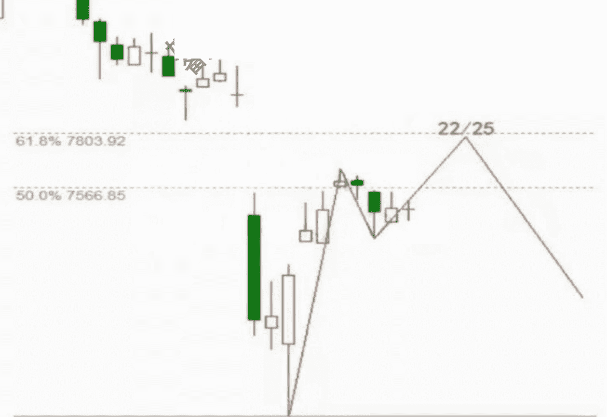

# 下周走势剧透，越来越重要了！

原创 飞浪王 指浪王 2025年04月20日 13:48

湖南

## 前言

越来越重要...

飞浪预判市场距离下一次下跌很近，而且这个下次下跌速度比较快，具有很强大的杀伤力，这波下跌一方面是确认3040点到底是不是底部，另一方面即便出现新低，那么市场底部也将呼之而出。

这就意味着我们不会踏空，而会有更加确定性的抄底机会。

4月份四个时间窗口，分别是：4月1号、4月8号、4月14号和4月25号。

4月1号，恰好这个时间来，3号和2号低和小高之间，所以确认。

（加微信：pep458免费获取文章）

4月8日，沪指构造提前在7号构造，9号构造了3040点，国证2000构造T1到9号构造了6562点；4月14日国证2000构造了小高点；下一个时间在4月25日，有望产生短线震盘。

比较奇怪的是4月5号第2、3、4个时间窗口并未受到清明假期一天休市影响，时间根本不需要后移，却产生了明显的震盘这种。

我这里讲4月25号与5月20号这两个时间相互之间的关系分类：

- 1、4月25号构造高点，5月20号可以构造右侧高点，是否高于4月25号高点？高于，则顶部在5月20号；低于，则4月25号就是顶部（蓝）。
- 2、4月25号构造低点，涨到5月20号形成顶部。与上述逻辑套用，但顶部均在5月20号（紫）。
- 3、4月25号构造顶部，一路跌到5月20号。5月20号构造阶段性大底，我们将执行抄底（红）。

上面三种分类图解如下：

分类1、2是飞浪前期做出讲解的，分类3走势比较特殊，必须要确认4月25号就是顶部，人才希望在5月20日构造大底。

上面三种时间对应的走势分类，建议诸位不要先入为主。4月25号时间一自然就会排除一种路径，等到5月20号就会确认唯一的路径。

实际上，不管哪种走势，关键的时间是5月20号，因为它将决定整个市场最主要的路径选择。

飞浪之判断未来还会会有波急跌动作，直到为止都不担心踏空，原因是知道后面会跌下来，而且买点一定会出现，所以现在只需要等待市场确定性的信号出现足够了。

至于周末有一些利好，关于G税协商和稳定股市的消息，这些已经被大众投资解读为大涨爆发的信号。

我看到后依然泰自若，内心毫无波澜。

这里和当初的3月19日构造顶部前夕也是一样，飞浪几乎每篇文章都千言万说，只是为了让你成功逃顶，当时多少人不相信，认为不可能跌，最终还是跌下来了。

A股不是给面面子只能涨，它要涨必须要涨“禁谎咒”，要跌面子再大都没用。

我现在都已经懂得打规律了，因为固执胸肺把观点说得很清楚了，你愿意听，等着就行；你不想听，我说再多都无济于事。

| 码加入：知识星球TOP 免费资源 | 备注 |
| :--- | :--- |
| 4月8日 | 沪指构造提前在7号构造，9号构造了3040点 |
| 国证2000 | 构造T1到9号构造了6562点 |
| 4月14日 | 国证2000构造了小高点 |
| 4月25日 | 下一个时间有望产生短线震盘 |
| 4月5号 | 第2、3、4个时间窗口未受清明假期影响，产生明显震盘 |

| 类别 | 描述 |
| :--- | :--- |
| 码加入：知识星球TOP | 免费资源 |
| 4月8日 | 沪指构造提前在7号构造，9号构造了3040点 |
| 国证2000 | 构造T1到9号构造了6562点 |
| 4月14日 | 国证2000构造了小高点 |
| 4月25日 | 下一个时间有望产生短线震盘 |
| 4月5号 | 第2、3、4个时间窗口未受清明假期影响，产生明显震盘 |

