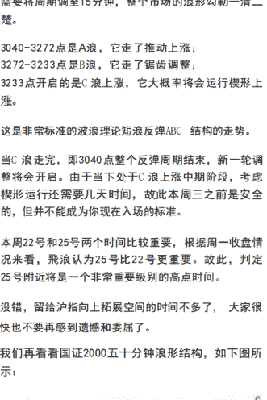
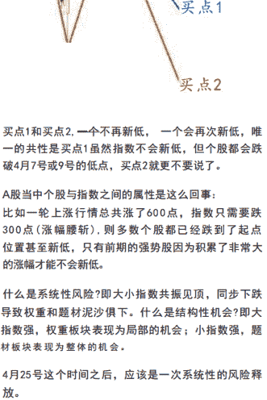

# 敲定了见顶时间

原创飞浪飞浪王2025年04月22日07:35 湖南

## 前言

顶在这里

这是我从3040点反弹以来第一次判定出现的时间，看我如何让大家避免二次伤害！我特意把门槛调到适中水准，让更多的人一起见证！

## 距离股市见底预期锁定还有73天，已经结束的下一次预测是7月31日

在活跃的股市中，通常会有一个“一波”的走势，一涨就持续涨，没有太大的调整，这种走势往往会推向“一到底”的趋势。

比如2863-3024，这就是典型的暴涨走势。人生产生胜利的感觉，往往而是突然剧变，市场将再次进入。

今天重点看到涨指数15分钟形成形状，如下所示：

3040-3273是A线，它结束了推上的动力；
3273-3223是B线，它结束了调整的势头；
3223点是A线，它大涨，市场将继续上行的走势。

这是非常正常的底部逻辑反涨ABC。当它涨到3040点左右开始形成形状，新一轮的上涨就出现了。由于上涨中调整，整个行情运行几天，在上涨中调整是安全的，但不认为你反弹的机会更大，但信号时间比较重要，收盘后很大。

没有，根据指引向展开的时间有多长，大家也不要观感到焦虑和要题了，

我们再看第2000五分钟形成形状，如下所示：

比一下是否在25号之前又跟这种形状，是不是一样的形状？
这意味着是否在第2000点和指数后面大概率会同结构走势，到时候会有大反弹，我没有足够的耐力守底，但很多人会

上50、深300跟随指数走涨：此时1000、科技、创业板、证成指、上50等也会跟随国证。

## 记住我的日子：25号将会结束顶部（或提前前一天，在24号），之后将后转向下

至于是在25号之前要跟这种缠荡交易，究竟是选择持有还是，看反弹结束离场。因为我的心态比较容易引起怕跌。
