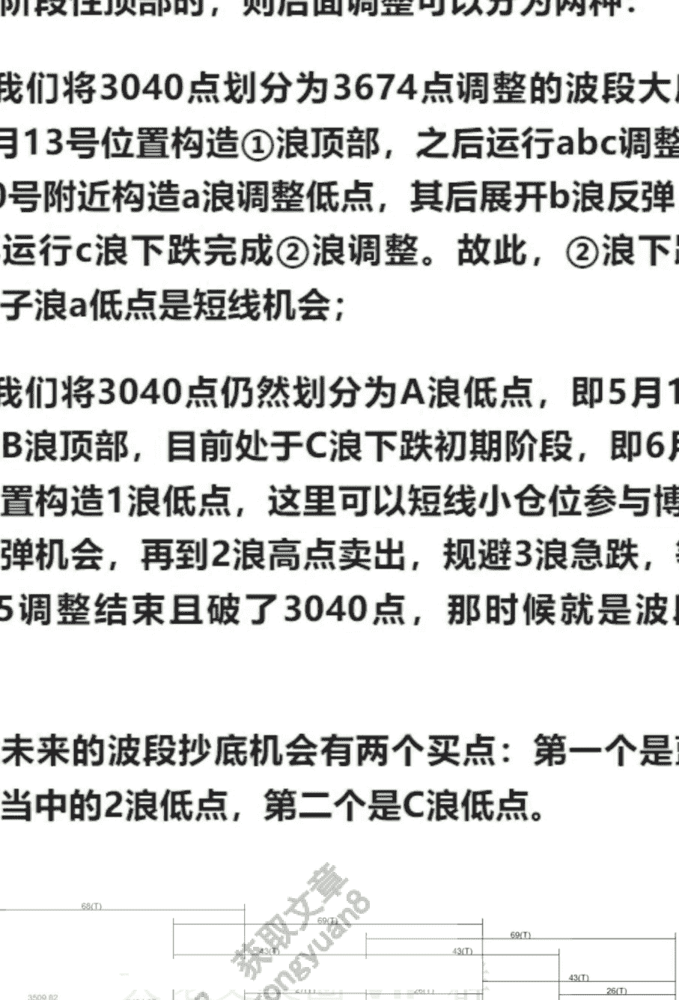
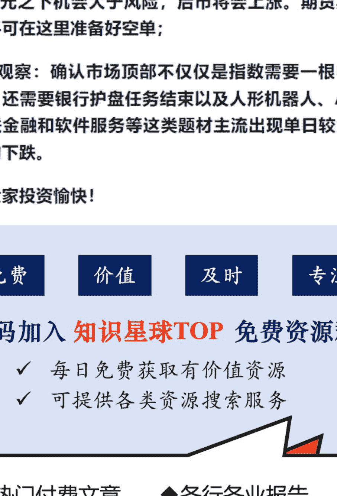

# 下一个短线抄底时间、浪形推演以及波段两类抄底买点

原创 飞浪 飞浪王 2025年05月14日 08:54 湖南

## 前言

提前剧透下一个短线抄底时间

本文已提前告诉你，接下来市场会怎么走？关于5月13号这个时间在趋势当中的定位；下一次短线抄底手机的时间；波段抄底两类买点；市场未来下跌时，那个标的是机会；期货交易选选在这里应该怎么办？

温馨提示：安卓手机1元可以兑换10个微信，请在家人陪伴订阅此文，一订阅概不退款，立即扣消费。购买微信后需要点击“兑换”才能解锁全文，如兑换并未打开全文重新进入。购买此文免费赠给自己的边的抄底朋友。另外，苹果手机订阅1元就能兑换7个微信，价格会比设置的价格提升30%，渠道手续费需要抽取3成%。建议大家用自己或朋友的安卓手机订阅，之后他点击这里“赠送文章给你观看”，这是一个比较省的重要步骤（这段文字自己认真看准，不要时候来追问各种什么么）。

金不换学员，周四盘前7:30将会发布！

## 下午天开盘大涨保住指数，将指数拉回3400，收出79个涨停板

收获了，实实在用了。
我没法告诉大家，其实这篇文有个好计划：

这种方法真的有效。因为只有板块的人多，股票就不会跌，因为所有的板块的人多。。昨天下午收盘，股有200多个跌的，个股的大不是动的，是有有过上涨一下的。

这是不是涨了？
依旧如此，如果认为人为涨对了，尽管在现在买入，我就建议大家重视：

5月13日涨停了吗？
部分指数在5月13日，部分指数在5月7日，部分指数在5月5日，由于指数的差异太大，这就导致了各类的指数的涨不同的，有的结束了。

但是，我认为大家看到指数到2000点，如果指数2000点性的上涨上，在5月13日这已经结束了，明天回到这个位置。

这里没有留方案，方案这里就是就是。我说部分指数在两个阶段涨了，这个只有有意义的。
大家，我们已经很明确了，你千万不要被这种突然的拉升骗了。

5月13日涨停了，千万不要信，过天一下就好了，5月13日这个行情主要是因为已经结束了。它的重要主要来自于自己的三个阶段产生共同

同时，5月13日3439点跌下第34个交易日向5月7日；4700点3040点跌下第21个交易日向5月8日；86674点跌下第14个交易日向5月12日。

由此可见，这将形成阶段性顶部，之后将开始新的一波。
但是，如果不是我们都要我们要望的呢？不是缩量顶部阶段才开始的，真的可以。
可是，在下跌的过程中，它也会出现机会，如下所示：

5月13日的位置位于3509点，3494点和3439点相同的阶段性顶部时，前面阶段可以分为两种：
1. 我们将3040点做成364点在此处的涨，第一阶段在5月13日位置涨了，之后还有C段，6月10日位置涨了，缩量反弹，随后再次下跌，两次反弹，两次回踩，第三次急跌，然后C段结束了。
2. 这里的阶段在5月13日位置就是波段底部。
