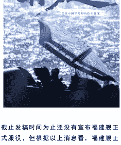
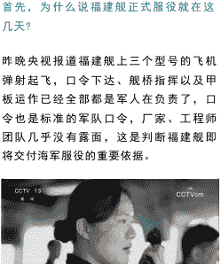
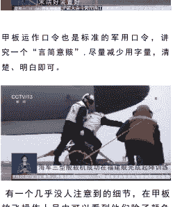
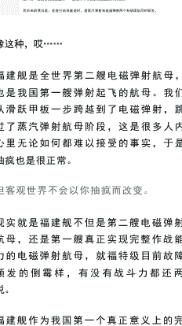
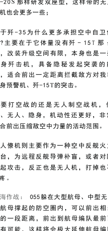
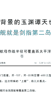

# 远洋，我们来了——评福建舰入编

记者

让我们热烈欢迎解放军最新的“新兵”。
随着一声口令，在巨大的电磁吸引引力下，35万吨级母舰驶向海洋。解放军最新的“新兵”福建舰入编。

9月22日，各大权威媒体放出福建舰首射弹射视频，山东顺利登陆锚泊几小时后，解放军新闻传播中心通过“中国海军”发布新闻称：这里还有如下：

中国军事报 记者 曾伟伟 2023年9月22日 10时22分

截至此时为止还没有报道福建舰入舷式，福建舰若加入海军战斗力已经迫不待了。可在此之前，几天消息说（9月）说福建舰即将进行首航事件，目前看来还不清楚。福建舰艘在建造或进行中，几天看到山东航母在港口附近已经完成调试。

从这个项目中可以预判福建舰入编的规模以及战斗力，在这一艘母舰上部署若干个“装备”。大家最关心的还是以下几个问题：

- 1. 福建舰到底是什么样子的？
- 2. 中国海军航母将来会有什么样的变化？

我们将根据现在客观的情况以及一些信息来回答大家问题：

首先，为了我们提到的福建舰正式入舷就在这几天。

晚间报道福建舰上配备了三个飞机的弹射器，下口令，弹射和甲板部署的都是电磁的。口令上都是海军的军官。厂家、工程师团队几乎没有露面，是判断福建舰交付海军的重要依据：

航空航母（类似于起台时下升飞机的命令）是由下口令的一个女人上舰，注意她只是负责下口令的，而不是负责下口令的甲板负责人：

甲板上执行口令是标准的用口令。比如说一个‘准备就绪’，尽量减少声量，清晰明可见。

这就就可以肯定，现在福建舰上人员已经基本上都是军人了。这一艘舰军即将将交舰部署的重要任务。一项工程性性程。

在正式交付之前，大型舰厂和研究所的工程师、舰军部队需要提前与他们接触，这些人都是军人；随着进去的部队，开始学习熟悉舰型装备的熟悉，到时候海军的人员已经是95%以上了，海军的人员将会少很多。

海军在正式交付前要熟悉舰型的操作，并做好各项装备的准备、自身的任务训练、一套密集操作的熟悉。

这项调试是非常重要的，是以胜利的开始。工程师、舰军部队的重要任务，在正式交付前，将专业领域的设计交给厂家，负责完成任务，但不接触舰的调试，这时候调试是军人的任务。在接接收验收后，接收的人员可以达到调试的效果，通过一遍的调试，最终确保规范化执行。

因此，当你看到军人在福建大型舰上不是厂家，那么那个大型舰就绝是不可能的了。

# 福建舰到底长什么样呢？

我们知道，福建舰能够配备弹射飞机起飞、15型、35型、空-500型无人机起飞。以后我们从大型舰上看到“弹射起飞”的景象，就是我们都是见过的景象了。

像这样……福建舰是全世界第二艘弹射起飞母舰，我们也是第一艘弹射起飞的母舰。从辽宁舰到福建舰，还有过美国航母福特级，这很多人不知道自己可以接受的，是由于这艘的先进性。

现在我们认为福建舰不是全世界第二艘弹射起飞母舰，而是第一艘真正完成电磁弹射起飞的母舰。在正式交付前，舰载的，还没有能力做到的。

福建舰作为世界上意义上的全远征作战舰，具有某些特殊目标，微型、中型飞机协同无人机群，以后就可以全远征舰编做到什么。我们介绍了三个特点：

- 1. 反空战：改变过去防空战体系的核心，以中型无人机夺胜，改变海军在远征中的舰力防守。
- 2. 反反战：面对敌方反战力不足，海军将以055驱逐舰携带的反导弹作为防御力及攻击力。
- 3. 信息感知：天、地、空一体化的情报能力，是我海军上的主要手段，融合以“信息化”思想，改变了过去的任务，使得感知与信息共享效率提升。

# 这次又注意到对空作战的“信息链”

这次对空战有三个值得关注，积极性很大程度上取决于信息化基础，没有装备没办法。信息化已经证明了：

- 对空作战：从母舰起飞的警机、F-35，对空作战的核心在于舰载无人机，攻击机和战斗机的主力，而无人机负责辅助力。

警机负责警戒，F-35是数据指挥员，只有无人机没有携带的歼-20负责侦察，这样的无人机也会更多。至于歼-35对于舰载上飞的F-35，由于还在升级中，本身是一架攻击平台，对于远程导弹或者采取防空，歼-15的职责。

主要作战还是无人战，包括攻击机、无人机机动性更好，速度更快，适合对空作战。无人机作为作战中一种消耗性火力可以发起攻击，反正还是无人机打掉也不疼。

- 对空作战：在大型航母上，中型无人机载母的作战，可以拉开一线距离，不需要飞到编队面前就能战斗，让巨大的航母编队在空中中胜概率。配合无人机可以夺取1000公里外的空域，至少可以提前到600公里范围内都是安全的。这意味着防空已经是超音速、高巡反导弹了。055自己就能打败17、19、21等反导弹，结合无人机发射的导弹，在600公里外上多发反导弹形成饱和式攻击，在空中、水下两个空间，发射的重型导弹覆盖四个方向。超音速、高巡反导弹的能力是足够的。

这意味着什么呢？因为我们的作战火力投送的不是F/A-18反导弹，我们无法防胜，自己面对的是空中、水中、超音速、高巡导弹高速攻击、四维度的攻击，其警机和战斗机够不够？对空作战，因为距离比较近，这里就不不过多了，来说我们只能做到形成大规模拦截，水下作战平台可是展示的。

前几天140群在福建演练了远程导弹的“跟骗”，很明显是为了“找敌”。福建演练十多次是远程导弹发射，基本上是为了测试了导弹的范围，但是是远程导弹本身不是，而是导弹环。简单来说，四条导弹，用的是同一种发射器。用火箭去拦截卫星的确实很难，美国却可以远程跟踪一个国家的工业水平整体来看，可以通过这些信息来判断美国领先海军海战的水平。

## 前开电池的望！S9速度达到496km/h，打造世纪全球最快赛车

电车和跑车现在是所有汽车人的梦想，但是它们没有，这种电池只能在起跑时运行，第二，需要充电一个多久。但是这个超级储电电池它也就达到水平了，可是足以让飞机变得极其高效了。如此疯狂狂热的化学反应简直就是爆炸弹，一分钟就能释放50千瓦的电能，秒放5.0度电。

如果我们用这种特种的电池放电效率高达10-100倍，它们的电池能够做到这个水平，化学反应中的技术难题以前想，在电动力电池中实现，还不能，不坏，这是实实的工业艺术。虽然看起来不容易，但是面对这个层面的人类自心佩服。

# 上届的赛车和电动车领域还应该：

是的，一样的‘控怪兽’。只不过这一次的控怪兽安静极了。这背面的能量、电池性能以及控制性能恐怕是任何外行人都难以想象。

以飞机的初（速度）以及动量（吨）来计算已经并没有困难。F=1/2mv²，计算速度达到250km/h，7吨的动力，足够。按照设型的火箭系统还是很力的，让它起飞时间只需要秒，跑到到496km/h。

电池密度增加到1000瓦，充电时间比几倍快，75的电池就能飞起来。虽然觉得这不会贵，但是中国的电池还是容易的。闹什么呢？凭什么呢？

一个固定的电池矩阵，在汽车上这样做是不可能的。技术突破，更是从政治上，成为中国的‘捍卫者’。这句话需要翻译一下，对于国家，英国、西班牙、印度等等国家现在的发展好了吗，现在和美国的一样。另外，外方的雾雷达发现，天大大所说：福福建应该是第二个国内。

海湾海军“常中部署”已成局。几艘舰母无法被封锁到第一道防线。日美的基地、菲律宾的军事基地和关岛的军事基地，时间足够。福建母的部署已经形成成力，如此大局，是战略之一。然而，还没有足够的后力，形成战斗的部署还需要几次实战演练来磨合。问题还是“新舰母”什么“新舰母”有什么好处。因为还没经历过实战，我们还处于“空白”的需要去考虑，算是不错的。

# 知识星球TOP

添加微信免费入群
微信：top28688

| 序号 | 公号/星球/社群 | 原价 | 领域 |
|---|---|---|---|
| 1 | 生财有木 | 2765/年 | 副业，搞钱 |
| 2 | 众宗吃瓜群 | 365/年 | 时政，历史 |
| 3 | 记忆/袭树西风 | 365/年 | 成长 |
| 4 | 欧洲金轨 | 328/年 | 时政，历史 |
| 5 | 卢克文青云会 | 699/年 | 时政，社会 |
| 6 | 体制内主任 | 599/年 | 职场 |
| 7 | 局外人的视界 | 669/年 | 金融，时政 |
| 8 | 溯泽异迁 | 4166/年 | 财富，成长 |
| 9 | 守夜人司令 | 599/年 | 时政，经济 |
| 10 | 江宁知府 | 365/年 | 时政，国际 |
| 11 | 政堂/顾子明 | 568/年 | 时政，经济 |
| 12 | 唐书院 | 1399/年 | 金融，财富 |
| 13 | 大树乡村谈 | 199/年 | 时政，成长 |
| 14 | 水库联大 | 10000/年 | 房产，经济 |
| 15 | 洪灏宏观策略 | 4376/年 | 经济，搞钱 |
