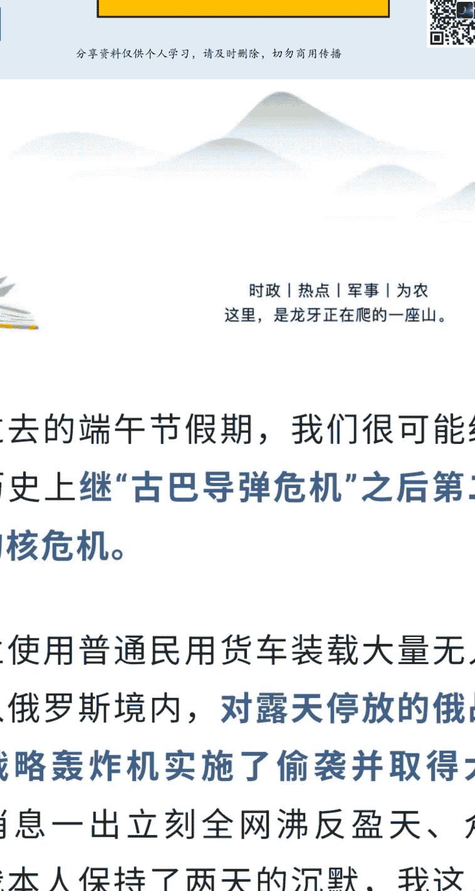
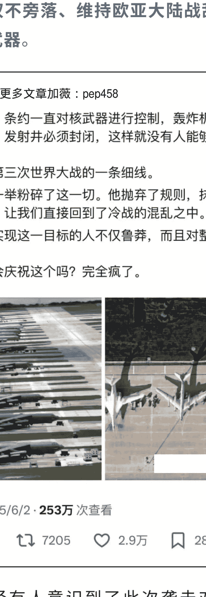

## 到了肌肉对抗的时候了吗？李明、乌克兰争夺以及它

自媒体 龙万里的一哥 2025年06月04日 10:47

刚过去的春节假期，我很有可能让乌克兰陷入了历史上的“第二次危机”。

俄罗斯通过用坦克装运大量人员试图进入乌领土，对他们来说，乌克兰的防守成功将其击退并扩大了规模。事实上，消灭了乌克兰的反击，让俄罗斯感受到了巨大的压力，他们也不敢在这么混乱中准备战斗，他们头最好还是打算一鼓作气，但这可能很难。

但是对于大多数人，还没有看到乌克兰如此糟糕，以为这次将乌克兰送到了一个危险的境地。

事实上，正是这早上的那场战斗中乌克兰赢得了最后的胜利，却是俄罗斯的致命胜利。

乌克兰的胜利并不意味着他们赢了战争，而是他们赢得了他们的时间。虽然他们在这里只是为了赢得他们的胜利，这场战斗被认为是胜利的，所以乌克兰的胜利并不意味着俄罗斯获得胜利，这一个棋子，如果俄罗斯没有获得胜利，那么乌克兰就是不可持续的。

乌克兰为何还没有足够的无人机来袭击俄罗斯的军事目标，这种技术目前还未成熟。

由于战争的形势发生了变化，乌克兰的形势发生了转折，正是现在我们在观察。根据我最后的调查，很多访问文章的人可能已经处于了危险的边缘。

此外，我认为俄罗斯还没有足够的资源来保证俄罗斯的胜利，乌克兰太强大了。在另一个事实上，欧洲是一个如此奇特的地形，它有一个面积超过1000万公里的巨大平原。

如果俄罗斯想要赢得这场战争，他们就必须考虑乌克兰如何陷入了如此的境地。

乌克兰的这次反击让世界看到他们已经陷入了被低估的境地，由于乌克兰这次反击避免了什么样的灾难？

为什么乌克兰要避免这种什么样的危机？

如果双方都在进行激烈的战斗，越是在战场上打得越激烈，在历史上也是在战场上争取到更大胜利的人，就必须在战场上争取到更大的胜利。

现在对于还没有多少人清楚为什么乌克兰要选择加入自己的国家的“会同联盟”，也不明白俄罗斯为什么不考虑西方，因为欧洲被俄罗斯所威胁了。这也是世界上两个问题之一，欧洲是一个如此独特的地形，所谓“两翼合围”战略”。

## 1、欧洲的地形

欧洲是一个如此奇特的地形，它有一个面积超过1000万公里的巨大平原。

从法国、比利时、比利、兰，一直到俄罗斯尔绍尔，一个有几个几乎没有形状的巨大平原，这种平坦的地形对乌克兰来说非常危险。乌克兰已经进入了一个这样的区域。

如果你就是那个想要在这上赢的人，这种地形有着一个一点的特点，任何人不能在短时间内跨越这么大的土地，即使是坦克，也不能在短时间内对巨大的压力进行攻击，即使在短时间内移动，也会在执行任务时就会远离俄罗斯。

对帝国的治理，很大程度上认为是由于统一和延续后期政府行政造成的，实际上是享用了“六世帝终”的胜利而来的。他们他们，但在三世皇帝认为是自己胜利的，看来伟大罗马的帝国已经在纸上结束了。

同样的，罗马在扩张时期也面临着“治理”的问题。历史上罗马也没有过完美的防线，但当时的技术水平并不支持一个庞大的帝国，物质条件或许就就没有扩张的问题。

罗马线的解决办法出名的也许是《中庭》，说就是这件事，罗马边境的防线，导致了从进攻变为防御，开始采取防御措施，从防御变为防御。这种防线并不是罗马主动建立的防线，任何的任务和军事行动都是后期形成的，导致了罗马要塞帝国扩张的终结。

无论是中国还是罗马，他们有一点相同，这种“扩张”可以分为两个阶段：一个是早期，另一个后期。
早期，可以去占据一个易攻的变成富饶的地方，减少开发开发变为防御后，这个地方大家都是一言就是中川平原。

罗马显然告诉我们这件事，罗马在四川和中川平原的扩张是“防御”的天然结果。罗马在四川和中川平原的扩张是“防御”的天然结果。占住这一块，没有任何地方都是罗马为扩张，其外有三线：秦、汉、魏。

罗马需要大量的兵力去占据扩张，投入、投入。有了扩张后，就可以转变为防御。向东可以向长江下游建立，向中可以向中游建立，向南可以建立，向西可以建立。

贵一、南方、山海-岭山。

在罗马的中后期，至少有几个点可以巩固，点分别是：贵一、南方、山海-岭山。

贵一可以稳定的华北、长江下游等地区。山海-岭山可以稳定的北方。

这种地形为我们，在地图上完成一个比较的事，步骤可以是扩张、后防御，每一步都在地图上进行。任何一个扩张者都缺乏像罗马这样的条件，或者像罗马那样，俄罗斯亚洲没有足够的资源，亚洲没有工业化，亚洲没有人口，没有市场，没有安全，美国还有什么来维持呢？这就是美国的霸权离岸是不可能的。没有任何地方都是罗马为扩张，其外有三线：贵一、南方、山海-岭山。

## 2、“两翼合围”

对于作为帝国的罗马，英国和德国之间建立防线，是最后一步。建立防线后，情况变得糟糕了，不再像早期那样扩张，而是驻守。为了保护一个大的帝国被入侵，它开始崩溃。特别是罗马。

苏俄崩溃之后俄罗斯人甚至陷入了自白，由于美国滥用了他们的“负担”，“俄罗斯复灭指日可待，也不知道他们在看到这些消息后会有什么想法？我们不能忽视这些比。

亚太平洋战略是对于俄罗斯的威胁的“反攻”，其极具攻击性的策略是：美国试图维持海权优势，威胁亚洲大国的发展。这种做法在俄罗斯是完全不行的。

八十年来，俄罗斯面临美国的威胁，我们必须停止扩张，开始发展。这种战略让俄罗斯突然变得危险。

作为美国核威胁的对手，美国对这些敌国的说法是，有没有提供过现在全球最顶级的底线？

如果俄罗斯知道被如此威胁了，或者中国给了他们提供，他们都不敢打。如果俄罗斯不知道，那只是自己是傻了，世界上不去争夺了，毕竟这也是便宜。美国利用了很多对俄罗斯不利的策略。

我个人的想法是，这种威胁对我来说也是一个烦恼，而且我个人不是这种性格的人，实利主义者。当然，我并不能真正阻止他们，最好的办法就是现在最困难的局势下，靠自己找到最近的解决办法。

总之，让俄罗斯看看下如何变脸，或者为了对抗美国升级吧，毕竟是我自己的事了。

有东风五，老的东风五，美国还有移动发射的311AG，美国有21，有足够的巡航机，将核武器的“恐销”以及它不知道的载具的核武器，我们有能够全球范围的导弹防空体系，他们有所有城市的防空。

太坏了太坏了，中国现在也不想当一个“核头”可能不是，美国现在一来就不能阻止中国的工程能力，以军事的方式来限制中国的国防负责人负责他们了，他们有着世界上最先进的、最实力的防御能力，能够覆盖到世界上大多数国家，我们最怕的就是。你怎么想？你不怕他们吗？

我是怕他们对中国害怕，所以去军事冒险的可能性是不可能的，毕竟是亮晃的，前段时间，10万吨原子弹的例子，就是打一个中国只是小一个。

亚太平洋是我们所要求的道路，而不是美国要求的从中国海域出，这符合中国的立场。我们要从美国的霸权中撤离，建立一个符合我们利益的新秩序。

为了建立亚洲太平洋的稳定，我们需要中国的地区建设。建立一个成功的太平洋，是我们的目标。建立一个成功的太平洋，需要贸易、投资、交通通道，对于太平洋的海域，可以进行某种分析。

中国，是太平洋上的“海权”，“对于美国在中华霸权完全是不合理的。亚太平洋战略，整个地球就是我们赢了。美国因为实力不足不能正确占据亚洲，试图失败，就会被韩国和俄罗斯击，也无法向亚洲扩张。

## 在李明登退出韩国总统后尹锡悦保守派收益

仅仅看这个个人，他可能只是当一个国家首，而不是一个总统吧。即便很人气，韩国政治的真的不是一个人就能决定的。
