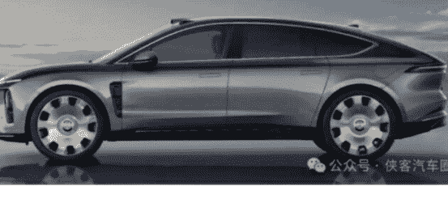

各位投资者大家好

我们关注到近期有关未来与汽车的新闻，GIC起诉蔚来，从2022年开始的对蔚来汽车的集体诉讼有关，于10月初结，等待集体诉讼进展。此事件并非重大转变，我们判断整体风险可控，为回复大家的顾虑，特此说明。

## 1 背景（智能与BaaS的关系）

- 蔚能成立：2020-08-18，由宁德时代、蔚来、国睿莱、湖北科技四方25%出资
- 设置为：承接蔚来电池供应BaaS（车同步+电池租赁）模式。
- 业务重心：蔚能拥有/优质管理电池供应及电池回收能力，蔚来负责车辆销售与服务
- 二者合作BaaS遭遇相关事件。

## 2 事件前因（外界质疑从何而来）

- 空空报告（2022-06-26）：Grizzly指称蔚来通过向方蔚能“前置确认收入”，将压力下给蔚能，从而让利美国；蔚来官方公告报告“错误误导”，由委托委员会委托律师所/审计会计进行独立调查。
- 集体诉讼（SDNY 2022）：以“蔚能确认收入”为主的证券类集体诉讼在纽约南区合并，统一在22-cv-07252 (Saye v. NIO)中，法官为Vernon S. Bradley。

## 3 GIC的诉讼（2025-08）

- 立案信息：GIC v. NIO, Bin Li, Wei Feng, 1:2025-cv-07176, SDNY；主张蔚来通过不当/提前确认收入，导致其2020-2022年间买入股东股票减损。（Jud Stocks & Holdings）
- 媒体披露：指涉及约6亿美元的收入确认争议，诉讼于10月初结（stay），目前仍暂已有集体诉讼进展。（The Business Times）

## 4 目前进展（截至2025-10-16）

- 集体诉讼（22-cv-07252）：合并并指定首席原告席；2023-08-22遭遇对方辩诉状；蔚来在2025-02-04申请撤回回应（MTD），目前法院未就MTD的公开裁决。
- GIC案件（25-cv-07176）：已被法院审理程序，以免与上述集体诉讼重复，等待关键节点后再审理。（Justice Docs & Holdings）
- 公司控股：蔚来在20-F/新闻稿中否认曾做过口头指控并披露已开展独立调查，后续规则更新。（ir.nio.com.）

目前没有实体裁决或财务重建的定论；GIC会被暂缓、合并后的集团仍仍在动议阶段。对蔚能的直接经营冲击有限。本次相关新闻的快速爆发，可能与新新能源车市场激烈的竞争有关。GIC于 2025 年 8 月提起了相关诉讼，2025 年 10 月 15 日中午开始有相关公众账号撰写了此新闻的相关报道，16 日开展相关信息传播境内多媒体转发，蔚来汽车股价在 16 日下午暴跌超过 5%，又迟延修复。

蔚来是否实质控制蔚能，牵出新加坡主权基金起诉蔚来
原创：来汽车图 2025 年 10 月 15 日 12:28 湖北

作者|许锐李
编辑|叶本华

最近财经报道了蔚来汽车新加坡主权基金起诉的事。这是头一回有一个国家的主权基金，把蔚来控股公司上法庭。
GIC，隶属于于新加坡金融管理局，目标是实现最核心的三大国投资机构。GIC成立于1981年，目标是实现长期收益。本次诉讼涉及约6亿美元的收入确认争议，诉讼于10月初结（stay），目前仍暂已有集体诉讼进展。（The Business Times）

蔚来是否实质控制蔚能，牵出新加坡主权基金起诉蔚来

目前没有实体裁决或财务重建的定论；GIC会被暂缓、合并后的集团仍仍在动议阶段。对蔚能的直接经营冲击有限。本次相关新闻的快速爆发，可能与新新能源车市场激烈的竞争有关。GIC于 2025 年 8 月提起了相关诉讼，2025 年 10 月 15 日中午开始有相关公众账号撰写了此新闻的相关报道，16 日开展相关信息传播境内多媒体转发，蔚来汽车股价在 16 日下午暴跌超过 5%，又迟延修复。

蔚来是否实质控制蔚能，牵出新加坡主权基金起诉蔚来
原创来汽车图 2025年10月15日12:28 湖北

最近财经报道了蔚来汽车新加坡主权基金起诉的事。这是头一回有一个国家的主权基金，把蔚来控股公司上法庭。
GIC，隶属于于新加坡金融管理局，目标是实现最核心的三大国投资机构。GIC成立于1981年，目标是实现长期收益。本次诉讼涉及约6亿美元的收入确认争议，诉讼于10月初结（stay），目前仍暂已有集体诉讼进展。（The Business Times）

### 蔚来 背景（智能驾驶与BaaS的关系）

## 2 事件前因（外界质疑从何而来）

- 空空报告（2022-06-26）：Grizzly指称蔚来通过向方蔚能“前置确认收入”，将压力下给蔚能，从而让利美国；蔚来官方公告报告“错误误导”，由委托委员会委托律师所/审计会计进行独立调查。
- 集体诉讼（SDNY 2022）：以“蔚能确认收入”为主的证券类集体诉讼在纽约南区合并，统一在22-cv-07252 (Saye v. NIO)中，法官为Vernon S. Bradley。

## 3 GIC的诉讼（2025-08）

- 立案信息：GIC v. NIO, Bin Li, Wei Feng, 1:2025-cv-07176, SDNY；主张蔚来通过不当/提前确认收入，导致其2020-2022年间买入股东股票减损。（Jud Stocks & Holdings）
- 媒体披露：指涉及约6亿美元的收入确认争议，诉讼于10月初结（stay），目前仍暂已有集体诉讼进展。（The Business Times）

## 4 目前进展（截至2025-10-16）

- 集体诉讼（22-cv-07252）：合并并指定首席原告席；2023-08-22遭遇对方辩诉状；蔚来在2025-02-04申请撤回回应（MTD），目前法院未就MTD的公开裁决。
- GIC案件（25-cv-07176）：已被法院审理程序，以免与上述集体诉讼重复，等待关键节点后再审理。（Justice Docs & Holdings）
- 公司控股：蔚来在20-F/新闻稿中否认曾做过口头指控并披露已开展独立调查，后续规则更新。（ir.nio.com.）

目前没有实体裁决或财务重建的定论；GIC会被暂缓、合并后的集团仍仍在动议阶段。对蔚能的直接经营冲击有限。本次相关新闻的快速爆发，可能与新新能源车市场激烈的竞争有关。GIC于 2025 年 8 月提起了相关诉讼，2025 年 10 月 15 日中午开始有相关公众账号撰写了此新闻的相关报道，16 日开展相关信息传播境内多媒体转发，蔚来汽车股价在 16 日下午暴跌超过 5%，又迟延修复。
