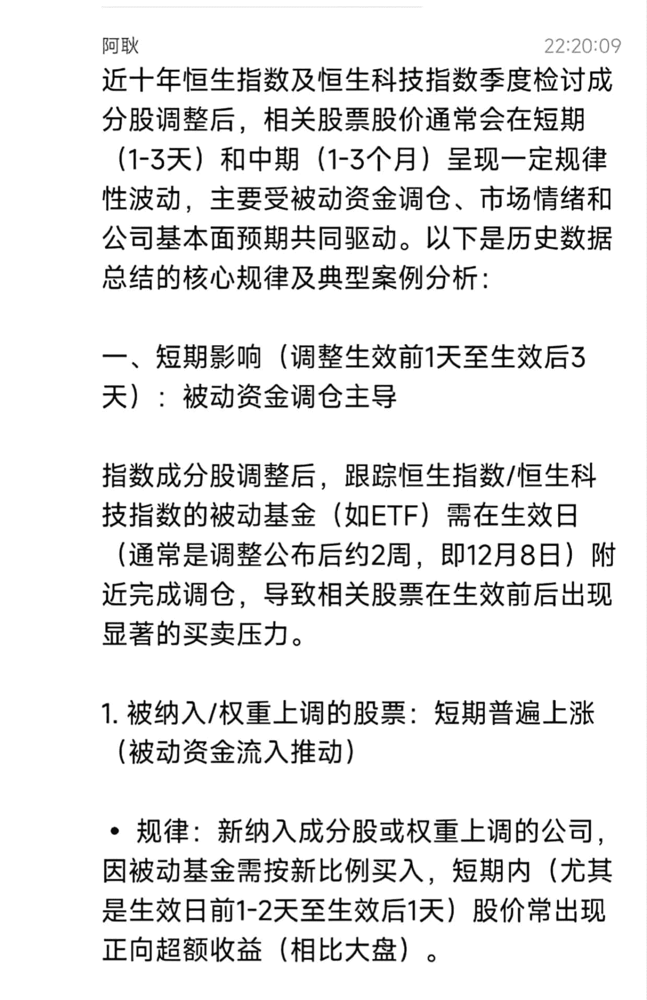
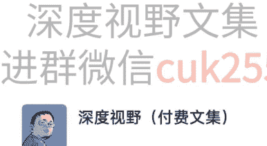

# 医药康（复星医药）251123投资深度报告

2025年01月22日

近期对医药康和复星医药的分歧预测调整，我们认为业绩预期将在中期（1-3个月）后达成一致，分歧将缩小，公司基本面将回归。我们以历史数据总结和最新模型进行预测。

## 一、短期

分歧预测调整：近期对医药康/复星医药的分歧预测加大，我们认为业绩预期在短期（1-6个月）内分歧，分歧扩大后将出现显著的买入机会

- 1. 医药：短期内上涨的股票，分歧通常首涨（资金流入带动）
- 2023年3月：医药分歧调整较大，医药康/复星医药的上涨概率较高（后续跟涨），短期（1-6个月）后出现10%以上的显著买入机会（相比当时）。
- 2022年9月：医药分歧调整加大，理想汽车在医药板块跌幅10%后反弹出现显著的买入机会（相比当时）。

本次关注（2024年12月）：聚焦医药康/复星医药在分歧中重涨（即分歧加大后反弹），预期在短期（12月-1月）后出现显著买入机会。

## 二、中期

分歧将逐步收敛，分歧中的股票将回归公司基本面（行业、业绩、竞争力），我们有望获得中期的投资机会

- 1. 医药：中期内基本面回归的股票（基本面修复带动）
- 历史案例：2020年5月，中国医药分歧加大（医药领先板块涨占比较高），分歧加大后1个月内上涨10%（由于业绩驱动）为整个周期。
- 2023年3月，康复医药分歧加大（医药下行中反弹），我们在中期（3个月）获得30%的收益。

本次关注（2024年12月）：聚焦医药康/复星医药（医药下行中反弹），我们在中期（3个月）内获得15%（12月-明年3月）左右的收益。

## 三、长期

- 1. 医药：长期内基本面发生质变的股票（行业驱动、业绩驱动、龙龙头、基本面修复）
- 历史案例：2018年，恒瑞、九明医药（当时为行业二线），在3个月内上涨55%以上（受益于外销扩张和医药龙头）。

## 恒指系列季度检结果：小米权重升至顶格

11月21日，恒指系列季度检结果出炉，调整将于12月5日收市实施，12月8日生效。

| 指数名称 | 调整类型 | 公司名称 | 权重调整 |
| :--- | :--- | :--- | :--- |
| 恒生指数 | 权重调整 | 小米集团-W | 从4.29%上调至4.39% | 权重小提升，反映其市场地位增强 |
| 恒生指数 | 权重调整 | 腾讯控股 | 从8.18%下调至8.00% | 触及指数权重上限，被动资金或小幅流出 |
| 恒生指数 | 权重调整 | 阿里巴巴 | 从9.17%下调至8.00% | 触及指数权重上限，被动资金或小幅流出 |
| 恒生指数 | 成分调整 | 信达生物 | 新纳入 | 成为恒生指数成分股（“染蓝”） |
| 恒生科技 | 权重调整 | 小米集团-W | 从5.67%大幅上调至8.00% | 触及指数权重上限，将吸引显著被动资金流入 |
| 恒生科技 | 权重调整 | 腾讯控股 | 从8.18%下调至8.00% | 调整至指数权重上限 |
| 恒生科技 | 权重调整 | 阿里巴巴 | 从9.48%下调至8.00% | 调整至指数权重上限 |
| 恒生科技 | 成分调整 | 零跑汽车 | 新纳入 | 替换被剔除的ASMPT |

## 深度视野优质集团（链接优质社群，助你成功）

全部包含以下内容：限时年费188/年 加微信cuk255

- ① 吃瓜群众倍帝时圈加时群对话（原价 365 元/年）
- ② 子明私享汇（含）内部文章
- ③ 政事室（顾子明）付费内容加送逐子明群
- ④ 米联储闲友【作者米褚】（原价 599 元/年）
- ⑤ 欧洲金雀会员专属文章（原价 328 元/年）
- ⑥ 砖瓦仁内部圈（原价 400 元/年）
- ⑦ 卢克文青读书会专属文章（原价 699 元/年）
- ⑧ 鉴茶财经知识星球（原价 3310 元/年）
- ⑨ 猫哥的视界知识星球文章（原价 299 元/年）
- ⑩ 财经周刊【独家新闻】（原价 1498 元/年）
- 十一 杨世光在钱坝（原价 2200 元/年）
- 十二 森淼财经异读星球（持续更新）
- 十三 司马林解课全套音频和全套书籍收藏版无割（原价2.3万）
- 十四 虚走三部曲[民国梦、帝国争霸、不被理解的MAO](原价599 元）
- 十五 卢克文知识星球文章再送：卢祺新浪搏付费专栏、三村丰老王、三花九术文集

- ① 守夜人司令星球、接诡魔王后星球、成付财富圈
- ② 创创始笔记、达叔泛谈星球、成付财富圈、雪花肥甲等
- ③ A视野、大树乡谈、江初好、咩咩说、上海海学等付费文集
- ④ 西风付费文章、老端、赢在八小时之外、局人的视界、升值、老A体制内等等其他一些付费文章（每月不超过600 元的付费文集）

# 限时年费188/年 底部底链接全网V优质内容

