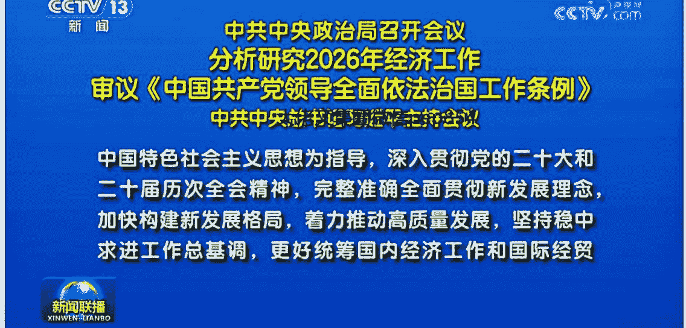
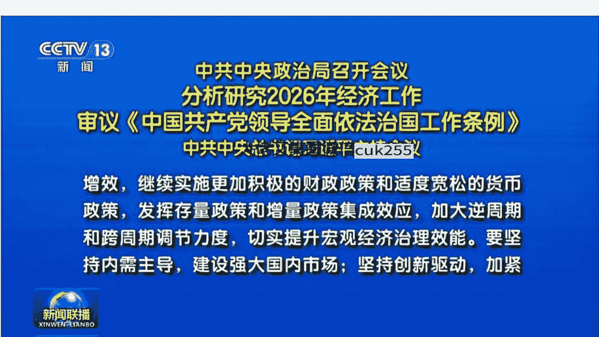

# 【苏莽】2025年12月政治局经济会议

特别分析

<政治局会议分析研究经济>

上周六20251206 刚说“下周就会召开政治局会议研究经济工作”，本周一就如约而至——中共中央政治局12月8日召开会议，分析研究2026年经济工作，审议”。

审议条例没说的，研究经济工作的重要性之前在《讲一下政治局经济会议对资本市场的判断》和20251031的解读中，今天特别下分析2026年经济工作。

今年五个政治局通报很快，虽然说陆后会有会议详细解读2026年经济工作(到时候也会在直播详细解读的)，但是还是偏量，和往年相比属于短小规模。

第一段是说今年取得的经济成绩，这段没啥说的。

第二段是说今年对经济的宏观展望，就是以新时代中国特色社会主义思想为指导、贯彻党的二十大和二十二届历次全会精神、新发展理念、新发展格局、各种统筹的内容，一般来说也没啥值得特别的，但今年有不同不同。

深度视野VIP群 人工追踪50+大V 付费群加微信cuk255 微信chap5568

第一个不是顺序了，很长时间以来我们经营经济的头脑都是“坚持稳中工作总基调”，在这一次——“完全对齐发展趋势，加强构建新发展格局，加力推高高质量发展，坚持稳筹国内经济和国际循环，更好筹发展和安全，实施更加积极的宏观政策”。来自营销伙伴255

这里面还是老论（其他老了好几年了，“稳筹国内经济和国际循环”是今年20250425政治局首次会议的会议），这一个非常重大的调整。调整中强调的首个字头还是坚持好几年了，大家明白它的重点是“稳”那个字，这次把“稳”放在了“发展”之后，意味着我们政策从防守性转变为进攻性

改进性要从明年经济经营的要求看来，这次会议的意见是：“明年经济首要坚持稳中求进、提质增效——跨周期和周期调节力度”，还是说是：“要坚持稳中求进、以促进增长、创新、先立后破——加强常规超出周期调节”，又要“提质”、“增效”，进攻性表现得淋漓尽致。更为重要的是今年除了了一直的周期外还提出了跨周期调节。简单来说跨周期就是在短期经济波动中反向对冲减少经济波动，这几年主要是经济中有下行压力时鼓励调整；跨周期就是要跨越短期波动的中长期政策，是在经济稳定的时候提前解决长期难题”。

接下来的就是“八个坚持”，应该说是具体举措，但报道简单——

- 坚持内需为主，建设强大国内市场；
- 坚持创新驱动，加紧筹壮大动能；
- 坚持改革攻坚，增强高质量发展动力活力；
- 坚持对外开放，推动多领域合作转型；
- 坚持协调发展，促进城乡融合和区域联动；
- 坚持“双循环”引领，推动生态绿色转型；
- 坚持民生为主，努力为人民群众多谋事；
- 坚持守住底线，稳极推进重点领域风险；

从坚持的内容来看并没有特别的，和之前一样不脱政策、协调发展了，这部分具体的的内容将在中央经济工作会议再公布了。进群微信加cuk255

最后一句就是加强党对经济工作的领导，确保落实，调动干部积极性的话了。

## <总结一下>

- <1>明年经济政策从防御性转化为进攻性了，防御性政策给大家普遍兜底，进攻性政策是马太效应强者越强，明年防御性资产比较较弱
- <2>在逆周期调节的基础上增加了跨周期调节，意味着资源会向成长性的行业倾斜（就是新质生产力）。

## <特别说明>

既然是周一开了政治局会议，那么中央经济工作会议在本周后半段的可能性就高了，一般来说中央经济会议和政治局会议研究经济的内容基本一致，但历史上曾经出现过U型转弯的情况，当时几天的中央经济工作会议完全推翻了前几天政治局会议研究经济的内容。

这次会议报道内容简单简单，不知道是否留了转弯余地。

## 深度视野优质集团（链接优质社群，助你成功）

全部包含以下内容：限时年费188/年 加微信cuk255

- ① 吃瓜群众倍帝时圈加微信群对话 (原价 365 元/年)
- ② 子明私享汇（内部）文章
- ③ 政室(顾子明)付费内容再送顾子明群聊
- ④ 米联储闲见【作者米穗】(原价 599 元/年)
- ⑤ 欧洲金雀会员专属文章 (原价 328 元/年)
- ⑥ 钨瓦内部圈 (原价 400 元/年)
- ⑦ 卢克文青读书会专属文章 (原价 699 元/年)
- ⑧ 鉴茶财经知识星球 (原价 3310 元/年)
- ⑨ 猫哥的视界知识星球文章 (原价 299 元/年)
- 10 财新周【独家新闻】(原价 1498 元/年)
- 11 杨世光在金钱树 (原价 2200 元/年)
- 12 森淼财经知识星球 (原价 1600 元/年)
- 13 潇泽译译付费文章 (持续更新)
- 14 司马林解课选全套音频和全套书籍收藏版无删减 (原价 2.3 万)
- 15 虚构三部曲[民国梦、帝国亡、不被理解的MAO] (原价 599 元起)
- 16 卢克文知识星球文章 (原价 268 元/年)
- 17 额外再送：卢祺元新浪博获付费专栏、三村丰老王、三花九洞文集

不定期内容：（更多资源将下去）……

- ① 守夜人知识星球、接换魔王知识星球、成达谈论星球、成术财财富、雪球花甲老头
- ② 创始笔记、达叔谈论星球、成术财财富、雪球花甲老头
- ③ A视野、大树乡谈、江初序、咩咩说、上海海家学等付费文集
- ④ 西凤付费文章、老端、赢在八小时之外、局外的视界、升值、老体制内等一些V付费文章（每月不低于600 元的付费文章）

限时年费188/年

底层链接链接全网达V优质内容

深度视野文集
进群微信cuk255
深度视野（付费文集）

