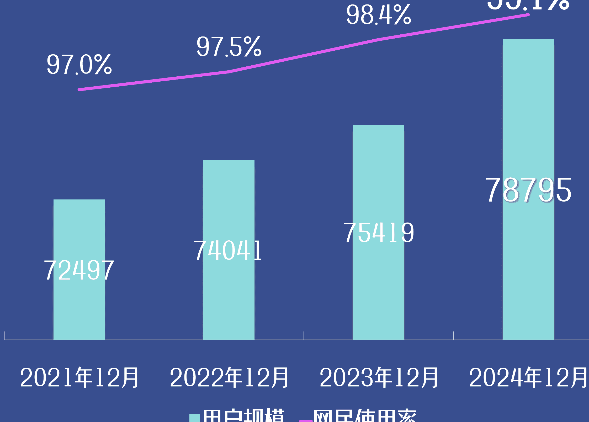
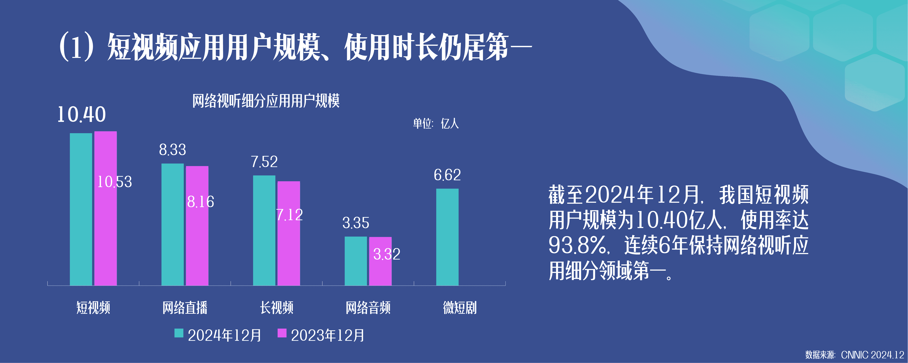
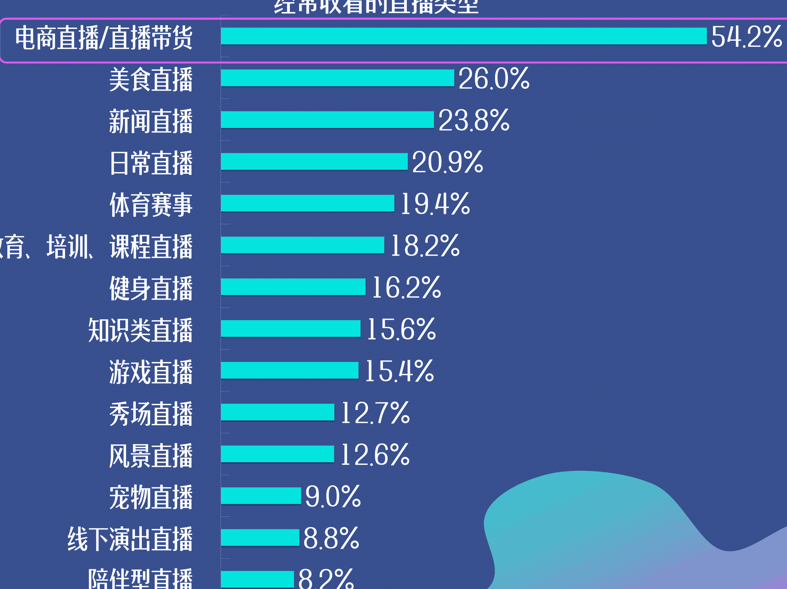
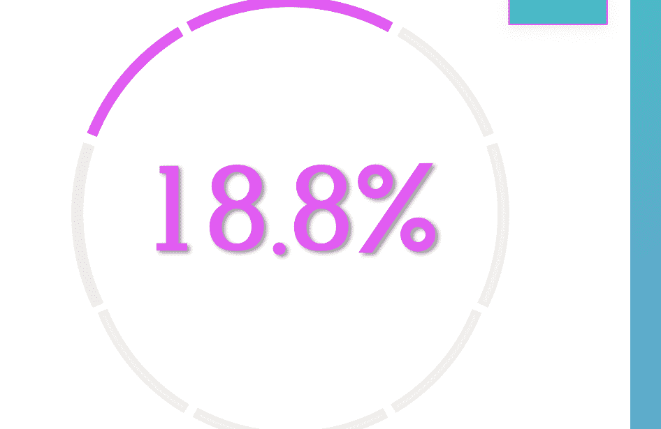
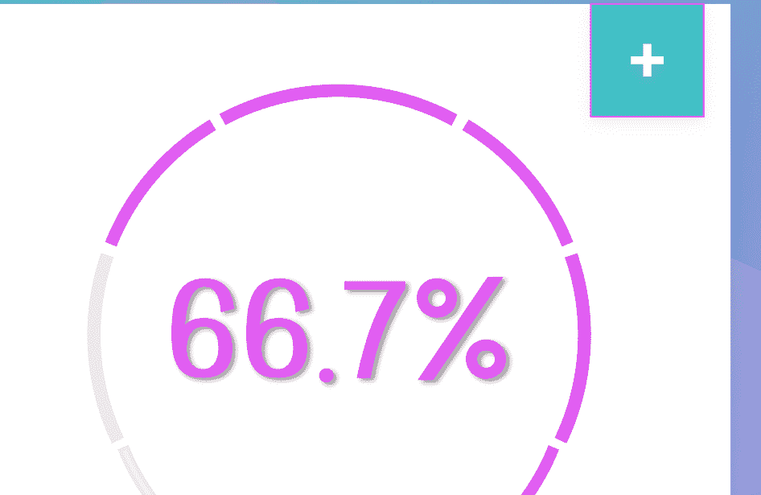

# 中国网络视听发展研究报告（2025）
## 主要发现

中国网络视听协会 周结
2025.3

# 扫码加入 知识星球TOP 免费资源群

免费

公众号: 知识星球TOP

- 每日免费获取高价值资源
- 可提供各类资源搜索服务

价值

微信: jntsg8

| 热门付费文章 | 各行各业报告 |
| 精选图书资源 | 副业赚钱方法 |
| 职场实用资源 | AI财经自媒体 |

及时

微信: jntsg2

专注

分享资料仅供个人学习，请及时删除，切勿商用传播

## 前言
### 网络视听已成推动行业新质生产力发展的重要力量

经过十余年的发展演进，网络视听行业在技术迭代、市场竞争和政策引导的三重驱动下，逐渐形成了包含短视频、长视频、中视频、微短剧、网络直播、IPTV、互联网电视、网络音频等多种态存在且相互交互的格局。各类业态在竞争与合作中不断探索新的发展模式和发展路径，共同推动着网络视听行业的繁荣与创新，构筑全民“数字生活基座”。

《中国网络视听发展研究报告》由中国网络视听协会策划编制，中国互联网信息中心CNNIC提供研究支持。今年是第十次发布。《报告》依托相关主管部门、研究机构、头部企业、数据公司等的数据案例，多维度全面展示行业现状特点、前沿趋势，是目前网络视听领域具有科学性、专业性和公信力的权威研究报告。

## 前言
### 网络视听已成推动行业新质生产力发展的重要力量

本年度《报告》坚持立足宏观视野，将中国第一互联网应用——网络视听放在服务经济社会发展、服务民生需求的广阔维度中进行评估，通过用户规模、市场规模、使用时长、内容供给量、大屏激活及开机时长、中国视听应用海外下载及收入规模等一系列重要宏观数据指标，旨在系统性梳理2024年度视听产业发展脉络，展现网络视听在推动行业新质生产力发展中所发挥的作用。

## 01 无视听、不网络，网络视听已成全网民呼吸的“数字空气”

## 网络视听用户规模及网民使用率
### 网络视听互联网应用冠军，城镇网民使用率接近百分百。

单位：万人

| 年份 | 2018.12 | 2020.12 | 2021.12 | 2022.12 | 2023.12 | 2024.12 |
| --- | --- | --- | --- | --- | --- | --- |
| 用户规模 | 73183 | 85675 | 94376 | 99087 | 103991 | 109099 |
| 网民使用率 | 88.3% | 94.8% | 95.4% | 96.0% | 97.4% | 98.4% |

截至2024年12月，我国网络视听用户规模达10.91亿，同比增长1722万人，增长率为1.6%，网民使用率为98.4%，同比增长0.1百分点，继续保持增长态。第一大互联网应用地位日益加固。

- 用户规模
- 网民使用率

数据来源：CNNIC 2024.12

## 城镇网络视听用户规模及网民使用率

单位：万人

截至2024年12月，我国城镇网络视听用户规模达7.88亿，网民使用率达99.1%。城镇网民几乎都是网络视听用户。

数据来源：CNNIC 2024.12

## 万亿级市场持续向好，下沉市场主战场

中国网络视听市场总规模持续增长，达1.2万，下沉市场释放活力。在参考最新的《全国广播电视行业统计报表》、《上市企业、非企业公开的市场收益、第三方数据的基础上推算出：

## 不同地域层级网民对网络视听的使用率

- 一线城市: 98.0%
- 新一线城市: 96.4%
- 二线城市: 98.3%
- 三线城市: 99.0%
- 四线城市: 99.2%

网络视听用户中，三四线城市对网络视听的使用率均在99%左右，且地域层级越下使用率越高。

## 行业景气高，“小微”力量蓬勃发展，有效拉动就业

据完全统计和测算，2024年12月，我国现有网络视听行业从业企业共计7570万家，其中2024年新成立企业1257万家，占总数约16.6%。

(1) 网络视听企业规模根据企业分类、经营范围等综合信息得出：
(2) 拉动就业、推动经济发展从企业规模看，微型企业60.85万家，占比达80.4%，小型企业11.76万家，占比达15.5%。2024年新成立企业中，小微企业（小型和微型企业）占比达98.3%。小微企业是吸纳就业的“主力军”“蓄水池”，也是创新生态的“毛细血管”、支撑健康的“基石”。

## 04 内容“短”势稳健，“长”“短”“直”“音”互动催生新增长

### (1) 短视频应用用户规模、使用时长仍第一

网络视听细分应用规模（单位：亿人）

| | 2023年12月 | 2024年12月 |
| --- | --- | --- |
| 短视频 | 10.53 | 10.40 |
| 网络直播 | 8.33 | 8.16 |
| 长视频 | 7.52 | 7.12 |
| 网络音频 | 3.35 | 3.32 |

截至2024年12月，我国短视频用户规模为10.40亿，使用率达93.8%。连续6年保持网络视听细分领域第一。

数据来源：CNNIC 2024.12

## 网络视听分类应用人均单日使用时长（单位：分钟）

| | 2017.12 | 2018.12 | 2019.12 | 2020.12 | 2021.12 | 2022.12 | 2023.12 | 2024.6 | 2024.12 |
| --- | --- | --- | --- | --- | --- | --- | --- | --- | --- |
| 短视频 | 99 | 102 | 105 | 124 | 139 | 168 | 151 | 154 | 156 |
| 长视频 | 79 | 92 | 104 | 103 | 103 | 120 | 112 | 90 | 110 |
| 网络音频 | 49 | 52 | 65 | 66 | 67 | 68 | 63 | 58 | 61 |
| 娱乐/游戏直播 | 37 | 41 | 54 | 58 | 45 | 38 | 29 | 27 | 25 |
| 独立微剧APP | | | | | | | | | 101 |

截至2024年12月，短视频应用人均单日使用时长达156分钟，居所有应用首位，同比增长3.1%。

- 短视频
- 长视频
- 网络音频
- 娱乐/游戏直播
- 独立微剧

数据来源：QuestMobile

(2) 微剧用户规模迅速增长，在广播电视总局的规范管理与引导扶持下，内容创作日益丰富、充满活力，吸引了更多用户。

## 微剧用户规模及使用率（单位：万人）

截至2024年12月，微剧用户规模达6.62亿，半年增长高达14.8%；人单日使用时长从90分钟涨到101分钟，已经趋近均衡。

数据来源：CNNIC 2024.12

(3) 长视频回暖，大小屏融合实现较大增幅。在主管部门引导和行业市场双重驱动下，随着传播、引流方面的互动逐渐成熟，长视频用户规模实现回升。

## 长视频用户规模及使用率

截至2024年12月，我国长视频用户规模达7.52亿，创2018以来新高；网民使用率为67.9%，同比提升2个百分点，增幅超过短视频、网络直播和网络音频。

- 用户规模
- 使用率

数据来源：CNNIC 2024.12

长视频的用户也呈现出圈层化特征。“高学历”、“年轻”用户一直是长视频内容的主要群体，使用率在86%左右，较整体高出近20个百分点。

## 不同网民群体对长视频的使用率

| 类别 | 使用率 |
| --- | --- |
| 男 | 65.4% |
| 女 | 70.5% |
| 城镇 | 72.3% |
| 农村 | 56.6% |
| 20岁以下 | 67.3% |
| 20–29岁 | 85.7% |
| 30–39岁 | 77.7% |
| 40–49岁 | 69.0% |
| 50–59岁 | 57.0% |
| 60岁及以上 | 49.6% |
| 小学及以下 | 50.9% |
| 初中 | 65.3% |
| 高中 | 71.8% |
| 大专 | 82.0% |
| 本科及以上 | 87.2% |
| 一线城市 | 73.2% |
| 新一线城市 | 72.4% |
| 二线城市 | 68.1% |
| 三线城市 | 68.4% |
| 四线城市 | 63.8% |
| 五线城市 | 66.3% |

数据来源：CNNIC 2024.12

## (4) 网络直播以打破空间局限的“即时现场感”，成为用户随身携带的“万能窗口”

尤其是直播发展迅猛，把手机变成了随时随地的线上流量中心，拓展了线下零售空间，也成为增长的主力军。截至2024年12月，我国网络直播用户规模达8.33亿，同比增长730万，占网民整体7.5个百分点。

## 网络直播用户规模及使用率（单位：万）

- 用户规模
- 使用率

(5) 网络音频以“声音陪伴”嵌入日常生活缝隙，通勤路上、家务时、睡前，依托声音提供心灵价值。近年来，网络音频用户规模稳步扩张，为行业注入了精彩故事。

## 网络音频用户规模及使用率（单位：万人）

| 年份 | 2018.12 | 2020.12 | 2021.12 | 2022.12 | 2023.12 | 2024.12 |
| --- | --- | --- | --- | --- | --- | --- |
| 用户规模 | 30158 | 27965 | 28239 | 31040 | 31839 | 33529 |
| 使用率 | 36.4% | 30.9% | 28.6% | 30.1% | 29.8% | 30.4% |

截至2024年12月，我国网络音频用户规模达3.35亿，同比增长340万人，网民使用率为30.3%，与去年基本持平。

- 用户规模
- 使用率

数据来源：CNNIC 2024.12

## 大屏治理持续深化，用户规模持续扩大、激活规模保持增长

### (1) 全国直直播频道用户平均活跃率62.2%，较去年上涨9.6%

2024年，电视“套娃”与操作复杂治理全面落地。在巩固2023年第一阶段已取得成果的基础上，2024年第二阶段、第三阶段治理工作实现了一系列重大创新，取得了一系列重要突破：

- 酒店等场所操作复杂治理显著，183万酒店159万客房实现“便捷看电视”；
- “一个遥控器看电视”取得重要突破，帮助2亿多用户启用遥控器红外学习功能，成功研制三模通用遥控器，实现了“所见即所控”；
- 互联网电视播控权回归互联网电视平台，7家集成平台完成1.8亿终端的播控全覆盖；
- 推动更多优秀内容上大屏，增强大屏吸引力，“重温经典”频道已有6580万用户、超2.5亿观众。

### (2) 大屏用户规模以及硬件覆盖、激活规模连续保持增长

截至2024年底，全国有线电视实际用户达2.09亿，同比增长3.5%。其中有线数字电视实际用户达2.01亿，同比增长4.1%；IPTV用户总达4.08亿，全年净增长653.4万；智能电视（OTT，不包括OTT Box）激活终端3.36亿，同比增长3.1%，年度日活跃用户1.74亿，智能电视月活跃率保持在88%以上，单日均使用时长达331分钟。

数据来源：易科技

### (3) 超六成用户使用大屏，互动互动深度融合

优质微剧登陆大屏终端，既满足了家庭场景下用户的多元化内容需求，亦助力微剧突破移动端圈层，实现受众扩容。治理工作给广播电视和网络视听行业带来积极变化。中国视听大数据（CVB）显示，2024年，全国直直播用户平均活跃率62.2%，较去年上涨9.6%。

## (3) 电商直播领跑、其他类型垂直直播全面发展

电商直播的用户渗透率持续攀升，高达54.2%的受访者保持高频观看习惯，较去年同期增长0.5个分点，较第二名的领先优势对比扩大11.8个百分点，稳居直播内容。美食、新闻、日常、体育、教育、健身、知识等各类直直播形成“多点支撑”格局，用户内容需求呈现“去中心化”趋势。

| 直播类型 | 占比 |
| --- | --- |
| 电商直播 | 54.2% |
| 美食直播 | 26.0% |
| 新闻直播 | 23.8% |
| 日常直播 | 20.9% |
| 体育赛事 | 19.4% |
| 教育、培训、课程直播 | 18.2% |
| 健身直播 | 16.2% |
| 知识类直播 | 15.6% |
| 游戏直播 | 15.4% |
| 秀场直播 | 12.7% |
| 风景直播 | 12.6% |
| 宠物直播 | 9.0% |
| 线下演出直播 | 8.8% |
| 伴侣型直播 | 8.2% |
| 其他 | 11.6% |

数据来源：2025中国网络视听用户调查

## (4) 店播剧增，职业主播规模达3880万，同比增长1.5倍，短视频账号规模达16.2亿

规模化的UGC生态显示视听的全民创作时代来临。

结合主要网络视听平台和部分社交平台、电商平台相关数据，截至2024年末，我国短视频作者账号规模已达16.2亿，相当于全国平均每人都拥有一个短视频账号。在平台智能分发、流量激励、门槛降低等多种因素驱动下，根据主要平台数据综合统计，每天全国上线短视频突破1.3亿条，相当于平均位中国人每个月上传3条短视频。

受中小店播及生活服务直播高速增长影响，截至2024年底，职业主播（含在机构账号中开播的职业主播以及在个人账号中开播的职业主播）规模达到3880万，同比增长157%。

这种全民创作势能不仅构建了数字内容供给侧的海量资源池，更通过“创作—分发—反馈”的闭环系统持续激活内容创新，形成以用户生产为主的视听新范式。

## 07 “短”“直”已成“种草利器”，“内容即货架”催生消费新范式、新链路

短视频和直播是刺激消费的“催化剂”。根据国家统计局的相关的数据，2024年全国网上零售额达155225亿元，比上年增长7.2%。短视频和直播在带动网上零售方面发挥了重要作用。调查数据显示，近一半受访者因观看短视频、直播而消费 48.6%。

数据来源：国家统计局；2025中国网络视听用户调查

## 因观看短视频/直播购买商品情况

值得注意的是，其中有57.8%属于典型的非计划性消费，传统的“需求—搜索—购买”的消费逻辑发生根本转变。这种“内容货架”的新范式背后是三重机制协同作用的结果。

- 本就有购买计划：搜索商品时看到相关短视频，直播后购
- 并无购买计划：看到相关短视频，直播后购
- 算法精准匹配
- 场景沉浸体验
- 情绪即时共振

因观看短视频、直播购买的商品种类中，生活用品、食品饮料、服饰包等日耗品依旧居前三位。高复购、低客单价的日耗品天然适配视频流量分发逻辑。这种由“兴趣激发—场景验证—即时转化”构成的消费链路，正推动零售业从供给驱动向需求响应的转型。

## 因观看短视频/直播购买的商品种类

| 类别 | 比例 |
|---|---|
| 生活用品 | 28.3% |
| 食品饮料 | 23.0% |
| 服饰箱包 | 22.2% |
| 美妆用品 | 14.7% |
| 电子数码产品 | 10.4% |
| 线下娱乐服务 | 10.3% |
| 线下消费/折扣券 | 9.0% |
| 旅游服务 | 8.9% |
| 宠物用品 | 6.3% |
| 在线娱乐服务 | 5.5% |

数据来源：2025中国网络视听用户调查

## “中国风”走向世界，全球Top100应用占比30%

据统计，2024年，全球视听类应用下载量Top100应用的总次数为69.8亿次，其中中国应用（含港澳台）下载次数为18.25亿，占比超过1/4；海外视听类应用收入规模Top100应用为116.5亿美元，其中中国应用（含港澳台）收入为29.6亿元，占比29.1%。

| 统计维度 | 中国应用（含港澳台） 2024年 | 2023年 |
| --- | --- | --- |
| 下载量Top100数量 | 19个 | 16个 |
| 收入规模Top100数量 | 20个 | 12个 |
| 下载增长率 | 26.1% | 21.5% |
| 收入增长率 | 29.1% | 25.0% |

数据来源：数据

## (2) 中国短剧领跑全球市场

2024年，在海外视听应用下载量Top100中，中国应用（含港澳台）有19个，其中2个为微短剧，同比增长3%；海外视听应用收入规模Top100中，中国应用（含港澳台）有20个，其中1个为微短剧，成为中国走出去的“故事”。

## 生成式AI重塑内容，近1/3网民使用AI制作视频，技术普惠与规范治理并行

生成式人工智能的快速演进重塑视听内容生产体系，其多模态生成能力显著降低了内容创作门槛。

## 用户使用生成式人工智能的目的

| 项目 | 比例 |
| --- | --- |
| 回答问题 | 77.6% / 62.2% |
| 生成、处理文本 | 47.2% / 27.4% |
| 生成会议纪要、PPT | 45.5% / 31.5% |
| 生成图片、视频 | 31.0% / 25.6% |
| 作为生活助手 | 24.6% / 25.2% |
| 休闲娱乐 | 19.7% / 28.6% |
| 帮助编写代码 | 14.8% / 11.1% |

相关数据显示，使用AI工具进行图片、视频制作的用户占比在半年内有所增长，从25.8%上升到31%，技术普惠效应持续释放。

数据来源：CNNIC

## 关于印发《人工智能合成标识办法》的通知

6月14日 17:00 来源：中国网 【打印】【收藏】

关于印发《人工智能合成标识办法》的通知

国办发字（2023）2号

近日，国家互联网信息办公室、工业和信息化部、公安部、国家广播电视总局联合发布《人工智能合成标识办法》，进一步规范了人工智能合成标识，为技术创新划定了安全边界，为促进相关行业健康发展提供了重要的制度保障。

国家互联网信息办公室、通信网办公室、公安局（厅）、广电局、新疆生产建设互联网信息办公室、工业和信息化部、发展信部联合发布《人工智能合成标识办法》。根据《网络法》和其他法律法规，为了维护社会公共利益，国家互联网信息办公室、公安部、国家广播电视总局制定了《人工智能合成标识办法》，通知印发实施，请认真执行。

国家互联网信息办公室
工业和信息化部
公安部
国家广播电视总局
2023年3月7日

随着AI深度融入内容创作、审核、分发的全流程，其在降本增效的同时，也存在虚假信息传播、版权归属模糊等新型风险。

## 《中国视听发展报告（2025）》编辑委员会

编委会主任：聂辰 编委：赵景春 罗建辉 魏觉军
编委会副主任：高建民 陶嘉庆 许秀中 韩肖鹏
张晓 王常青
总策划：周结
主编：余力
执行主编：何紫薇
副主编：谭淑芬
编辑：王晓培 王如 李冠泽 田可心

## 扫码加入 知识星球 免费资源群

- 每日免费获取高价值资源
- 可提供各类搜索服务

| 热门付费文章 | 各行各业报告 |
| 精选图书资源 | 副业赚钱方法 |
| 职场实用资源 | AI经政自媒体 |

公众号:知识星球TOP

专注

分享资料仅供个人学习，请及时删除，切勿商用传播
